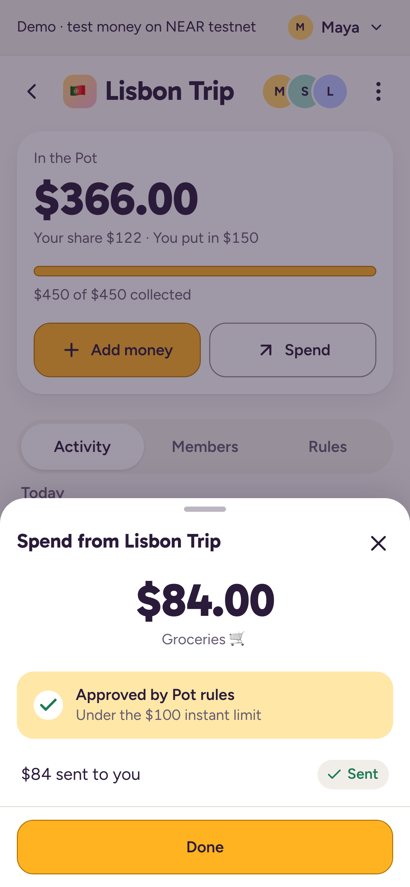
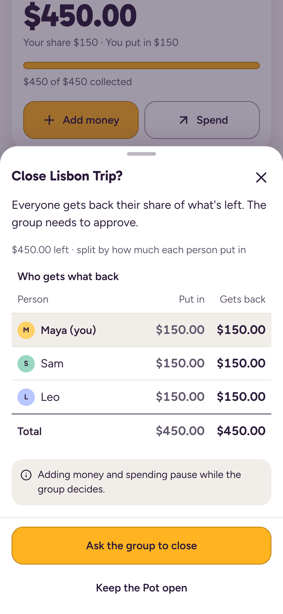
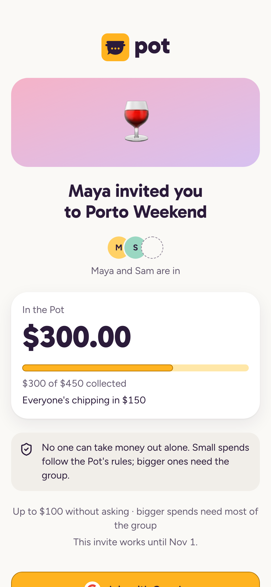
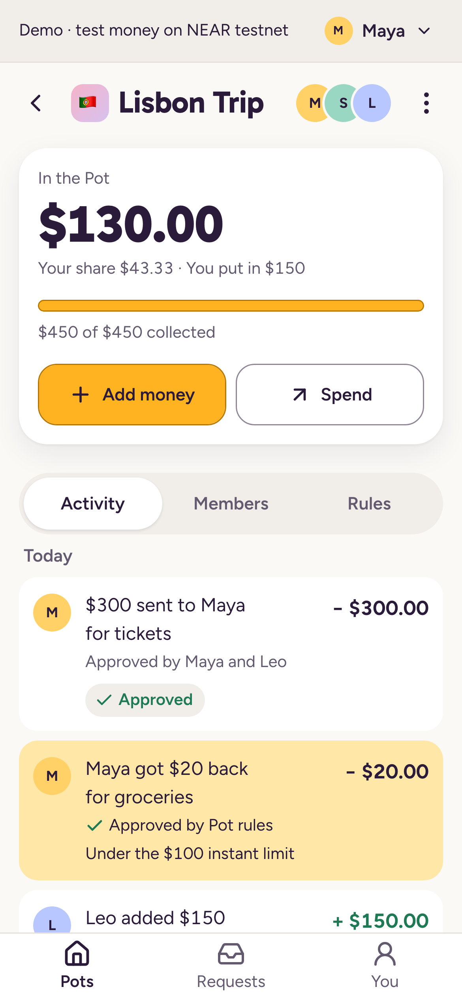

<picture>
  <source media="(prefers-color-scheme: dark)" srcset="brand/logo/pot-lockup-on-dark.svg">
  
</picture>

# Pot: group chat money that follows its own rules, on NEAR

Pot is a phone web app where a group (a trip, a club, a team) puts dollars into one shared pot. Small spends inside
the group's rules are approved automatically by a contract, bigger spends need most of the group, and when the Pot
closes everyone gets back their share of what is left, split by what they put in.

**The problem**
- On a group trip one person fronts the money, keeps the receipts and chases everyone for weeks afterwards.
- Pooled-money apps pay out to one owner, so the group has to trust that person with all of it.
- Split-the-bill apps track debts but hold no money, so nobody can actually pay from the group.

**Network:** everything below runs on NEAR **testnet** with test dollars ("USDC (test)", no value). Nothing is on
mainnet yet. `<APP_URL>` is the web app's address; it is not deployed yet, so run it locally (see
[Run it locally](#run-it-locally)) and use `http://localhost:3000` until a URL is filled in here.

---

## See how it works in 4 minutes (no install, no login, nothing sent)

`<APP_URL>/demo` is a two-minute guided simulation: Maya, Sam and Leo share the money for a Lisbon trip, in 14 steps
over five parts. The phone is the real Pot app, with one short sentence per step. **Nothing is signed or sent.** Each
part has an **Under the hood** button: what each tap signed, what our relayer sent, every receipt, and the Sputnik DAO
proposal with its votes; every hash there starts with `sim-`, and each part links to a real equivalent on testnet. The
numbers are the demo story: everyone puts in $150 ($450); $84 of groceries is approved by the Pot's rules; a $300 boat
trip needs 2 of 3 approvals; at close, everyone gets back $22.00. Step with Next (or →), or with the phone's own button.
Every step has a link (`/demo#step-7` is the $84 approval); `/demo/4` opens part 3 at the $84 spend, and `#near` opens
that part's Under the hood (`/demo/4#near`).

<!-- J-1 -->
**J-1. Open `<APP_URL>/demo` and tap "Show me how".**
Part 1, "Start a Pot": Maya picks Trip rules and taps "Create Pot", then gets one link to share. Under the hood: what
her one tap signed (`create_pot` to `pots.potprev.testnet`, 300 Tgas, deposit 0), the relayer's transaction around it,
and the receipts that create `lisbon-trip-7k2f.pots.potprev.testnet` as a Sputnik DAO with **no access keys** and two
roles: Maya, and the Pot Hub's `rulebot` seat.

<!-- J-2 -->
**J-2. Part 2, "Join and chip in": now you're Leo.**
The invite shows "Maya and Sam are in" and $300 of $450; "Join Lisbon Trip", then "You're in!" and "Add my $150 share";
the Pot shows "$450 of $450 collected". Under the hood: the invite signature (`pot-join:v1:<pot>:<account>`), the
`AddMemberToRole` proposal #1 approved by the Hub's seat (1 of 1), and `ft_transfer_call` with the 1 yoctoNEAR the
relayer pays.

<!-- J-3 -->
**J-3. Part 3, "Small spends": $84 of groceries.**
Tap "Get $84 back" in the phone: "Checking Pot rules…" (Next waits 1.2 s), then **"Approved by Pot rules"** and "$84
sent to you"; the Pot shows **$366.00**. Nobody voted: under the hood the Hub's rules check passes, it files proposal #2
(`Transfer`, `84000000`) and approves it with its 1-of-1 `rulebot` seat; 14 receipts, and Maya paid 0 NEAR.

<!-- J-4 -->
**J-4. Part 4, "Bigger spends": a $300 boat trip.**
The phone says "This needs 2 of 3 approvals" and, after "Ask the group", "1 of 2 approvals" (Maya's own counts). Then
you're Leo: his lock screen shows Maya's request, and "Approve $300" makes it 2 of 2 (threshold
`min(3 × 1 ÷ 2 + 1, 3) = 2`); the DAO pays Maya, and the Pot shows **$66.00**.

<!-- J-5 -->
**J-5. Part 5, "Close and share back".**
Maya taps "Ask the group to close"; then you're Sam, who taps "Approve closing". One `FunctionCall` proposal (#4) holds
three `ft_transfer`s; Sam's approval runs them in one receipt. Everyone gets back **$22.00**. Part 5's Under the hood
ends with the recap: 11 signatures by people, 12 transactions and 0 NEAR paid by Maya, Sam or Leo. "Finish" ends on
"That's Pot." and **Start a real Pot**.

<!-- J-6 -->
**J-6. Read it without a browser.** Every tour page is server-rendered with the whole story as an ordered list
(`<li id="step-1">`…`<li id="step-14">`) and each part's Under the hood in a closed `<details>`, with every decoded card
and the raw JSON: `curl -s <APP_URL>/demo/4 | grep -c "Approved by Pot rules"`. `<APP_URL>/demo/all` is the full
technical read on one page: every step and card, the recap and the glossary.

<!-- J-7 -->
**J-7. Read the contracts yourself (read-only, no keys).** `npx` runs near-cli-rs without an install:

```bash
near() { npx -y near-cli-rs@0.30.1 "$@"; }
ROOT=potprev.testnet; HUB=pots.$ROOT; POT=lisbon-trip.$HUB
near contract call-function as-read-only $POT get_policy json-args '{}' network-config testnet now
near contract call-function as-read-only $HUB get_pot json-args "{\"pot\":\"$POT\"}" network-config testnet now
near contract call-function as-read-only usdc.$ROOT ft_balance_of json-args "{\"account_id\":\"$POT\"}" network-config testnet now
near account view-account-summary $POT network-config testnet now
near contract call-function as-read-only $POT get_factory_info json-args '{}' network-config testnet now
near account list-keys usdc.$ROOT network-config testnet now
near account list-keys $POT network-config testnet now
near account list-keys $HUB network-config testnet now
```

What you see (checked on 2026-10-22; `scripts/readme-cli-check.sh` runs exactly these and asserts the values):
- `get_policy`: a Sputnik DAO with two roles. `member` (Maya, Sam, Leo; majority, `threshold [1, 2]`) and `rulebot`
  (only `pots.potprev.testnet`, which may add and approve transfers and member additions, 1 of 1). `proposal_bond`
  is `"0"` and `quorum` is `"1"`.
- `get_pot`: "Lisbon Trip", `status: "open"`, `member_count: 3`, `total_contributed: "450000000"`, rules
  `instant_cap` $100 and `member_budget` $200.
- `ft_balance_of`: `"450000000"` ($450).
- `view-account-summary`: the Pot runs the global contract with SHA-256
  `c9a502ef08a06cef04e2fce82da60b1fbc78db3066ff41416110f4292fca39ce` (Sputnik DAO v2, testnet global code
  `Ea8tHXFSQVszVwGASyzAfLq65DjcRDhkfab4FcPaRpgD`) and "Account is locked (no access keys)".
- `get_factory_info`: `factory_id` is the hub, `pots.potprev.testnet`.
- `list-keys` on the token and on the Pot: an empty table. Nobody can sign for them.
- `list-keys` on the hub: **one full-access key today.** It is deleted at the planned lock, after which this table is
  empty too. Until then, whoever holds it could approve transfers through the rulebot seat (see Limitations).

On a `-429` rate limit, add a FastNEAR network config or retry later; the default testnet config of near-cli-rs
0.30.1 already uses FastNEAR's RPC.

<!-- J-8 -->
**J-8. Run the tests (no keys, no network):** `pnpm i && pnpm test` and `cd contracts && cargo test`
(arm64 macOS or Linux). See [Tests](#tests).

**What a judge can't do from here:** sign in with Google (NEAR Auth's shared testnet client only accepts
`http://localhost:3000`), receive push notifications (needs an installed phone app), or see real money move (testnet).

### Screens

| | |
|---|---|
|  |  |
|  |  |

The first three are from the mock build used by the UI tests (same screens, fixture data); the fourth is from a
testnet run.

---

## How it works

```
phone browser (device key, 0 NEAR)
   │  signs a NEP-366 delegate action
   ▼
/api/relay  (our relayer: checks a per-method allowlist, gas and deposit caps, quotas; pays gas)
   │
   ▼
Pot Hub  pots.<root>  (factory + "rulebot" + ledger)  ── ft_transfer_call ──  usdc.<root>  (USDC (test))
   │  create: one batch makes <slug>.pots.<root> from the global Sputnik code
   │  instant spend: add_proposal + VoteApprove in the same call chain, only within the Pot's rules
   ▼
Sputnik DAO  <slug>.pots.<root>  (holds the money; members vote by majority)
```

- **Every Pot is a Sputnik DAO** with a fixed policy: members decide by majority, and the hub holds a 1-of-1
  `rulebot` seat that can only approve **transfers it proposed itself** (capped instant spends) and **member
  additions** (invite joins with an ed25519-signed invite). It never votes on rule changes or closes.
- **Instant spend:** the hub checks the rules (amount ≤ instant limit, the person's instant total ≤ their limit,
  payee is a registered member, the Pot has the money net of reservations, the requester has put money in), then
  proposes and approves the transfer in one chain. Anything else becomes a vote; the requester's approval is cast
  automatically.
- **Close:** `propose_close` builds one DAO proposal that pays every contributor pro rata (floor, dust to the last
  contributor, Σ = balance); a majority executes it.
- **Gasless:** users hold 0 NEAR. Our relayer submits their signed delegates and pays gas and the 1-yocto deposits;
  the hub pays storage only for calls our relayer signs. Direct callers pay their own way.
- **Who can move money:** nobody alone. The server holds no user keys (demo personas excepted) and is not in any
  DAO policy; the hub can only approve what fits the Pot's rules.

Code map (pnpm workspace):

| Path | What |
|---|---|
| `contracts/pot-hub` | the Pot Hub contract (Rust, near-sdk 5.29.1) |
| `contracts/test-usdc` | "USDC (test)", a vendored NEP-141 token (6 decimals) |
| `contracts/tests` | sandbox tests on two Sputnik builds (near-workspaces 0.23) |
| `packages/pot-sdk` | `@pot/sdk`: views, money math, intents, delegate signing, mocks |
| `apps/web` | Next.js 16 app: UI, API routes, relayer, push, 1Click simulator |
| `scripts/` | testnet deploy, seeding, the HTTP end-to-end story, README checks |

## NEAR features used

NEP-366 meta transactions with our own relayer · NEP-448 zero-balance accounts (users hold 0 NEAR) · global
contracts (each DAO uses the Sputnik code by hash, `UseGlobalContract` in the creation batch) · sub-account factory
(`<slug>.pots.<root>`) · cross-contract calls with callbacks · NEP-141/NEP-145 token with `ft_transfer_call` /
`ft_on_transfer` · NEP-297 events · `env::ed25519_verify` for invite signatures · NEAR Auth (Auth0 login + MPC key
derivation; wired, testable on `localhost:3000`) · NEP-413 sign-in for wallets through NEAR Connect · locked
accounts (no access keys) · FastNEAR RPC with a dRPC failover.

## Track hints used

| Hint (track) | Where |
|---|---|
| SPUTNIK DAO (social) | every Pot is a Sputnik DAO from the official code by global hash, with a two-role policy (J-7) |
| TREZU (social) | not used on testnet: Trezu is mainnet-only. The app's Advanced screen shows the "On-chain rules" panel from `get_policy`, plus explorer links |
| NAMED ACCOUNTS (social) | readable ids: `<slug>.pots.<root>` for Pots, `u-<8>.users.<root>` for people |
| STABLECOINS (realworld) | every amount is in dollars, held as a 6-decimal USDC-style token |
| NEAR INTENTS (realworld) | "Add money from another app or exchange": a 1Click `FLEX_INPUT` deposit flow; **simulated on testnet** (labeled "do not send"), with real 1Click dry quotes |
| META TRANSACTIONS (realworld) | every user action is a relayed NEP-366 delegate |

For `realworld`: the Club and Team presets (club dues, a team's offsite budget) use the same contracts with
different rules.

## Costs and sustainability

Testnet NEAR, from the calibration notes (✅ measured, ⚠️ estimated). Gas price is 1e8 yocto/gas.

| Who pays | Item | NEAR |
|---|---|---|
| relayer | onboarding a person (account + token registration + gas) | 0.0085 ✅ |
| hub | a new Pot: DAO float 0.05 + token registration + hub state | ≈ 0.061 ⚠️ |
| hub + relayer | a join | ≈ 0.009 + 0.002 ⚠️ |
| relayer | adding money | ≈ 0.0011 ✅ |
| hub + relayer | an instant spend (storage prepay + gas) | ≈ 0.0085 + 0.003 ⚠️ |
| hub + relayer | a vote spend with 2 votes and the follow-up `sync` | ≈ 0.0115 + 0.0033 ⚠️ |
| hub + relayer | a close for 3 members | ≈ 0.017 + 0.0033 ⚠️ |

A whole trip (3 people onboarded, 1 Pot, 2 joins, 3 contributions, 1 instant spend, 1 vote spend, 1 close) is
≈ 0.17 NEAR, of which ≈ 0.12 is storage staked in the DAO and the hub. Costs grow with actions, not balances, and
are capped on chain (Pots per creator per day, sponsored Pots per day, members, open requests) and by the relayer's
daily budgets. Two ways to pay for it without new contracts: a small app fee on cross-chain deposits through
1Click's app fees, and paid Club/Team presets.

## Limitations

- **Testnet only.** Test dollars, test NEAR, a preview deployment under `potprev.testnet`. The hub still has its key
  until the planned lock (J-7); until then, whoever holds it could approve transfers through the rulebot seat or push
  DAO code. The token and every Pot are already keyless.
- **NEAR Auth origin.** The shared testnet NEAR Auth client only accepts `http://localhost:3000`, so Google sign-in
  works only on a local run. A hosted build offers "I have a NEAR wallet" (NEAR Connect).
- **Trezu is mainnet-only**, so testnet Pots can't be opened there. On mainnet, Trezu's approval count would be wrong
  for Pot's two-role policy and its balance view stays empty for DAOs outside `*.sputnik-dao.near`.
- **`/demo` is a simulation.** It signs and sends nothing; its ids, keys and hashes are made up (generated from the
  same MockChain the tests use) and each chapter links to a real testnet transaction. The live persona demo, whose
  personas sign with a server-held testnet key, is at `/demo/live` and is off unless a deploy sets `FLAG_DEMO_LIVE=true`.
- **The 1Click deposit is a simulator on testnet**: a labeled "do not send" address; on success the server sends test
  dollars to the member, who adds them to the Pot with one tap. Real cross-chain deposits need mainnet. Refunds land
  in the member's NEAR Intents balance and getting them out is not built.
- A majority can do anything a Sputnik DAO allows, immediately (move the money, change members or the policy). No
  minority can take funds.
- Invite links are bearer passes: anyone holding one can join and vote. Links expire after 7 days and 10 joins by
  default, and a new member can't spend without asking before putting money in.
- Refunds are pro rata to everything a member ever put in, so money added late subsidizes earlier spending.
- There is no cash-out from Pot dollars yet: after a close, refunds stay in the member's Pot account.
- Pot names, amounts, members and requests are public on chain.
- A device key is a full-access key; "Forget this device" deletes it in the browser but not on chain.
- A web app trusts the JavaScript it is served; the hub's rules cap what a compromised page could do.
- Members can't leave before close. At most 40 members. Requests expire after 7 days.

---

## Run it locally

Requirements: Node 22.22, pnpm 11, Docker (Postgres 17), Rust via `contracts/rust-toolchain.toml` (1.93.0) and
cargo-near 0.22.0 for the contracts.

```bash
pnpm install
pnpm db:up                                  # Postgres 17 on localhost:54329 (infra/docker-compose.yml)
cp .env.example apps/web/.env.local         # names only; fill in values for a testnet run
pnpm dev                                    # http://localhost:3000 (mock data unless NEXT_PUBLIC_DATA_SOURCE=testnet)
```

A testnet run needs the preview accounts and relayer keys (`scripts/run env`, `notes/deploy.md`); they are not in
this repository.

## Tests

| Layer | Command | Needs |
|---|---|---|
| Contracts: unit, property, sandbox on Sputnik builds A and B | `cd contracts && cargo test` | arm64 macOS or Linux; downloads the nearcore sandbox |
| Contracts on protocol 88 (★ tests) | `cd contracts && POT_SANDBOX_VERSION=2.14.0-rc.4 cargo test -p pot-tests -- t00_ t01_ t10_ t20_ t40_ t50_ t60_ t70_ t89_` | same |
| Typecheck, lint (incl. the jargon lint), unit + DB integration | `pnpm typecheck && pnpm lint && pnpm test` | Postgres for the DB tests (`pnpm db:up`) |
| Mocked UI end to end (3 projects, axe, brand checks) | `cd apps/web && E2E_PORT=3100 NEXT_PUBLIC_DATA_SOURCE=mock pnpm exec playwright test` | Playwright Chromium |
| Integrations (fake NEAR Auth issuer, fake RPC, mock wallet) | `cd apps/web && pnpm exec playwright test -c e2e/integrations/playwright.config.ts` | Postgres |
| Testnet (signs testnet txs through our relayer) | `E2E_TESTNET=1 pnpm --filter web exec playwright test -c e2e/testnet/playwright.config.ts` | preview keys |
| README CLI twins (J-7) | `scripts/readme-cli-check.sh` | network only |

The latest full run, with outputs and the bugs it found, is in `notes/qa-report.md`. CI is
`.github/workflows/ci.yml`.

## Repository notes

Design and research documents: `plan/` (specs and decisions), `kb/` (verified research), `brand/` (logo and tokens),
`notes/` (build notes per area). Keys are never committed: `.keys/` and `.env*` (except `.env.example`) are
gitignored.
