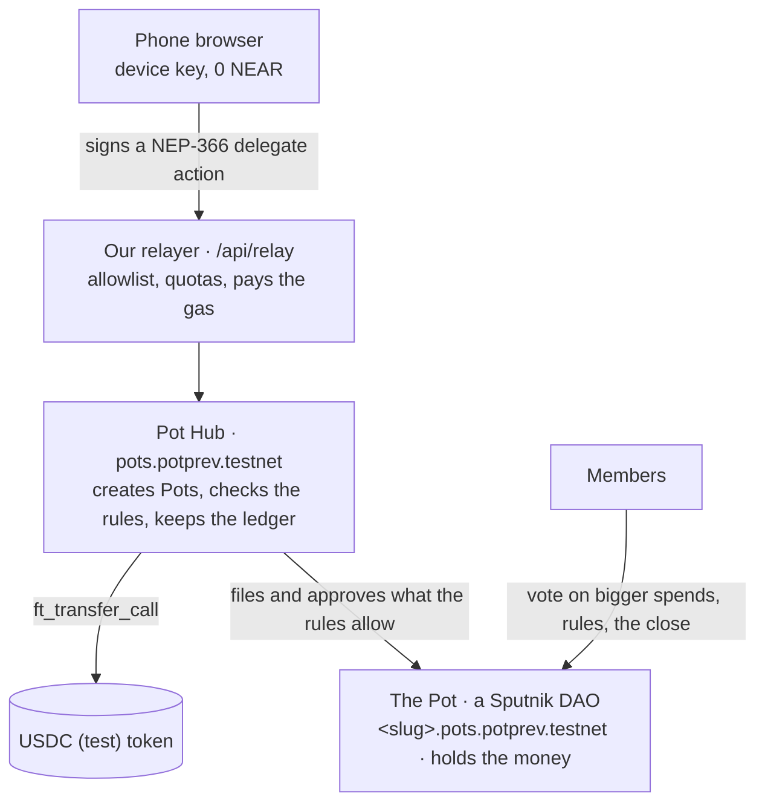

<picture>
  <source media="(prefers-color-scheme: dark)" srcset="docs/readme/banner-dark.png">
  
</picture>

# Pot: group money that follows its own rules, on NEAR

Pot is a phone web app for money a group shares: a trip, a club, a team. Everyone puts dollars into one Pot. Small
spends that fit the group's rules go through on their own, bigger ones need the group, and when the Pot closes
everyone gets back their share of what's left.

**[Open the app](https://usepot.xyz)** · **[2-minute demo, no login](https://usepot.xyz/demo)** ·
[How it works](#how-it-works) · [NEAR features](#near-features-used) · [Step-by-step for judges](#step-by-step-for-judges) ·
[Security](SECURITY.md)

Built by **Cerasela Mardare** (solo builder) for NEAR HACKATHON, tracks **`social`** and **`realworld`**. Runs on
NEAR **testnet** with test dollars; nothing is on mainnet yet.

---

## Why Pot

- On a group trip one person fronts the money, keeps the receipts and chases everyone for weeks afterwards.
- Pooled-money apps pay out to one owner, so the group has to trust that person with all of it.
- Split-the-bill apps track debts but hold no money, so nobody can actually pay from the group.

Pot keeps the money in a contract the group controls together, with rules everyone can read, so no single person
holds it.

## What it does

**Start a Pot and invite your friends.** Name it, keep the suggested rules or change them, and share one link or QR
code. Friends see the Pot before they sign in, then join with a NEAR wallet (Google sign-in works on a local run for
now). Nobody pays gas.


**Spend with rules, not with permission.** A small spend within the limits is approved instantly by the contract.
A bigger one needs one OK from another member; anything bigger goes to a group vote. Everyone sees who the money goes
to before they approve, and each person's limit grows as they build a track record.


**Money in from anywhere.** Members add money from their Pot balance or from another app or exchange on another
chain, through NEAR Intents (simulated on testnet, with real live quotes). People outside the group can chip in too, through a pay-in link or a public
page.


**See the group, then share it back.** Each member's row shows what they put in and what they'd get back. A suggested
amount each shows who has chipped in. When the group agrees to close, everyone is paid their share in one go.


## Try it

| | What you need | Start here |
|---|---|---|
| **Watch the demo** | Nothing: no install, no login, nothing is sent | [usepot.xyz/demo](https://usepot.xyz/demo): a 14-step simulation of a Lisbon trip, with an "Under the hood" view of every NEAR transaction |
| **Use the real app** | A NEAR testnet wallet (e.g. Meteor or Intear); 0 NEAR is fine | [usepot.xyz](https://usepot.xyz) → "Start a Pot" → "I have a NEAR wallet" ([J-9](#step-by-step-for-judges)) |
| **Run it yourself** | Node, pnpm, Docker; Rust for the contracts | [Run it locally](#run-it-locally) |

<p align="center"></p>

---

## How it works



- **Every Pot is a Sputnik DAO** with a fixed policy: members decide by majority, and in new Pots (policy v3) only
  the hub files proposals. The hub's 1-of-1 `rulebot` seat approves only **transfers it proposed itself** within the
  rules (instant spends, and one-OK spends once another member has given the OK), **member additions** (invite joins
  with an ed25519-signed invite), and, in a Pot with an all-or-nothing goal, the **refund** when the goal is missed.
  It never votes on rule changes or on a close the members asked for.
- **Instant spend:** the hub checks the rules (amount ≤ the person's instant limit, their instant total ≤ their
  budget, the payee is allowed, the Pot has the money net of reservations, the requester has put in at least $1),
  then proposes and approves the transfer in one chain. Bigger spends need one OK or a group vote; the requester's
  approval is cast automatically.
- **Close:** `propose_close` builds one DAO proposal that pays every contributor pro rata (floor, dust to the last
  contributor, Σ = balance); a majority executes it, and the Pot counts as closed once the money has left.
- **Gasless:** users hold 0 NEAR. Our relayer submits their signed delegates and pays gas and the 1-yocto deposits;
  the hub pays storage only for calls our relayer signs. Direct callers pay their own way.
- **Who can move money:** no member alone. The server holds no user keys and is not in any DAO policy; the hub can
  only approve what fits the Pot's rules (while on testnet the hub itself is still upgradeable; see Limitations).

**Code map** (pnpm workspace):

| Path | What |
|---|---|
| `contracts/pot-hub` | the Pot Hub contract (Rust, near-sdk) |
| `contracts/test-usdc` | "USDC (test)", a vendored NEP-141 token (6 decimals) |
| `contracts/tests` | sandbox tests on two Sputnik builds (near-workspaces) |
| `packages/pot-sdk` | `@pot/sdk`: views, money math, intents, delegate signing, mocks |
| `apps/web` | the Next.js app: UI, API routes, relayer, push, 1Click simulator |
| `scripts/` | testnet deploy, seeding, the HTTP end-to-end story, README checks |

## NEAR features used

| NEAR feature | How Pot uses it | Where | Check it |
|---|---|---|---|
| **Sputnik DAO v2** | Every Pot is its own DAO that holds the money. Policy: a `member` role (majority) and a `rulebot` role held only by the Pot Hub (1 of 1). In new Pots (policy v3) members can only vote; every proposal is filed by the hub, so every money move goes through the Pot's rules and shows in the app | `contracts/pot-hub/src/policy.rs` | J-7 `get_policy` |
| **Global contracts** (NEP-591) | Each DAO is created with `UseGlobalContract` by the hash of the official Sputnik code (0.0121 NEAR per Pot, against about 5.4 NEAR through the old Sputnik factory) | `create_pot` in `contracts/pot-hub/src/lib.rs` | J-7 `view-account-summary` |
| **Named sub-accounts + locked accounts** | A Pot is `<slug>.pots.potprev.testnet`, a person `u-<8>.users.potprev.testnet`. Pots and the token have **no access keys**: only their code can move money | `lib.rs` (create), `server/features/wallet`, `server/session` | J-7 `list-keys` |
| **Cross-contract calls and callbacks** | The hub files and approves DAO proposals, forwards money, reads DAO state, and records anything only in `#[private]` callbacks after the call succeeded | `lib.rs`, `wave4.rs`, `security.rs` | `cargo test` (unit and sandbox tests) |
| **NEP-141 / NEP-145 token** | Dollars are a 6-decimal USDC-style token. Money comes in with `ft_transfer_call` → the hub's `ft_on_transfer` (only from that token) and is forwarded to the Pot | `contracts/test-usdc`, `ft_on_transfer` in `lib.rs` | J-7 `ft_balance_of` |
| **NEP-366 meta transactions** | People hold 0 NEAR. They sign delegate actions in the browser; our relayer checks a per-method allowlist (receiver, method, exact args, deposit, gas), per-person and per-IP quotas, then pays gas and deposits | `apps/web/server/relay/` | relayer tests: `pnpm test` |
| **NEP-448 zero-balance accounts** | New accounts cost ≈ 0.0085 NEAR in total, paid by the relayer | `server/features/wallet`, `registration.ts` | [Costs](#costs-and-sustainability) |
| **NEAR Auth (MPC)** | "Continue with Google": Auth0 login, the account's key derived by NEAR's MPC network, then a device key so each action doesn't need a popup | `apps/web/lib/signing/near-auth/`, `server/session/` | works on `localhost:3000` only (see Limitations) |
| **NEAR Connect + NEP-413** | "I have a NEAR wallet": wallet picker, sign-in by a signed message bound to this site's host (no transaction) | `apps/web/lib/signing/near-connect/` | J-9 |
| **NEAR Intents (1Click API)** | "Add from another app or exchange": many networks and coins, with **real live quotes** from 1Click (`FLEX_INPUT`); on testnet the transfer itself is simulated and labeled "Test" | `apps/web/server/features/oneclick/` | Add money → "Another app or exchange" |
| **NEAR AI Cloud** | "Scan receipt": a model running in a TEE reads the photo; the reply's signature is checked against our exact request and linked to NEAR's Verification Center. A SHA-256 fingerprint of the saved receipt goes on chain in the spend's `request_ref` | `apps/web/server/features/receipts/` | Spend → "Scan receipt" |
| **NEP-297 events** | Every hub action emits a `pot` event the app reads for its feed | `contracts/pot-hub/src/events.rs` | any tx on nearblocks |
| **`env::ed25519_verify`** | Invite links and pay-by-link claims are ed25519 signatures checked on chain (domain-separated; a claim is bound to the account that receives it) | `lib.rs` (join), `wave4.rs` (claim_link) | `cargo test` |
| **FastNEAR RPC** | All reads, with a dRPC failover | `apps/web/lib/client/config.ts` | — |

### What the Pot Hub enforces

- **Three ways a spend gets approved:** instantly within the Pot's limits (per spend and per person); with **one
  OK** from another member up to the one-OK limit; otherwise by a majority vote. Instant and one-OK spends need the
  requester to have put in at least $1; the OK must come from someone else who joined before the request and isn't
  the one being paid.
- **Earned trust:** a member's instant limit grows (1×, 2×, 3×) after settled spends and drops after a declined one.
- **Pay by link:** the payee can be "whoever holds this link": the money waits in the hub until claimed, even by a
  brand-new 0-NEAR account.
- **Goal with a date:** optional; "all or nothing" locks spending until it's reached and refunds everyone
  automatically if the date passes (`refund_unfunded`).
- **Money from outside:** anyone can pay into a Pot that accepts it (pay-in links and a public page); it never makes
  them a member.
- **Close:** one proposal pays everyone their share pro rata; the Pot is "Closed" only once the money has left;
  anything sent later can be shared out with `propose_sweep`.

## Tracks

Pot is entered in **`social`** (our main track) and **`realworld`**.

**Why `social`:** Pot is what a group does with a Sputnik DAO, not another multisig. The DAO holds a shared budget, and
how a spend gets approved depends on its size and on the person's record: small ones go through on the rules alone,
mid-size ones need one other member's OK, big ones go to the group. Trust is earned per member from settled spends
and shows on every member's row; every spend, OK and vote stays on a public record anyone can open.

**Why `realworld`:** Pot is stablecoin money for everyday groups: a club collecting dues, a team's budget, friends on a
trip. Every Pot is created with its own rules on the same contracts. Money can come from anyone, including people
outside the group, through a pay-in link, and from any chain through NEAR Intents. Nobody needs NEAR for gas, and
the record downloads as a CSV an accountant can open.

Track hints used:

| Hint (track) | Where |
|---|---|
| SPUTNIK DAO (social) | every Pot is a Sputnik DAO from the official code by global hash, with a two-role policy (J-7) |
| TREZU (social) | not used on testnet: Trezu is mainnet-only. The app's Advanced screen shows the "On-chain rules" panel from `get_policy`, plus explorer links |
| NAMED ACCOUNTS (social) | readable ids: `<slug>.pots.<root>` for Pots, `u-<8>.users.<root>` for people |
| STABLECOINS (realworld) | every amount is in dollars, held as a 6-decimal USDC-style token |
| NEAR INTENTS (realworld) | "Add money from another app or exchange": many networks and coins through the 1Click API (`FLEX_INPUT`), with real live quotes; the transfer is **simulated on testnet** (labeled "Test"); each deposit has a details sheet (coin, rate, timeline) |
| META TRANSACTIONS (realworld) | every user action is a relayed NEP-366 delegate |

## Security

Pot went through an AI-assisted security audit (contracts, relayer, app and key handling), and the fixes were then
reviewed again independently. The trust model, every fix with the test that proves it, and the open limitations are in
[SECURITY.md](SECURITY.md). In short: no member can move a Pot's money alone, the server holds no user keys, and our
relayer only forwards the specific calls the app makes. While Pot is on testnet, the hub keeps an upgrade key; it is
deleted before mainnet.

---

## Step-by-step for judges

Each step says what to do and what you should see. Steps J-1 to J-6 use the demo (nothing is signed), J-7 reads the
contracts on testnet, J-8 runs the tests and J-9 uses the live app with a NEAR wallet.

`https://usepot.xyz/demo` is a two-minute guided simulation: Maya, Sam and Leo share the money for a Lisbon trip, in 14 steps
over five parts. The phone is the real Pot app, with one short sentence per step. **Nothing is signed or sent.** Each
part has an **Under the hood** button: what each tap signed, what our relayer sent, every receipt, and the Sputnik DAO
proposal with its votes; every hash there starts with `sim-`, and each part links to a real equivalent on testnet. The
numbers are the demo story: everyone puts in $150 ($450); $84 of groceries is approved by the Pot's rules; a $300 boat
trip needs one OK from Sam or Leo; at close, everyone gets back $22.00. Step with Next (or →), or with the phone's own button.
Every step has a link (`/demo#step-7` is the $84 approval); `/demo/4` opens part 3 at the $84 spend, and `#near` opens
that part's Under the hood (`/demo/4#near`).

<!-- J-1 -->
**J-1. Open `https://usepot.xyz/demo` and tap "Show me how".**
Part 1, "Start a Pot": Maya keeps the suggested rules and taps "Create Pot", then gets one link to share. Under the hood: what
her one tap signed (`create_pot` to `pots.potprev.testnet`, 300 Tgas, deposit 0), the relayer's transaction around it,
and the receipts that create `lisbon-trip-7k2f.pots.potprev.testnet` as a Sputnik DAO with **no access keys** and two
roles: Maya, and the Pot Hub's `rulebot` seat.

<!-- J-2 -->
**J-2. Part 2, "Join and chip in": now you're Leo.**
The invite shows "Maya and Sam are in" and $300 of $450; "Join Lisbon Trip", then "You're in!" and "Add my $150 share";
the Pot shows "$450 of $450 collected". Under the hood: the invite signature (`pot-join:v1:<pot>:<account>`), the
`AddMemberToRole` proposal #1 approved by the Hub's seat (1 of 1), and `ft_transfer_call` with the 1 yoctoNEAR the
relayer pays.

<!-- J-3 -->
**J-3. Part 3, "Small spends": $84 of groceries.**
Tap "Get $84 back" in the phone: "Checking Pot rules…" (Next waits 1.2 s), then **"Approved by Pot rules"** and "$84
sent to you"; the Pot shows **$366.00**. Nobody voted: under the hood the Hub's rules check passes, it files proposal #2
(`Transfer`, `84000000`) and approves it with its 1-of-1 `rulebot` seat; 14 receipts, and Maya paid 0 NEAR.

<!-- J-4 -->
**J-4. Part 4, "Bigger spends": a $300 boat trip.**
The phone says "This needs one OK from anyone else" (a new Pot's rules: one OK covers spends up to $300) and, after
"Ask for one OK", "Needs one OK". Then you're Leo: his lock screen shows "Maya needs one OK", and "OK $300" pays Maya
("Done. Your OK sent $300 to Maya."); the Pot shows **$66.00**. Part 4's Under the hood was recorded before one OK
existed: it shows the path that spends over the one-OK limit still take, with Maya's and Leo's approvals as DAO votes
(2 of 3, threshold `min(3 × 1 ÷ 2 + 1, 3) = 2`).

<!-- J-5 -->
**J-5. Part 5, "Close and share back".**
Maya taps "Ask the group to close"; then you're Sam, who taps "Approve closing". One `FunctionCall` proposal (#4) holds
three `ft_transfer`s; Sam's approval runs them in one receipt. Everyone gets back **$22.00**. Part 5's Under the hood
ends with the recap: 11 signatures by people, 12 transactions and 0 NEAR paid by Maya, Sam or Leo. "Finish" ends on
"That's Pot." and **Start a real Pot**.

<!-- J-6 -->
**J-6. Read it without a browser.** Every tour page is server-rendered with the whole story as an ordered list
(`<li id="step-1">`…`<li id="step-14">`) and each part's Under the hood in a closed `<details>`, with every decoded card
and the raw JSON: `curl -s https://usepot.xyz/demo/4 | grep -c "Approved by Pot rules"`. `https://usepot.xyz/demo/all` is the full
technical read on one page: every step and card, the recap and the glossary.

<!-- J-7 -->
**J-7. Read the contracts yourself (read-only, no keys).** `npx` runs near-cli-rs without an install:

```bash
near() { npx -y near-cli-rs@0.30.1 "$@"; }
ROOT=potprev.testnet; HUB=pots.$ROOT; POT=lisbon-trip.$HUB
near contract call-function as-read-only $POT get_policy json-args '{}' network-config testnet now
near contract call-function as-read-only $HUB get_pot json-args "{\"pot\":\"$POT\"}" network-config testnet now
near contract call-function as-read-only usdc.$ROOT ft_balance_of json-args "{\"account_id\":\"$POT\"}" network-config testnet now
near account view-account-summary $POT network-config testnet now
near contract call-function as-read-only $POT get_factory_info json-args '{}' network-config testnet now
near account list-keys usdc.$ROOT network-config testnet now
near account list-keys $POT network-config testnet now
near account list-keys $HUB network-config testnet now
```

What you see (`scripts/readme-cli-check.sh` runs exactly these and asserts the values):
- `get_policy`: a Sputnik DAO with two roles. `member` (Maya, Sam, Leo; majority, `threshold [1, 2]`) and `rulebot`
  (only `pots.potprev.testnet`, which may add and approve transfers and member additions, 1 of 1). `proposal_bond`
  is `"0"` and `quorum` is `"1"`. This is an early Pot. A Pot created now shows policy v3:
  the `member` role has only `*:VoteApprove` and `*:VoteReject` (members vote; only the hub files proposals), and
  `get_pot` shows `policy_version: 3`.
- `get_pot`: "Lisbon Trip", `status: "open"`, `member_count: 3`, `total_contributed: "450000000"`, rules
  `instant_cap` $100 and `member_budget` $200.
- `ft_balance_of`: `"450000000"` ($450).
- `view-account-summary`: the Pot runs the global contract with SHA-256
  `c9a502ef08a06cef04e2fce82da60b1fbc78db3066ff41416110f4292fca39ce` (Sputnik DAO v2, testnet global code
  `Ea8tHXFSQVszVwGASyzAfLq65DjcRDhkfab4FcPaRpgD`) and "Account is locked (no access keys)".
- `get_factory_info`: `factory_id` is the hub, `pots.potprev.testnet`.
- `list-keys` on the token and on the Pot: an empty table. Nobody can sign for them.
- `list-keys` on the hub: **one full-access key today.** It stays while Pot is on testnet so we can keep improving
  the hub, and it is deleted before mainnet, after which this table is empty too. Until then, whoever holds it could
  approve transfers through the rulebot seat (see Limitations).

On a `-429` rate limit, add a FastNEAR network config or retry later; the default testnet config of near-cli-rs
0.30.1 already uses FastNEAR's RPC.

<!-- J-8 -->
**J-8. Run the tests (no keys, no network):** `pnpm i && pnpm test` and `cd contracts && cargo test`
(arm64 macOS or Linux). See [Tests](#tests).

<!-- J-9 -->
**J-9. Try the real thing on testnet (needs a NEAR testnet wallet, e.g. Meteor or Intear; 0 NEAR is fine).**
Open https://usepot.xyz → "Start a Pot" → "I have a NEAR wallet" and sign the sign-in message (NEP-413; no
transaction). Name the Pot and tap "Create Pot": the sheet says "Free: we cover the setup.", and a new account
`<slug>.pots.potprev.testnet` exists (Settings → "On the explorer"). "Add money" → "Demo dollars (test money)" shows
"+$X on the way", then the balance. "Spend" $20 → "This will be approved instantly" → "Approved by Pot rules" and
"$20 sent to you": the hub filed and approved the DAO transfer in one call chain, and you paid 0 NEAR. "Invite
friends" gives a QR and a link; a second wallet that opens it sees "<you> invited you to <Pot>" and joins.
The same flows run automatically in `apps/web/e2e/testnet/flows.testnet.ts`.

**What a judge can't do from here:** sign in with Google (NEAR Auth's shared testnet client only accepts
`http://localhost:3000`), receive push notifications (needs an installed phone app), or see real money move (testnet).

---

## Costs and sustainability

Testnet NEAR, from the calibration notes (✅ measured, ⚠️ estimated). Gas price is 1e8 yocto/gas.

| Who pays | Item | NEAR |
|---|---|---|
| relayer | onboarding a person (account + token registration + gas) | 0.0085 ✅ |
| hub | a new Pot: DAO float 0.05 + token registration + hub state | ≈ 0.061 ⚠️ |
| hub + relayer | a join | ≈ 0.009 + 0.002 ⚠️ |
| relayer | adding money | ≈ 0.0011 ✅ |
| hub + relayer | an instant spend (storage prepay + gas) | ≈ 0.0085 + 0.003 ⚠️ |
| hub + relayer | a vote spend with 2 votes and the follow-up `sync` | ≈ 0.0115 + 0.0033 ⚠️ |
| hub + relayer | a close for 3 members | ≈ 0.017 + 0.0033 ⚠️ |

A whole trip (3 people onboarded, 1 Pot, 2 joins, 3 contributions, 1 instant spend, 1 vote spend, 1 close) is
≈ 0.17 NEAR, of which ≈ 0.12 is storage staked in the DAO and the hub. Costs grow with actions, not balances, and
are capped on chain (Pots per creator per day, sponsored Pots per day, members, open requests) and by the relayer's
daily budgets. Two ways to pay for it without new contracts: a small app fee on cross-chain deposits through
1Click's app fees, and paid plans for clubs and teams.

## Limitations

- **Testnet only.** Test dollars, test NEAR, contracts under `potprev.testnet`, the app at https://usepot.xyz. The hub
  keeps its key while we iterate on testnet and is locked before mainnet (J-7); until then, whoever holds it could
  approve transfers through the rulebot seat or push DAO code. The token and every Pot are already keyless. See [SECURITY.md](SECURITY.md).
- **NEAR Auth origin.** The shared testnet NEAR Auth client only accepts `http://localhost:3000`, so Google sign-in
  works only on a local run. A hosted build offers "I have a NEAR wallet" (NEAR Connect).
- **Trezu is mainnet-only**, so testnet Pots can't be opened there. On mainnet, Trezu's approval count would be wrong
  for Pot's two-role policy and its balance view stays empty for DAOs outside `*.sputnik-dao.near`.
- **`/demo` is a simulation.** It signs and sends nothing; its ids, keys and hashes are made up (generated from the
  same MockChain the tests use) and each chapter links to a real testnet transaction. To do it for real, sign in with
  Google/email (NEAR Auth) or a NEAR wallet; there is no test-account or server-signed sign-in.
- **The 1Click deposit is a simulator on testnet**: a labeled "do not send" address; on success the server sends test
  dollars to the member, who adds them to the Pot with one tap. Real cross-chain deposits need mainnet. Refunds land
  in the member's NEAR Intents balance and getting them out is not built.
- New Pots (policy v3): members can only vote on what the hub proposes, so every money move goes through
  Pot's rules and shows in the app. Older Pots (policy v1/v2) still let a majority file any Sputnik proposal. No
  minority can take funds. See [SECURITY.md](SECURITY.md) for the trust model and the audit.
- Invite links are bearer passes: anyone holding one can join and vote. Links expire after 7 days and 10 joins by
  default, and a new member can't spend without asking before putting money in.
- Refunds are pro rata to everything a member ever put in, so money added late subsidizes earlier spending.
- There is no cash-out from Pot dollars yet: after a close, refunds stay in the member's Pot account.
- Pot names, amounts, members and requests are public on chain.
- A device key is a full-access key; "Forget this device" deletes it in the browser but not on chain.
- A web app trusts the JavaScript it is served; the hub's rules cap what a compromised page could do.
- Members can't leave before close. At most 40 members. Requests expire after 7 days.

---

## Run it locally

Requirements: Node and pnpm (versions in the root `package.json`), Docker (Postgres, `infra/docker-compose.yml`),
and for the contracts Rust (pinned by `contracts/rust-toolchain.toml`) and `cargo-near`.

```bash
pnpm install
pnpm db:up                                  # Postgres on localhost:54329 (infra/docker-compose.yml)
cp .env.example apps/web/.env.local         # names only; fill in values for a testnet run
pnpm dev                                    # http://localhost:3000 (mock data unless NEXT_PUBLIC_DATA_SOURCE=testnet)
```

A testnet run needs the preview accounts and relayer keys (`scripts/run env`, `notes/deploy.md`); they are not in
this repository.

## Tests

| Layer | Command | Needs |
|---|---|---|
| Contracts: unit, property, sandbox on Sputnik builds A and B | `cd contracts && cargo test` | arm64 macOS or Linux; downloads the nearcore sandbox |
| Contracts on protocol 88 (★ tests) | `cd contracts && POT_SANDBOX_VERSION=2.14.0-rc.4 cargo test -p pot-tests -- t00_ t01_ t10_ t20_ t40_ t50_ t60_ t70_ t89_` | same |
| Typecheck, lint (incl. the jargon lint), unit + DB integration | `pnpm typecheck && pnpm lint && pnpm test` | Postgres for the DB tests (`pnpm db:up`) |
| Mocked UI end to end (3 projects, axe, brand checks) | `cd apps/web && E2E_PORT=3100 NEXT_PUBLIC_DATA_SOURCE=mock pnpm exec playwright test` | Playwright Chromium |
| Integrations (fake NEAR Auth issuer, fake RPC, mock wallet) | `cd apps/web && pnpm exec playwright test -c e2e/integrations/playwright.config.ts` | Postgres |
| Testnet (signs testnet txs through our relayer; each run creates throwaway 0-NEAR accounts that sign in with a NEAR wallet) | `E2E_TESTNET=1 scripts/with-testnet-lock.sh pnpm --filter web exec playwright test -c e2e/testnet/playwright.config.ts` | preview keys, `pot-funds-65k8.testnet` in the near-cli-rs legacy keychain |
| README CLI twins (J-7) | `scripts/readme-cli-check.sh` | network only |

The latest full run, with outputs and the bugs it found, is in `notes/qa-report.md`. CI is
`.github/workflows/ci.yml`.

## Built with

Contracts: Rust, `near-sdk`, `cargo-near`, `near-workspaces` (sandbox tests), the official Sputnik DAO v2 code
(testnet global contract). App: Next.js, React, TypeScript, Tailwind CSS, Base UI + shadcn, TanStack Query, Zod,
Drizzle ORM on Neon Postgres, Vercel (functions, cron, Workflow). NEAR libraries: `near-api-js`,
`@hot-labs/near-connect`, `@auth0/auth0-spa-js` (NEAR Auth), NEAR Intents 1Click API, NEAR AI Cloud. Exact versions
are pinned in `package.json`, `pnpm-lock.yaml`, `contracts/Cargo.toml` and `contracts/rust-toolchain.toml`. Also `web-push`, `qrcode.react`, `lucide-react`, Playwright + axe, Vitest, Remotion (the video).
Much of the code was written with AI assistance (Claude Code), reviewed and tested by the team.

## Team

Cerasela Mardare, solo builder.

## License

Copyright (c) 2026 Cerasela Mardare. Open source, in two parts:

| Part | License |
|---|---|
| The app, API, relayer and SDK (`apps/`, `packages/`, `scripts/`, everything not listed below) | [AGPL-3.0](LICENSE) |
| The contracts (`contracts/`) | [MIT](contracts/LICENSE) |
| Vendored third-party code: the test token (`contracts/test-usdc`) and the Sputnik DAO builds (`contracts/res/sputnik`) | MIT, their own notices |
| The name "Pot", the logo and the brand assets (`brand/`) | Not licensed; see [TRADEMARKS.md](TRADEMARKS.md) |

The AGPL means anyone may use and change the app, but whoever runs a changed version as a service must publish its
source. The contracts are MIT so anyone can audit and reuse the code that holds the money.

## Repository notes

Design and research documents: `plan/` (specs and decisions), `kb/` (verified research), `brand/` (logo and tokens),
`notes/` (build notes per area). Keys are never committed: `.keys/` and `.env*` (except `.env.example`) are
gitignored.
