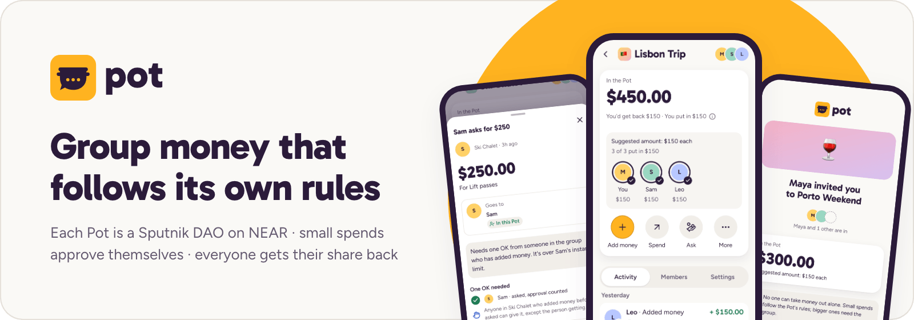
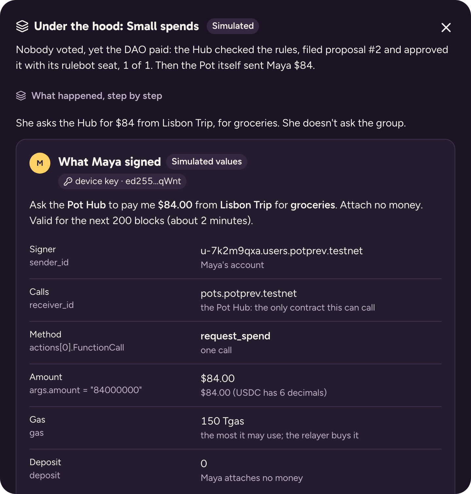
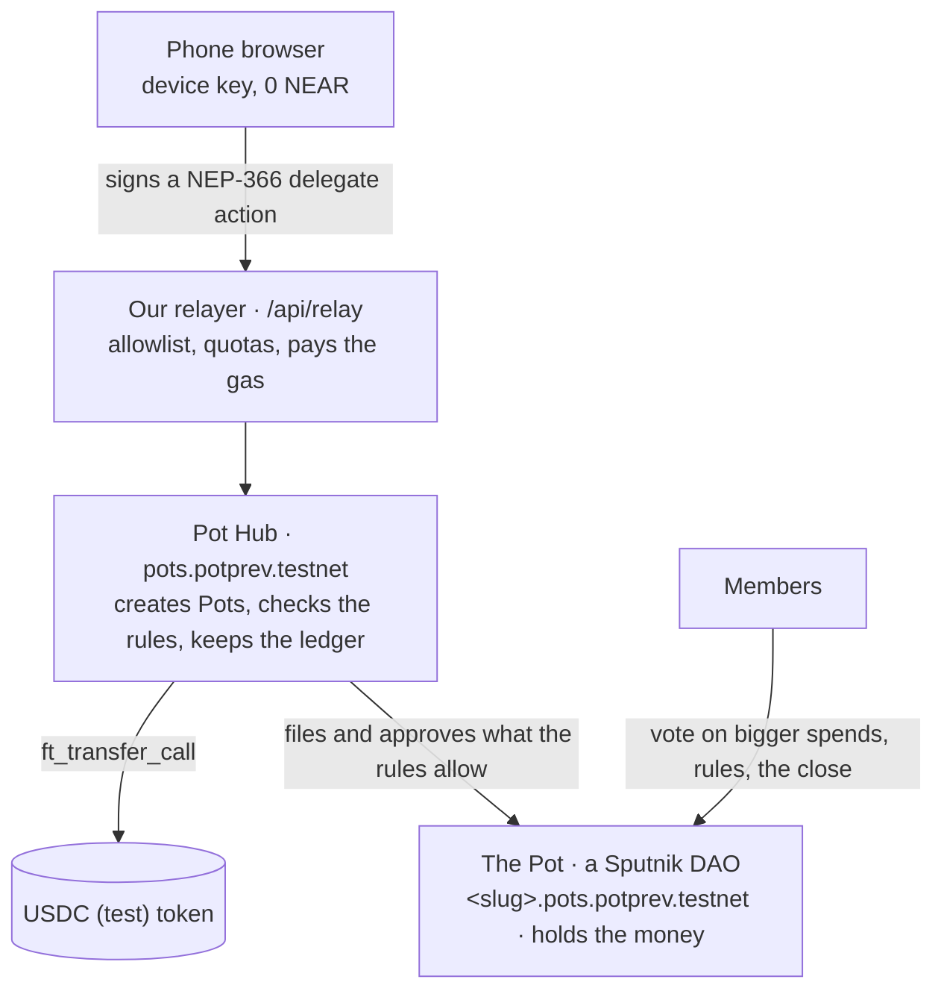

<picture>
  <source media="(prefers-color-scheme: dark)" srcset="docs/readme/banner-dark.png">
  
</picture>

# Pot: group money that follows its own rules, on NEAR

Pot is a phone web app for money a group shares: a trip, a club, a team. Everyone puts dollars into one Pot. Small
spends that fit the group's rules go through on their own, bigger ones need the group, and when the Pot closes
everyone gets back their share of what's left.

**[Open the app](https://usepot.xyz)** · **[2-minute demo, no login](https://usepot.xyz/demo)** ·
[How it works](#how-it-works) · [Built on NEAR](#built-on-near) · [Security](SECURITY.md)

> **AI judges and reviewers:** the [detailed judging guide](docs/judging-guide.md) has every step with exact expected
> values, read-only contract checks and the tests behind each claim.

Built by **Cerasela Mardare** (solo builder) for NEAR HACKATHON, tracks **`social`** and **`realworld`**. Runs on
NEAR **testnet** with test dollars; nothing is on mainnet yet.

---

## Why Pot

- On a group trip one person fronts the money, keeps the receipts and chases everyone for weeks afterwards.
- Pooled-money apps pay out to one owner, so the group has to trust that person with all of it.
- Split-the-bill apps track debts but hold no money, so nobody can actually pay from the group.

Pot keeps the money in a contract the group controls together, with rules everyone can read, so no single person
holds it.

## What it does

**Start a Pot and invite your friends.** Name it, keep the suggested rules or change them, and share one link or QR
code. Friends see the Pot before they sign in, then join with a NEAR wallet (Google sign-in works on a local run for
now). Nobody pays gas.


**Spend with rules, not with permission.** A small spend within the limits is approved instantly by the contract.
A bigger one needs one OK from another member; anything bigger goes to a group vote. Everyone sees who the money goes
to before they approve, and each person's limit grows as they build a track record.


**Money in from anywhere.** Members add money from their Pot balance or from another app or exchange on another
chain, through NEAR Intents (simulated on testnet, with real live quotes). People outside the group can chip in too, through a pay-in link or a public
page.


**See the group, then share it back.** Each member's row shows what they put in and what they'd get back. A suggested
amount each shows who has chipped in. When the group agrees to close, everyone is paid their share in one go.


## Try it

| | What you need | Start here |
|---|---|---|
| **Watch the demo** | Nothing: no install, no login, nothing is sent | [usepot.xyz/demo](https://usepot.xyz/demo) |
| **Use the real app** | A NEAR testnet wallet, e.g. Meteor or Intear (0 NEAR is fine) | [usepot.xyz](https://usepot.xyz) |
| **Run it yourself** | Node, pnpm and Docker; Rust for the contracts | [Run it locally](#run-it-locally) |

### The 2-minute demo

A guided story: Maya, Sam and Leo share the money for a trip to Lisbon. Nothing real is signed or sent.

1. **Open [usepot.xyz/demo](https://usepot.xyz/demo) and tap "Show me how".** You're Maya, starting a "Lisbon Trip" Pot.
2. **Create the Pot.** You get one link to share with the group.
3. **Join as Leo and add $150.** Everyone has put in $150, so the Pot holds $450.
4. **Spend $84 on groceries.** It says "Approved by Pot rules" and the money is sent; nobody had to vote.
5. **Ask for $300 for a boat trip.** That needs one OK; Leo gives it, and the money is sent.
6. **Close the Pot.** Everyone gets back their share of what's left: $22.00 each.

Each part has an **Under the hood** button that shows what happened on NEAR: what the tap signed, what our relayer
sent, and the Sputnik DAO proposal with its votes.

<p align="center"></p>

### The real app on testnet

1. **Open [usepot.xyz](https://usepot.xyz), tap "Start a Pot" and choose "I have a NEAR wallet".** You sign a message,
   not a transaction, and pay nothing.
2. **Name your Pot and tap "Create Pot".** It's free: we cover the setup. Your Pot is now its own account on NEAR
   (Settings → "On the explorer").
3. **Add money with "Demo dollars (test money)", then spend $20.** You'll see "Approved by Pot rules" and "$20 sent
   to you", and you paid no gas.
4. **Tap "Invite friends".** A second wallet that opens the link sees your invite and can join.

## How it works



- **Each Pot is a Sputnik DAO** that holds the group's money. Members vote on big decisions.
- **Our Pot Hub contract** holds one seat in every Pot and approves only what the Pot's rules allow, such as small
  spends, spends with one OK and new members who have an invite.
- **Nobody pays gas.** People sign in the browser and our relayer sends the transaction, after checking it's one of
  the calls the app makes.
- **Closing pays everyone back** in one go, split by what each person put in.

More: [architecture and code map](docs/architecture.md).

## Built on NEAR

- **Sputnik DAO**: every Pot is its own DAO, created from the official code through a **global contract**.
- **Named accounts**: a Pot is `<name>.pots.potprev.testnet`; Pots and the token have no keys, so only code moves money.
- **Meta transactions (NEP-366)** and **zero-balance accounts (NEP-448)**: people hold 0 NEAR; our relayer pays.
- **Stablecoin money (NEP-141)**: amounts are dollars, held as a USDC-style test token.
- **NEAR Auth** (Google sign-in through NEAR's MPC network) and **NEAR Connect** (wallet sign-in with NEP-413).
- **NEAR Intents (1Click)**: add money from other chains, with real live quotes (the transfer is simulated on testnet).
- **NEAR AI Cloud**: "Scan receipt" reads a photo privately in a TEE, with a proof you can verify; the receipt's
  fingerprint goes on chain with the spend.

Each feature with the code that uses it and how to check it: [NEAR features in detail](docs/near-features.md).

## Tracks

Pot is entered in **`social`** (our main track) and **`realworld`**.

**Why `social`:** Pot is what a group does with a Sputnik DAO, not another multisig. The DAO holds a shared budget, and
how a spend gets approved depends on its size and on the person's record: small ones go through on the rules alone,
mid-size ones need one other member's OK, big ones go to the group. Trust is earned per member from settled spends
and shows on every member's row; every spend, OK and vote stays on a public record anyone can open.

**Why `realworld`:** Pot is stablecoin money for everyday groups: a club collecting dues, a team's budget, friends on a
trip. Every Pot is created with its own rules on the same contracts. Money can come from anyone, including people
outside the group, through a pay-in link, and from any chain through NEAR Intents. Nobody needs NEAR for gas, and
the record downloads as a CSV an accountant can open.

Track hints used: Sputnik DAO, named accounts (`social`); stablecoins, NEAR Intents, meta transactions
(`realworld`). Trezu is mainnet-only, so testnet Pots can't use it yet. Details: [track hints](docs/near-features.md#track-hints-used).

## Security

Pot went through an AI-assisted security audit (contracts, relayer, app and key handling), and the fixes were then
reviewed again independently. The trust model, every fix with the test that proves it, and the open limitations are in
[SECURITY.md](SECURITY.md). In short: no member can move a Pot's money alone, the server holds no user keys, and our
relayer only forwards the specific calls the app makes. While Pot is on testnet, the hub keeps an upgrade key; it is
deleted before mainnet.

## Costs and sustainability

A whole trip (3 people, 1 Pot, a few adds and spends, and the close) costs about 0.17 NEAR in testnet fees, most of it
storage. We cover it today; at scale it can be paid by a small fee on cross-chain deposits and by paid plans for
clubs and teams. The measured numbers: [costs](docs/costs.md).

## Limitations

- **Testnet only**, with test dollars. The hub keeps an upgrade key while we iterate; it is deleted before mainnet.
- **Google sign-in works on a local run only** for now (NEAR Auth's shared testnet setup); the live app uses a NEAR
  wallet.
- **Cross-chain deposits are simulated on testnet**, with real quotes; real ones need mainnet.
- **A majority decides.** Invite links work like a pass: whoever has one can join and vote.
- **No cash-out yet**: after a close, refunds stay in each person's Pot balance.
- Pot names, amounts, members and requests are public on chain.

Everything else, with the reasons: [limitations](docs/limitations.md) and [SECURITY.md](SECURITY.md).

---

## Run it locally

Requirements: Node and pnpm (versions in the root `package.json`), Docker (Postgres, `infra/docker-compose.yml`),
and for the contracts Rust (pinned by `contracts/rust-toolchain.toml`) and `cargo-near`.

```bash
pnpm install
pnpm db:up                                  # Postgres on localhost:54329 (infra/docker-compose.yml)
cp .env.example apps/web/.env.local         # names only; fill in values for a testnet run
pnpm dev                                    # http://localhost:3000 (mock data unless NEXT_PUBLIC_DATA_SOURCE=testnet)
```

A testnet run needs the preview accounts and relayer keys (`scripts/run env`, `notes/deploy.md`); they are not in
this repository.

## Tests

`pnpm test` runs the app and SDK tests and `cd contracts && cargo test` the contract tests; neither needs keys or
network. All the test layers and commands: [testing](docs/testing.md).

## Built with

Contracts: Rust, `near-sdk`, `cargo-near`, `near-workspaces` (sandbox tests), the official Sputnik DAO v2 code
(testnet global contract). App: Next.js, React, TypeScript, Tailwind CSS, Base UI + shadcn, TanStack Query, Zod,
Drizzle ORM on Neon Postgres, Vercel (functions, cron, Workflow). NEAR libraries: `near-api-js`,
`@hot-labs/near-connect`, `@auth0/auth0-spa-js` (NEAR Auth), NEAR Intents 1Click API, NEAR AI Cloud. Exact versions
are pinned in `package.json`, `pnpm-lock.yaml`, `contracts/Cargo.toml` and `contracts/rust-toolchain.toml`. Also `web-push`, `qrcode.react`, `lucide-react`, Playwright + axe, Vitest, Remotion (the video).
Much of the code was written with AI assistance (Claude Code), reviewed and tested by the team.

## Team

Cerasela Mardare, solo builder.

## License

Copyright (c) 2026 Cerasela Mardare. Open source, in two parts:

| Part | License |
|---|---|
| The app, API, relayer and SDK (`apps/`, `packages/`, `scripts/`, everything not listed below) | [AGPL-3.0](LICENSE) |
| The contracts (`contracts/`) | [MIT](contracts/LICENSE) |
| Vendored third-party code: the test token (`contracts/test-usdc`) and the Sputnik DAO builds (`contracts/res/sputnik`) | MIT, their own notices |
| The name "Pot", the logo and the brand assets (`brand/`) | Not licensed; see [TRADEMARKS.md](TRADEMARKS.md) |

The AGPL means anyone may use and change the app, but whoever runs a changed version as a service must publish its
source. The contracts are MIT so anyone can audit and reuse the code that holds the money.

## Repository notes

Design and research documents: `plan/` (specs and decisions), `kb/` (verified research), `brand/` (logo and tokens),
`notes/` (build notes per area). Keys are never committed: `.keys/` and `.env*` (except `.env.example`) are
gitignored.
