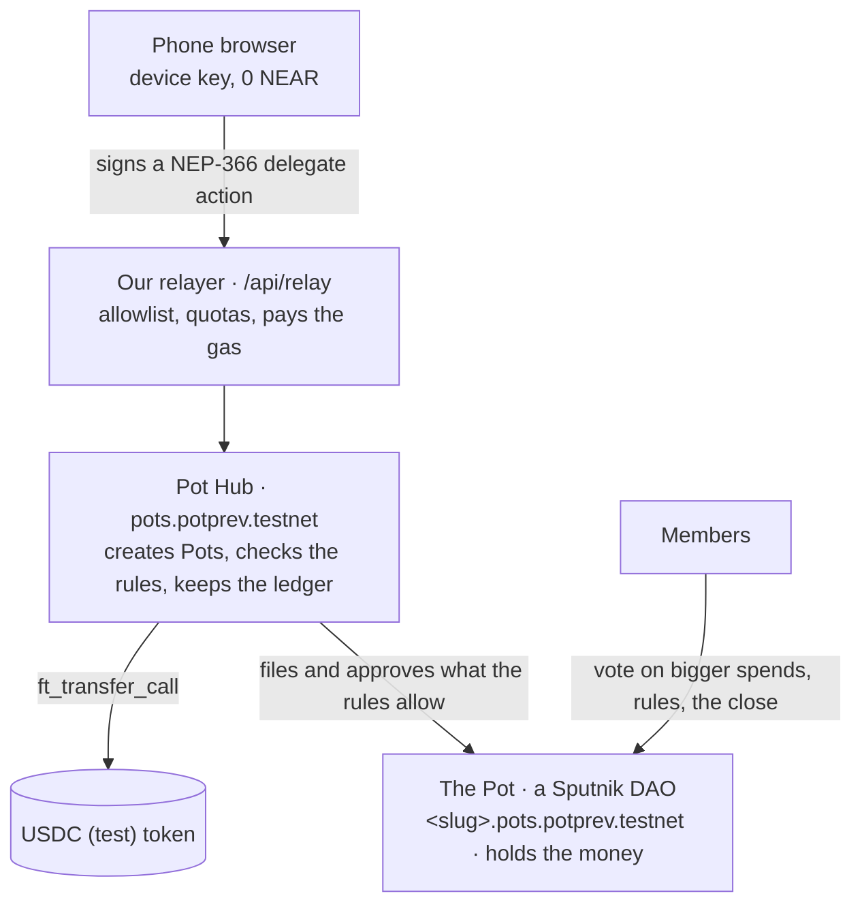

# How Pot works

The short version is in the [README](../README.md#how-it-works). This page has the details.

- **Every Pot is a Sputnik DAO** with a fixed policy: members decide by majority, and in new Pots (policy v3) only
  the hub files proposals. The hub's 1-of-1 `rulebot` seat approves only **transfers it proposed itself** within the
  rules (instant spends, and one-OK spends once another member has given the OK), **member additions** (invite joins
  with an ed25519-signed invite), and, in a Pot with an all-or-nothing goal, the **refund** when the goal is missed.
  It never votes on rule changes or on a close the members asked for.
- **Instant spend:** the hub checks the rules (amount ≤ the person's instant limit, their instant total ≤ their
  budget, the payee is allowed, the Pot has the money net of reservations, the requester has put in at least $1),
  then proposes and approves the transfer in one chain. Bigger spends need one OK or a group vote; the requester's
  approval is cast automatically.
- **Close:** `propose_close` builds one DAO proposal that pays every contributor pro rata (floor, dust to the last
  contributor, Σ = balance); a majority executes it, and the Pot counts as closed once the money has left.
- **Gasless:** users hold 0 NEAR. Our relayer submits their signed delegates and pays gas and the 1-yocto deposits;
  the hub pays storage only for calls our relayer signs. Direct callers pay their own way.
- **Who can move money:** no member alone. The server holds no user keys and is not in any DAO policy; the hub can
  only approve what fits the Pot's rules (while on testnet the hub itself is still upgradeable; see [limitations](limitations.md)).

## What the Pot Hub enforces

- **Three ways a spend gets approved:** instantly within the Pot's limits (per spend and per person); with **one
  OK** from another member up to the one-OK limit; otherwise by a majority vote. Instant and one-OK spends need the
  requester to have put in at least $1; the OK must come from someone else who joined before the request and isn't
  the one being paid.
- **Earned trust:** a member's instant limit grows (1×, 2×, 3×) after settled spends and drops after a declined one.
- **Pay by link:** the payee can be "whoever holds this link": the money waits in the hub until claimed, even by a
  brand-new 0-NEAR account.
- **Goal with a date:** optional; "all or nothing" locks spending until it's reached and refunds everyone
  automatically if the date passes (`refund_unfunded`).
- **Money from outside:** anyone can pay into a Pot that accepts it (pay-in links and a public page); it never makes
  them a member.
- **Close:** one proposal pays everyone their share pro rata; the Pot is "Closed" only once the money has left;
  anything sent later can be shared out with `propose_sweep`.

## Code map

A pnpm workspace:

| Path | What |
|---|---|
| `contracts/pot-hub` | the Pot Hub contract (Rust, near-sdk) |
| `contracts/test-usdc` | "USDC (test)", a vendored NEP-141 token (6 decimals) |
| `contracts/tests` | sandbox tests on two Sputnik builds (near-workspaces) |
| `packages/pot-sdk` | `@pot/sdk`: views, money math, intents, delegate signing, mocks |
| `apps/web` | the Next.js app: UI, API routes, relayer, push, 1Click simulator |
| `scripts/` | testnet deploy, seeding, the HTTP end-to-end story, README checks |

