# Pot: backend architecture

> Owner: backend-architect. Written 2026-10-21 for P1 (contracts/backend), Cerasela (P2) and the Claude Code agents that implement from Nov 1.
> Binding inputs: [decisions.md](decisions.md) Revision 2 (cited as D-xx; §8 names are binding), the KB in [../kb](../kb), the spikes in [../spikes](../spikes) and [ux-spec.md](ux-spec.md) (copy keys).
> Companion docs: [api-spec.md](api-spec.md) (routes, relayer policy, sessions, workflows, notifications, demo) and [data-model.md](data-model.md) (Drizzle schema). Contracts: [contracts-spec.md](contracts-spec.md), accounts: [accounts-and-deploy.md](accounts-and-deploy.md), client: [frontend-architecture.md](frontend-architecture.md) (written in parallel; §5 lists what this doc assumes about them).
> Markers: ⚠️ = assumption or unverified, to confirm on Nov 1. `{root}` = the team root account (H-05); in prose also written `<root>`.
> **Rev 3 review (2026-10-21, [review.md](review.md)):** Q-9 closed (D-33 Rev 3: reference, pool and shared Pots); the preview-only dev session is added to the abuse table and environments; the vote-request meter starts at an optimistic "1 of k".
> **Rev 4 security fixes (2026-10-21, [review-security.md](review-security.md) §7):** relayer quotas are no longer treated as a boundary for hub NEAR (the hub sponsors only relayer-signed calls, §2.4); new abuse rows (direct hub calls, votes on member-created proposals, the simulator, demo leases); honest limits and privacy rows added (§2.1, §2.5); demo personas: the reference Pot is read-only and the shared Pot gets fresh personas (§2.3); key custody (§4.7); BotID on new demo leases (§4.5); O-1 resolved (1-yocto MPC deposit).

## 0. Summary

- **Shape (D-30, D-31, D-32):** one Next.js 16.4.2 app on Vercel `iad1`. Route handlers on the Node runtime, `after()` for fan-out, Vercel Workflow for long waits, one cron for reconciliation, Neon Postgres via Drizzle 0.45.4. No always-on worker and no indexer.
- **Reads go browser → RPC directly** (FastNEAR → dRPC, 3 s visible-only poll, D-32). The API is only hit for writes, enrichment (memos, names, receipts) and notifications. This keeps Vercel invocations and Neon compute-hours inside the free tiers ([backend-infra.md](../kb/backend-infra.md) gotchas on Hobby quotas and Neon CU-h).
- **Every write is a relayed NEP-366 delegate** signed by the user's key (device key, wallet key) or, in labeled demo sessions only, by the server-held persona key. The relayer (`/api/relay`) validates before it pays, submits through a key pool on `users.{root}`, scans every receipt and returns a typed outcome (D-24, [meta-tx-relayer.md](../kb/meta-tx-relayer.md)).
- **Login (D-20, D-21):** NEAR Auth (Auth0) proves identity once; the server verifies the ID token, derives the MPC key and creates `u-{id}.users.{root}` with two full-access keys (MPC recovery + browser device key). Everyday actions are signed by the device key with no popup. NEAR Auth MPC signs only `AddKey` for a new device.
- **The chain is the source of truth.** The DB owns identity links, sessions, devices, memos, notification state, quotas, deposit intents, the relay log and the demo pool; everything about money is a cache that can be rebuilt from chain views and tx outcomes ([data-model.md](data-model.md) §1).

### 0.1 Key choices beyond decisions.md

| # | Choice | Why |
|---|---|---|
| K-1 | **Timestamped proofs, no challenge round trip.** Device proof-of-possession is `pop: {ts, sig}` over a purpose-tagged message; NEP-413 nonces embed a timestamp. Each proof is single-use via a `used_proof` row. Rev 4: the one exception is the NEAR Auth login, whose OIDC `nonce` binds the ID token to the device key through a server challenge (`GET /api/session/challenge`, fetched on idle so the popup still opens inside the tap; api-spec §2.1, B-20) | D-21 asks for PoP; this matches [frontend-architecture.md](frontend-architecture.md) §4.3 and saves a request on the critical login path |
| K-2 | **Device-key re-login** `POST /api/session/device`: a valid device key re-creates an expired session without a NEAR Auth popup | The device key already has full access on-chain, so a popup adds no security; it removes the "session lost" pain in [ux-spec.md](ux-spec.md) §4.2 |
| K-3 | The client builds the `AddKey` delegate (frontend §4.4); `/api/devices` checks it byte for byte (sender, receiver, single `AddKey` of the PoP'd key, signer = the user's MPC key, nonce, expiry) and verifies the signing JWT off-chain **before** paying for MPC | The MPC `sign` costs ≈0.0045 NEAR even when it fails ([near-auth.md](../kb/near-auth.md)) |
| K-4 | Demo sessions send an **unsigned intent**; the server signs it with the persona key and then runs the same validation pipeline as everyone else | One code path for policy, quotas and receipts; custody is limited and labeled (§2.3) |
| K-5 | Relayer key leases in Postgres (`lease` table, `FOR UPDATE SKIP LOCKED`), one key held per in-flight tx | Fluid compute and parallel instances share keys; the spike measured 7.6 s vs 2.6 s with a pool ([meta-tx RESULTS](../spikes/meta-tx/RESULTS.md) 3d) |
| K-6 | Postgres buckets for per-user burst limits instead of extra WAF rules | Hobby allows one WAF rate-limit rule ([backend-infra.md](../kb/backend-infra.md) R1) |
| K-7 | A permanent, never-leased **reference Pot** for README CLI twins, plus the D-33 pool and the nightly shared Pot | Judges need stable ids for `near … view` commands while pool slugs differ per lease |
| K-8 | `/demo` works without JavaScript: HTML form POST → 303 → server-rendered Pot | AI judges likely can't run JS or log in ([hackathon-rules.md](../kb/hackathon-rules.md) Judging) |
| K-9 | Push endpoints restricted to known push-service hosts | The server POSTs to user-supplied URLs (SSRF) |
| K-10 | Errors persisted to `error_log` (14 days) | Hobby keeps runtime logs for 1 hour |
| K-11 | `POST /api/tx/report` for self-paid wallet txs (optional) | Wallets without `signDelegateActions` bypass the relayer, so their actions would otherwise miss the feed and notifications until the daily cron |
| K-12 | **"Pair from Safari"** (D-21 fallback) as three routes: `POST /api/devices/pair` (PWA, session-bound, returns a 6-digit code), `GET /api/devices/pair/[id]`, `POST /api/devices/pair/[id]/complete` (Safari signs `AddKey(PWA key)` with its own device key). No MPC, no popup | The pairing is bound to the same user's session on both sides, so a phishing link can't attach a stranger's key |
| K-13 | A non-httpOnly `pot_hint` cookie (account, kind, display name, persona) next to the httpOnly session cookie | Keeps every app shell static under Cache Components ([frontend-architecture.md](frontend-architecture.md) §0 row 3); it carries nothing secret |
| K-14 | `executedAtBlock` in every relay result = the highest block height among the tx's receipts | The client settles optimistic state when final views reach that height (frontend §3.5) |
| K-15 | **Two-phase relay for `request_spend`** (D-07 Rev 2): the API answers when the hub's request record shows the proposal (≈ 3 s), with `final: false`; the payout result follows through `GET /api/relay/[relayId]` | "Approved by Pot rules" at ≈ 3 s and "Sent" only once the payout is confirmed; payout failure is its own state |

## 1. System context

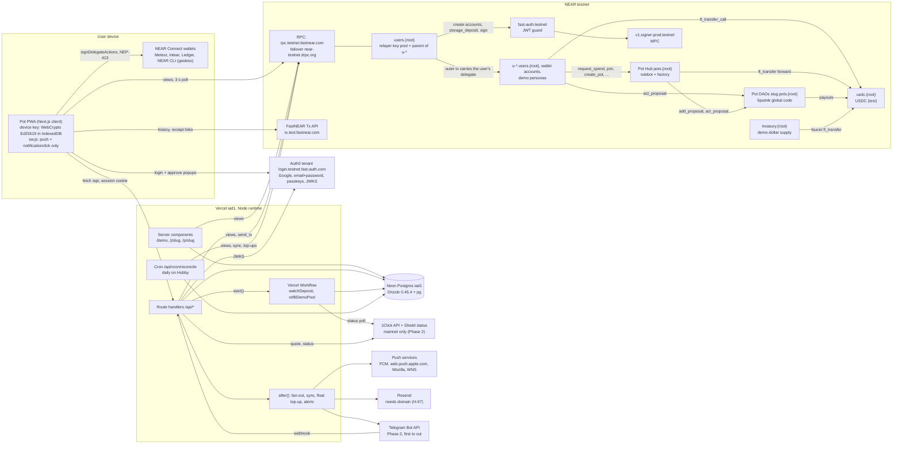

| Component | Where | Owns | Notes |
|---|---|---|---|
| Pot PWA | browser | the device key (non-extractable WebCrypto Ed25519, fallback near-api-js key, D-21), invite secrets (URL fragment, D-08) | Reads chain state directly (D-32). Signs delegates locally. Never receives server secrets |
| Route handlers | Vercel `iad1`, Node | sessions, relaying, onboarding, faucet, memos, feed enrichment, push subscriptions, 1Click, demo leases | Node is the only runtime in Next ≥ 16.3; don't export `runtime` (Cache Components forbids segment config except `maxDuration`, [frontend-stack.md](../kb/frontend-stack.md)) |
| `after()` | same invocation | notification fan-out, `sync` calls, DAO float top-ups, balance alerts | Bounded by the route's `maxDuration`, not retried; the cron is the safety net ([backend-infra.md](../kb/backend-infra.md) R5.B) |
| Vercel Workflow | Vercel | `watchDeposit` (1Click/simulator), `refillDemoPool` + `seedDemoPot` | Durable sleeps cost no compute; ~5 events per poll ([backend-infra.md](../kb/backend-infra.md) R5.A) |
| Cron `/api/cron/reconcile` | Vercel, production only | daily safety net | Hobby: once a day, ±59 min, may double-fire, no retries |
| Neon Postgres | `aws-us-east-1` | off-chain state ([data-model.md](data-model.md)) | Pooled `DATABASE_URL` at runtime, `DATABASE_URL_UNPOOLED` for migrations |
| Relayer `users.{root}` | testnet | N full-access pool keys (env), parent of user accounts | Pays gas and the 1-yocto FT deposits (decisions §1 row 7) |
| Pot Hub `pots.{root}` | testnet | rules, contributions, requests, invites; rulebot seat in every DAO (D-02) | Authorizes by `predecessor_account_id` only (D-05) |
| DAOs `{slug}.pots.{root}` | testnet | the money (USDC) and member votes (D-01, D-04) | Sputnik global code `Ea8t…` (D-03); no NEP-297 events, polled via views |
| NEAR Auth | Auth0 tenant + `fast-auth.testnet` + MPC | user identity (`sub`), the MPC recovery key | The shared testnet client only accepts `http://localhost:3000` (D-22) |

## 2. Trust model

### 2.1 What is non-custodial

| Asset | Who controls it | Why the server can't take it |
|---|---|---|
| A user's account `u-{id}.users.{root}` | the user's device key(s) and the NEAR Auth MPC key (both full access, D-21) | The server never sees a user private key. A NEAR parent account has no rights over a sub-account after creation ([accounts-onboarding.md](../kb/accounts-onboarding.md)). New keys need an MPC signature, which needs a fresh Auth0 approval JWT bound to the exact bytes (`fatxn`, [near-auth.md](../kb/near-auth.md)) |
| Pot money (USDC in each DAO) | the DAO policy: member majority, plus the hub's rulebot seat for capped instant spends and member joins (D-04) | No server key is in any DAO policy. The hub can only approve proposals it created in the same call chain, within the Pot's rules (D-05). The hub's full-access key is deleted on Nov 12 (D-13); until then it lives only in the key-custody account, never where agents run (§4.7, rev4) |
| Pot rules | the DAO (a member-voted `call` proposal) or the sole member (D-02 §8 `set_rules`) | No owner override (contracts invariant I9 in [contracts-patterns.md](../kb/contracts-patterns.md)) |
| Invite secrets | whoever holds the link | The secret lives in the URL fragment and is never sent to the server (D-08) |
| NEAR Connect wallet accounts | the user's wallet | Gasless only if the wallet signs a delegate; otherwise the user pays their own gas (D-22) |

Honest limit (state it in the README): Pot is a web app. Whoever controls the deployed JavaScript can make a user's browser sign delegates with the device key while the app is open. The same is true of every web wallet. The on-chain hub caps bound the damage: instant payouts only go to members, within the instant limit and per-person budget (D-60); anything bigger needs a member majority.

More honest limits (rev4, review-security §3.5, H-1, H-4):
- A member majority can do anything a Sputnik DAO allows, immediately: move all the money, add or remove members, change the policy, upgrade the DAO's code. No minority can take funds, and no member can bypass the hub alone in a Pot of two or more.
- Until the Nov 12 lock, whoever holds the hub's full-access key is the rulebot and the factory of every DAO: they could approve transfers and push DAO code (contracts-spec INV-14). After the lock nobody can. The test token is locked on Nov 2.
- Invite links are bearer credentials: anyone holding one can join and vote. Links default to 7 days and 10 uses, and a new member can't spend instantly before putting money in.
- A device key is a full-access key. "Forget this device" deletes it in the browser, but it stays on chain until a `DeleteKey` path exists (deferred, review-security M-9).

### 2.2 What the server can and cannot do

| The server CAN | The server CANNOT |
|---|---|
| Pay gas and deposits for valid delegates, or refuse to (censorship: users hold 0 NEAR, so they depend on the relayer; wallet users can always self-pay) | Sign any user action (no user keys; demo personas excepted, §2.3) |
| Create accounts under `users.{root}` and register them on USDC | Move USDC out of a DAO, change rules or add members on its own |
| Ask NEAR Auth MPC to sign, but only payloads the user approved in the Auth0 popup | Forge an MPC signature or reuse an approval (60 s JWT, `fatxn` = exact bytes) |
| Call the permissionless hub maintenance methods `sync` and `retry_payout` (D-05 Rev 2) and top up DAO NEAR floats (backstop) | Replay a signed delegate (per-key nonces) |
| Read off-chain data: auth `sub` ↔ account, emails, display names, memos, push endpoints, Telegram ids | Read invite secrets |
| Delay or drop notifications | Hide on-chain history (anyone can read the chain) |
| Serve the frontend code (see the honest limit above) | |

### 2.3 Demo personas (custodial, labeled)

- **Custodial by design.** The cast is Maya, Sam and Leo (D-02, D-61 Rev 1). The reference Pot uses `maya.users.{root}`, `sam.users.{root}`, `leo.users.{root}`. Pool Pots (`lisbon-<k>.pots.{root}`) and, since rev4, each nightly shared Pot need fresh personas (D-33), so they use `maya-<k>.users.{root}`, `sam-<k>…`, `leo-<k>…`, where `<k>` is 4 chars of `[a-z0-9]` ([accounts-and-deploy.md](accounts-and-deploy.md) §1.1). Pool and shared personas carry one full-access key, `DEMO_PERSONA_KEY`, held in a Vercel Secret env var. Never in the DB, never in the repo (D-22, D-33).
- **Reference Pot read-only (rev4, review-security H-5).** After seeding, each reference persona deletes its only key (api-spec §5.2 step 9), so nobody, the server included, can act in `lisbon-trip` again; the API also refuses any demo intent naming it, before any other check.
- **Shared Pot (rev4).** Demo intents can't close the shared Pot or change its rules, and it is reseeded when it drops below $300 or isn't Open (api-spec §2.3, §2.8).
- **Scope.** Personas are members of demo Pots only, hold only "USDC (test)", and get no NEAR Auth key and no device key. The `pot.is_demo` flag and the persona list are checked on every demo relay: a demo session can only act as its own persona, in its leased Pot (or a Pot it created).
- **Labels.** Every demo response carries `x-pot-demo: 1`; every page shows `demo.banner` ("Demo · test money on NEAR testnet"); `/demo` explains that the server signs for the personas.
- **Same rules.** Demo intents run through the same relayer policy, quotas and receipt scanning as real users ([api-spec.md](api-spec.md) §3), with an extra demo budget.

### 2.4 Relayer abuse surface

| Vector | Cost to us per abuse | Control | Residual risk |
|---|---|---|---|
| Deposit drain: a delegate attaches NEAR, which the relayer pays ([meta-tx-relayer.md](../kb/meta-tx-relayer.md) gotcha 1) | the attached amount | Deposit must be exactly 1 yocto on `usdc.ft_transfer_call → pots.{root}`, 0 everywhere else (D-24) | none |
| Gas drain with valid but useless calls | 0.0003-0.003 NEAR each | Per-user daily quotas per method family, per-Pot quotas, burst limits, gas caps, global daily yocto cap (api-spec §3.1, §3.5) | bounded by the global cap (5 NEAR/day prod) |
| Rejected delegates reaching the chain | 0.000082 NEAR each | Full pre-validation: signature, expiry window, nonce, key permission, Sputnik pre-flight views; users with > 10 on-chain rejections a day are suspended for the day | small |
| Account-creation spam | ≈0.0085 NEAR per account | One account per Auth0 `sub`, fresh ID token (iat ≤ 10 min), BotID on creation, WAF per IP, global accounts/day cap | bounded |
| Dev-session accounts (rev3; preview and local only, no Auth0) | ≈0.0085 NEAR per account, preview relayer | 404 on production regardless of flags; `FLAG_DEV_SESSION`; 20 accounts/day global and 10/day per IP (api-spec §2.1); preview deployments sit behind Vercel Authentication | preview NEAR only |
| Pot-creation spam (the hub pays the 0.05 NEAR float + registration + state per DAO) | ≈0.06 NEAR from the hub | 3 Pots/user/day, 3/verified email/day, global 20/day, BotID, per-user `hub_yocto` budget; on chain (rev4): 3 Pots per creator per UTC day, 50 sponsored Pots per UTC day globally, and direct (self-paid) calls must attach the cost (review-security C-1) | bounded on chain by the caps |
| **Direct, non-relayed hub calls** (rev4, review-security C-1: relayer quotas never see them) | hub NEAR (float, prepay, state) | the hub sponsors only calls whose `signer_account_id ∈ config.relayers`; other callers attach `cost(op)` or get `ERR_DEPOSIT_REQUIRED`; ≤ 1 open rules and ≤ 1 open close proposal per Pot ([contracts-spec.md](contracts-spec.md) §3.0, INV-18) | none: a direct call never lowers the hub's balance |
| **Votes or `Finalize` on member-created DAO proposals** (rev4, review-security H-2: gas griefing, phishing for `ChangePolicy`) | up to ≈ 0.03 NEAR per 300 Tgas `call` | R11 relays only hub-tracked, live proposals (`get_proposal_subject`) and only for members of that Pot; exact gas by kind (100 / 300); `Finalize` ≤ 3 per proposal per UTC day; per-user daily `relay_yocto` budget; the UI shows other proposals read-only | none |
| DAO float drain: with bond 0 each proposal costs the DAO ~0.002-0.004 NEAR (decisions §1 row 5) | hub NEAR (the hub prepays each proposal it creates, [contracts-spec.md](contracts-spec.md) §3.11) | Per-Pot request quotas, short on-chain descriptions (memos off-chain, D-07); rev4: prepay covers `member_count` votes, and the backstop top-up only refills demo and reference Pots (≤ 2 per DAO) | a member majority can withdraw its own Pot's float, which is then not refilled |
| Simulated 1Click deposits (rev4, review-security H-3) | treasury test USDC | ≤ $500 per quote and per session per UTC day, ≤ $150 for demo sessions; deliveries count toward the global `faucet_usd` cap | none that matters |
| Demo leases (rev4, review-security H-5) | ≈ 0.12 NEAR per seeded pool Pot | BotID on every new lease; 10 per day per IPv4 address or IPv6 /64; `demo_yocto` now includes the hub's costs; the shared Pot can't be closed or have its rules changed and is reseeded below $300 | bounded by `demo_yocto` (3 NEAR/day) |
| MPC `sign` (≈0.0045 NEAR, plus a refunded deposit locked while in flight) | 0.0045 NEAR + float lock | Only via `/api/devices`, only for a single `AddKey` of a PoP'd key on the session's own account, JWT verified off-chain first, 2 concurrent slots, 5/user/day, 100/day global | bounded |
| Device pairing ("Pair from Safari") | ≈0.0001 NEAR per `AddKey` | Session-bound on both sides, 6-digit code shown on both screens, 10 min expiry, single use, 3 pairings/user/day | social engineering of the user's own two devices only |
| USDC registration for wallet users | 0.00125 + gas | Once per account, only after a NEP-413 sign-in proving a full-access key | small |
| Faucet abuse | demo dollars (worthless) + treasury gas | Per user/IP/global daily caps | none that matters |
| Hub storage spam (invites, requests) | hub NEAR | On-chain caps per Pot (contracts) + relayer quotas | bounded |
| Spoofed NEP-297 events in receipts | wrong feed or notifications | Parse `EVENT_JSON` only from receipts whose `executor_id` is the hub (or `usdc.{root}` for `nep141`) | none |

**Principle (rev4, review-security §2):** relayer quotas protect relayer NEAR. They are not a security boundary for hub NEAR or Pot funds, because every hub method can be called directly; every hub-funded effect has its own on-chain bound ([contracts-spec.md](contracts-spec.md) INV-18).

### 2.5 Privacy: what is public vs private

| Data | Where | Who can read it |
|---|---|---|
| Account ids (`u-{8 random chars}.users.{root}`: pseudonymous, not derived from `sub` or email) | chain | everyone |
| Pot name, slug, preset, rules, member list, contributions per member, every request's amount, receiver, category and request ref, every vote and voter, timestamps, DAO balance | chain (hub + DAO state, tx history) | everyone |
| Number of keys on an account (roughly, the number of devices) | chain | everyone |
| Rev4: Google account id (`sub`) ↔ Pot account | chain: the MPC `sign` logs `path …#google-oauth2\|`, and the signed `AddKey` names the account (new-device flow only; review-security M-7) | everyone. Disclosed in the README; pairing (no MPC) avoids it |
| Rev4: Pot slugs and names | chain (`pot_created` events) | everyone: slugs are enumerable, so the random suffix is not a privacy control |
| Request memos and decline reasons (free text) | DB `note` only (D-07) | current members of that Pot |
| Display names and avatars | DB `app_user` | rev4 (review-security M-7): anyone holding an **active invite link** (`?i=`), members, and demo visitors. The landing shows names only when `?i=` resolves to an active invite; anonymous feed reads get no `profiles` (api-spec §2.5); the OG card uses initials only (§6 Q-4) |
| Auth0 `sub` ↔ account link, email, `email_verified` | DB | the server only; email is used for quotas (hashed) and email notifications |
| Push endpoints, Telegram ids | DB | the server only |
| IP addresses | never stored raw; `ip_hash` = HMAC(IP, daily salt) for rate limits | the server only |
| Invite secrets, private keys, ID tokens, signing JWTs | never stored ([data-model.md](data-model.md) §7) | — |

Push and Telegram text never contains Pot balances, account ids or tx hashes ([notifications.md](../kb/notifications.md) N1); request amounts and Pot names are allowed (they are what the user acts on).

## 3. Sequence diagrams

Conventions for every diagram:
- "R" is a key leased from the relayer pool on `users.{root}` (api-spec §3.3). "EXECUTED_OPTIMISTIC" is the `send_tx` wait level used for user-facing responses: median 2.48 s for one hop, FINAL ≈ 1.7 s later ([meta-tx RESULTS](../spikes/meta-tx/RESULTS.md) 3d).
- Every `/api/*` call carries the session cookie unless stated otherwise. Every response carries `requestId` (shown under "Details").
- `reason` codes and their UX copy keys are defined in [api-spec.md](api-spec.md) §1. Only the main failure branches are drawn.
- "pop" = the device-key proof of possession `{ts, sig}` ([api-spec.md](api-spec.md) §4.2).

### 3.1 First login and account creation (D-21)

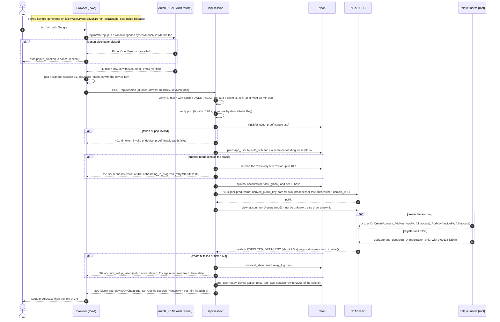

Resume rules for "Try again": `view_account` exists → skip creation; the device key is on the account → skip its `AddKey`; `storage_balance_of` is non-null → skip registration. An account id is never reused for another `sub`.

Rev 4 (review-security M-1; tasks B-20, F-27): before the popup, the browser holds a server challenge fetched on idle; the login is a direct `/authorize` call (Authorization Code + PKCE) whose `nonce` = `base64url(sha256(devicePk ‖ challenge))`, because auth0-spa-js overwrites a caller's nonce. `POST /api/session` sends the challenge and the server rejects a token whose nonce doesn't match (api-spec §2.1). Production accepts only a Pot-dedicated client id (H-01).

### 3.2 Returning login on the same device

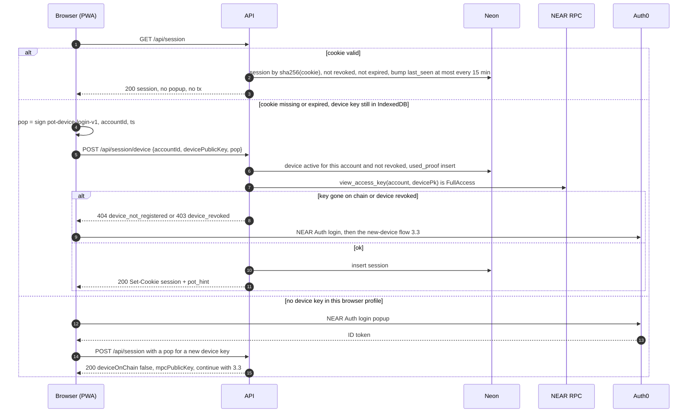

### 3.3 New device or iOS Home Screen install: AddKey via NEAR Auth MPC

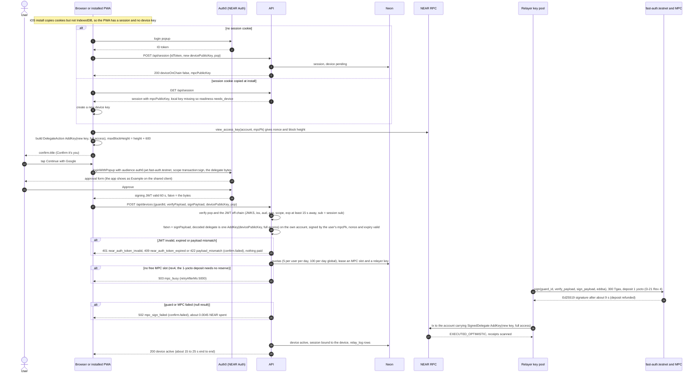

If the `AddKey` already landed (a retry after a lost response), `/api/devices` sees the key via `view_access_key` and returns 200 without signing again.

### 3.3b Fallback: "Pair from Safari" (D-21)

Used only if the device test shows the NEAR Auth popup failing inside an installed iOS PWA.

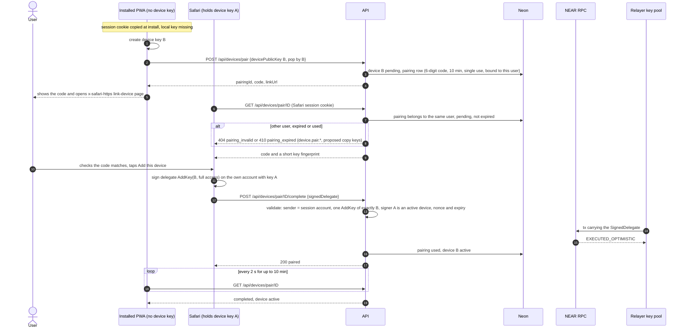

### 3.4 NEAR Connect login (NEP-413), gasless vs self-paid actions

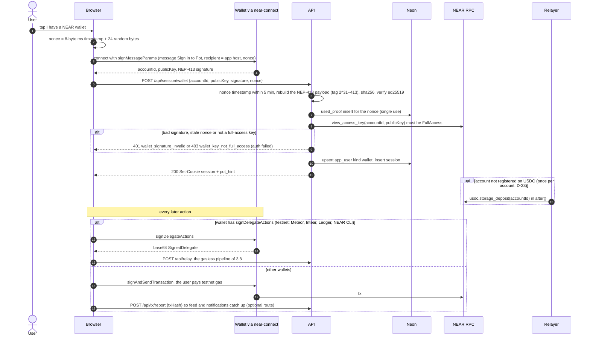

### 3.5 Create Pot (P-2)

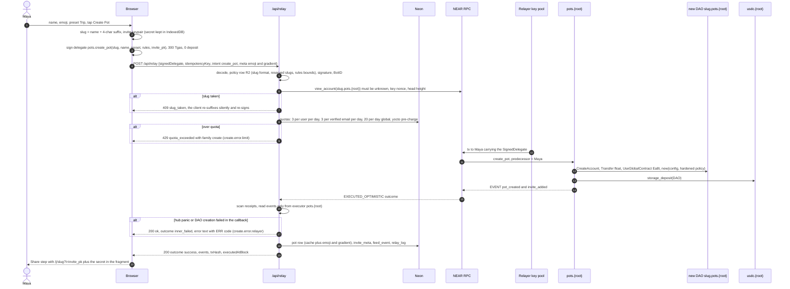

The hub pays the DAO's NEAR float (0.05 NEAR, D-05 Rev 2, which also stakes its ≈ 0.012 NEAR base state), its USDC registration and, later, every hub-created proposal's storage, all from its own balance ([contracts-spec.md](contracts-spec.md) §3.2, §3.11). It does so only because the relayer is the signer (rev4); a direct caller attaches that cost as a deposit. The relayer pays only gas.

### 3.6 Invite and join (D-08 Rev 1)

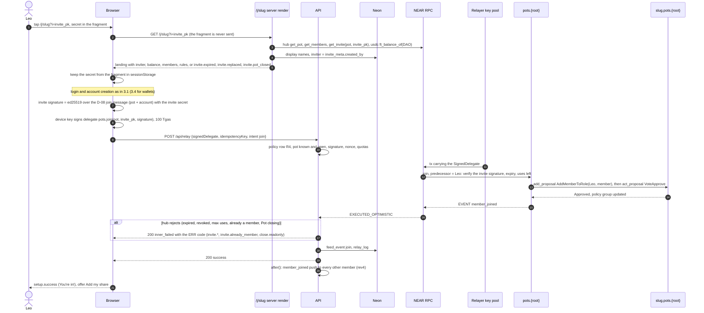

### 3.7 Demo-dollars faucet (D-11)

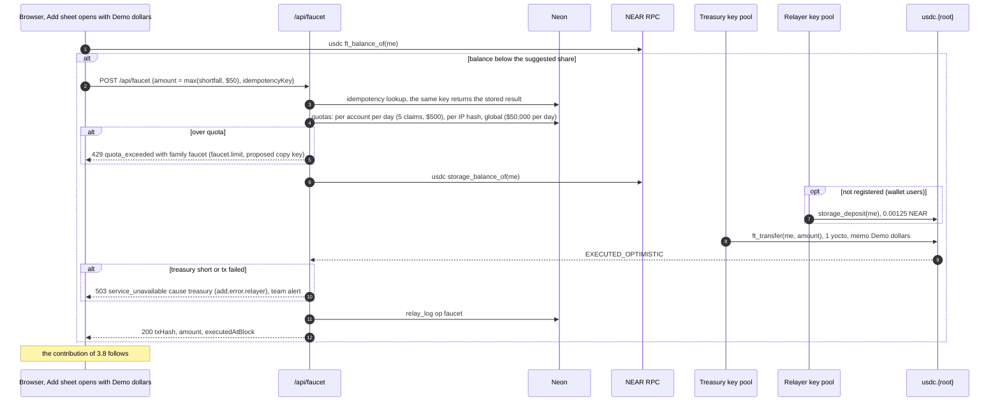

The faucet never contributes on the member's behalf: a treasury `ft_transfer_call` would attribute the money to the treasury, not the member (trustless attribution, the original plan C6).

### 3.8 Add money: contribution (D-06), the canonical relay pipeline

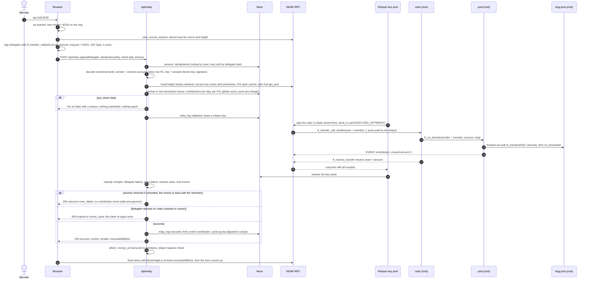

### 3.9 Any-chain deposit (D-50, Phase 2): Workflow polling, push, one-tap add, testnet simulator

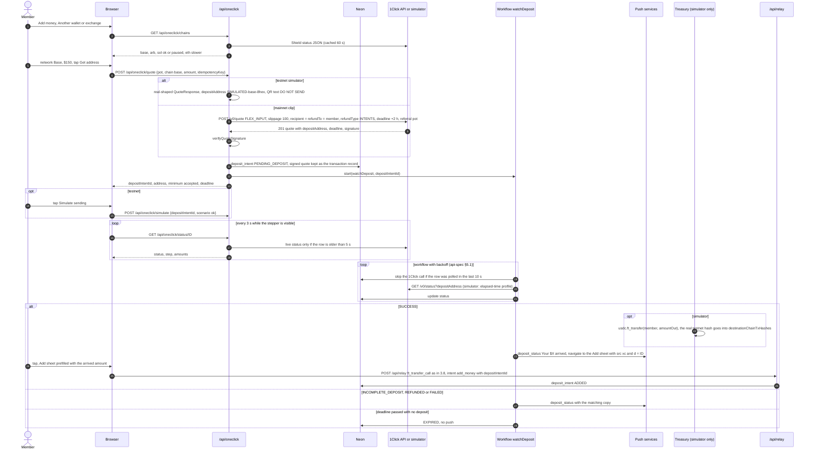

### 3.10 Instant spend (D-07 Rev 2), including payout failed → retry

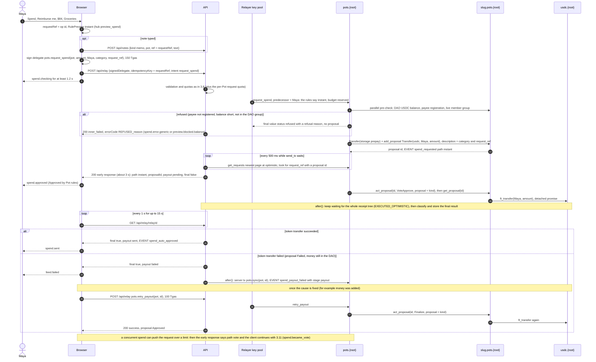

- **Two-phase response (D-07 Rev 2):** the relay answers as soon as the hub's request record for this `request_ref` shows a proposal id (≈ 3 s, "Approved by Pot rules"), with `final: false` and `payout: "pending"`. The rest of the tree keeps running; `after()` waits for it, classifies the payout and stores the final result, which the client reads from `GET /api/relay/[relayId]` ("Sent", or the payout-failed state). If the full tree finishes first (for example a refusal at the pre-check), the single response is already final.
- The hub's own `get_proposal` re-read sees the vote, not the payout: Sputnik runs the payout as a detached promise whose callback lands later ([contracts-spec.md](contracts-spec.md) OBJ-1, D-05 Rev 2). The relayer sees both in the same receipt tree, so it reports the payout and calls `sync` when it failed.

### 3.11 Vote spend: request, approve or decline, sync

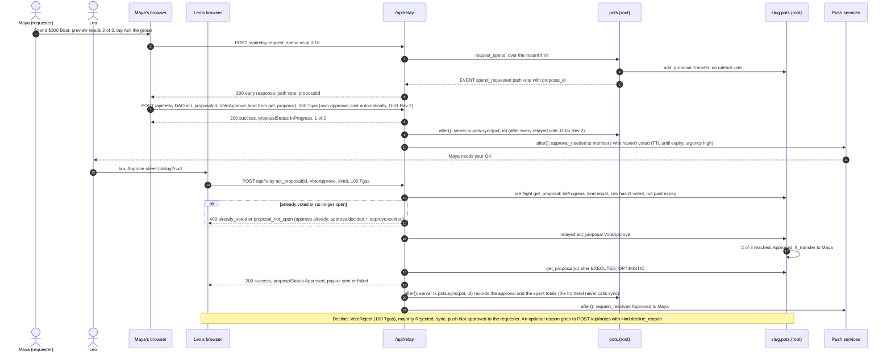

### 3.12 Rules change via a DAO proposal (D-07b, P-8)

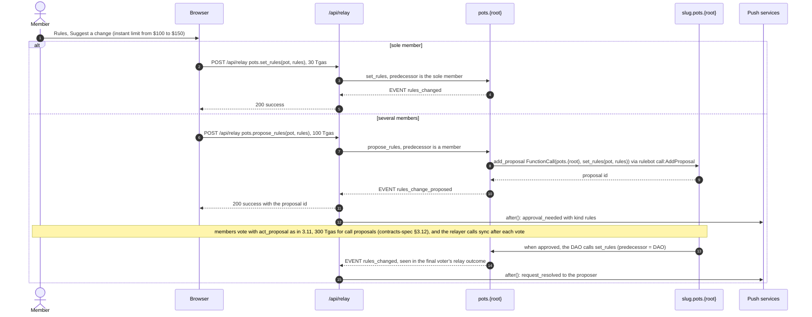

### 3.13 Close (D-09, P-9)

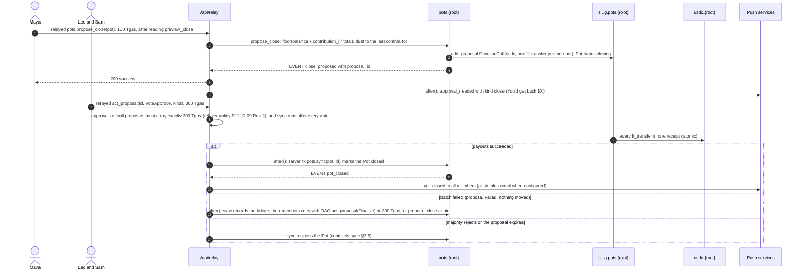

While a close is open the hub refuses contributions and spends (D-09), and the relayer pre-check returns `pot_closed` with `detail.status = "closing"` (copy ⓟ `pot.closing`).

### 3.14 Notification fan-out

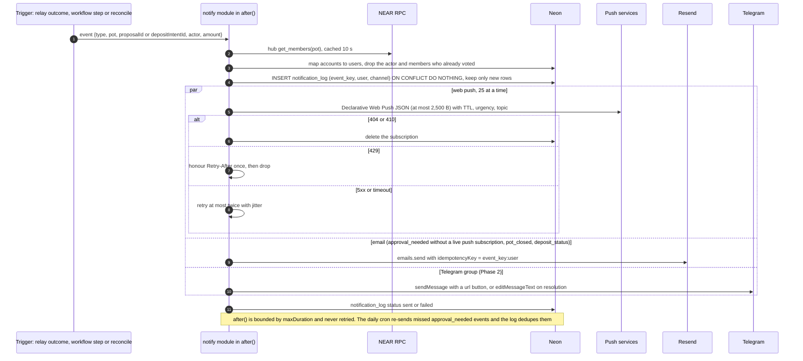

### 3.15 Demo pool: lease and refill (D-33)

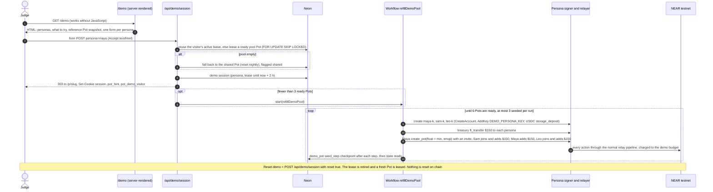

The seeded state matches D-61 Rev 1 and ux-spec §6: Lisbon Trip, Maya + Sam + Leo, $150 each, $450 in the Pot, no spends yet.

Rev 4 (review-security H-5): a new lease first passes BotID (the `/demo` page posts its form with `fetch` when JavaScript runs; a no-JS post gets a 303 to the read-only `/demo?ro=1`) and a per-IPv4-address / per-IPv6-/64 limit of 10 a day. The refill's hub costs count in `demo_yocto`. The shared fallback Pot gets fresh personas, refuses close and rules changes, and is reseeded below $300 (api-spec §2.8, §7.5).

## 4. Cross-cutting concerns

### 4.1 Idempotency and retry safety

| Layer | Key | Where enforced | Replay behaviour |
|---|---|---|---|
| Client intent | `idempotencyKey` = the op id: 16 chars of lowercase Crockford base32, generated once per user intent; for spends it is also the `request_ref` ([frontend-architecture.md](frontend-architecture.md) §6.1) | every side-effecting POST body | the same key + same body returns the stored result with `replayed: true`; same key + different body → 409 `idempotency_conflict` |
| Relay | `UNIQUE (user_id, idempotency_key)` and `UNIQUE (delegate_hash)` on `relay_log` (`delegate_hash` = sha256 of the signed delegate bytes) | `/api/relay`, `/api/devices`, pairing completion | a retried delegate, even under a new key, never reaches the chain twice |
| Delegate on chain | the delegate nonce: one execution per (account, key, nonce) | NEAR runtime ([meta-tx-relayer.md](../kb/meta-tx-relayer.md) rules table) | a second submission fails `DelegateActionInvalidNonce` and costs 0.000082 NEAR; pre-validation stops it first |
| Outer tx | the outer tx hash is computed and stored (`relay_log.outer_tx_hash`, status `signed`) **before** broadcast | relayer | see the timeout algorithm below |
| Server-signed txs (`sync`, `retry_payout`, top-ups, faucet, demo seeding, simulator delivery) | deterministic keys, e.g. `sync:{dao}:{pid}`, `topup:{dao}:{yyyymmddhh}`, `faucet:{user}:{clientKey}`, `seed:{demoPotId}:{step}` | `relay_log` unique key | at most once per key |
| Account creation | `app_user.auth_sub` unique + onboarding lease (30 s) | `/api/session` | resumes from chain state (3.1) |
| Cron | lease row `cron:reconcile` (15 min) and idempotent steps | `/api/cron/reconcile` | a double-fired run exits early |
| Workflows | checkpoint columns (`deposit_intent.status`, `demo_pot.seed_step`) re-read at the start of every step | Workflow steps | a retried step re-checks the chain before acting |

**Relayer timeout algorithm** (an RPC timeout leaves the outcome unknown):
1. Poll `tx_status(outer_tx_hash, relayer account, EXECUTED_OPTIMISTIC)` every 1 s for up to 20 s. Found → classify as normal.
2. Not found, and the relayer key's on-chain nonce is still below the outer tx nonce → re-broadcast the **same signed bytes** (same hash, so it can't land twice).
3. Not found, and the key nonce has moved past it → the outer tx was dropped. Read `view_access_key(sender, delegate key)`:
   - nonce < delegate nonce and the delegate isn't expired → sign a **new** outer tx around the unchanged delegate;
   - nonce ≥ delegate nonce → the delegate already executed somewhere: look it up by sender through the FastNEAR Tx API (`/v0/account`, ≈ 1-3 s after finality) and classify from there;
   - expired → mark `failed`, reason `expired`.
4. Still unknown after 25 s → respond `202 {status:"pending", relayId}`. The client polls `GET /api/relay/[relayId]` and the chain views.

**User nonces.** The client signs with `max(chain nonce, lastUsed) + 1` and keeps one delegate in flight per key (frontend §4.7). The relayer rejects a delegate whose nonce is ≤ the chain nonce (`nonce_used`) or ≤ the highest nonce of an in-flight delegate for the same key (`nonce_pending`, retry after 2 s).

### 4.2 Optimistic-UI contract with the frontend

The API never answers before the chain has executed the action (`EXECUTED_OPTIMISTIC`), so a 200 means "it happened". What the UI shows before that is the frontend's projection.

| Action | UI immediately (client) | API returns (median, p95 budget) | Then (client polling, D-32) | If it fails |
|---|---|---|---|---|
| Add money | `add.sending` chip, hero `+$150 on the way` | 200 + `contribution` event, ≈ 3-4 s / 8 s | `ft_balance_of(DAO)` at `final` reaches `executedAtBlock` (≈ +1.5 s) → hero counts up | `inner_failed` without the event → revert + `add.error.generic` (money refunded) |
| Instant spend | `spend.checking`, at least 1.2 s | early 200 with `path: instant`, `final: false`, `payout: pending` at ≈ 3 s ("Approved by Pot rules", D-07 Rev 2); then `GET /api/relay/[relayId]` → `final: true` with `payout: sent` or `failed` at ≈ 5-6 s | balance and request status at `final` | refusal → `inner_failed` → `spend.error.generic` / `preview.blocked.balance`; `path: vote` → `spend.became_vote`; payout failed → `feed.failed` |
| Vote request | `spend.vote_sent`, meter optimistic `1 of k` while the requester's own approval is in flight (frontend §5.3; rev3, was `0 of k`) | early 200 with `path: vote` and `proposalId`; then the client relays the requester's own vote automatically (D-61 Rev 2) → 200 + `proposalStatus` | proposal votes | — |
| Approve or decline | `approve.optimistic`, meter +1 | 200 + `proposalStatus` (re-read after execution) + payout state when it executed | `get_proposal` at `final` | `already_voted` → `approve.already`; `proposal_not_open` → refetch → `approve.decided.*` / `approve.expired` |
| Join | `setup.progress.2` | 200 + `member_joined`, ≈ 3-5 s | `get_members` | `inner_failed` with an invite error → `invite.*` |
| Create Pot | `create.progress` | 200 + `pot_created`, ≤ 15 s p95 (P-2) | `get_pots_of` | `slug_taken` → silent retry; quota → `create.error.limit` |
| Faucet | (part of Add money) | 200 + `txHash`, ≈ 2.5 s | the user's USDC balance | quota → ⓟ `faucet.limit` |
| New device | `confirm.waiting` | 200, ≈ 15-25 s | `view_access_key(account, new key)` | `confirm.failed` |

Every relay result carries `executedAtBlock` (K-14) and `txHash`. If the response is lost, the client retries the identical body (same `idempotencyKey`) and gets the stored outcome.

### 4.3 Error taxonomy (summary)

- **Shape:** errors are `{ok: false, reason, requestId, retryAfterMs?, txHash?, detail?}`, with `reason` a stable snake_case code. Success is `{ok: true, requestId, …}`. The full table, with HTTP status, retryability and the ux-spec copy key per flow, is [api-spec.md](api-spec.md) §1.
- **Classes:**
  - **Rejected before submission** (4xx: validation, auth, quota, policy): nothing was submitted and nothing was spent. Copy says "Nothing left your account / the Pot".
  - **Submitted, inner failure** (200, `outcome: "inner_failed"`, `error` = the raw panic text with its `ERR_*` substring, `errorCode` = the parsed code): the relayer paid gas, but the contract refused or refunded. The client maps `errorCode` to copy (frontend §4.8).
  - **Submitted, delegate rejected on chain** (409 `expired` / `nonce_used` with `txHash`): nothing executed; the client re-signs once.
  - **Unknown** (202 `pending`, or a network error): resolve through `GET /api/relay/[relayId]` and chain views.
  - **Infrastructure** (503 `service_unavailable` with `detail.cause` ∈ `rpc`, `db`, `relayer_busy`, `sponsor_low`, `global_cap`, `treasury`, `maintenance`): `relayer.down.banner` or `maintenance`.
- Raw panic texts are sanitized (RPC JSON can carry unescaped control characters from `assert_eq!` panics, [sputnik-dao.md](../kb/sputnik-dao.md) gotcha 11) and shown only under Details with the Advanced toggle.

### 4.4 Observability

| What | How |
|---|---|
| Request id | `requestId` = `req_` + ULID, generated per HTTP request, in the body of every JSON response and in the `x-request-id` header. ErrorDetails shows it with `txHash` and the receipt link (ux-spec `details.*`) |
| Structured logs | one JSON line per request: `{t, level, requestId, route, userId?, kind?, reason?, ms, txHash?, relayId?}`. Never log ID tokens, signing JWTs, emails, cookies, push keys or invite secrets |
| `relay_log` | one row per tx a server key signed or relayed: op, sender, receiver, methods, Pot, nonce, outer hash, status, outcome, `error_code`, gas burnt, yocto spent, events, timings ([data-model.md](data-model.md) §2) |
| `error_log` | 5xx responses, `inner_failed` outcomes, workflow step failures and alerts, kept 14 days, because Hobby keeps runtime logs for 1 hour ([backend-infra.md](../kb/backend-infra.md) R1) |
| Alerts | `alert_state` dedupe (≤ 1 per hour per key, [backend-infra.md](../kb/backend-infra.md) snippet 6), sent to `ALERT_WEBHOOK_URL` (a Discord or Slack incoming webhook a human sets up), else Resend to `ALERT_EMAIL`, else a `level: "alert"` log line. Keys: `relayer_low`, `relayer_critical`, `hub_low`, `treasury_low`, `global_cap_hit`, `mpc_failures`, `auth_jwks_down`, `rpc_degraded`, `workflow_stuck`; rev4: `hub_budget` (`global/hub_yocto` past 80 %) and `hub_key_used` (a tx signed by `pots.{root}` that isn't a planned deploy, checked by the cron, api-spec §5.3) |
| Health | `GET /api/health` (public, cached 15 s) feeds `relayer.down.banner` |
| Spend reports | SQL over `relay_log` (daily yocto by op, failures by reason); no dashboard service |

### 4.5 Rate limiting and quotas

Layers, cheapest first (numbers in [api-spec.md](api-spec.md) §3.1 and §3.5):

| # | Layer | Key | Scope | Notes |
|---|---|---|---|---|
| 1 | Vercel WAF rate-limit rule (Hobby allows exactly one) | IP | `POST` and `DELETE` on `/api/*`: 60 requests / 60 s → 429 | Per region counters are fine with one region ([backend-infra.md](../kb/backend-infra.md) R1) |
| 2 | BotID Basic `checkBotId()` | request | account creation (`POST /api/session` for a new `sub`), `create_pot` relays, `/api/faucet`, and (rev4) every **new** demo lease (`POST /api/demo/session`) | Bypass with `x-pot-ci-bypass: $BOTID_BYPASS_SECRET` for Playwright: the preview value on previews; on production only the nightly job's separate secret (GitHub Actions only, rotated after judging) |
| 3 | Burst bucket in Postgres | `user:{id}` (or `ip:{hash}` before login) | 20 writes per minute | `quota_usage` with a minute `period_start` |
| 4 | Daily per-user quotas | `user:{id}`, `email:{sha256}`, `account:{id}`; demo: `visitor:{hash}` and (rev4) `ipnet:{hash}` | per method family (contribute, spend, vote, join, create, invite, rules, close, maintenance, devices, faucet, notes, nudges); rev4: per-user NEAR budgets `relay_yocto` (0.2 NEAR) and `hub_yocto` (0.3 NEAR), and `Finalize` ≤ 3 per proposal | atomic upsert-with-limit ([data-model.md](data-model.md) §3) |
| 5 | Daily per-Pot quotas | `pot:{dao}` | spends and votes per Pot | protects the DAO's NEAR float (bond 0, §2.4) |
| 6 | Global daily caps | `global` | relayer yocto spent, hub yocto sponsored (rev4), accounts created, registrations (rev4), Pots created, MPC signs, faucet dollars, demo budget | circuit breaker → 503 `service_unavailable` with `cause: "global_cap"` |
| 7 | On-chain caps | hub state | per-Pot storage (invites, open requests), per-creator Pots per day; rev4: sponsored Pots per day globally, ≤ 1 open rules and ≤ 1 open close proposal per Pot, and direct calls pay their own cost | contracts-spec §3.0, INV-12, INV-18 |

All daily windows are UTC days. Quota checks that belong to one request run in one DB transaction, so a later failure doesn't consume earlier quotas.

### 4.6 Environments

| | Local | Preview | Production |
|---|---|---|---|
| URL | `http://localhost:3000` (exactly: port 3000, never `127.0.0.1`) | `https://<project>-git-<branch>-<team>.vercel.app`, behind Vercel Authentication | `https://pot-<team>.vercel.app` or the H-07 domain |
| NEAR network | testnet | testnet | testnet (1Click mainnet only for the recorded clip, D-50) |
| On-chain accounts | the **preview** set under `preview.<root>` (`pots.preview.<root>`, `users.preview.<root>`, `treasury.preview.<root>`; D-02 Rev 2) | preview set | production set: `pots.<root>`, `users.<root>`, hot `treasury.<root>` (refilled by hand from the cold `reserve.<root>`), shared `usdc.<root>` ([accounts-and-deploy.md](accounts-and-deploy.md) §1) |
| NEAR Auth login | ✅ the shared testnet client accepts only this origin (D-22) | ❌ callback mismatch → demo + NEAR Connect | ❌ until H-01 gives us a dedicated client (preferred) or a whitelist, **and** the nonce binding (B-20, F-27) is live (decide Nov 8; rev4) → demo + NEAR Connect |
| Dev session (`POST /api/session/dev`, rev3) | on (`FLAG_DEV_SESSION`) | on where `FLAG_DEV_SESSION` is set (G1, G2, hallway round B) | **never**: the route answers 404 whatever the flag says |
| Database | Neon branch `dev` | Neon branch `preview` (one branch for all previews; no migrations in preview builds unless per-PR branching is enabled) | Neon `main` |
| Cron | none (call `/api/cron/reconcile` by hand with the secret) | none (Vercel runs crons on production only) | daily (Hobby) or every minute (Pro) |
| Workflows | local dev runner ⚠️ verify the `workflow` dev story on Nov 1 | ✅ | ✅ |
| Push | dev VAPID pair | preview VAPID pair | production VAPID pair (never rotated) |
| Email | off | off | on only after H-07 |
| Telegram (Phase 2) | off | DevBot (needs the protection-bypass query on the webhook URL) | PotBot |
| 1Click | simulator | simulator | simulator; real API only in the clip build |
| BotID | off | on, CI bypass header accepted | on; only the nightly job's separate bypass secret is accepted (rev4: the nightly E-tier leases demo Pots on production; test-plan §5.2) |

### 4.7 Secrets

All are Vercel **Secret** env vars (write-only after save), with **different values per environment** and never added to Development except where noted ([backend-infra.md](../kb/backend-infra.md) R6).

| Name | Envs | Purpose |
|---|---|---|
| `RELAYER_KEYS` | prod, preview | comma-separated `ed25519:` secret keys, all full-access on `users.{root}` (8 in prod, 4 in preview) |
| `TREASURY_KEYS` | prod, preview | full-access keys on `treasury.{root}` (faucet, simulator delivery, demo seeding; 3 keys) |
| `DEMO_PERSONA_KEY` | prod, preview | the one key on every demo persona account (§2.3) |
| `APP_HMAC_SECRET` (≥ 32 chars) | all | IP-hash salt (`HMAC(secret, utc_date)`), demo visitor cookie MAC, pairing ids |
| `CRON_SECRET` | prod | `Authorization: Bearer` for the cron |
| `VAPID_PRIVATE_KEY` | per env | Web Push signing (public half in `NEXT_PUBLIC_VAPID_PUBLIC_KEY`, subject in `VAPID_SUBJECT`) |
| `RESEND_API_KEY` | prod | email (H-07) |
| `TELEGRAM_BOT_TOKEN`, `TELEGRAM_WEBHOOK_SECRET`, `TELEGRAM_BOT_INFO` | prod, preview (DevBot) | Phase 2 |
| `ONECLICK_API_KEY` | prod, optional | 1Click partner key (H-08); a bad key returns 401 for everything ([intents-1click.md](../kb/intents-1click.md)) |
| `FASTNEAR_API_KEY` | prod, preview, optional | server-side RPC from shared Vercel egress IPs |
| `DATABASE_URL`, `DATABASE_URL_UNPOOLED` | injected by the Neon integration | runtime pool / migrations |
| `BOTID_BYPASS_SECRET` | preview; rev4: a separate prod value for the nightly job only | Playwright on previews and the nightly production run (rotate after judging) |
| `ALERT_WEBHOOK_URL` | prod, preview | team alerts |
| `VERCEL_AUTOMATION_BYPASS_SECRET` | GitHub Actions only | e2e against protected previews |

Never in Vercel: the hub's deploy key (deleted on Nov 12, D-13), the `usdc.{root}` key (deleted on Nov 2, rev4), the root key, the cold `reserve.{root}` key and the recovery keys of the relayer and treasury ([accounts-and-deploy.md](accounts-and-deploy.md) §1.5).

**Key custody (rev4, review-security H-4; D-63):**
- The hub, root, reserve and treasury full-access keys (and every other full-access key we hold except the Vercel hot keys) are **never on disk in the macOS user account that runs AI coding agents**. The `.claude/settings.json` Read deny rules don't stop `Bash` (`cat`, `cp`, `python`) or a prompt-injected agent. They live in a separate macOS user, on a hardware wallet (`sign-with-ledger`), or in the password vault with import-on-demand into that separate user, removed after use.
- Signing runs in a terminal logged in as that custody user, never through `sudo` from the agent's shell (sudo caches its ticket).
- Agents only ever get the **preview relayer keys**, through env vars, for local development. Flows that need the treasury or persona keys are tested against the preview deployment.
- Never add Secret env vars to the Development environment (`vercel env pull` would bring them to a laptop). Key-loading modules import `server-only` and use `experimental.taintUniqueValue`. Keep Git Fork Protection on when the repo goes public.
- The cron alerts on any unplanned tx signed by the hub (`hub_key_used`, §4.4).

Non-secret config: `NEXT_PUBLIC_NETWORK`, `NEXT_PUBLIC_APP_URL`, `NEXT_PUBLIC_HUB_ID`, `NEXT_PUBLIC_USDC_ID`, `NEXT_PUBLIC_RPC_URLS`, `NEXT_PUBLIC_NEAR_AUTH_CLIENT_ID`, `RELAYER_ACCOUNT_ID`, `TREASURY_ACCOUNT_ID`, `DEMO_REFERENCE_POT`, `MPC_SIGN_DEPOSIT_YOCTO`, `QUOTA_*` overrides, `FLAG_*`.

### 4.8 Region `iad1`, Hobby vs Pro (D-30)

- **Region:** functions in `iad1` next to Neon `aws-us-east-1`; Workflow runs stay pinned to the region and deployment that started them; FastNEAR and dRPC are anycast. EU users pay ≈ +90 ms per API round trip, which is noise next to 2-5 s of chain latency ([backend-infra.md](../kb/backend-infra.md) R2).

| Concern | Hobby | Pro | Effect on Pot |
|---|---|---|---|
| Cron | once a day, fires anywhere in the hour | every minute | Reconcile catches actions that bypassed our relayer (self-paid wallet txs not reported, expiries) within 24 h on Hobby vs 1 min on Pro. Everything that goes through our relayer notifies immediately on both |
| WAF rate-limit rules | 1 | 40 | Per-user limits live in Postgres (K-6) |
| Runtime logs | 1 h | 1 day | `error_log` and `relay_log` in the DB (K-10) |
| Function duration | 300 s | up to 800 s | Our longest route (`/api/devices`, ≈ 25 s) fits both; set `maxDuration = 60` |
| Repo and team | public repo, or only the owner's commits deploy; non-commercial | both teammates; private repo OK | H-04 |
| Quota overrun | the feature pauses for 30 days | billed | Keep client polling on RPC, not on `/api/*` |
| Trial | — | 14 days, ends Nov 15, before judging (Nov 16-18) | Pay for November, or stay inside Hobby limits |

The design runs entirely on Hobby; Pro only shortens reconcile latency and keeps logs longer.

## 5. What this doc assumes about the companion specs

| # | Spec | Assumption | If it turns out false |
|---|---|---|---|
| S-1 | contracts-spec | ✅ Confirmed (§3.5, §3.6): `sync` and `retry_payout` accept any caller. The server calls `sync` after votes that change a hub-tracked proposal and after a failed payout (contracts OBJ-1), and the reconcile job syncs pending requests older than 7 days | — |
| S-2 | contracts-spec | ✅ Confirmed: event names and fields per contracts-spec §5, including `rules_change_proposed`, `spend_withdrawn` (rev5: Phase 3, not built) and `proposal_synced` | — |
| S-3 | contracts-spec | ✅ Confirmed: `ERR_*` codes per contracts-spec §3.13. Refusals of spends, joins and creations are returned as outcome values, not panics ([api-spec.md](api-spec.md) §3.4) | Unknown codes map to the flow's `*.error.generic` |
| S-4 | contracts-spec | ✅ Confirmed: slug `^[a-z0-9]+(-[a-z0-9]+)*$`, 2-32 chars, plus the reserved list of contracts-spec §3.2; the relayer mirrors both | — |
| S-5 | contracts-spec | ✅ Confirmed: the joiner signs `pot-join:v1:<dao_id>:<joiner>` (raw ed25519); `signature` is standard base64 (§3.7) | — |
| S-6 | contracts-spec / accounts-and-deploy | ✅ Resolved: `create_pot(…, float)` may only lower the float; demo seeding passes `min_dao_float` = 0.05 NEAR (§3.2) | — |
| S-7 | accounts-and-deploy | ✅ Account names, budgets, key counts (8 relayer, 3 treasury), the preview namespace `*.preview.<root>`, pool personas `maya-<k>` and pool Pots `lisbon-<k>` (§1.1) | Env config only |
| S-8 | frontend-architecture | Items A1-A12 of its §13, with the deltas listed in [api-spec.md](api-spec.md) §9.1 (`pop` also on `/api/devices`, extra reason codes, `pot_hint` content, demo `persona` includes `sam`) | Adjust the client types |

## 6. Open questions

| # | Question | Owner | Default until answered |
|---|---|---|---|
| Q-1 | Does the requester's own approval count (H-10)? | Cerasela + P1 | Yes, by default since D-61 Rev 2: the client relays the requester's `VoteApprove` right after a vote-path request (3.11). The relayer treats that pair as normal traffic |
| Q-2 | ~~Is 1 yocto enough as the `fast-auth.testnet.sign` deposit?~~ | — | **Resolved (Rev 4):** yes, proven on chain (tx `FzULQ33c…`, review-security F-6); `MPC_SIGN_DEPOSIT_YOCTO = 1`, no reserve |
| Q-3 | Remove a device on sign-out: allow a relayed `DeleteKey` of a non-MPC key on the sender's own account (Phase 2)? D-24 allows `AddKey` only | lead | The key stays on chain; its private half is deleted locally and `device.status = revoked` blocks device re-login. Rev4: deferred (review-security M-9, risk-register R-33); the README discloses it |
| Q-4 | Display names are readable by anyone who has the Pot slug (landing and OG card need them before login). Accept? | Cerasela | Rev4 default (review-security M-7): names only with an active invite link (`?i=`), for members and in demo Pots; anonymous feed reads get no names; the OG card shows initials |
| Q-5 | ux-spec §5.15's contribution push says "{potName} now has {balance}", but [notifications.md](../kb/notifications.md) N1 bans balances in push text | Cerasela | Drop the balance from push bodies |
| Q-6 | Hobby or Pro (H-04)? | human | Hobby-compatible design |
| Q-7 | Domain for Resend and the `VAPID_SUBJECT` mailto (H-07)? | human | Push + in-app only; `VAPID_SUBJECT = mailto:` a team inbox |
| Q-8 | New copy keys used by this spec: `faucet.limit`, `device.pair.*`, `pot.closing`, `generic.checking` (the last two are also frontend ⓟ) | Cerasela | API returns the reason; the client falls back to `generic.error` |
| Q-9 | ~~accounts-and-deploy.md made `lisbon-trip` both the reference Pot and the nightly-reset shared Pot~~ | — | **Resolved (decisions.md D-33 Rev 3):** `lisbon-trip` is never leased (stable README twins and `/demo` snapshot); the nightly shared Pot `lisbon-<yyyymmdd>` is pointed to by a `demo_pot` row, not by env ([api-spec.md](api-spec.md) §7.2). accounts-and-deploy.md and frontend-architecture.md now say the same |

## 7. Objections

| # | Decision | Evidence | Followed now | Proposed change |
|---|---|---|---|---|
| O-1 (**resolved, Rev 4**: 1 yocto is proven on chain, review-security F-6; D-21 now says 1 yocto with no reserve) | D-21: "The relayer keeps ≥ 2 NEAR free for each concurrent `fast-auth.testnet.sign`" | The observed testnet `sign` calls attach 1 yocto: ≈ 0.00075 NEAR of each one's cost is "the 1-yocto deposit-refund transfer receipt" ([near-auth.md](../kb/near-auth.md) gotchas, costs table), and the spike relayer uses a 1-yocto deposit ([relay.mjs](../spikes/near-auth/relay.mjs) `signDeposit: 1n`). The 2 NEAR figure is the Peersyst reference relayer's default `NEAR_MPC_DEPOSIT_AMOUNT` ([meta-tx-relayer.md](../kb/meta-tx-relayer.md)) | `MPC_SIGN_DEPOSIT_YOCTO` defaults to 2 NEAR, with a 2 NEAR reserve per MPC slot | Test one `sign` with 1 yocto on day 2 (≈ 0.0045 NEAR). If it succeeds, default to 1 yocto and size MPC slots by the 0.3 NEAR gas prepay instead |

O-2 (D-33's leftover cast and seeded state) was withdrawn: Revision 2 fixed D-33.
