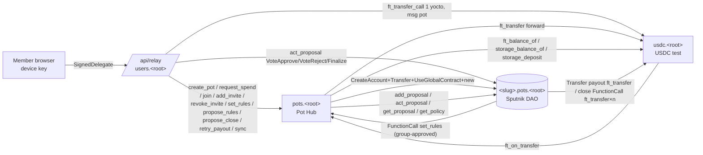
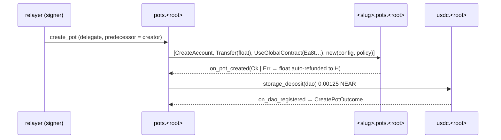
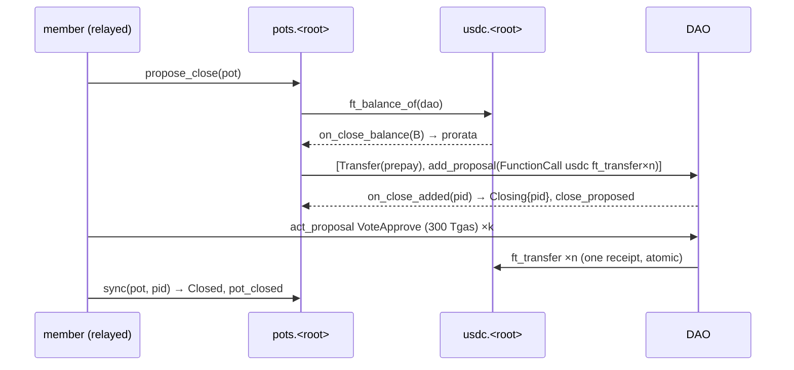

# Pot Hub contracts spec (v1.0)

> Owner: onchain-architect. Written 2026-10-21 for implementation on Nov 1-10 (the schedule is [implementation-plan.md](implementation-plan.md) §3.2 and §4; §10 below mirrors it).
> Binding inputs: [decisions.md](decisions.md) (cited as D-xx; §8 names are binding). Evidence: [../kb](../kb) (linked inline). Companion: [accounts-and-deploy.md](accounts-and-deploy.md).
> Readers: P1 (implementer), Cerasela (P2), Claude Code.
> Legend: ✅ verified in KB, spike or primary source · ⚠️ estimate or assumption (calibrate in the sandbox on Nov 4, task C-09) · 🆕 an addition beyond decisions.md §8 (listed again in §11; made binding by decisions.md Revision 3).
> **Rev 3 review (2026-10-21, [review.md](review.md)):** DAO float 0.05 NEAR on testnet (D-05 Rev 2; OBJ-2 accepted); 300 Tgas for every vote and `Finalize` on `call` proposals everywhere (OBJ-1 and OBJ-3 accepted too); the §10 day order now follows implementation-plan.md; `request_ref` is the client's 16-char op id; new view test T-88.
> **Rev 4 security fixes (2026-10-21, [review-security.md](review-security.md) §7, decisions.md Revision 4):** the hub sponsors NEAR only for calls signed by `config.relayers`; other callers attach the cost (`ERR_DEPOSIT_REQUIRED`, §3.0); a global daily cap on sponsored Pots (`ERR_GLOBAL_DAILY_LIMIT`); at most one open rules proposal (`ERR_RULES_PENDING`) and one open close proposal per Pot, plus a 24 h close cooldown (`ERR_CLOSE_COOLDOWN`); invites default to 7 days and 10 uses; instant spends need `contributed > 0` (reason `new_member`); new view `get_proposal_subject`; `set_config` bounded to ranges, `owner` immutable; prepay covers `member_count` votes; `sync` expires by the DAO's `submission_time`. New tests T-89…T-97 and PR-05 (§7.2).
> **Rev 5 (2026-10-21, decisions.md Revision 5):** the rulebot loses `transfer:RemoveProposal` (§3.2, `DaoAction`, INV-03, INV-16, T-85) and `withdraw_request` moves to **Phase 3, not built**: §3.6b keeps its spec and safety checks for later, while C-19, T-47/T-48, `spend_withdrawn` and the withdraw error codes are out of the v1 hub; §12 Q10 is resolved.
> No product code exists yet. Every Rust and TS block in this file is a signature, shape or pseudo-code sketch, not an implementation.
> **Revision 1 (2026-10-21).** This version follows decisions.md Revision 1:
> - demo cast Maya / Sam / Leo; Trip per-person limit $200;
> - `propose_rules` (D-07b);
> - `withdraw_request` (Phase 2) plus `transfer:RemoveProposal`;
> - invite links `/j/<slug>?i=<pk>#<secret>`.
>
> It is also aligned with the [architecture.md](architecture.md) and [frontend-architecture.md](frontend-architecture.md) drafts (env names, gas, view shapes; see §11).

---

## 0. TL;DR

1. **Three wasm artifacts, one of them ours.**
   - `pot-hub` is our code, deployed at `pots.<root>`.
   - `test-usdc` is vendored from `near-examples/FT@7721a494…`, deployed at `usdc.<root>`.
   - The Sputnik DAO code is used by global hash and is not ours: `Ea8t…` on testnet, `DtHZ…` on mainnet (D-03, D-11, D-12).
2. **The hub is both Rulebot and factory** (D-02). It creates `<slug>.pots.<root>` in one batch: `CreateAccount` → `Transfer(float)` → `UseGlobalContract(hash)` → `new({config, policy})`. It then registers the DAO with USDC.
3. **Instant spends use a four-hop chain:**
   1. a parallel pre-check: the DAO's USDC balance, the payee's USDC registration, and the live DAO member group;
   2. `add_proposal(Transfer)`, batched with a storage prepay;
   3. `act_proposal(VoteApprove, kind)`;
   4. a `get_proposal` re-read.

   The chain is ≈ 8 receipts deep (≈ 5-6 s ⚠️). Over-cap, over-budget and non-allowed-payee requests stop after `add_proposal`, and members vote directly in the DAO (D-07).
4. **The DAO's NEAR is self-funding.** It gets a float at creation: 0.05 NEAR on testnet (D-05 Rev 2; the prod and preview hubs both set `dao_float` = `min_dao_float` = 0.05) and 0.1 NEAR on the mainnet clip hub (§9.2). Callers may only ask for less than `dao_float`, down to `min_dao_float`. On top of that, **every hub-created proposal carries its own storage prepay**, a `Transfer` action in the same batch as `add_proposal`. This prepay is the "top it up" of D-05, and no off-chain job is needed.
5. **The budget counts instant spends only.** `instant_used(member)` is the sum of that member's rule-approved spends that are live or paid. Group-approved spends never use up a member's instant budget.
6. **`sync(pot, proposal_id)` is permissionless and idempotent.** It reconciles vote outcomes, payout failures, closes and pending joins. The relayer calls it after any vote or payout that changes a hub-tracked proposal (§3.5).
7. **Invites (D-08)** are ed25519 keys. The joiner signs the UTF-8 message `pot-join:v1:<dao_id>:<joiner_account_id>` and the hub checks it with `env::ed25519_verify`.
8. **Close (D-09)** is one `FunctionCall` proposal to USDC with ≤ 40 `ft_transfer` actions (5 Tgas each). Members are capped at 40 (§3.9).
   - The balance is the DAO's real USDC balance, read inside the same call chain.
   - Payouts are floor pro-rata, and the dust goes to the last contributor, so Σ = balance.
   - The relayer attaches **300 Tgas to votes on `call` proposals** (close, rules) and 100 Tgas to other votes.
9. **The owner** (`<root>`) can change only the float, the limits, the relayer list and a pause switch, each within a range fixed in code (§3.10). `set_config` has no transfer path: it can never move USDC or NEAR to an account, change rules or membership, or change `owner`, `usdc` / `dao_code_hash`. Until the Nov 12 lock, whoever holds the hub's full-access key can do anything (redeploy the hub, approve as the rulebot, push DAO code as the factory, INV-14); that is why the lock exists and why that key never sits where agents run (D-13, D-63 Rev 4). The token is locked on Nov 2 and the hub on Nov 12.
10. **Mainnet clip:** use the same pattern with code `DtHZ…`. Trezu's source loads any DAO by account id. Only its balance-tracking registration rejects ids that don't end in `.sputnik-dao.near` (§9).
11. **Rules (D-07b):**
    - `propose_rules`: a member's call makes the hub add a DAO `call` proposal for `set_rules`, and the group votes.
    - `set_rules` applies directly only when called by the DAO or by a sole member.
12. **Withdraw (D-07): Phase 3, not built during the hackathon (rev5).**
    - `withdraw_request` would let the requester remove their own still-pending vote request (§3.6b).
    - It needs the rulebot's `transfer:RemoveProposal`, which the day-1 policy no longer grants (D-04 Rev 5); adding it later takes a voted policy change in each Pot.
13. **Sponsorship (Rev 4, review-security C-1):** the hub pays NEAR (float, registration, prepay, new state) only when `env::signer_account_id()` is in `config.relayers` (our relayer; NEP-366 makes it the signer). Any other caller attaches the cost or gets `ERR_DEPOSIT_REQUIRED` (§3.0). On-chain caps: 3 Pots per creator per UTC day, 50 sponsored Pots per UTC day globally, ≤ 1 open rules proposal and ≤ 1 open close proposal per Pot.

---

## 1. Overview and contract list

### 1.1 Contracts

| Contract | Account (testnet) | Code | Who writes it | Notes |
|---|---|---|---|---|
| **Pot Hub** | `pots.<root>.testnet` (preview: `pots.preview.<root>.testnet`) | crate `contracts/pot-hub` → `target/near/pot_hub/pot_hub.wasm` | us (P1 + Claude Code) | Rulebot + factory + ledger for every Pot (D-02). Locked Nov 12 (D-13). |
| **USDC (test)** | `usdc.<root>.testnet` (shared by prod and preview) | crate `contracts/test-usdc` = `src/lib.rs` vendored verbatim from **`https://github.com/near-examples/FT` @ `7721a49423466bcd1104369dcea50229e64282fd`** (branch `master`, 2025-10-29, the latest commit on 2026-10-21 ✅) | vendored; we change only `Cargo.toml` | NEP-141/145, 6 decimals, `new(owner_id, total_supply, metadata)` mints everything to `owner_id`; **no mint method** (D-11) ✅ [fungible-tokens-usdc.md](../kb/fungible-tokens-usdc.md) |
| **Sputnik DAO v2** | `<slug>.pots.<root>.testnet` | **not ours**: global code by hash `Ea8tHXFSQVszVwGASyzAfLq65DjcRDhkfab4FcPaRpgD` (`sputnikdao2@278adc7`, 430,308 B) ✅ | near-daos | One DAO per Pot. No access keys. `factory_info.factory_id = pots.<root>` (set by `new`; see INV-14) ✅ source |

`test-usdc` vendoring rules:
- Upstream pins near-sdk 5.12.0, edition 2018 and toolchain 1.86 (✅ read at that commit).
- Copy `src/lib.rs` byte-for-byte. Our `Cargo.toml` uses `near-sdk = "=5.29.1"` and `near-contract-standards = "=5.29.1"` (D-12) and keeps `edition = "2018"` to avoid edition churn.
- Drop the upstream `near-workspaces 0.19` dev-dependency; our tests live in `contracts/tests`.
- Record the upstream commit in `contracts/test-usdc/UPSTREAM.md`.
- If 5.29.1 needs a source tweak (none expected: the file uses only `FungibleToken`, `LazyOption` and `StorageManagement`), keep it under 10 lines and note it there.

### 1.2 Architecture



### 1.3 Repo layout (D-64)

```
contracts/
  Cargo.toml                 # workspace: members = ["pot-hub", "test-usdc", "tests"], resolver "3"
  rust-toolchain.toml        # channel = "1.93.0", targets = ["wasm32-unknown-unknown"] (D-12)
  pot-hub/                   # [lib] crate-type = ["cdylib","rlib"]; near-sdk "=5.29.1"
    src/{lib.rs, types.rs, policy.rs, kinds.rs, ledger.rs, prorata.rs, events.rs, views.rs, ext.rs, errors.rs}
  test-usdc/                 # vendored near-examples/FT src/lib.rs + UPSTREAM.md
  tests/                     # near-workspaces =0.23.0 sandbox tests (package "pot-tests")
  res/sputnik/               # vendored third-party wasm + SHA256SUMS + fetch.sh (D-12)
```

Workspace `[profile.release]` is the cargo-near template: `codegen-units = 1`, `opt-level = "z"`, `lto = true`, `panic = "abort"`, **`overflow-checks = true`**. `[workspace.package] repository = "https://github.com/<org>/pot"` feeds NEP-330 metadata ✅ [contracts-toolchain.md](../kb/contracts-toolchain.md).

Build every contract with `cargo near build non-reproducible-wasm`, never with `cargo build` ✅. Output goes to `contracts/target/near/<crate>/<crate>.wasm`, plus ABI.

### 1.4 Vendored Sputnik artifacts (`contracts/res/sputnik/`)

| File | Bytes | NEAR code hash (base58) | sha256 (hex) | Source | Used for |
|---|---|---|---|---|---|
| `sputnikdao2_testnet_global_278adc7.wasm` | 430,308 | `Ea8tHXFSQVszVwGASyzAfLq65DjcRDhkfab4FcPaRpgD` | `c9a502ef08a06cef04e2fce82da60b1fbc78db3066ff41416110f4292fca39ce` ✅ (CLI `view-account-summary` of the spike DAO; base58 round-trip checked) | testnet RPC `view_global_contract_code` | sandbox build **A** = what testnet Pots run |
| `sputnikdao2_mainnet_v3_2.wasm` | 444,088 | `DtHZA1mUmGYeScEaUoUZYQGGFHSMpnjMCvkr5U9hJXuF` | `bf6f951ee5e45968e3367fa857bebf8bc80badec183998c2239c487237e0d7f6` ✅ | mainnet RPC `view_global_contract_code` | sandbox build **B** = mainnet clip |
| `sputnikdao_factory2_mainnet.wasm` 🆕 | 198,307 | `BXd5idTXSnC7WRfxHmi7z4crw2F5WXQJ6MZUEv8DfnnY` | `9c6d17411c2d0f634a27a7d5046272cffdc3aef1977f263c26bc71d64e14e675` ✅ | mainnet `view_code sputnik-dao.near` | **tests only**: its owner-only `store()` publishes a DAO wasm as global code in the sandbox. near-workspaces 0.23 has no global-contract tx actions ✅ |

`fetch.sh` (illustrative, adapted from the tested KB script):

```bash
set -euo pipefail; cd "$(dirname "$0")"
python3 - <<'EOF'
import json, base64, urllib.request
def q(url, params):
    body = json.dumps({"jsonrpc":"2.0","id":1,"method":"query","params":params}).encode()
    return json.load(urllib.request.urlopen(urllib.request.Request(url, body, {"Content-Type":"application/json"})))["result"]
T, M = "https://test.rpc.fastnear.com", "https://free.rpc.fastnear.com"
def gcode(url, h): return base64.b64decode(q(url, {"request_type":"view_global_contract_code","finality":"final","code_hash":h})["code_base64"])
open("sputnikdao2_testnet_global_278adc7.wasm","wb").write(gcode(T,"Ea8tHXFSQVszVwGASyzAfLq65DjcRDhkfab4FcPaRpgD"))
open("sputnikdao2_mainnet_v3_2.wasm","wb").write(gcode(M,"DtHZA1mUmGYeScEaUoUZYQGGFHSMpnjMCvkr5U9hJXuF"))
open("sputnikdao_factory2_mainnet.wasm","wb").write(base64.b64decode(q(M,{"request_type":"view_code","finality":"final","account_id":"sputnik-dao.near"})["code_base64"]))
EOF
shasum -a 256 -c SHA256SUMS   # commit SHA256SUMS with the three hex hashes above
```

`res/` is third-party code and fine to commit. Spikes are never copied (D-63).

---

## 2. Hub state layout

### 2.1 Contract struct and storage prefixes

All collections are `near_sdk::store` collections. Each one gets a 1-byte prefix (the variant index of a `BorshStorageKey` enum). Per-Pot data uses flat maps with composite keys that start with the Pot's `idx: u32`; collections are never nested.

```rust
#[near(serializers = [borsh])]
#[derive(BorshStorageKey)]
enum StorageKey { Pots, Members, MemberList, PotsOf, Requests, Subjects, Invites, Closes, CreatorDaily, PendingPots }

#[near(contract_state)]
#[derive(PanicOnDefault)]
pub struct PotHub {
    config: HubConfig,
    pot_count: u32,                                      // next Pot idx
    pots: LookupMap<AccountId, Pot>,                     // 0x00  DAO id → Pot header
    members: LookupMap<(u32, AccountId), Member>,        // 0x01  (pot idx, account) → Member
    member_list: LookupMap<(u32, u32), AccountId>,       // 0x02  (pot idx, join_index) → account (join order; used for views + close order)
    pots_of: LookupMap<AccountId, Vec<AccountId>>,       // 0x03  account → DAO ids where Active (≤ limits.max_pots_per_account)
    requests: LookupMap<(u32, u32), Request>,            // 0x04  (pot idx, request id) → Request
    subjects: LookupMap<(u32, u64), Subject>,            // 0x05  (pot idx, DAO proposal id) → what the hub created it for
    invites: LookupMap<(u32, [u8; 32]), Invite>,         // 0x06  (pot idx, ed25519 pk bytes) → Invite
    closes: LookupMap<u32, CloseRecord>,                 // 0x07  pot idx → latest close attempt
    creator_daily: LookupMap<AccountId, DailyCount>,     // 0x08  creator → (utc day, count)
    pending_pots: LookupSet<AccountId>,                  // 0x09  DAO ids whose creation batch is in flight
    sponsored_today: DailyCount,                         // rev4: sponsored (relayer-signed) create_pot calls this UTC day (global cap, §3.2)
}
```

### 2.2 Types

```rust
// ---- config ----
#[near(serializers = [borsh, json])]
pub struct HubConfig {
    pub owner: AccountId,                // <root>; may call set_config only; IMMUTABLE after new() (rev4)
    pub usdc: AccountId,                 // IMMUTABLE after new()
    pub dao_code_hash: Base58CryptoHash, // IMMUTABLE after new(): Ea8t… (testnet) / DtHZ… (mainnet)
    pub dao_float: NearToken,            // default float per DAO (D-05 Rev 2: 0.05 NEAR on testnet; 0.1 on the mainnet clip); range [0.05, 0.5] NEAR (rev4, §3.10)
    pub min_dao_float: NearToken,        // floor for create_pot(float) (0.05 NEAR); range [0.05 NEAR, dao_float] (rev4)
    pub relayers: Vec<AccountId>,        // rev4: ≤ 4 accounts whose signed (relayed) calls the hub sponsors (§3.0); [] on mainnet
    pub limits: Limits,
    pub paused: bool,
}
#[near(serializers = [borsh, json])]
pub struct Limits {
    pub max_members: u32,                  // default 40; hard cap 40 (close gas, §3.9)
    pub max_pots_per_creator_per_day: u32, // default 3 (C5); UTC day; counts every creation, sponsored or not
    pub max_sponsored_pots_per_day: u32,   // rev4: default 50; global per UTC day, sponsored creations only (incl. demo seeding)
    pub max_pots_per_account: u32,         // default 100 (bounds pots_of)
    pub max_active_invites: u32,           // default 20 per Pot
    pub max_invites_total: u32,            // default 100 per Pot (incl. revoked)
    pub max_pending_per_member: u32,       // default 10 open vote-path requests per requester
    pub max_requests_per_pot: u32,         // default 1000
    pub min_hub_reserve: NearToken,        // default 2 NEAR of free balance the hub never spends below
}

// ---- pot ----
#[near(serializers = [borsh])]
pub struct Pot {
    pub idx: u32,
    pub seq: u64,                      // change counter: +1 on EVERY hub-side change of this Pot (cheap poll target for the UI)
    pub slug: String,
    pub name: String,
    pub emoji: Option<String>,         // cover emoji (D-61: covers are emoji + gradient); ≤ 16 bytes, no control chars
    pub preset: Preset,
    pub rules: Rules,
    pub rules_version: u32,            // 1 at creation, +1 per change
    pub status: PotStatus,
    pub creator: AccountId,
    pub created_at_ms: u64,
    pub closed_at_ms: u64,             // 0 until Closed
    pub closing_until_ms: u64,         // > now ⇒ a propose_close chain is in flight (blocks money in)
    pub busy_until_ms: u64,            // > now ⇒ a contribution or instant spend is in flight (blocks propose_close)
    pub member_count: u32,             // Active members
    pub joining_count: u32,            // members in Joining
    pub next_join_index: u32,          // next member join_index
    pub request_seq: u32,              // next request id
    pub active_invites: u32,
    pub invites_total: u32,
    pub unpaid_approved: u32,          // requests in PayoutFailed (blocks propose_close)
    pub open_requests: u32,            // Vote requests in {Checking, Proposing, Pending} (ClosePreview.open_requests)
    pub total_contributed: u128,       // Σ recorded contributions (never decreases)
    pub spent_instant: u128,           // Σ amount of Instant requests in Approved
    pub spent_vote: u128,              // Σ amount of Vote requests in Approved (known via sync)
    pub reserved: u128,                // Σ amount of Instant requests in {Checking, Proposing, Approving, PayoutFailed}
    pub last_contributor: Option<AccountId>,
    pub float: NearToken,              // float transferred at creation
    pub open_rules_proposal: Option<u64>, // rev4: the hub-created rules proposal still open (≤ 1 per Pot, §3.8); cleared by sync
}
#[near(serializers = [borsh])]
pub enum PotStatus { Open, Closing { proposal_id: u64 }, Closed }   // binding variants (task brief)

#[near(serializers = [borsh, json])] #[serde(rename_all = "snake_case")]
pub enum Preset { Trip, Club, Team, Custom }

#[near(serializers = [borsh, json])]
pub struct Rules {
    pub instant_cap: U128,             // max amount of ONE instant spend; "0" = no instant spends
    pub member_budget: U128,           // max Σ instant spends per member over the Pot's life
    pub instant_payees: PayeeRule,
    pub payee_allowlist: Vec<AccountId>, // ≤ 10; used only with MembersAndAllowlist
}
#[near(serializers = [borsh, json])] #[serde(rename_all = "snake_case")]
pub enum PayeeRule { Members, MembersAndAllowlist }

// ---- members ----
#[near(serializers = [borsh])]
pub struct Member {
    pub join_index: u32,               // join order (0 = creator); NOT the Pot change counter `seq`
    pub status: MemberStatus,
    pub joined_at_ms: u64,
    pub invite_pk: Option<[u8; 32]>,   // None for the creator
    pub contributed: u128,
    pub instant_used: u128,            // budget used (see §2.4)
    pub spent: u128,                   // Σ this member's requests (any path) in Approved
    pub pending_votes: u32,            // this member's Vote requests in {Checking, Proposing, Pending}
}
#[near(serializers = [borsh])]
pub enum MemberStatus { Joining { proposal_id: Option<u64> }, Active }

// ---- requests ----
#[near(serializers = [borsh])]
pub struct Request {
    pub id: u32,
    pub requester: AccountId,
    pub receiver_id: AccountId,
    pub amount: u128,
    pub category: Category,
    pub request_ref: String,           // ^[a-z0-9]{8,32}$, links the off-chain memo (D-07)
    pub path: Path,
    pub reason: Reason,
    pub status: RequestStatus,
    pub proposal_id: Option<u64>,
    pub created_at_ms: u64,
    pub updated_at_ms: u64,
}
#[near(serializers = [borsh, json])] #[serde(rename_all = "snake_case")]
pub enum Path { Instant, Vote }
#[near(serializers = [borsh, json])] #[serde(rename_all = "snake_case")]
pub enum Reason { WithinRules, OverCap, OverBudget, PayeeNotAllowed, NewMember /* rev4 */, AutoApproveFailed }
#[near(serializers = [borsh, json])] #[serde(rename_all = "snake_case")]
pub enum RequestStatus { Checking, Proposing, Approving, Pending, Approved, PayoutFailed, Rejected, Expired, Removed }
#[near(serializers = [borsh, json])] #[serde(rename_all = "snake_case")]
pub enum Category { Groceries, Food, Transport, Stay, Tickets, Other }   // = ux-spec reason chips

// ---- invites, subjects, close ----
#[near(serializers = [borsh])]
pub struct Invite {
    pub created_by: AccountId,
    pub created_at_ms: u64,
    pub expires_at_ms: u64,            // rev4: always set; default now + 7 d, at most now + 30 d (§3.7)
    pub max_uses: u32,                 // rev4: always set; default 10, at most 40
    pub uses: u32,
    pub revoked_at_ms: Option<u64>,
}
#[near(serializers = [borsh])]
pub enum Subject { Spend { request_id: u32 }, Join { member: AccountId }, Close, Rules { version: u32 } }

#[near(serializers = [borsh])]
pub struct CloseRecord {
    pub proposal_id: Option<u64>,      // None while Proposing
    pub status: CloseStatus,
    pub balance: u128,                 // DAO USDC balance read in the same chain
    pub payouts: Vec<(AccountId, u128)>, // join order, zero payouts omitted
    pub dust: u128,
    pub dust_to: AccountId,
    pub proposed_by: AccountId,
    pub created_at_ms: u64,
}
#[near(serializers = [borsh])]
pub enum CloseStatus { Proposing, Pending, Approved, Failed, Rejected, Expired }

#[near(serializers = [borsh])]
pub struct DailyCount { pub day: u32, pub count: u32 }   // day = block_timestamp_ms / 86_400_000
```

### 2.3 Constants

| Constant | Value | Why |
|---|---|---|
| `VERSION` | `"1.0.0"` | `get_config` |
| `ROLE_MEMBER` / `ROLE_RULEBOT` | `"member"` / `"rulebot"` | hard-coded (D-04, D-05) |
| `PROPOSAL_PERIOD_NS` | `604_800_000_000_000` (7 days) | D-04 |
| `JOIN_DOMAIN` | `"pot-join:v1"` | D-08 |
| `MIN_SLUG_LEN` / `MAX_SLUG_LEN` | 2 / 32, and the full id `<slug>.<hub>` must be ≤ 64 | AccountId rules ✅; same grammar as the relayer ([architecture.md](architecture.md) S-4) |
| `MAX_NAME_CHARS` | 48 (after `trim()`, no control chars) | |
| `MAX_ALLOWLIST` | 10 | |
| `MAX_AMOUNT` | `1_000_000_000_000_000` (1e15 = $1B at 6 dp, the test-USDC supply) | keeps `balance × c_i ≤ 1e30 < u128::MAX` ✅ [contracts-patterns.md](../kb/contracts-patterns.md) §F |
| `HARD_MAX_MEMBERS` | 40 | a 40-payee close vote needs ≈ 231 Tgas, inside the relayer's 300 Tgas `call`-vote cap with margin (§3.9). Club's ≈ 30 members fit. |
| `DEFAULT_INVITE_TTL_MS` / `DEFAULT_INVITE_MAX_USES` | 7 days / 10 (rev4; was 30 days, unlimited) | the invite `create_pot` makes, and `add_invite` with no expiry or max uses (review-security H-1) |
| `MAX_INVITE_TTL_MS` / `MAX_INVITE_USES` | 30 days / 40 (rev4) | `add_invite` bounds; 40 = the member cap |
| `CLOSE_COOLDOWN_MS` | 86_400_000 (24 h, rev4) | the same member can't propose a close again for 24 h after their close was Rejected or Expired (§3.9) |
| `MIN_DAO_FLOAT_BOUND` / `MAX_DAO_FLOAT` | 0.05 / 0.5 NEAR (rev4) | `new` / `set_config` ranges (§3.10) |
| `MIN_HUB_RESERVE_BOUND` / `MAX_RELAYERS` | 0.5 NEAR / 4 (rev4) | same |
| `BUSY_WINDOW_MS` / `CLOSING_WINDOW_MS` | 60_000 / 60_000 | self-healing in-flight guards (a stuck chain can block close for ≤ 60 s) |
| `USDC_STORAGE_DEPOSIT` | 0.00125 NEAR (`1250000000000000000000`) | `storage_balance_bounds` ✅ |
| Gas constants | see §8.2 | |

### 2.4 Ledger and accounting (exact definitions)

A request contributes to counters according to its `(path, status)`. A single function `apply_transition(pot, member, req, (old_path, old_status) → (new_path, new_status))` subtracts the old tuple's contributions and adds the new tuple's. It is the only code that changes these counters. This guarantees exactly-once accounting (INV-06).

| Counter | Counts `amount` (or 1) of requests with… |
|---|---|
| `member.instant_used` (budget used) | path `instant`, status ∈ {checking, proposing, approving, approved, payout_failed} |
| `pot.reserved` | path `instant`, status ∈ {checking, proposing, approving, payout_failed} |
| `pot.spent_instant` | path `instant`, status = approved |
| `pot.spent_vote` | path `vote`, status = approved |
| `member.spent` (requester) | any path, status = approved |
| `member.pending_votes` (count) | path `vote`, status ∈ {checking, proposing, pending} |
| `pot.unpaid_approved` (count) | any path, status = payout_failed |
| `pot.open_requests` (count) | path `vote`, status ∈ {checking, proposing, pending} |

`pot.seq` (the change counter) is incremented exactly once per state-changing call or callback that touches the Pot: contribution, request transition, join, invite, rules, close and sync. Views are O(1) or O(members ≤ 40) / O(limit ≤ 50) reads, so the UI can poll `get_pot` cheaply. The RPC `call_function` response already carries `block_height`, so no contract field is needed for "read at height".

The terms used elsewhere in this spec:

- **Budget** (D-60 "per-member budget"): instant is allowed only if `instant_used + amount ≤ rules.member_budget`.
  - Vote-approved spends **do not** count, because the group sanctioned them.
  - ux-spec copy should read "Each person can spend up to $200 in total **without asking**".
- **Balance used for decisions:** the DAO's real USDC balance, read in-chain, minus the `reserved` of other in-flight requests.
- **`balance_estimate`** (views only) = `total_contributed − spent_instant − spent_vote`, saturating. The authoritative balance is `usdc.ft_balance_of(<dao>)`. Clients pass it into the views that take a `balance` argument.

### 2.5 Lifecycles

```mermaid
stateDiagram-v2
  [*] --> Open: on_pot_created Ok
  Open --> Open: propose_close in flight (closing_until_ms)
  Open --> Closing: on_close_added Ok (proposal_id)
  Closing --> Closed: sync → DAO Approved
  Closing --> Open: sync → Rejected / Expired / Removed
  Closing --> Closing: sync → Failed (CloseRecord.Failed; propose_close allowed again)
  Closed --> [*]
```

```mermaid
stateDiagram-v2
  [*] --> checking: request_spend (reservation if instant)
  checking --> [*]: refused (record deleted, reservation released)
  checking --> proposing: on_spend_checked ok
  proposing --> [*]: add_proposal failed (refused add_failed)
  proposing --> approving: on_spend_added (instant)
  proposing --> pending: on_spend_added (vote)
  approving --> approved: re-read Approved (hub vote counted)
  approving --> pending: re-read InProgress (path→vote, reason auto_approve_failed)
  approving --> rejected: re-read Rejected
  approving --> payout_failed: re-read Failed (rare in-chain; usually via sync)
  pending --> approved: sync Approved
  pending --> rejected: sync Rejected
  pending --> expired: sync Expired / InProgress past period
  pending --> removed: sync Removed (withdraw_request is Phase 3, rev5)
  approved --> payout_failed: sync Failed
  payout_failed --> approved: retry_payout / sync Approved
  payout_failed --> expired: sync Expired
  expired --> approved: sync Approved late (rev4, the DAO is the truth)
  expired --> payout_failed: sync Failed late (rev4)
```





---

## 3. Methods

### 3.0 Conventions

- **Auth (D-05, INV-01):** only `env::predecessor_account_id()`. Under NEP-366 the predecessor is the user and `signer_account_id()` is the relayer ✅ ([meta-tx-relayer.md](../kb/meta-tx-relayer.md)). `signer_account_id` is never used for authorization; since rev4 it decides only **who pays** (Sponsorship, below).
- **Deposits:** the six hub-funded methods (`create_pot`, `request_spend`, `join`, `add_invite`, `propose_rules`, `propose_close`) are `#[payable]` **only** so that direct callers can pay their own way (Sponsorship, below). Every other public hub method stays **non-payable**: near-sdk rejects any deposit with `Method <name> doesn't accept deposit`. Our relayer never attaches a deposit to a hub call (api-spec §3.1); the only deposit it pays is the 1 yocto on `usdc.ft_transfer_call` (D-24).
- **Sponsorship (rev4, review-security C-1).** A call that makes the hub spend NEAR (DAO float, USDC registration, proposal prepay, new hub state) is *sponsored* only when `env::signer_account_id() ∈ config.relayers`. Under NEP-366 the signer of the inner receipt is the relayer and can't be spoofed ✅ ([meta-tx-relayer.md](../kb/meta-tx-relayer.md)); authorization still uses the predecessor.
  - **Sponsored:** the hub pays. The relayer attaches 0; anything attached is kept by the hub.
  - **Not sponsored** (a direct, self-paid tx, a wallet without `signDelegateActions`, a CLI script, another relayer, every call on the mainnet hub where `relayers = []`): `attached_deposit ≥ cost(op)`, else panic `ERR_DEPOSIT_REQUIRED: <cost in yocto>` (a synchronous panic refunds the deposit). The hub keeps `cost(op)` and refunds any excess to the predecessor in the same call. A refusal discovered later in a callback (e.g. `payee_not_registered`, `dao_create_failed`) does **not** refund `cost(op)`.
  - `cost(op)` = the NEAR the hub sends out for that op (float + 0.00125 registration, or the prepay of §3.11) + its new hub state at the §8.4 sizes. Values to attach, which always cover it at the current limits:

    | Method | Attach (testnet, float 0.05) | Mainnet clip (float 0.1) |
    |---|---|---|
    | `create_pot` | `dao_float` + 0.02 NEAR = 0.07 | 0.12 |
    | `join` | 0.02 | 0.02 |
    | `request_spend` | 0.06 (covers a 40-member vote prepay, ≈ 0.049) | 0.06 |
    | `add_invite` | 0.005 | 0.005 |
    | `propose_rules` | 0.06 | 0.06 |
    | `propose_close` | 0.15 (covers 40 payees, ≈ 0.143) | 0.15 |

  - Only sponsored `create_pot` calls count toward `limits.max_sponsored_pots_per_day`; every creation counts toward the per-creator cap. Everything else (per-Pot caps, `min_hub_reserve`) applies to both paths.
- **Callbacks:** `#[private]` (the near-sdk message is `Method <name> is private`). Every result is read with `#[callback_result] Result<T, PromiseError>`. A callback **never panics**: it records the failure, releases reservations and returns an outcome value (INV-07).
- **Gas:** every hop uses `.with_static_gas(X).with_unused_gas_weight(0)`, so budgets are deterministic. "Caller gas" is what the relayer or CLI attaches.
- **Errors:** synchronous checks panic with `env::panic_str("ERR_<CODE>")` or `"ERR_<CODE>: <detail>"`. Clients match the `ERR_` prefix (§3.13). Failures discovered in a callback are returned as outcome values with a `reason`.
- **Amounts:** `U128` JSON strings in base units (USDC 6 dp: `$84` = `"84000000"`). NEAR amounts are `NearToken` yocto strings. Proposal ids are JSON numbers (u64). Request ids are u32. Timestamps are ms u64 JSON numbers (safe in JS). Contract JSON is **snake_case**; `packages/pot-sdk` maps it to the camelCase types of [frontend-architecture.md](frontend-architecture.md) (mapping in §11).
- **Free balance:** `free = env::account_balance() − env::storage_usage() × env::storage_byte_cost()`. Any call that makes the hub spend NEAR first requires `free ≥ spend + limits.min_hub_reserve`, else it panics with `ERR_HUB_LOW_BALANCE`.

**External interfaces** (`ext.rs`; JSON shapes match both Sputnik builds ✅ source diff 278adc7 vs 2b0f34a):

```rust
#[ext_contract(ext_ft)]
trait Ft {
    fn ft_transfer(&mut self, receiver_id: AccountId, amount: U128, memo: Option<String>);   // 1 yocto
    fn ft_balance_of(&self, account_id: AccountId) -> U128;
    fn storage_balance_of(&self, account_id: AccountId) -> Option<StorageBalanceLite>;     // null = unregistered
    fn storage_deposit(&mut self, account_id: Option<AccountId>, registration_only: Option<bool>) -> StorageBalanceLite;
}
#[ext_contract(ext_dao)]
trait Dao {
    fn act_proposal(&mut self, id: u64, action: DaoAction, proposal: DaoKind, memo: Option<String>); // ALWAYS pass proposal (D-05)
    fn get_proposal(&self, id: u64) -> DaoProposalLite;
    fn get_policy(&self) -> DaoPolicyLite;
}
// add_proposal is always sent as a low-level batch so a Transfer(prepay) can precede it (§3.11):
//   Promise::new(dao).transfer(prepay).function_call("add_proposal", json!({"proposal": {"description": d, "kind": k}}), 0, GAS_ADD)
#[near(serializers=[json])] pub enum DaoAction { VoteApprove, Finalize }  // → "VoteApprove" | "Finalize" (rev5: no RemoveProposal; withdraw is Phase 3)
#[near(serializers=[json])] pub enum DaoKind {                                     // externally tagged, = Sputnik JSON
    Transfer { token_id: String, receiver_id: AccountId, amount: U128, msg: Option<String> },
    AddMemberToRole { member_id: AccountId, role: String },
    FunctionCall { receiver_id: AccountId, actions: Vec<DaoActionCall> },
}
#[near(serializers=[json])] pub struct DaoActionCall { pub method_name: String, pub args: Base64VecU8, pub deposit: U128, pub gas: U64 }
#[near(serializers=[json])] pub struct DaoProposalLite { pub status: String, pub votes: HashMap<AccountId, String>, pub submission_time: U64 } // rev4: submission_time (ns) for expiry (§3.5); other fields ignored
#[near(serializers=[json])] pub struct DaoPolicyLite { pub roles: Vec<DaoRoleLite> }
#[near(serializers=[json])] pub struct DaoRoleLite { pub name: String, pub kind: serde_json::Value }               // {"Group":[..]}
```

**Kind builders** (`kinds.rs`; these are the only shapes the hub may ever propose, INV-02). They are deterministic, so the same inputs rebuild the same kind for `act_proposal`, and the kind is never stored.

| Builder | JSON (exact) |
|---|---|
| `transfer_kind(usdc, receiver, amount)` | `{"Transfer":{"token_id":"usdc.<root>.testnet","receiver_id":"<receiver>","amount":"<amount>","msg":null}}` |
| `join_kind(joiner)` | `{"AddMemberToRole":{"member_id":"<joiner>","role":"member"}}` |
| `close_kind(usdc, payouts)` | `{"FunctionCall":{"receiver_id":"usdc.<root>.testnet","actions":[{"method_name":"ft_transfer","args":"<b64 {\"receiver_id\":\"<m>\",\"amount\":\"<a>\",\"memo\":\"pot refund\"}>","deposit":"1","gas":"5000000000000"}, …]}}` |
| `rules_kind(hub, pot, rules)` | `{"FunctionCall":{"receiver_id":"pots.<root>.testnet","actions":[{"method_name":"set_rules","args":"<b64 {\"pot\":\"<dao>\",\"rules\":{…}}>","deposit":"0","gas":"15000000000000"}]}}` |

Descriptions are ASCII and contain no user text beyond the category (D-07):

- spend: `"Pot request #<id>: <category> (ref <request_ref>)"`
- join: `"Pot join via invite"`
- close: `"Pot close-out: refund <balance> to <n> members"`
- rules: `"Pot rules change v<n>"`

The Transfer `description` becomes the `ft_transfer` memo ✅ [sputnik-dao.md](../kb/sputnik-dao.md) R8.

### 3.1 `new` (init)

```rust
#[init]
pub fn new(owner: AccountId, usdc: AccountId, dao_code_hash: Base58CryptoHash,
           dao_float: NearToken, min_dao_float: NearToken, relayers: Vec<AccountId> /* rev4 */, limits: Option<Limits>) -> Self
```

```json
{"owner":"<root>.testnet","usdc":"usdc.<root>.testnet","dao_code_hash":"Ea8tHXFSQVszVwGASyzAfLq65DjcRDhkfab4FcPaRpgD",
 "dao_float":"50000000000000000000000","min_dao_float":"50000000000000000000000",
 "relayers":["users.<root>.testnet"],"limits":null}
```

- **Validation:** the ranges of §3.10 (rev4): `dao_float` ∈ [0.05, 0.5] NEAR, `min_dao_float` ∈ [0.05 NEAR, `dao_float`] (DAO base storage ≈ 0.012 ✅), `relayers.len() ≤ 4`, every limit inside its range (`max_members ≤ 40`, …); else `ERR_CONFIG_INVALID`. `limits: null` means the defaults in §2.2. The preview hub passes `["users.preview.<root>.testnet"]`, the mainnet hub `[]` (§9.2).
- **Deploy-time step** (not part of `new`): register the hub with USDC (`storage_deposit`). See [accounts-and-deploy.md](accounts-and-deploy.md) §3.
- **Gas** < 5 Tgas. Attach 30 Tgas.

### 3.2 `create_pot`

```rust
pub fn create_pot(&mut self, slug: String, name: String, preset: Preset, rules: Option<Rules>,
                  invite_pk: Option<PublicKey>,
                  emoji: Option<String> /* 🆕 cover emoji, frontend A9 */, float: Option<NearToken> /* 🆕 */) -> Promise
```

```json
{"slug":"lisbon-trip-7k2f","name":"Lisbon Trip","preset":"trip","rules":null,
 "invite_pk":"ed25519:7CUDgW32…","emoji":"🇵🇹","float":null}
```

| Aspect | Spec |
|---|---|
| Access | any account (the creator is the predecessor). Not paused. Deposit: 0 when sponsored (signer ∈ `config.relayers`); otherwise ≥ `cost(op)` (§3.0, rev4). |
| Caller gas | **150 Tgas** (needs ≈ 65; the 300 in [architecture.md](architecture.md) also works, and the surplus is refunded) |
| Synchronous checks (panic, no state change) | `ERR_PAUSED`; slug rules (below) → `ERR_SLUG_INVALID` / `ERR_SLUG_RESERVED`; `<slug>.<hub>` in `pots` or `pending_pots` → `ERR_SLUG_TAKEN`; name → `ERR_NAME_INVALID` (rev4: also rejects Unicode format characters (Cf) except ZWJ U+200D and VS16 U+FE0F); `emoji` (if set) must be 1-16 bytes UTF-8 with **no ASCII bytes** and no Cf other than U+200D/U+FE0F → `ERR_EMOJI_INVALID` (rev4, review-security L-4); `preset == custom` with `rules: null` → `ERR_RULES_INVALID` (rev3: `custom` has no default rules); `rules.unwrap_or(preset.default())` → `validate_rules` → `ERR_RULES_INVALID`; creator's `DailyCount` for today ≥ limit → `ERR_CREATOR_DAILY_LIMIT`; sponsored and `sponsored_today` for today ≥ `max_sponsored_pots_per_day` → `ERR_GLOBAL_DAILY_LIMIT` (rev4); not sponsored and `attached < cost` → `ERR_DEPOSIT_REQUIRED` (rev4); `pots_of(creator).len() ≥ max_pots_per_account` → `ERR_TOO_MANY_POTS`; `invite_pk` not ed25519 → `ERR_INVITE_PK_INVALID`; `free < float + 0.00125 + reserve` → `ERR_HUB_LOW_BALANCE`; creator == hub → `ERR_NOT_MEMBER` |
| Float | `f = clamp(float.unwrap_or(config.dao_float), config.min_dao_float, config.dao_float)`. Callers can only ask for **less** than the default. The D-33 demo pool passes `min_dao_float`. |
| State before the promise | `pending_pots.insert(dao)`; creator `DailyCount += 1`; if sponsored, `sponsored_today += 1` (rev4); if not sponsored, refund `attached − cost` to the creator |
| Promise (hop 1, to the **new** account) | `Promise::new(dao).create_account().transfer(f).use_global_contract(config.dao_code_hash).function_call("new", new_args, 0, GAS_DAO_NEW=20 Tgas)` |
| Callback (hop 2) | `.then(on_pot_created(dao, slug, name, emoji, preset, rules, creator, invite_pk, f))`, static **30 Tgas**, `#[callback_result] r: Result<(), PromiseError>` (`new` returns nothing, so the empty result is `Ok(())`) ✅ [contracts-patterns.md](../kb/contracts-patterns.md) A.5 |
| `on_pot_created` Ok | insert `Pot` (idx = `pot_count++`, status Open, `rules_version` 1); creator `Member{join_index 0, Active}`; `member_list[(idx,0)]`; `pots_of[creator].push(dao)`; optional `Invite{created_by: creator, expires: now + 7 d, max_uses: 10}` (rev4; was 30 d, unlimited); `pending_pots.remove`; emit `pot_created` (+ `invite_added`). Then, if `free ≥ 0.00125`, return `usdc.storage_deposit({account_id: dao, registration_only: true})` with 0.00125 NEAR and **10 Tgas**, `.then(on_dao_registered(dao))` (**5 Tgas**). Otherwise return the outcome with `usdc_registered: false`. |
| `on_pot_created` Err | `pending_pots.remove`; creator `DailyCount −= 1` (and `sponsored_today −= 1` if it was sponsored); return `{"ok":false,"pot":dao,"reason":"dao_create_failed"}`. The batch reverted, so **the float is refunded to the hub automatically** (deposit refunds go to the receipt's predecessor = hub) and the DAO account does not exist ✅ [sputnik-dao.md](../kb/sputnik-dao.md) R2 (same mechanism) |
| Returns (final value) | `CreatePotOutcome {"ok":true,"pot":"lisbon-trip-7k2f.pots.<root>.testnet","slug":"lisbon-trip-7k2f","float":"50000000000000000000000","usdc_registered":true}` |
| Events | `pot_created`, `invite_added` (if `invite_pk`) |
| Storage (who pays) | **Hub** (sponsored) or the **caller's deposit** (direct, rev4): float `f` + USDC registration 0.00125 + hub state ≈ 0.0094 NEAR (Pot 405 B + Member 188 B + list 85 B + `pots_of` ≈ 115 B + invite 150 B ⚠️). **DAO:** its ≈ 1.1-1.25 KB base state (≈ 0.012 NEAR ✅ 1,210 B measured incl. a key) is staked from `f`. **Relayer (signer):** gas + the 0.007 NEAR `account_creation_charge` ✅ [accounts-onboarding.md](../kb/accounts-onboarding.md) |

**Slug rules:**
- `^[a-z0-9]+(-[a-z0-9]+)*$` (no `_`, no `.`, no leading, trailing or doubled `-`; a doubled separator is also an invalid AccountId ✅), 2-32 chars. The relayer must reject `--` too (S-4 omits it).
- `format!("{slug}.{hub}")` must parse as an `AccountId` of ≤ 64 chars ✅. With `pots.preview.<root>.testnet`, a 32-char slug needs `len(<root>) ≤ 10` (see accounts-and-deploy.md §1.4).
- Squatting is impossible: only the hub (the parent) can create `x.pots.<root>` ✅ [contracts-patterns.md](../kb/contracts-patterns.md) §C.1.
- The frontend auto-suffixes on `ERR_SLUG_TAKEN` (ux-spec): `lisbon-trip` → `lisbon-trip-7k2f`.

**Reserved slugs** (exact match, D-02): `api app www demo admin root pot pots hub usdc treasury faucet users user relay relayer preview test testnet mainnet near sputnik trezu dao rulebot owner system support help about settings static assets auth login logout j p r new create null undefined`.

**DAO `new` args** (`new_args`). The policy is [policy-hardened.json](../spikes/sputnik-rulebot/policy-hardened.json) ✅ (tested on `g1.potspike-dao-svuw.testnet`), plus D-04 Rev 1's `call:AddProposal` (rev5: without `transfer:RemoveProposal`, D-04 Rev 5), with the creator as the only member and the hub as the rulebot. These permissions ship from day 1, because changing the policy later needs a vote.

```json
{
  "config": {
    "name": "<name>",
    "purpose": "Pot group fund (<preset>). Rules enforced by <hub>",
    "metadata": ""
  },
  "policy": {
    "roles": [
      { "name": "member",
        "kind": { "Group": ["<creator>"] },
        "permissions": ["*:AddProposal", "*:VoteApprove", "*:VoteReject", "*:Finalize"],
        "vote_policy": {} },
      { "name": "rulebot",
        "kind": { "Group": ["<hub>"] },
        "permissions": ["transfer:AddProposal", "transfer:VoteApprove", "transfer:Finalize",
                        "add_member_to_role:AddProposal", "add_member_to_role:VoteApprove",
                        "call:AddProposal"],
        "vote_policy": {
          "transfer":           { "weight_kind": "RoleWeight", "quorum": "1", "threshold": [1, 1] },
          "add_member_to_role": { "weight_kind": "RoleWeight", "quorum": "1", "threshold": [1, 1] } } }
    ],
    "default_vote_policy": { "weight_kind": "RoleWeight", "quorum": "1", "threshold": [1, 2] },
    "proposal_bond": "0",
    "proposal_period": "604800000000000",
    "bounty_bond": "0",
    "bounty_forgiveness_period": "86400000000000"
  }
}
```

Notes, all ✅ from source and spike:
- `quorum "1"` everywhere blocks the empty-role Finalize bypass. Neither Group is ever empty: members can't leave in v1, and the rulebot is always the hub.
- `metadata ""` is Trezu-safe.
- `Config` and `Policy` use `deny_unknown_fields`, so send exactly these keys.
- A 1-member Pot needs 1 approval: `max(1, min(1·1/2+1, 1)) = 1`.
- The rulebot's single vote decides `transfer` and `add_member_to_role` alone, and its vote never counts toward the member majority.
- `call` proposals (close, rules) fall back to the default `[1,2]` member majority. The hub cannot vote on them (no `call:VoteApprove`, D-04).
- Rev 5: the rulebot has **no** `transfer:RemoveProposal`. That permission would let the hub delete **any** Transfer proposal, because Sputnik checks only the permission, not the status (✅ source: `Action::RemoveProposal => self.proposals.remove(&id)`). `withdraw_request` (§3.6b) is Phase 3, not built, and would need it added by a voted policy change.



≈ 5 receipts deep ≈ 3-4 s ⚠️, inside P-2's 15 s.

### 3.3 `ft_on_transfer` (contributions, D-06)

```rust
pub fn ft_on_transfer(&mut self, sender_id: AccountId, amount: U128, msg: String) -> PromiseOrValue<U128>
```

The member's relayed call looks like this (the relayer pays the 1 yocto, D-24):

```json
// usdc.<root>.ft_transfer_call, deposit 1 yocto, 100 Tgas
{"receiver_id":"pots.<root>.testnet","amount":"150000000","msg":"{\"pot\":\"lisbon-trip.pots.<root>.testnet\"}"}
```

| Aspect | Spec |
|---|---|
| Access | predecessor == `config.usdc`, else `ERR_WRONG_TOKEN` |
| Caller gas (on `ft_transfer_call`) | **100 Tgas** (D-06). Below ≈ 35 Tgas the hub's own `ft_on_transfer` panics while scheduling and the token refunds everything ✅ (25-30 failed, 35 worked) [contracts-patterns.md](../kb/contracts-patterns.md) §B |
| Checks (a panic means a **full refund** by `ft_resolve_transfer` ✅) | `msg` parses strictly as `{"pot": AccountId}` (`deny_unknown_fields`) → `ERR_BAD_MSG`; Pot exists → `ERR_POT_NOT_FOUND`; status Open and `closing_until_ms ≤ now` → `ERR_POT_NOT_OPEN`; not paused → `ERR_PAUSED`; `sender_id` is an **Active** member → `ERR_NOT_MEMBER`; `total_contributed + amount ≤ MAX_AMOUNT` → `ERR_AMOUNT_TOO_LARGE` |
| State before the promise | `busy_until_ms = now + 60_000` (nothing is recorded yet) |
| Promise | `ext_ft::ext(usdc).with_attached_deposit(1 yocto).with_static_gas(10 Tgas).ft_transfer(dao, amount, Some("Pot contribution"))` `.then(on_contribution_forwarded(pot, sender_id, amount))` with **10 Tgas** |
| `on_contribution_forwarded`, `#[callback_result] r: Result<(), PromiseError>` | **Ok:** `member.contributed += amount`, `pot.total_contributed += amount`, `pot.last_contributor = sender`. Emit `contribution`. Return `U128(0)` (all used). The record is written even if the Pot changed state meanwhile, because the money is already in the DAO. **Err:** return `amount`, so the token refunds the sender ✅ and nothing is recorded. This happens, for example, when the DAO is not registered. |
| Returns | `PromiseOrValue::Promise`, whose final value is the callback's `U128` (unused amount) |
| Events | `contribution` (Ok only) |
| Storage | none (Member is fixed-size). The hub pays the 1 yocto for the forward. |
| Measured | whole chain **10.1 Tgas** ✅, ≈ 0.001 NEAR to the relayer |

Client rule: a top-level tx `SuccessValue` does not mean success. The relayer reads the `ft_resolve_transfer` value: used = `amount` means recorded, `"0"` means refunded ✅ [fungible-tokens-usdc.md](../kb/fungible-tokens-usdc.md).

### 3.4 `request_spend` (D-07)

```rust
pub fn request_spend(&mut self, pot: AccountId, amount: U128, receiver_id: AccountId,
                     category: Category, request_ref: String) -> Promise
```

```json
{"pot":"lisbon-trip.pots.<root>.testnet","amount":"84000000","receiver_id":"maya.users.<root>.testnet",
 "category":"groceries","request_ref":"k3d9x1a2b4c6m7n8"}
```

**Access:** an Active member. Deposit 0 when sponsored, else ≥ `cost(op)` (§3.0, rev4). **Caller gas: 150 Tgas** (needs ≈ 110).

**Decision function.** It is shared verbatim with `preview_spend`; the first matching row wins.

| # | Check | Result |
|---|---|---|
| 1 | paused / Pot not Open / `closing_until_ms > now` | panic `ERR_PAUSED` / `ERR_POT_NOT_OPEN` |
| 2 | requester not an Active hub member | panic `ERR_NOT_MEMBER` |
| 3 | `amount == 0 \|\| amount > MAX_AMOUNT` | panic `ERR_BAD_AMOUNT` |
| 4 | `receiver_id` ∈ {hub, this DAO, `config.usdc`} | panic `ERR_BAD_RECEIVER`. A plain `ft_transfer` to the hub would strand USDC. |
| 5 | `request_ref` !~ `^[a-z0-9]{8,32}$` | panic `ERR_BAD_REQUEST_REF` |
| 6 | `pot.request_seq ≥ max_requests_per_pot` | panic `ERR_TOO_MANY_REQUESTS` |
| 7 | `rules.instant_cap == 0 \|\| amount > rules.instant_cap` | **vote**, reason `over_cap` |
| 8 | `member.instant_used + amount > rules.member_budget` | **vote**, reason `over_budget` |
| 9 | receiver is not an Active member and not (`members_and_allowlist` and receiver ∈ allowlist) | **vote**, reason `payee_not_allowed` |
| 9b | `member.contributed == 0` (rev4, review-security H-1: a link-joiner who hasn't put money in can't spend without asking; the default until Cerasela decides, H-10) | **vote**, reason `new_member` |
| 10 | otherwise | **instant**, reason `within_rules` |
| 11 | vote path and `member.pending_votes ≥ max_pending_per_member` | panic `ERR_TOO_MANY_PENDING` |
| 12 | not sponsored and `attached < cost(path)` | panic `ERR_DEPOSIT_REQUIRED` (rev4, §3.0) |
| 13 | `free < prepay(path) + reserve` | panic `ERR_HUB_LOW_BALANCE` |

The bounds are inclusive: `amount == instant_cap` and `instant_used + amount == member_budget` are both instant (P-5 "at or under the cap").

**Synchronous state:** allocate `id = request_seq++` and insert `Request{status: checking}`. Apply the transition `(—) → (path, checking)`, which reserves budget and balance for instant requests. For instant, set `busy_until_ms = now + 60 s`.

**Chain:**

| Hop | Receipt | Static gas | Callback / result |
|---|---|---|---|
| 1 | `usdc.ft_balance_of(dao)` **and** `usdc.storage_balance_of(receiver_id)` **and** `dao.get_policy()`, joined with `Promise::and` | 5 + 5 + 5 | → `on_spend_checked(pot, request_id)` **85 Tgas** with three `#[callback_result]` args: `Result<U128,_>`, `Result<Option<StorageBalanceLite>,_>`, `Result<DaoPolicyLite,_>` |
| 2 | `on_spend_checked` | — | Refuse when any of these hold (in order): any `Err` → `dao_unavailable`; the requester is not in the DAO `member` Group (live policy, so removals made directly in the DAO are respected) → `not_in_dao_group`; the payee rule is `members` and the receiver is not in the DAO Group → `not_in_dao_group`; registration is `null` → `payee_not_registered` (D-05); `amount > dao_balance − (pot.reserved − own_reservation)` → `insufficient_balance`; the Pot is no longer Open → `pot_not_open`; `free < prepay + reserve` → `hub_low_balance`. **Refuse** = apply the transition to "deleted", **delete the record**, return a `SpendOutcome` with `status:"refused"`. **Proceed** = status `proposing`, then the batch below |
| 3 | `Promise::new(dao).transfer(prepay).function_call("add_proposal", {"proposal":{"description":…,"kind":transfer_kind(…)}}, 0, 10 Tgas)` | 10 | → `on_spend_added(pot, request_id)` **60 Tgas**, `#[callback_result] Result<u64,_>` |
| 4 | `on_spend_added` | — | **Err** → refused `add_failed`: delete the record and release. The prepay was refunded with the reverted batch. **Ok(pid)** → `request.proposal_id = pid`, `subjects[(idx,pid)] = Spend{id}`, emit `spend_requested`. **Vote:** status `pending`, return the outcome. **Instant:** status `approving`, then hop 5 |
| 5 | `ext_dao.act_proposal(pid, VoteApprove, transfer_kind(…), Some("auto: within Pot rules"))` `.then(ext_dao.get_proposal(pid))` `.then(on_spend_status(pot, request_id))` | 40, 5, cb 10 | This votes only on the id returned by **our** `add_proposal` in this chain (D-05, INV-03). `get_proposal` is chained on the DAO, so it runs whether or not `act_proposal` succeeded. |
| 6 | `on_spend_status`, `#[callback_result] Result<DaoProposalLite,_>` | — | `Approved` with `votes[hub] == "Approve"` → status **approved**, emit `spend_auto_approved`. `InProgress` (the vote was not cast, or did not decide because the policy was changed) → path `vote`, reason `auto_approve_failed`, status `pending`, emit `spend_payout_failed{stage:"approve"}`. `Rejected` (members rejected between hops 3 and 5) → `rejected`. `Failed` → `payout_failed`, emit `spend_payout_failed{stage:"payout"}`. `Err` → leave `approving` (no state change; `sync` fixes it). Every branch goes through `apply_transition` and returns a `SpendOutcome` |

**Why the re-read can't confirm the payout.** It reads the vote outcome reliably but **not** the payout ✅ (source: `act_proposal` executes the payout as a detached promise, whose `on_proposal_callback` runs ≥ 2 blocks after `act_proposal`; the chained `get_proposal` runs 1 block after). Payout failure is reconciled by `sync`. See OBJ-1. The pre-checks above (payee registered, balance net of reservations) make payout failure on the instant path rare.

**Block timeline and UI timing contract** (⚠️ ≈ 0.55-0.6 s per block ✅ [meta-tx-relayer.md](../kb/meta-tx-relayer.md)):

| Block | Receipt | Feed signal |
|---|---|---|
| B0 | `request_spend` (after the relayer tx and delegate receipt, ≈ 2 blocks) | request record `checking` (findable by `request_ref` via `get_requests`) |
| B1 | 3 views | |
| B2 | `on_spend_checked` | |
| B3 | prepay + `add_proposal` | |
| B4 | `on_spend_added` | **`spend_requested{path}`** ≈ 3-3.5 s after submit: the UI may show "Approved by Pot rules" for `path: instant` |
| B5 | `act_proposal` (Approved; payout scheduled) | |
| B6 | `get_proposal`, `usdc.ft_transfer` (payout) | |
| B7 | `on_spend_status`, DAO `on_proposal_callback` | **`spend_auto_approved`** + USDC `ft_transfer` event ≈ 5-6 s: the UI shows "Sent" |

The client generates `request_ref` before submitting: it is the client's op id, 16 chars of lowercase Crockford base32 (`OpKey`, [api-spec.md](api-spec.md) §0.3; rev3, was "12 chars"), which also satisfies the hub's `^[a-z0-9]{8,32}$`. The relayer checks that it equals the relay body's `requestRef` (R3), which the client also uses as the `idempotencyKey`. It stores the memo via `POST /api/notes {kind:"memo", pot, ref, text}` (decisions §8), so the memo never goes on-chain (D-07). While the relay is pending, the relayer polls `get_requests` (newest page) for this `request_ref` and answers early once the proposal exists ([api-spec.md](api-spec.md) §3.4, architecture K-15). The frontend's own probe ([frontend-architecture.md](frontend-architecture.md) §5.2 E1) is only a fallback if that early response slips.

**Returns** (final value of the chain):

```json
{"request_id":0,"proposal_id":2,"path":"instant","reason":"within_rules","status":"approved","refusal":null,"approvals_needed":2}
{"request_id":1,"proposal_id":3,"path":"vote","reason":"over_cap","status":"pending","refusal":null,"approvals_needed":2}
{"request_id":2,"proposal_id":null,"path":"instant","reason":"within_rules","status":"refused","refusal":"payee_not_registered","approvals_needed":2}
```

**Events:**
- `spend_requested` (B4, both paths).
- `spend_auto_approved` (instant success).
- `spend_payout_failed` (stage `approve` or `payout`).

**Storage, who pays** (the hub when sponsored; the caller's deposit otherwise, rev4):
- **Hub:** the Request ≈ 186 B and the Subject ≈ 60 B (≈ 0.0025 NEAR ⚠️). Refused requests are deleted and refunded.
- **Hub → DAO prepay** (§3.11): ≈ 0.006 NEAR instant, ≈ 0.009 vote (3 members; rev4 prepays `member_count` votes) ⚠️. The DAO measured 0.0042 for an auto-approved spend ✅.
- **Relayer:** gas ≈ 30 Tgas ≈ 0.003 NEAR ⚠️. The measured core is 16.6-17.0 Tgas ✅ without the pre-check and re-read hops.

**Vote-path follow-up (H-10, D-61).** If the requester's own approval counts, the client immediately signs a second relayed delegate: `act_proposal({id: proposal_id, action: "VoteApprove", proposal: <kind from get_proposal>})` on the DAO. The hub cannot cast it, because hub votes count only for the rulebot role. README step 3 ("Leo approves → executes" at 2 of 3) **depends on this**.

### 3.5 Vote path and `sync`

Members vote directly in the DAO through the relayer (D-07, D-24):

```json
// <dao>.act_proposal, deposit 0, 100 Tgas for a Transfer vote (an executing vote needs ≥ 25); 300 Tgas for `call` proposals (§3.12)
{"id":3,"action":"VoteApprove","proposal":{"Transfer":{"token_id":"usdc.<root>.testnet","receiver_id":"maya.users.<root>.testnet","amount":"300000000","msg":null}}}
```

```rust
pub fn sync(&mut self, pot: AccountId, proposal_id: u64) -> Promise
```

```json
{"pot":"lisbon-trip.pots.<root>.testnet","proposal_id":3}
```

| Aspect | Spec |
|---|---|
| Access | **anyone** (permissionless, idempotent). Allowed in every Pot status and while paused. Deposit 0. |
| Caller gas | **50 Tgas** (needs ≈ 20) |
| Checks | Pot exists → `ERR_POT_NOT_FOUND`; `subjects[(idx, proposal_id)]` exists → `ERR_UNKNOWN_PROPOSAL`. This avoids cross-contract calls for proposals the hub didn't create. |
| Chain | `ext_dao.get_proposal(proposal_id)` (5 Tgas) → `on_sync(pot, proposal_id)` (**10 Tgas**), `#[callback_result] Result<DaoProposalLite,_>` |
| Mapping: Spend | DAO `Approved` → `approved`; `Failed` → `payout_failed`; `Rejected` → `rejected`; `Removed` / `Moved` → `removed`; `Expired`, **or `InProgress` with the DAO's `submission_time` + `proposal_period` < now** (rev4, review-security L-3: the DAO's time, not the hub's `created_at_ms`, which is 1-2 s earlier; Sputnik expiry is lazy ✅) → `expired`; `InProgress` otherwise → no change. The DAO is the source of truth: an `expired` request may still move to `approved` or `payout_failed` if the DAO later reports it (rev4). Each change goes through `apply_transition`. |
| Mapping: Join (member in `Joining{pid}`) | `Approved` → Active (`member_count++`, `pots_of` push, `member_joined`). Rejected / Expired / Removed → delete the member, invite `uses −= 1`. |
| Mapping: Close (`status == Closing{pid}`) | `Approved` → **Closed** (`closed_at_ms`, CloseRecord Approved, `pot_closed`). Rejected / Expired / Removed → Open (CloseRecord status updated). `Failed` → stays Closing with CloseRecord Failed (so `propose_close` may run again, §3.9). A close proposal that a newer one replaced is no longer `live` (§4 `get_proposal_subject`). |
| Mapping: Rules | no rules change in the hub (the DAO applied it via `set_rules`, §3.8). Rev4: any DAO status other than `InProgress` (or `InProgress` past its period) clears `pot.open_rules_proposal` when it equals `proposal_id`, so the next `propose_rules` is allowed. Emits `proposal_synced`. |
| Events | `proposal_synced` 🆕 on every change; plus `member_joined`, `pot_closed` or `spend_payout_failed{stage:"payout"}` where applicable |
| Returns | `{"proposal_id":3,"subject":"spend","dao_status":"Approved","hub_status":"approved","changed":true}` |
| Storage | none (status updates). The caller pays gas. |

**What the hub records for a vote-approved spend:**
- request `status = approved`;
- `pot.spent_vote += amount`;
- requester `member.spent += amount`;
- `member.pending_votes −= 1`.

**No budget is consumed** (§2.4).

**Who calls `sync`** (→ api-spec):
1. The relayer, after relaying any `act_proposal` on a hub-tracked id (D-05 Rev 2: after every relayed vote, whether or not the status changed; `sync` is idempotent). It sends a relayer-signed tx (not a delegate). Since rev4 the relayer relays votes **only** on hub-tracked, live proposals (`get_proposal_subject`, §4; api-spec §3.1 R11), so members' own DAO proposals never reach this step.
2. The relayer, when its receipt scan of a `request_spend` shows the payout `ft_transfer` or the DAO callback failed.
3. The reconcile job, for `pending` requests past 7 days and for a rules proposal that left `InProgress` (it frees the rules slot, §3.8).
4. Anyone.

### 3.6 `retry_payout`

```rust
pub fn retry_payout(&mut self, pot: AccountId, proposal_id: u64) -> Promise
```

| Aspect | Spec |
|---|---|
| Access | **anyone**. Finalize only re-executes what votes already approved ✅ [contracts-patterns.md](../kb/contracts-patterns.md) A.3. Deposit 0. |
| Caller gas | **100 Tgas** (needs ≈ 60) |
| Checks | Pot Open → `ERR_POT_NOT_OPEN`; subject is `Spend` → `ERR_UNKNOWN_PROPOSAL`, but for Close/Rules → `ERR_USE_DAO_FINALIZE` (the rulebot has no `call:Finalize`, D-04: members send `act_proposal(Finalize)` to the DAO themselves); request status == `payout_failed` → `ERR_NOT_RETRYABLE` |
| Chain | `ext_dao.act_proposal(pid, Finalize, transfer_kind(…), Some("retry"))` (40) `.then(get_proposal(pid))` (5) `.then(on_retry_status(pot, pid))` (**10**) |
| `on_retry_status` | `Approved` → `approved` (the payout re-executed). `Expired` → `expired` (the money stays in the DAO; reservations are released). `Failed` (Finalize panicked, e.g. `ERR_PROPOSAL_NOT_EXPIRED_OR_FAILED` because new joins moved a vote-path threshold ✅ source comment) → no change. `{"retried":false}` |
| Events | `proposal_synced` |
| Measured | Finalize retry 8.2-8.3 Tgas ✅ |

The usual cause of a payout failure is an unregistered receiver. Fix it first (the relayer runs `storage_deposit`), then retry ✅ (spike b5).

### 3.6b `withdraw_request` (D-07): Phase 3, not built during the hackathon (rev5)

> **Phase 3, not built during the hackathon; requires adding `transfer:RemoveProposal` via a voted policy change** (`ChangePolicyAddOrUpdateRole` on the `rulebot` role, in each existing Pot) plus new hub code (D-13). The v1 hub, its ABI and its tests don't include it. The spec and its safety checks below are kept for that later work.

```rust
pub fn withdraw_request(&mut self, pot: AccountId, request_id: u32) -> Promise
```

```json
{"pot":"lisbon-trip.pots.<root>.testnet","request_id":1}
```

| Aspect | Spec |
|---|---|
| Access | predecessor == `request.requester` → `ERR_NOT_REQUESTER`. Allowed while paused. Deposit 0. **Caller gas 100 Tgas** (needs ≈ 70). |
| Checks | request exists → `ERR_UNKNOWN_REQUEST`; `path == vote` and `status == pending` and not past `created + 7 d` → `ERR_NOT_WITHDRAWABLE` |
| Hop 1 (live re-check) | `ext_dao.get_proposal(pid)` (5) → `on_withdraw_checked(pot, request_id)` (**55 Tgas**) |
| `on_withdraw_checked` | Proceed only if the DAO status is `InProgress` **and** no account other than the requester has voted (`votes` keys ⊆ {requester}). Otherwise return `{"withdrawn":false,"reason":"already_decided"\|"has_votes"}` with no state change; `sync` later records the real outcome. Then `ext_dao.act_proposal(pid, RemoveProposal, transfer_kind(…), Some("withdrawn by requester"))` (40) `.then(on_withdrawn(pot, request_id))` (**10**), `#[callback_result] Result<(),_>` |
| `on_withdrawn` | Ok → transition `(vote, pending) → (vote, removed)` (`pending_votes −1`, `open_requests −1`), `subjects` entry deleted, emit `spend_withdrawn` 🆕, return `{"withdrawn":true}`. Err → no change, `{"withdrawn":false,"reason":"remove_failed"}` |
| Why the extra checks | Sputnik's `RemoveProposal` deletes a proposal **whatever its status** ✅ source. Without the live `InProgress` and no-other-votes check, the hub could erase a proposal the group had just approved, leaving no on-chain record of a payout that happened. A 2-block race remains (another member's deciding vote can land between the check and the remove). The UI hides Withdraw once anyone else has voted. |
| Storage | frees the DAO's proposal storage (the NEAR stays in the DAO float) and the hub's `Subject` (≈ 60 B refunded to the hub) |

### 3.7 Invites and `join` (D-08, P-3)

**Keys and link** (D-08 Rev 1; format aligned with [frontend-architecture.md](frontend-architecture.md) §2.5):
- The inviter's browser generates an ed25519 keypair from a random 32-byte seed. The hub stores only `pk` (32 bytes).
- The link is **`/j/<slug>?i=<pk_b58>#<secret>`**:
  - `<pk_b58>` is the base58 public key **without** the `ed25519:` prefix, because a `:` in a URL is mangled by some chat apps. Hub calls use `"ed25519:" + pk_b58`.
  - The key is public. It lets the server call `get_invite` and render "{inviter} invited you" and the expired / revoked screens before login.
  - `<secret>` = base64url of the 32-byte seed with no padding (43 chars). It lives only in the fragment and never reaches a server.

**Message signed by the joiner:** UTF-8 bytes of `pot-join:v1:<dao_id>:<joiner_account_id>`, for example `pot-join:v1:lisbon-trip.pots.potapp.testnet:u-7k2f9x1a.users.potapp.testnet`. Raw ed25519 over those bytes, with no hashing and no NEP-413 envelope.
- **Domain separation:** the prefix plus the DAO id, which encodes hub, environment and network, so the message is not valid for another Pot, environment or network.
- **Binding:** the joiner id equals the predecessor, so a stolen signature is useless to anyone else, and front-running a pending join only joins the victim.

```ts
// illustrative (frontend owns the real code): @noble/curves ed25519
const seed32 = base64urlDecode(location.hash.slice(1));   // 43 chars → 32 bytes
const msg = new TextEncoder().encode(`pot-join:v1:${daoId}:${accountId}`);
const sig = ed25519.sign(msg, seed32);                    // 64 bytes
const invite_pk = 'ed25519:' + bs58.encode(ed25519.getPublicKey(seed32));   // must equal 'ed25519:' + ?i=
const signature = base64(sig);                            // standard base64 with padding (Base64VecU8)
```

#### `add_invite` / `revoke_invite`

```rust
pub fn add_invite(&mut self, pot: AccountId, invite_pk: PublicKey, expires_at_ms: Option<u64>, max_uses: Option<u32>) -> InviteView
pub fn revoke_invite(&mut self, pot: AccountId, invite_pk: PublicKey)
```

```json
{"pot":"lisbon-trip.pots.<root>.testnet","invite_pk":"ed25519:8qEj…","expires_at_ms":1795600000000,"max_uses":null}
```

| | `add_invite` | `revoke_invite` |
|---|---|---|
| Access | Active member, Pot Open, not paused | Active member (any member may revoke any invite of the Pot) |
| Checks | ed25519 → `ERR_INVITE_PK_INVALID`; new pk → `ERR_INVITE_EXISTS`; rev4: `expires_at_ms` omitted → now + 7 d, else it must be in `(now + 60 000, now + 30 d]` → `ERR_INVITE_EXPIRY_INVALID`; `max_uses` omitted → 10, else `1..=40` → `ERR_INVITE_MAX_USES_INVALID`; `active_invites < max_active_invites` and `invites_total < max_invites_total` → `ERR_TOO_MANY_INVITES`; not sponsored and `attached < cost` → `ERR_DEPOSIT_REQUIRED` | exists → `ERR_INVITE_NOT_FOUND`; not yet revoked → `ERR_INVITE_REVOKED` |
| State | insert the Invite; `active_invites++`, `invites_total++` | `revoked_at_ms = now`; `active_invites−−`. The record is kept, so the landing page can say "replaced". |
| Event | `invite_added` | `invite_revoked` |
| Gas | 30 Tgas (sync, ≈ 3 burnt) | 30 Tgas |
| Storage | hub ≈ 150 B (0.0015 NEAR) ⚠️, or the caller's deposit when not sponsored | none |

Rotation ("Make a new link") = `revoke_invite(old)` then `add_invite(new)`. That is two relayed delegates, or one if the old link is simply left to expire. Any member can make a new link at any time (rev4: links are bearer credentials, so short-lived links are the default; review-security H-1).

#### `join`

```rust
pub fn join(&mut self, pot: AccountId, invite_pk: PublicKey, signature: Base64VecU8) -> Promise
```

```json
{"pot":"lisbon-trip.pots.<root>.testnet","invite_pk":"ed25519:8qEj…","signature":"3q2+7w…=="}
```

| Aspect | Spec |
|---|---|
| Access | the joiner is the predecessor (≠ hub). Not paused. Deposit 0 when sponsored, else ≥ `cost(op)` (§3.0, rev4). **Caller gas 100 Tgas** (needs ≈ 78; matches architecture.md and frontend-architecture.md). |
| Checks, in order | Pot Open and not closing → `ERR_POT_NOT_OPEN`; the predecessor has no Member record (Active or Joining) → `ERR_ALREADY_MEMBER` (one join per account); `member_count + joining_count < max_members` → `ERR_POT_FULL`; `pots_of(joiner).len() < max_pots_per_account` → `ERR_TOO_MANY_POTS`; invite exists → `ERR_INVITE_NOT_FOUND`; not revoked → `ERR_INVITE_REVOKED`; not expired → `ERR_INVITE_EXPIRED`; `uses < max_uses` → `ERR_INVITE_USED_UP`; `signature.len() == 64` and `env::ed25519_verify(sig, "pot-join:v1:{pot}:{predecessor}", pk)` → `ERR_BAD_SIGNATURE` (base cost ≈ 0.21 Tgas ✅); rev4: not sponsored and `attached < cost` → `ERR_DEPOSIT_REQUIRED`; `free < prepay + reserve` → `ERR_HUB_LOW_BALANCE` |
| Synchronous state | `invite.uses += 1`; insert `Member{join_index: next_join_index++, status: Joining{None}, invite_pk}`; `joining_count++` |
| Chain | prepay + `add_proposal(join_kind(predecessor))` (10) → `on_join_added(pot, member)` (**60**). On Ok(pid): `subjects[(idx,pid)] = Join{member}`, status `Joining{pid}`; then `act_proposal(pid, VoteApprove, join_kind)` (40) `.then(get_proposal(pid))` (5) `.then(on_join_status(pot, member))` (**10**) |
| `on_join_status` | `Approved` → Active (`joining_count−−`, `member_count++`, `pots_of` push), emit `member_joined`, return `{"ok":true,"status":"active","proposal_id":7}`. `InProgress` → stays `Joining{pid}` (the group may still approve; `sync` activates it), return `status:"pending"`. Anything else, or Err at `on_join_added` → delete the Member, `uses −= 1`, `joining_count−−`, return `{"ok":false,"status":"failed","reason":"…"}` |
| Why the re-read is exact here | `AddMemberToRole` executes **synchronously** inside `act_proposal` (policy write, no detached promise) ✅ source, so the chained `get_proposal` sees the final state |
| Role | always `"member"` (D-05). The hub has no code path that proposes another role or another member id (INV-09) |
| Events | `member_joined` |
| Storage | **Hub:** Member 188 + list 85 + `pots_of` +34..115 + Subject ≈ 90 B ≈ 0.004 NEAR ⚠️. **Hub → DAO prepay** ≈ 0.005 NEAR (measured +319 B for AddMemberToRole incl. the member ✅). **Relayer** gas ≈ 15-20 Tgas (11.6 measured for the core ✅) |

The threshold moves when someone joins. In-flight vote-path requests then need the new majority ✅ (spike test h). The UI must always compute "k of n" from the current member count.

**Rev 4 notes (review-security H-1, L-1):**
- A joined member can vote at once, but instant spends need `contributed > 0` (§3.4 row 9b).
- A member removed directly in the DAO by a group vote keeps their hub record: `request_spend` is refused (`not_in_dao_group`, live policy), but `add_invite`, `propose_close`, `propose_rules` and contributions still accept them. To remove someone, the group also revokes their invites; a `prune_members(pot)` synced from `get_policy` is Phase 3 (risk-register R-33).

### 3.8 `set_rules` and `propose_rules` (P-8, D-07b)

```rust
pub fn set_rules(&mut self, pot: AccountId, rules: Rules) -> RulesOutcome
pub fn propose_rules(&mut self, pot: AccountId, rules: Rules) -> Promise      // final value: RulesOutcome
```

```json
{"pot":"lisbon-trip.pots.<root>.testnet","rules":{"instant_cap":"50000000","member_budget":"150000000","instant_payees":"members","payee_allowlist":[]}}
```

`rules` are validated in every case (`ERR_RULES_INVALID`).

| Call | Predecessor | Behaviour |
|---|---|---|
| `set_rules` | **the Pot's DAO** (a group-approved `call` proposal executing) | The Pot must not be Closed (otherwise panic, and the DAO proposal ends `Failed`). Apply `rules`, `rules_version++`, `seq++`. Emit `rules_changed{by:"group"}`. Return `{"applied":true,"proposal_id":null,"rules_version":2}`. A different DAO → `ERR_NOT_POT_DAO`. Never blocked by pause. |
| `set_rules` | **the only Active member** (P-8 "unless sole member") | Requires Open and not paused. Apply immediately and emit `rules_changed{by:"sole_member"}`. **Caller gas 30 Tgas.** |
| `set_rules` | an Active member of a multi-member Pot | `ERR_USE_PROPOSE_RULES` (the client calls `propose_rules`) |
| `set_rules` | anyone else | `ERR_NOT_MEMBER` |
| `propose_rules` | any Active member (a sole member may use it too; it then needs just their own approval) | Requires Open, not paused, `free ≥ prepay + reserve`. Rev4: `pot.open_rules_proposal` must be empty → else `ERR_RULES_PENDING` (at most one open rules proposal per Pot; `sync` frees the slot once the DAO resolves it, §3.5); not sponsored and `attached < cost` → `ERR_DEPOSIT_REQUIRED`. Prepay + `add_proposal(rules_kind(hub, pot, rules))` (10 Tgas) → `on_rules_added(pot, version)` (**10 Tgas**): records `subjects = Rules{version}` and `open_rules_proposal = Some(pid)`, emits `rules_change_proposed` 🆕 and returns `{"applied":false,"proposal_id":5,"rules_version":1}`. The rules don't change yet. Members vote in the DAO (majority `[1,2]`, votes at **300 Tgas**). On approval the DAO calls `hub.set_rules` (row 1); that action carries **15 Tgas**. Err at `add_proposal` → `{"applied":false,"proposal_id":null,"reason":"add_failed"}`. **Caller gas 100 Tgas** (needs ≈ 25). |

- `propose_rules` uses the rulebot's `call:AddProposal` (D-04). The hub never votes on it (no `call:VoteApprove`), and the relayer allowlist stays free of member-created DAO proposals (D-07b, D-24).
- If the proposer's own approval counts (H-10), the client sends the proposer's `VoteApprove` right after, as for spends.
- "Last approved wins": no version check.
- Rules changes apply to **future** requests only. `instant_used` is kept as it is.

**`validate_rules`:**
- `instant_cap ≤ MAX_AMOUNT`;
- `member_budget ≤ MAX_AMOUNT`;
- `payee_allowlist.len() ≤ 10`, no duplicates, and none of {hub, any DAO of this hub (suffix `.<hub>`), `config.usdc`};
- `instant_payees == members` ⇒ an empty allowlist.

`instant_cap > member_budget` is allowed (the budget then binds).

### 3.9 `propose_close` and the close math (D-09, P-9)

```rust
pub fn propose_close(&mut self, pot: AccountId) -> Promise
```

```json
{"pot":"lisbon-trip.pots.<root>.testnet"}
```

| Aspect | Spec |
|---|---|
| Access | Active member. Allowed **even while paused**, because close is the exit path. Deposit 0 when sponsored, else ≥ `cost(op)` (§3.0, rev4). **Caller gas 150 Tgas** (needs ≈ 55). |
| Checks | status Open, or Closing with `CloseRecord.status == Failed` → else `ERR_CLOSE_IN_PROGRESS` (or `ERR_POT_NOT_OPEN` if Closed); so at most **one open close proposal per Pot** (rev4 makes this explicit: a Failed close may be replaced, and the replaced proposal is no longer `live` for the relayer); `closing_until_ms ≤ now` → `ERR_CLOSE_IN_PROGRESS`; rev4: the latest CloseRecord was proposed by this same member less than `CLOSE_COOLDOWN_MS` (24 h) ago and ended Rejected or Expired → `ERR_CLOSE_COOLDOWN` (review-security M-5); not sponsored and `attached < cost` → `ERR_DEPOSIT_REQUIRED`; `busy_until_ms ≤ now` → `ERR_POT_BUSY` (a contribution or instant spend is in flight: retry in ≤ 60 s); `unpaid_approved == 0 && reserved == 0` → `ERR_PAYOUTS_PENDING` (an approved payout failed: `retry_payout` first, so the requester isn't diluted); `total_contributed > 0` → `ERR_NO_CONTRIBUTIONS`; `free ≥ prepay_close_upper_bound + reserve` → `ERR_HUB_LOW_BALANCE` |
| Synchronous state | `closing_until_ms = now + 60 000`. From here on, `ft_on_transfer`, `request_spend`, `join`, `add_invite`, `propose_rules` and sole-member `set_rules` refuse with `ERR_POT_NOT_OPEN` (D-09 "blocks … from the moment a close is proposed"). |
| Hop 1 | `usdc.ft_balance_of(dao)` (5) → `on_close_balance(pot, by)` (**45 Tgas**), `#[callback_result] Result<U128,_>` |
| `on_close_balance` | Err → clear `closing_until_ms`, return `{"ok":false,"reason":"balance_unavailable"}`. `balance == 0` → clear, `nothing_to_refund`. Otherwise compute `prorata(balance, contributions in join order, last_contributor)` (below), store `CloseRecord{Proposing, …}`, then prepay + `add_proposal(close_kind(usdc, payouts))` with **20 Tgas** (args ≤ ≈ 10 KB) → `on_close_added(pot)` (**10**) |
| `on_close_added` | Ok(pid) → `status = Closing{pid}`, `closing_until_ms = 0`, CloseRecord `{proposal_id: pid, Pending}`, `subjects[(idx,pid)] = Close`, emit `close_proposed`, return `CloseOutcome`. Err → delete the CloseRecord, clear `closing_until_ms`, `{"ok":false,"reason":"add_failed"}` |
| Approval | members vote in the DAO with relayed `act_proposal` at **300 Tgas**. The final vote executes all `ft_transfer`s **atomically** in one receipt. If one fails, all revert and the proposal is `Failed` ✅ (30-action test) [contracts-patterns.md](../kb/contracts-patterns.md) §F. Then `sync(pot, pid)` → Closed. |
| Events | `close_proposed`, later `pot_closed` (`sync`) |
| Storage | **Hub** (or the caller's deposit when not sponsored): CloseRecord ≈ 100 + 52·n B, Subject ≈ 60 B. **Hub → DAO prepay**: ≈ 0.014 NEAR at n = 3, ≈ 0.12 NEAR at n = 40 ⚠️ (rev4: prepays `member_count` votes). The DAO pays 1 yocto per action from its NEAR. |

**Pro-rata** (`prorata.rs`; pure, unit- and property-tested; the TS twin in `packages/pot-sdk` must match the vectors below):

```
input: balance B (u128), contributions [(account, c_i)] in join order, last_contributor L, total C = Σ c_i (> 0)
share_i = floor(B × c_i / C)        // checked_mul; B, c_i ≤ 1e15 ⇒ product ≤ 1e30 < u128::MAX
dust    = B − Σ share_i              // 0 ≤ dust < n
share_L += dust                      // L has c_L > 0 by construction
payouts = [(account, share_i) for i in join order if share_i > 0]   // NEP-141 rejects 0 ("The amount should be a positive number" ✅)
assert Σ payouts == B                 // P-9 "total paid equals balance"
```

| Vector | B | contributions (join order) | last contributor | payouts |
|---|---|---|---|---|
| V1 demo (D-61, ux-spec §6) | 66,000,000 | Maya 150e6, Sam 150e6, Leo 150e6 | Leo | 22,000,000 ×3 (dust 0) |
| V2 unequal | 66,000,000 | Maya 200e6, Sam 150e6, Leo 100e6 | Leo | 29,333,333 / 22,000,000 / **14,666,667** (dust 1 → Leo) |
| V3 | 187,200,000 | Maya 200e6, Leo 150e6, Sam 100e6 | Sam | 83,200,000 / 62,400,000 / 41,600,000 |
| V4 | 100 | A 1, B 1, C 1 | C | 33 / 33 / 34 |
| V5 | 10 | A 1, B 1,000,000 | A | A 0 + 1 dust = 1, B 9 |
| V6 | 0 | any | — | `nothing_to_refund` |
| V7 late contributor (rev4, review-security M-6) | 216,000,000 | Maya 150e6, Sam 150e6, Leo 150e6, Ana 150e6 (Ana put in after $384 had been spent) | Ana | 54,000,000 ×4 (dust 0): Ana gets back $54 of her $150. Refunds are pro rata to lifetime contributions, so late money subsidizes earlier spending (README limitation) |

**Gas.** The final voter's `act_proposal` must prepay every action's static gas plus the per-action send and exec fees (≈ 0.3-0.4 Tgas each), the DAO's own work and the 10 Tgas DAO callback. So it needs ≈ `15 + 5.4·n` Tgas ⚠️:

| n | Needed |
|---|---|
| 3 | 31 |
| 30 | 177 |
| 40 | 231 |

- Each action has 5 Tgas static. An `ft_transfer` burns 1.67-1.85 ✅. The measured 30-action close burnt 61.5 Tgas ✅ (and 3 Tgas static per action worked).
- A vote with too little gas fails as a whole: the vote isn't recorded, and it is safe to resend.
- Hence `HARD_MAX_MEMBERS = 40`, and **300 Tgas on votes and `Finalize` for `call` proposals**. Every doc now uses 300 (decisions.md D-07b and D-09, Rev 3); 200 Tgas would cover only ≈ 34 payees. The KB's 30-action probe executed with a 150 Tgas final vote, so this formula is conservative.
- T-73 measures the real figure on Nov 9 (task C-17).

**Race notes:**
- A vote-path payout approved after the balance read makes the close batch fail. `sync` → CloseRecord Failed → `propose_close` again reads the new balance.
- USDC sent straight to the DAO (bypassing the hub) after the read stays in the DAO after close. This is documented.
- Members can't leave in v1, so the payout set = members with `contributed > 0`.
- Rev4 (review-security M-5): a payee who `storage_unregister`s makes the atomic close `Failed`, which keeps the Pot Closing. The relayer therefore registers every payee (registration-only `storage_deposit`) before it relays the deciding close vote or a `Finalize` (api-spec §3.1 R11).
- Rev4: a vote-path payout that fails while the Pot is Closing can't be retried (`retry_payout` needs Open); its money is redistributed pro rata at close, so the requester loses that reimbursement. Documented as a limitation.



### 3.10 `set_config` (owner) 🆕

```rust
pub fn set_config(&mut self, patch: ConfigPatch)
// ConfigPatch { dao_float: Option<NearToken>, min_dao_float: Option<NearToken>, relayers: Option<Vec<AccountId>>,
//               limits: Option<Limits>, paused: Option<bool> }
// rev4: owner, usdc and dao_code_hash are NOT patchable (an unknown field fails deserialization)
```

- **Access:** predecessor == `config.owner` → `ERR_NOT_OWNER`. Same validation as `new`, against the ranges below → `ERR_CONFIG_INVALID`. Emits `config_changed` 🆕.
- **Ranges, fixed in code (rev4, review-security H-4).** A value outside its range panics `ERR_CONFIG_INVALID`:

  | Field | Range | Default (testnet) |
  |---|---|---|
  | `dao_float` | [0.05, 0.5] NEAR | 0.05 |
  | `min_dao_float` | [0.05 NEAR, `dao_float`] | 0.05 |
  | `relayers` | ≤ 4 accounts | `[users.<root>]` (preview: `[users.preview.<root>]`; mainnet `[]`) |
  | `max_members` | 2..=40 | 40 |
  | `max_pots_per_creator_per_day` | 1..=10 | 3 |
  | `max_sponsored_pots_per_day` | 1..=200 | 50 |
  | `max_pots_per_account` | 1..=100 | 100 |
  | `max_active_invites` / `max_invites_total` | 1..=20 / 1..=100 | 20 / 100 |
  | `max_pending_per_member` | 1..=10 | 10 |
  | `max_requests_per_pot` | 1..=1000 | 1000 |
  | `min_hub_reserve` | [0.5, 50] NEAR | 2 |

- **`paused = true` blocks:** `create_pot`, `request_spend`, `join`, `add_invite`, `propose_rules`, sole-member `set_rules`, and contributions (refunded).
- **`paused` never blocks:** `propose_close`, `sync`, `retry_payout`, `revoke_invite`, DAO-initiated `set_rules`, or views.
- **What the owner can't do:** `set_config` has **no path to move funds**: it can't send USDC or NEAR to any account, touch rules, members or requests, or change `owner`, `usdc` or the DAO code. Its only indirect reach over hub NEAR is through the bounded float and the relayer list: an owner who adds their own account to `relayers` gets sponsored floats, at most `max_sponsored_pots_per_day` × `dao_float` per UTC day (risk-register R-32). The owner key stays usable after the hub's own key is deleted on Nov 12. This is the incident kill switch, see [accounts-and-deploy.md](accounts-and-deploy.md) §5.
- **Before the lock** (Nov 12) whoever holds the hub's full-access key can do anything: redeploy the hub, vote as the rulebot in every DAO, push DAO code as the factory (INV-14). That is why the lock exists and why the hub, root, reserve and treasury keys never sit on disk in the OS user that runs agents (accounts-and-deploy §1.5, D-63 Rev 4).

### 3.11 DAO NEAR float and top-up

Every DAO pays its own storage, because the bond is 0 ✅ [sputnik-dao.md](../kb/sputnik-dao.md) R9. Funding works in two parts:

1. **Float at creation.** `f` = 0.05 NEAR on testnet (D-05 Rev 2: `dao_float` = `min_dao_float` = 0.05 on both the prod and the preview hub) and 0.1 NEAR on the mainnet clip hub (§9.2). It covers the DAO's base state (≈ 0.012 ✅) and anything not prepaid, such as proposals members create directly in the DAO. About 9 of those at ≈ 0.004 NEAR each would use up the ≈ 0.038 NEAR left after base state; the backstop top-up (below 0.02 NEAR available, api-spec §3.5; rev4: demo and reference Pots only) fires after about 5.
2. **Per-proposal prepay = the top-up.**
   - **Who:** the hub, from its own balance.
   - **When:** each time it creates a proposal (spend, join, close, rules).
   - **How:** a `Transfer(prepay)` action placed **before** `add_proposal` in the same batch receipt. The DAO's balance grows before the proposal's storage is charged. If `add_proposal` fails, the batch reverts and the prepay returns to the hub.

```
prepay_bytes = 250                          // proposal record overhead ⚠️ (v3.2: 261 B with a 32-char description ✅)
             + description.len() + kind_json.len()
             + 160                          // first vote of a role (v3.2: +159 B ✅)
             + 100 × extra_votes            // later votes ≈ 5 + len(account) + ~62 B ✅
extra_votes  = 0 for hub-approved kinds (instant spend, join)
             | member_count for member-voted kinds (vote spend, close, rules)   // rev4 (review-security M-4): every member may vote,
                                                                               // rejections included; was approvals_needed
prepay       = prepay_bytes × env::storage_byte_cost()          // 1e19 yocto/B
```

Examples ⚠️:
- instant spend ≈ 590 B → 0.0059 NEAR (vs 0.0042 measured ✅);
- vote spend, n = 3 ≈ 890 B → 0.0089 (rev4: 3 extra votes);
- join ≈ 510 B → 0.0051;
- close, n = 3 ≈ 1.4 KB → 0.014; n = 40 ≈ 12.1 KB → 0.12.

**Monitoring and backstop (→ [architecture.md](architecture.md)):**
- Alert when a DAO's `get_available_amount()` < 0.02 NEAR, or when the hub's free balance < 5 NEAR (`hub_low`).
- The backend's planned `after()` / daily DAO top-ups become a **backstop only**: a plain NEAR transfer to the DAO, made only when `get_available_amount()` < 0.02 NEAR. DAOs accept plain transfers without a function call.
- Rev4 (review-security M-4): top-ups go **only to demo and reference Pots** (`pot.is_demo`), at most 2 per DAO lifetime. A user Pot whose majority withdrew the float, or whose float was eaten, isn't refilled: otherwise the backstop is a faucet. Note: Sputnik's `store_blob` is callable by anyone and under-charges ≈ 137 B per call, so non-members can eat a DAO's float (≈ 0.0014 NEAR per call, derived from source; T-89 measures it).
- With prepay in place, those top-ups should almost never fire.

### 3.12 Calls that go straight to the DAO or the token (relayer reference)

| Call | Receiver | Args | Deposit | Gas | Notes |
|---|---|---|---|---|---|
| Contribute | `usdc.<root>` | `ft_transfer_call {receiver_id: hub, amount, msg: "{\"pot\":\"<dao>\"}"}` | **1 yocto** | **100 Tgas** | D-06; refunded if < 35 Tgas ✅ |
| Approve / Decline a **Transfer** (spend) or an **AddMemberToRole** (join the hub couldn't auto-approve) | `<dao>` | `act_proposal {id, action: "VoteApprove"\|"VoteReject", proposal: <kind from get_proposal>}` | 0 | **exactly 100 Tgas** (rev4) | always send `proposal` (decisions.md §1 row 3) ✅; an executing vote needs ≥ 25 |
| Approve / Decline a **`call`** proposal (close, rules) | `<dao>` | same | 0 | **exactly 300 Tgas** | the executing vote needs ≈ 15 + 5.4·n (close) or ≈ 30 (rules), §3.9 |
| Finalize (spend retry, close, rules, expiry) | `<dao>` | `act_proposal {id, action: "Finalize", proposal}` | 0 | 100 Tgas (Transfer) / **300 Tgas** (`call`) | members have `*:Finalize` (D-04); rev4: the relayer relays at most 3 per proposal per UTC day |
| Hub methods | `pots.<root>` | §3 | 0 relayed; direct callers attach §3.0's amounts (rev4) | create_pot 150 (≤ 300 ok) · request_spend 150 · join 100 · propose_close 150 · retry_payout 100 · propose_rules 100 · set_rules 30 · add/revoke_invite 30 · sync 50 | |

The relayer picks the vote gas from the proposal's `kind` (`Transfer` or `AddMemberToRole` → 100, `FunctionCall` → 300) and requires exactly that value (rev4). Since rev4 it relays votes only on proposals the hub created and still tracks as live (`get_proposal_subject`, §4), and only for members of that Pot (D-24, api-spec §3.1 R11).

### 3.13 Error codes (stable; clients match the `ERR_` prefix)

| Code | Raised by | Meaning (UI hint) |
|---|---|---|
| `ERR_PAUSED` | create_pot, request_spend, join, add_invite, propose_rules, set_rules (sole member), ft_on_transfer | hub paused by the owner (incident) |
| `ERR_NOT_OWNER` | set_config | |
| `ERR_CONFIG_INVALID` | new, set_config | a value outside its §3.10 range (rev4) |
| `ERR_POT_NOT_FOUND` | all Pot methods, ft_on_transfer | `pot.not_found` |
| `ERR_POT_NOT_OPEN` | ft_on_transfer, request_spend, join, add_invite, set_rules, propose_rules, propose_close, retry_payout | closing or closed (`invite.pot_closed`) |
| `ERR_POT_BUSY` | propose_close | money in flight; retry in a minute |
| `ERR_PAYOUTS_PENDING` | propose_close | a failed approved payout must be retried first |
| `ERR_CLOSE_IN_PROGRESS` | propose_close | a close proposal is already open (≤ 1 per Pot) |
| `ERR_CLOSE_COOLDOWN` 🆕 rev4 | propose_close | this member's last close was Rejected or Expired < 24 h ago (`close.error`) |
| `ERR_NO_CONTRIBUTIONS` | propose_close | nothing to refund |
| `ERR_NOT_MEMBER` | request_spend, add/revoke_invite, set_rules, propose_rules, propose_close, ft_on_transfer, create_pot (creator = hub) | `pot.not_member` |
| `ERR_NOT_POT_DAO` | set_rules | a different DAO called |
| `ERR_USE_PROPOSE_RULES` | set_rules | a member of a multi-member Pot; the client calls `propose_rules` |
| `ERR_NOT_REQUESTER` / `ERR_UNKNOWN_REQUEST` / `ERR_NOT_WITHDRAWABLE` (Phase 3, not built, rev5) | withdraw_request | Withdraw hidden or disabled |
| `ERR_EMOJI_INVALID` | create_pot | |
| `ERR_ALREADY_MEMBER` | join | `invite.already_member` |
| `ERR_POT_FULL` | join | 40 members |
| `ERR_TOO_MANY_POTS` | create_pot, join | 100 Pots per account |
| `ERR_SLUG_INVALID` / `ERR_SLUG_RESERVED` / `ERR_SLUG_TAKEN` | create_pot | the client auto-suffixes on TAKEN |
| `ERR_NAME_INVALID` | create_pot | `create.error.name` |
| `ERR_RULES_INVALID` | create_pot, set_rules, propose_rules | |
| `ERR_RULES_PENDING` 🆕 rev4 | propose_rules | a rules change is already waiting for the group (≤ 1 per Pot) |
| `ERR_CREATOR_DAILY_LIMIT` | create_pot | `create.error.limit` |
| `ERR_GLOBAL_DAILY_LIMIT` 🆕 rev4 | create_pot | the global cap on sponsored Pots per UTC day was reached (`create.error.limit`) |
| `ERR_DEPOSIT_REQUIRED` 🆕 rev4 | create_pot, request_spend, join, add_invite, propose_rules, propose_close | a direct (non-relayed) call attached less than `cost(op)`; the detail carries the required yocto (§3.0) |
| `ERR_HUB_LOW_BALANCE` | create_pot, request_spend, join, propose_close, propose_rules | sponsor low (`relayer.down.banner`) |
| `ERR_INVITE_PK_INVALID` / `ERR_INVITE_EXISTS` / `ERR_INVITE_NOT_FOUND` / `ERR_INVITE_REVOKED` / `ERR_INVITE_EXPIRED` / `ERR_INVITE_USED_UP` / `ERR_INVITE_EXPIRY_INVALID` / `ERR_INVITE_MAX_USES_INVALID` / `ERR_TOO_MANY_INVITES` | invites, join | `invite.invalid` / `.replaced` / `.expired` / `.used` |
| `ERR_BAD_SIGNATURE` | join | `invite.invalid` |
| `ERR_WRONG_TOKEN` / `ERR_BAD_MSG` / `ERR_AMOUNT_TOO_LARGE` | ft_on_transfer | refunded |
| `ERR_BAD_AMOUNT` / `ERR_BAD_RECEIVER` / `ERR_BAD_REQUEST_REF` / `ERR_TOO_MANY_PENDING` / `ERR_TOO_MANY_REQUESTS` | request_spend | |
| `ERR_UNKNOWN_PROPOSAL` / `ERR_NOT_RETRYABLE` / `ERR_USE_DAO_FINALIZE` | retry_payout, sync | |

Outcome `refusal` / `reason` values (not panics):
- spends: `payee_not_registered`, `insufficient_balance`, `not_in_dao_group`, `dao_unavailable`, `add_failed`, `hub_low_balance`, `pot_not_open`;
- joins: `add_failed`, `rejected`;
- close: `balance_unavailable`, `nothing_to_refund`, `add_failed`;
- create: `dao_create_failed`;
- rules proposal: `add_failed`;
- withdraw (Phase 3, not built, rev5): `already_decided`, `has_votes`, `remove_failed`.

near-sdk built-in panics: `Method <m> is private`, `Method <m> doesn't accept deposit` (every method except the six hub-funded ones, §3.0), `Failed to deserialize input from JSON.` (bad args, an unknown enum value, or an `owner` field in a `ConfigPatch`).

---

## 4. Views

All views are gas-free RPC `call_function` calls. Timestamps are ms numbers, amounts are strings.

| View | Signature | Returns |
|---|---|---|
| 🆕 `get_config` | `()` | `ConfigView` |
| `get_pot` | `(pot: AccountId)` | `Option<PotView>` |
| `get_pots_of` | `(account_id: AccountId)` | `Vec<PotSummary>` (Active memberships, ≤ 100) |
| `get_members` | `(pot, balance: Option<U128>)` | `Vec<MemberView>` in join order (Active + Joining) |
| `get_rules` | `(pot)` | `Option<RulesView>` |
| `preview_spend` | `(pot, account_id, amount: U128, receiver_id, balance: Option<U128>)` | `SpendPreview` |
| `preview_close` | `(pot, balance: Option<U128>)` | `ClosePreview` |
| `get_requests` | `(pot, from_index: u32, limit: u32 /* ≤ 50 */)` | `Vec<RequestView>`, ids ascending. Refused ids are absent (gaps). Newest page: `from_index = max(0, request_count − limit)`. |
| 🆕 `get_request` | `(pot, request_id: u32)` | `Option<RequestView>` |
| `get_invite` | `(pot, invite_pk: PublicKey)` | `Option<InviteView>` |
| 🆕 `get_proposal_subject` (rev4) | `(pot, proposal_id: u64)` | `Option<SubjectView>`: what the hub created this DAO proposal for, or `null` for a proposal the hub didn't create (a member's own DAO proposal). The relayer (api-spec §3.1 R11) relays votes and `Finalize` only when it is non-null and `live`; the UI shows other proposals read-only (review-security H-2) |

How the views read:
- When `balance` is passed (the client read `usdc.ft_balance_of(<dao>)`), it is used for `would_get_back`, the balance check and the close math. Otherwise `balance_estimate` is used, and `balance_source` says which.
- Every view is a bounded read: O(1), O(members ≤ 40) or O(limit ≤ 50).
- The RPC response carries `block_height`, which the frontend uses as "read at" (no contract field).
- Poll `get_pot` and compare `seq` to detect changes cheaply.

The examples show the D-61 demo state after the $84 instant spend (Maya, Sam and Leo, $150 each):

```jsonc
// ConfigView
{"version":"1.0.0","owner":"potapp.testnet","usdc":"usdc.potapp.testnet",
 "dao_code_hash":"Ea8tHXFSQVszVwGASyzAfLq65DjcRDhkfab4FcPaRpgD",
 "dao_float":"50000000000000000000000","min_dao_float":"50000000000000000000000",
 "relayers":["users.potapp.testnet"],                                // rev4
 "limits":{"max_members":40,"max_pots_per_creator_per_day":3,"max_sponsored_pots_per_day":50,"max_pots_per_account":100,"max_active_invites":20,
           "max_invites_total":100,"max_pending_per_member":10,"max_requests_per_pot":1000,"min_hub_reserve":"2000000000000000000000000"},
 "paused":false,"pot_count":42,"sponsored_today":7,"free_balance":"18400000000000000000000000"}   // sponsored_today: rev4

// SubjectView (get_proposal_subject, rev4)
{"pot":"lisbon-trip.pots.potapp.testnet","proposal_id":3,
 "kind":"spend",                       // "spend" | "join" | "close" | "rules"
 "request_id":1,"member":null,"rules_version":null,
 "live":true}                          // spend: request approving | pending | payout_failed; join: member Joining{this id};
                                       // close: Pot Closing{this id}; rules: open_rules_proposal == this id

// PotView
{"pot":"lisbon-trip.pots.potapp.testnet","slug":"lisbon-trip","name":"Lisbon Trip","emoji":"🇵🇹","preset":"trip",
 "seq":17,                                                             // change counter (frontend A9)
 "rules":{"instant_cap":"100000000","member_budget":"200000000","instant_payees":"members","payee_allowlist":[]},
 "rules_version":1,"status":"open","close_proposal_id":null,          // status: "open" | "closing" | "closed"
 "creator":"maya.users.potapp.testnet","created_at_ms":1793001234567,"closed_at_ms":null,
 "member_count":3,"joining_count":0,"approvals_needed":2,               // floor(n/2)+1 (D-04 majority)
 "proposal_period_ms":604800000,
 "total_contributed":"450000000","spent_instant":"84000000","spent_vote":"0","reserved":"0",
 "balance_estimate":"366000000","last_contributor":"leo.users.potapp.testnet",
 "request_count":1,"open_requests":0,"active_invites":1,"unpaid_approved":0,
 "float":"50000000000000000000000","usdc":"usdc.potapp.testnet"}

// PotSummary (get_pots_of)
{"pot":"lisbon-trip.pots.potapp.testnet","slug":"lisbon-trip","name":"Lisbon Trip","emoji":"🇵🇹","preset":"trip",
 "status":"open","seq":17,"member_count":3,"total_contributed":"450000000","balance_estimate":"366000000",
 "contributed":"150000000",                                            // the queried account's own contribution
 "created_at_ms":1793001234567}

// MemberView (get_members)
{"account_id":"leo.users.potapp.testnet","join_index":2,"status":"active","joined_at_ms":1793001300000,
 "contributed":"150000000",          // Σ recorded contributions
 "spent":"0",                        // Σ this member's requests (any path) that were approved and paid out
 "instant_used":"0","budget_left":"200000000",
 "would_get_back":"122000000",       // exactly what propose_close would pay now (pro-rata + dust); Closing/Closed: CloseRecord payout
 "share_of_spending":"28000000",     // contributed − would_get_back (saturating) = ux-spec "Share of spending"
 "is_last_contributor":true,"balance_source":"argument"}   // "argument" | "ledger" | "close_record"

// RulesView
{"pot":"lisbon-trip.pots.potapp.testnet","preset":"trip","rules":{…},"rules_version":1,
 "member_count":3,"approvals_needed":2,"proposal_period_ms":604800000}

// SpendPreview: same decision function as request_spend, minus the cross-contract checks a view can't do.
// Maya asks for $300 after her $84 instant spend.
{"path":"vote",                       // "instant" | "vote" | "blocked"
 "reason":"over_cap",                 // within_rules | over_cap | over_budget | payee_not_allowed | new_member (rev4) | insufficient_balance
                                      // | not_member | pot_not_open | bad_amount | bad_receiver | too_many_pending | paused
 "approvals_needed":2,"member_count":3,
 "instant_cap":"100000000","member_budget":"200000000","budget_used":"84000000","budget_left":"116000000",
 "balance_checked":"366000000",       // null if no balance passed and the ledger was used
 "client_must_check":["payee_registered","dao_membership"]}   // what request_spend verifies on-chain but a view cannot

// ClosePreview (after the $300 boat: $66 left)
{"pot":"lisbon-trip.pots.potapp.testnet","balance":"66000000","balance_source":"argument",
 "total_contributed":"450000000","approvals_needed":2,"open_requests":0,
 "payouts":[{"account_id":"maya.users.potapp.testnet","contributed":"150000000","amount":"22000000"},
            {"account_id":"sam.users.potapp.testnet","contributed":"150000000","amount":"22000000"},
            {"account_id":"leo.users.potapp.testnet","contributed":"150000000","amount":"22000000"}],
 "dust":"0","dust_to":"leo.users.potapp.testnet",
 "can_propose":true,"blocked_reason":null}   // pot_not_open | close_in_progress | payouts_pending | busy | no_contributions | nothing_to_refund

// RequestView
{"request_id":1,"pot":"lisbon-trip.pots.potapp.testnet","requester":"maya.users.potapp.testnet",
 "receiver_id":"maya.users.potapp.testnet","amount":"300000000","category":"tickets","request_ref":"p8w2m4q6z1x3r5t7",
 "path":"vote","reason":"over_cap","status":"pending","proposal_id":3,
 "created_at_ms":1793002000000,"updated_at_ms":1793002004100,"expires_at_ms":1793606800000}  // created + 7 d (UI expiry)

// InviteView (what /j/<slug>?i=… renders before login)
{"pot":"lisbon-trip.pots.potapp.testnet","invite_pk":"ed25519:8qEj…","created_by":"maya.users.potapp.testnet",
 "created_at_ms":1793001234567,"expires_at_ms":1793606034567,"max_uses":10,"uses":2,   // rev4: the create-time invite = 7 d, 10 uses
 "revoked":false,
 "status":"active"}                    // "active" | "expired" | "used_up" | "revoked"  (null result = invite.invalid)
```

---

## 5. Events (NEP-297, D-10)

```rust
#[near(event_json(standard = "pot"))]
pub enum PotEvent {
    #[event_version("1.0.0")] PotCreated { pot: AccountId, slug: String, name: String, emoji: Option<String>, preset: Preset, creator: AccountId, rules: Rules, float: NearToken },
    #[event_version("1.0.0")] MemberJoined { … }, /* … one variant per row below … */
}
// log line: EVENT_JSON:{"standard":"pot","version":"1.0.0","event":"<snake_case>","data":{…}}   ✅ format verified (probe)
```

Every event carries `pot` (the DAO id) for filtering. Amounts are strings. Events never contain memo text, emails or invite secrets (D-07, D-08). The size limit is 100 logs and 16 KB per receipt ✅. A 40-payout `close_proposed` is ≈ 3.5 KB.

| Event | Emitted in | `data` fields |
|---|---|---|
| `pot_created` | `on_pot_created` Ok | `pot, slug, name, emoji, preset, creator, rules, float` |
| `member_joined` | `on_join_status` Approved; `sync` (Join) | `pot, member, proposal_id, invite_pk` |
| `contribution` | `on_contribution_forwarded` Ok | `pot, member, amount, member_total, pot_total` |
| `spend_requested` | `on_spend_added` Ok | `pot, request_id, proposal_id, requester, receiver_id, amount, category, request_ref, path, reason, approvals_needed` |
| `spend_auto_approved` | `on_spend_status` Approved | `pot, request_id, proposal_id, requester, receiver_id, amount, budget_used, budget_left` |
| `spend_payout_failed` | `on_spend_status`, `sync` | `pot, request_id, proposal_id, stage ("approve"\|"payout"), dao_status` |
| `rules_changed` | `set_rules` apply | `pot, rules, rules_version, by ("group"\|"sole_member"), actor` |
| `invite_added` | `add_invite`, `on_pot_created` | `pot, invite_pk, by, expires_at_ms, max_uses` |
| `invite_revoked` | `revoke_invite` | `pot, invite_pk, by` |
| `close_proposed` | `on_close_added` Ok | `pot, proposal_id, by, balance, payouts [{account_id, amount}], dust, dust_to` |
| `pot_closed` | `sync` (Close Approved) | `pot, proposal_id, balance, payouts [{account_id, amount}]` |
| 🆕 `rules_change_proposed` | `propose_rules` → `on_rules_added` Ok | `pot, proposal_id, by, rules, rules_version` |
| 🆕 `spend_withdrawn` (Phase 3, not built, rev5) | `withdraw_request` → `on_withdrawn` Ok | `pot, request_id, proposal_id, requester`. The DAO proposal is deleted, so this event is the feed's only record. |
| 🆕 `proposal_synced` | `sync`, `on_retry_status` (on change) | `pot, proposal_id, subject ("spend"\|"join"\|"close"\|"rules"), request_id?, member?, dao_status, hub_status` |
| 🆕 `config_changed` | `set_config` | `by, config` (full ConfigView without `free_balance`) |

Example:

```
EVENT_JSON:{"standard":"pot","version":"1.0.0","event":"spend_auto_approved","data":{"pot":"lisbon-trip.pots.potapp.testnet","request_id":0,"proposal_id":2,"requester":"maya.users.potapp.testnet","receiver_id":"maya.users.potapp.testnet","amount":"84000000","budget_used":"84000000","budget_left":"116000000"}}
```

Sputnik emits no NEP-297 events ✅. The feed also polls `get_proposals` and `get_proposal`, and `get_actions_log` on both builds used here (D-10). The token emits `nep141 ft_transfer` events automatically ✅.

---

## 6. Presets (D-60; Cerasela confirms, H-10)

Amounts are in USDC base units (6 decimals). Every preset uses the DAO majority `[1,2]` for everything else (D-04) and 7-day requests.

| Preset | `instant_cap` | `member_budget` | `instant_payees` | `payee_allowlist` | Sentence (ux-spec `rules.*`) | Rationale |
|---|---|---|---|---|---|---|
| **trip** (D-60 Rev 1) | `"100000000"` ($100) | `"200000000"` ($200) | `members` | `[]` | "Anyone can spend up to $100 without asking. Each person can spend up to $200 in total without asking. Instant payments only go to members." | fixed by D-60 (matches ux-spec §6). Makes the $84 demo instant and the $300 boat a vote (D-61) |
| **club** (proposed) | `"50000000"` ($50) | `"150000000"` ($150) | `members_and_allowlist` | `[]` (the group adds venue/vendor accounts later) | "…up to $50 without asking… up to $150 in total without asking… instant payments go to members and approved payees." | ≈ 30 members on $10/month dues (C1's running-club treasurer persona). Small consumables (water, race fees) stay instant; a lower cap protects pooled dues because a 30-person majority (16 approvals) is slow to catch abuse. Fits the 40-member cap |
| **team** (proposed) | `"250000000"` ($250) | `"1000000000"` ($1,000) | `members_and_allowlist` | `[]` | "…up to $250 without asking… up to $1,000 in total without asking…" | small trusted group (offsite or team budget, the `realworld` framing in [hackathon-rules.md](../kb/hackathon-rules.md)); a team lunch for 8 fits instantly; vendors go on the allowlist by group vote |
| **custom** | as given | as given | as given | as given | | the label used when the creator edits values at creation |

`Preset::default_rules()` returns these values. `create_pot(rules: null)` uses them.

Rev 4 (all presets, review-security H-1): a member who hasn't put any money in (`contributed == 0`) can't spend instantly; their requests go to a vote with reason `new_member` (§3.4 row 9b). This is the default until Cerasela decides (H-10); the demo is unaffected because Maya, Sam and Leo each put in $150 first.

---

## 7. Security invariants and sandbox test matrix

### 7.1 Invariants

| # | Invariant | Where enforced |
|---|---|---|
| INV-01 | Authorization uses only `predecessor_account_id`, never `signer_account_id` (relayer under NEP-366 ✅). `signer_account_id` decides only who pays (INV-18). Callbacks are `#[private]`. | every method (D-05) |
| INV-02 | The hub proposes only the four §3.0 kinds: `Transfer{token_id = config.usdc, msg: null, 0 < amount ≤ MAX, receiver ∉ {hub, dao, usdc}}`, `AddMemberToRole{member_id = joiner, role = "member"}`, `FunctionCall{receiver = usdc, actions = ft_transfer×n (deposit 1, gas 5 T)}`, `FunctionCall{receiver = hub, actions = [set_rules(this pot)]}`. It never proposes NEAR transfers, `msg`, policy, config, upgrade or bounty kinds. | `kinds.rs` (the only constructor) |
| INV-03 | The hub votes only `VoteApprove`, only on a proposal id returned by its own `add_proposal` **in the same chain**, and only for Transfer (instant) and AddMemberToRole. It never votes on `call` proposals. `Finalize` only on hub-tracked Transfer proposals in `payout_failed`. It never sends `RemoveProposal` (rev5: the policy doesn't grant it; the Phase-3 conditions for `withdraw_request` are in §3.6b). There is no generic `approve(id)` or `remove(id)`. | `on_spend_added`, `on_join_added`, `retry_payout` |
| INV-04 | `act_proposal` always carries the exact kind, rebuilt deterministically. | `kinds.rs` |
| INV-05 | Instant iff: the requester is Active in the hub **and** in the live DAO `member` Group; `amount ≤ instant_cap`; `instant_used + amount ≤ member_budget`; the payee is allowed and **registered**; `amount ≤ dao_balance − reserved_by_others`; the Pot is Open and not closing; not paused. | `decide()` + `on_spend_checked` |
| INV-06 | Reservations (`instant_used`, `reserved`, `pending_votes`, invite `uses`, `joining_count`, `pending_pots`, `closing_until_ms`, `busy_until_ms`) are taken **synchronously before the first promise** and released exactly once on every failure path. All ledger counters change only in `apply_transition`. | `ledger.rs` |
| INV-07 | Callbacks use `#[callback_result]` and never panic after state changes. Every branch returns an outcome. Static gas per hop ≥ 3× measured burn. | callbacks |
| INV-08 | Contributions: predecessor == `config.usdc`; the Pot is looked up from hub state (the `msg` id is only a key); recorded **only** in the forward-success callback, exactly once; a failed forward returns the full amount (refund). | `ft_on_transfer` |
| INV-09 | Joins need a valid ed25519 signature over `pot-join:v1:<dao>:<predecessor>` by an active, unexpired, not-used-up, unrevoked invite key; one membership per account; role fixed to `"member"`; the member cap holds. | `join` |
| INV-10 | Rules change only if predecessor == this Pot's DAO (a group-approved `call` proposal created by `propose_rules`) or the predecessor is the sole Active member. `propose_rules` only creates a proposal, never applies. | `set_rules`, `propose_rules` |
| INV-11 | Close: Σ payouts == the DAO USDC balance read in the same chain; floor pro-rata; dust (< n) to the last contributor; only contributors are paid; executed only by a DAO member majority; contributions, spends, joins and new invites are blocked from `propose_close` until the close resolves. | `propose_close`, `prorata.rs` |
| INV-12 | Storage and NEAR are bounded: per-creator-day, global sponsored-Pots-per-day (rev4), per-account, per-Pot member, invite, pending and request caps, ≤ 1 open rules proposal and ≤ 1 open close proposal per Pot (rev4); the hub never spends below `min_hub_reserve`. | checks + `Limits` |
| INV-13 | All money math is `u128` with checked ops; `overflow-checks = true`; amounts ≤ `MAX_AMOUNT`. | everywhere |
| INV-14 | The hub calls only `add_proposal`, `act_proposal`, `get_proposal` and `get_policy` on DAOs (plus the creation batch and plain prepay transfers). It never calls `update`, `store_blob` or `remove_blob`, and never sends DeployContract, AddKey or DeleteAccount to a DAO after creation. Background: every DAO's `factory_info` is `{factory_id: hub, auto_update: true}`, so code at the hub could push DAO upgrades ✅ source `upgrade.rs`. **Deleting the hub's key on Nov 12 (D-13) removes that power for good.** Disclose it in the README. | code review + T-85 |
| INV-15 | The owner can change only `dao_float`, `min_dao_float`, `relayers`, `limits` and `paused`, each within its §3.10 range (rev4). `owner`, `usdc` and `dao_code_hash` are immutable. No hub method sends NEAR or USDC to an account the caller chooses, except the DAO float, the prepay, the USDC registration and the refund of a direct caller's excess deposit. | `set_config` + code review (T-95) |
| INV-16 | The DAO policy at creation is exactly the §3.2 template: `quorum "1"` in every vote policy, no empty Group, rulebot permissions = the D-04 list (rev5: no `RemoveProposal`), bond `"0"`, period 7 d. | `policy.rs` + T-01 |
| INV-17 | Every DAO runs exactly the vendored Sputnik code (by hash). | `config.dao_code_hash` immutable + T-00, T-01 |
| INV-18 (rev4) | The hub spends its own NEAR only on calls whose `signer_account_id ∈ config.relayers`. Every other call that makes it spend attaches `cost(op)` first, so direct calls never lower the hub's balance. Relayer quotas are **not** a security boundary for hub NEAR: every hub method can be called directly. | §3.0, T-89, PR-05 |
| INV-19 (rev4) | `new` and `set_config` reject any value outside the §3.10 ranges (`dao_float` ∈ [0.05, 0.5] NEAR, `min_hub_reserve` ≥ 0.5 NEAR, ≤ 4 relayers, …). | §3.10, T-95 |

### 7.2 Test matrix

**Harness** (`contracts/tests`, near-workspaces `=0.23.0`, nearcore 2.13.4 = protocol 86 ✅):
1. Deploy `res/sputnik/sputnikdao_factory2_mainnet.wasm` to `sputnik.test.near`, call `new({})`, then `store(<dao wasm bytes>)` with a 50 NEAR deposit (burns 0.0001 NEAR/B ✅). Assert the returned hash. Publish in an **earlier tx** than first use ✅.
2. Deploy `test-usdc` (supply to `treasury.test.near`).
3. Deploy the hub with `dao_code_hash` = the published hash, and register it with USDC.
4. Create `maya`, `sam`, `leo` (the D-61 cast), plus `ana` (a 4th member) and `eve` (an outsider or attacker), and fund them with test USDC.

**Every sandbox test runs twice**, as build **A** (`Ea8t…`, testnet) and build **B** (`DtHZ…`, mainnet v3.2). Use `rstest` cases or a loop, plus a CI matrix (D-65).
- Use `.gas(Gas::from_tgas(..))` explicitly; the default is 10 Tgas ✅.
- `fast_forward(3)` before balance asserts (refunds settle later ✅).
- Assert inner failures through `receipt_failures()`.
- Intel Macs run these in CI only (D-12, H-11).
- One extra CI job runs the starred tests (★) on `sandbox_with_version("2.14.0-rc.4")` (protocol 88, testnet parity ✅).

**Sputnik build differences for this matrix** (✅ source diff `278adc7` vs `2b0f34a`):
- `ActionCall.deposit`/`gas`: `U128`/`U64` (A) vs `NearToken`/`Gas` (B). Identical JSON strings.
- `proposal_bond`: `U128` (A) vs `NearToken` (B). JSON `"0"` in both.
- `Ratio` denominator `u64` (A) vs `NonZeroU64` (B).
- Factory `update()`: deploy (A) vs `use_global_contract(sha256)` (B). Never called.
- Bond-return promises are `.detach()`ed (B).

Both have `#[deny_unknown_arguments] act_proposal(id, action, proposal, memo)`, `ERR_WRONG_KIND`, string `vote_counts`, `get_actions_log`, the same status math and the same FunctionCall execution (one batch + a 10 Tgas callback). **Expected: identical outcomes. A test that differs between A and B is a finding to report.** Proposal byte sizes may differ slightly, which the prepay margins cover. The legacy v3.31 (`sputnikv2.testnet`) is not used (D-03) and not tested.

**Matrix:**

| # | Test | Asserts | INV | P |
|---|---|---|---|---|
| T-00 ★ | harness publishes both builds | hashes == `Ea8t…` / `DtHZ…`; sha256 == `SHA256SUMS` | 17 | — |
| T-01 ★ | create_pot happy path | DAO exists; `get_policy` == template (creator, hub, perms, quorum "1", bond "0", period); `get_config.name`; `get_factory_info.factory_id == hub`; DAO USDC registered; DAO NEAR ≈ float − storage; Pot state + `pot_created`; outcome JSON | 14, 16, 17 | P-2 |
| T-02 | slug rules | bad chars, `--`, too short or long, full id > 64, reserved → errors; hub balance unchanged | 12 | P-2 |
| T-03 | slug taken / pending | `ERR_SLUG_TAKEN` (incl. same-block double create) | 6 | P-2 |
| T-04 | creation rollback | force `new` failure (a test-only build feature that skips the §3.10 float range, with `min_dao_float` below DAO storage) → `ok:false`; pending cleared; hub balance restored; no DAO account | 6, 7 | P-2 |
| T-05 | creation limits | 4th Pot same day → `ERR_CREATOR_DAILY_LIMIT` (direct and sponsored alike); paused → `ERR_PAUSED`; low hub balance → `ERR_HUB_LOW_BALANCE` | 12, 15 | P-2 |
| T-06 | float clamp | `float` < min → min; > default → default; demo path | 12 | — |
| T-10 ★ | contribution | `ft_transfer_call` 100 Tgas 1 yocto: DAO +150, hub 0, member/pot totals, `last_contributor`, `contribution` event; resolve used == amount | 8 | P-4 |
| T-11 | non-member contributes | full refund; nothing recorded | 8 | P-4 |
| T-12 | bad msg | malformed, unknown field, unknown Pot → refund | 8 | P-4 |
| T-13 | wrong token | a second FT, or a direct call → `ERR_WRONG_TOKEN` | 8 | P-4 |
| T-14 | closing / closed Pot | refund | 8, 11 | P-4 |
| T-15 | DAO unregistered | members pass a DAO `FunctionCall{usdc, storage_unregister}` (1 yocto) first; contribution → forward fails → refund; hub holds 0 | 8 | P-4 |
| T-16 | low gas | 30 Tgas → refund (used "0"), nothing recorded; 35 → recorded (documents D-06) | 8 | P-4 |
| T-17 | same-block contributions | both recorded once; totals add up | 6, 8 | P-4 |
| T-20 ★ | instant $84 | outcome approved; DAO proposal Approved, `votes {hub: Approve}`; Maya +84; `instant_used` 84; `spend_requested(instant)` + `spend_auto_approved`; prepay ≥ DAO storage delta | 3, 4, 5 | P-5 |
| T-21 | over cap $101 | vote, pending, InProgress, no hub vote, `over_cap`; boundary $100 → instant | 5 | P-5/6 |
| T-22 | over budget (Trip $200) | after $84 + $100 instant (184 used), $20 → vote `over_budget`; $16 (exactly 200) → instant | 5 | P-5 |
| T-23 | payee rules | non-member receiver → vote `payee_not_allowed`; team preset allowlisted receiver → instant | 5 | P-5 |
| T-24 | payee unregistered | refused `payee_not_registered`; no proposal; record deleted; reservation released | 5, 6 | P-5 |
| T-25 | insufficient balance | refused (instant and vote) | 5 | P-5 |
| T-26 | concurrency | two same-block instants beyond the budget → the 2nd is vote; beyond the balance → at most one succeeds and nothing overdraws (rev4: either may win, and both may be refused) | 6 | P-5 |
| T-27 | member-created proposal | Maya `add_proposal`s a Transfer herself: no hub path votes it; `sync` / `retry_payout` → `ERR_UNKNOWN_PROPOSAL` | 3 | P-5 |
| T-28a | rulebot removed by the group | members approve `ChangePolicyRemoveRole{rulebot}` → instant request refused `add_failed` | 3, 7 | P-5 |
| T-28b | rulebot vote not decisive | members set the rulebot transfer threshold to 2 → request becomes `pending`, `auto_approve_failed`, `spend_payout_failed{approve}`; reservations released | 6, 7 | P-5 |
| T-29 | payout failure + sync + retry | vote-path request to a registered receiver; receiver `storage_unregister`s; group approves → DAO Failed; `sync` → `payout_failed` + event; register; `retry_payout` → approved; ledger exact | 3, 6 | P-6 |
| T-30 | bad receiver | hub / DAO / usdc → `ERR_BAD_RECEIVER` | 2 | P-5 |
| T-31 | not member | non-member → `ERR_NOT_MEMBER`; member removed in the DAO by group vote → refused `not_in_dao_group` | 1, 5 | P-5 |
| T-40 ★ | vote majority (D-61) | Maya, Sam, Leo; $300 → pending; Maya approves (H-10 client step), Leo approves (100 Tgas) → paid; `sync` → approved, `spent_vote`, `member.spent`, `pending_votes` −1, `open_requests` −1, `proposal_synced`; budget unchanged | 6 | P-6 |
| T-41 | rejection | 2 rejects → Rejected; `sync` → rejected | 6 | P-6 |
| T-42 | expiry | `fast_forward` past 7 d; `sync` on InProgress → expired; a vote after → Expired | 6 | P-6 |
| T-43 | threshold moves | pending at 1/2 approvals; 4th member joins → now needs 3 | — | P-6 |
| T-44 | pending cap | 11th open vote request → `ERR_TOO_MANY_PENDING` | 12 | P-6 |
| T-45 | sync idempotent | double `sync` → `changed:false`; non-member caller OK; unknown id → error | 6 | P-6 |
| T-46 | retry rules | not failed → `ERR_NOT_RETRYABLE`; close id → `ERR_USE_DAO_FINALIZE` | 3 | — |
| T-47 | withdraw (**Phase 3, not built**, rev5) | Maya withdraws her pending $300 → the DAO proposal is gone (`get_proposal` → `ERR_NO_PROPOSAL`); request `removed`; `pending_votes` and `open_requests` −1; `spend_withdrawn` | 3, 6 | P-6 |
| T-48 | withdraw guards (**Phase 3, not built**, rev5) | Sam withdraws Maya's → `ERR_NOT_REQUESTER`; instant or approved → `ERR_NOT_WITHDRAWABLE`; Leo has voted → `{"withdrawn":false,"reason":"has_votes"}` with no state change; the group approved it before the re-read → `already_decided` | 3 | P-6 |
| T-50 ★ | join | Active; DAO Group contains the joiner; `uses` 1; `member_joined`; `pots_of` | 9 | P-3 |
| T-51 | bad signature | signed for another account, another Pot, or with a wrong key → `ERR_BAD_SIGNATURE` | 9 | P-3 |
| T-52 | front-run / replay | attacker submits the victim's signature from its own account → `ERR_BAD_SIGNATURE`; replay after success → `ERR_ALREADY_MEMBER` | 9 | P-3 |
| T-53 | invite states | expired / revoked / used-up (`max_uses` 1) → errors; `get_invite.status` matches | 9 | P-3 |
| T-54 | double join | same-block joins by the same account → the 2nd is `ERR_ALREADY_MEMBER` | 6, 9 | P-3 |
| T-55 | full / closing | 41st → `ERR_POT_FULL`; closing → `ERR_POT_NOT_OPEN` | 9, 12 | P-3 |
| T-56 | invite admin | non-member add/revoke → `ERR_NOT_MEMBER`; 21st active → `ERR_TOO_MANY_INVITES` | 12 | P-3 |
| T-57 | role fixed | unit: `join_kind` always `role:"member"`, `member_id == predecessor` | 2, 9 | P-3 |
| T-60 | sole-member rules | `set_rules` applied at once; `rules_changed{sole_member}` | 10 | P-8 |
| T-61 ★ | group rules | `propose_rules` → `call` proposal (exact kind) + `rules_change_proposed`; rules unchanged; 2/3 approve (300 Tgas) → DAO calls `set_rules` → applied; `rules_changed{group}` | 10 | P-8 |
| T-62 | rules auth | outsider → `ERR_NOT_MEMBER`; another Pot's DAO → `ERR_NOT_POT_DAO`; invalid → `ERR_RULES_INVALID`; a member calling `set_rules` in a 3-member Pot → `ERR_USE_PROPOSE_RULES` | 10 | P-8 |
| T-70 ★ | close | D-61 run ($84 instant + $300 vote → $66 left) → $22 each; plus an unequal variant (Maya 200, Sam 150, Leo 100 = vector V2). `propose_close` → exact FunctionCall (3 actions, args, deposit "1", gas 5 T); Closing; contributions refunded; spend → `ERR_POT_NOT_OPEN`; 2 approvals (300 Tgas) → transfers; Σ == balance; dust to the last contributor; `sync` → Closed + `pot_closed` | 11 | P-9 |
| T-71 | rejected close | Open again; contributions accepted | 11 | P-9 |
| T-72 | failed close | a vote spend executes after `propose_close` → close Failed; `sync` → Failed; `propose_close` again → new balance → executes | 11 | P-9 |
| T-73 | close gas | 30 and 40 contributors: final vote at 300 Tgas executes; record the minimum prepaid gas that works (binary search) and the burnt gas; check the result against ≈ 15 + 5.4·n (and the KB's 150 Tgas that worked at n = 30) | 11 | P-9 |
| T-74 | busy / pending payouts | contribution in flight → `ERR_POT_BUSY`; `payout_failed` exists → `ERR_PAYOUTS_PENDING` | 6, 11 | P-9 |
| T-75 | empty | balance 0 → `nothing_to_refund`; status Open | 11 | P-9 |
| P-01 | pro-rata property (proptest, unit) | n ∈ 1..40, c_i ∈ 0..1e12 (≥ 1 non-zero), B ∈ 0..1e15: Σ = B; each ≥ floor; dust < n; zero contributors get 0; vectors V1-V6 | 11, 13 | P-9 |
| T-80 | private callbacks | direct `on_*` call → `Method … is private` | 1, 7 | — |
| T-81 | no deposits | 1 yocto on a method that isn't hub-funded (`sync`, `retry_payout`, `revoke_invite`, `set_rules`) → near-sdk panic (rev4: the six hub-funded methods are payable for direct callers, T-89) | 1 | — |
| T-82 | owner | non-owner `set_config` → `ERR_NOT_OWNER`; pause blocks the listed methods only; the patch can't carry `owner`, usdc or hash; invalid config in `new` and `set_config` (`min_dao_float` > `dao_float`, `max_members` > 40) → `ERR_CONFIG_INVALID` (rev3; the full range table is T-95) | 15 | — |
| T-83 | caps | members, invites, pending, Pots per account, hub reserve | 12 | — |
| T-84 | events snapshot | each method emits exactly the §5 events with exact JSON | — | — |
| T-85 | DAO call surface | unit / static: the `ext_dao` trait has only the 3 methods + the batch builder; `DaoAction` has only `VoteApprove` and `Finalize` (rev5: no `RemoveProposal`) | 3, 14 | — |
| T-87 | change counter | every state-changing method and callback bumps `seq` exactly once; views never do | — | — |
| T-86 | overflow | contribution beyond `MAX_AMOUNT` → `ERR_AMOUNT_TOO_LARGE`; pro-rata at maximum values doesn't overflow | 13 | — |
| T-88 | views (rev3) | `get_config` shape (ConfigView incl. `free_balance`); `get_rules`; **`preview_spend` parity**: for every T-21…T-25 input it returns the same `path` and `reason` that `request_spend` then takes; `get_requests` paging (`from_index`, `limit` ≤ 50, refused ids absent) and `get_request`; **`preview_close` parity**: its payouts equal the executed close in T-70 and T-72; `get_invite.status`; `get_pots_of` after join and close; every view bounded (O(members) or O(limit)) | 5, 11, 12 | P-5, P-9 |
| T-89 ★ | sponsorship (rev4, review-security C-1) | a direct `create_pot` by `eve` (signer = predecessor) with no deposit → `ERR_DEPOSIT_REQUIRED`, hub balance unchanged; with 0.07 NEAR attached → created, the excess refunded, the hub's balance doesn't drop; relayed (signer ∈ `relayers`, 0 deposit) → sponsored. The same three cases for `request_spend`, `join`, `add_invite`, `propose_rules` and `propose_close`. A sole member who created a Pot directly withdraws at most the float they paid themselves. `store_blob` by a non-member: measure the DAO float it eats | 1, 18 | P-2 |
| T-90 | creation caps (rev4) | 4th Pot by one creator in a UTC day → `ERR_CREATOR_DAILY_LIMIT`, direct or relayed; with `max_sponsored_pots_per_day` = 3 in the test config, the 4th sponsored creation by a 4th creator → `ERR_GLOBAL_DAILY_LIMIT`, while a direct paid creation still succeeds and doesn't count; `fast_forward` past UTC midnight resets both counters | 12, 18 | P-2 |
| T-91 | one open rules proposal (rev4) | a 2nd `propose_rules` while one is open → `ERR_RULES_PENDING`; the group rejects it, `sync` → the slot is free; `sync` on an expired one frees it too | 10, 12 | P-8 |
| T-92 | one open close proposal + cooldown (rev4, M-5) | a 2nd `propose_close` while one is Pending → `ERR_CLOSE_IN_PROGRESS`; after a Rejected close, the same member within 24 h → `ERR_CLOSE_COOLDOWN`, another member → allowed, the first member after 24 h → allowed; a payee `storage_unregister`s → close `Failed` → re-register → `Finalize` → Approved, the Pot stays Closing meanwhile; a replaced close reports `live: false` | 11, 12 | P-9 |
| T-93 | invite defaults and bounds (rev4, H-1) | the `create_pot` invite expires at now + 7 d with `max_uses` 10; the 11th join → `ERR_INVITE_USED_UP`; after `fast_forward` past 7 d → `ERR_INVITE_EXPIRED`; `add_invite` with no expiry or max uses → 7 d / 10; expiry > now + 30 d → `ERR_INVITE_EXPIRY_INVALID`; `max_uses` 41 → `ERR_INVITE_MAX_USES_INVALID` | 9 | P-3 |
| T-94 | new member (rev4, H-1) | Leo joins with `contributed` 0 and asks for $50 to himself → `vote`, reason `new_member`, no hub vote; `preview_spend` returns the same; after a $10 contribution the same request → instant. (T-20…T-26 fixtures contribute first) | 5 | P-5 |
| T-95 | `set_config` ranges (rev4, H-4) | every §3.10 field just outside its range → `ERR_CONFIG_INVALID`, at the edge → OK; a patch with `owner` → deserialization failure; `relayers` with 5 accounts → invalid; static check: the only `Promise::transfer` sites are the float, the prepay, the USDC registration and the excess-deposit refund (INV-15) | 15, 19 | — |
| T-96 | `get_proposal_subject` (rev4, H-2) | spend, join, close and rules ids → the right kind and `live: true`; a proposal Maya added herself → `null`; after resolution → `live: false` | 3 | P-6 |
| T-97 | `sync` time and prepay (rev4, L-3, M-4) | expiry uses the DAO's `submission_time` (1-2 s after the hub's `created_at_ms`); a late `Approved` moves `expired` → `approved`; in a 40-member Pot a contested vote with 40 votes cast never draws on the float (prepay covers `member_count` votes) | 6 | P-6 |
| PR-05 | no hub drain (rev4, proptest) | random interleavings of direct calls (each with exactly `cost(op)`) by k accounts across the six hub-funded methods → the hub's free balance never decreases; random sponsored sequences within a UTC day → sponsored creations ≤ `max_sponsored_pots_per_day` | 18 | — |

**Testnet E2E** (Playwright + relayer, D-65; outside the sandbox):
- relayed calls work and are sponsored; the signer (the relayer) decides only who pays, never who is authorized (INV-01, INV-18; rev4);
- P-2 Pot created in < 15 s;
- P-4 balance visible ≤ 5 s after finality;
- instant "Sent" ≤ 6 s ⚠️;
- the D-61 demo script end to end.

---

## 8. Gas and storage tables

### 8.1 Measured hop costs ✅ ([contracts-patterns.md](../kb/contracts-patterns.md) §A.4, §B; [sputnik-dao.md](../kb/sputnik-dao.md); [meta-tx-relayer.md](../kb/meta-tx-relayer.md))

| Hop | Burnt | Minimum static that worked |
|---|---|---|
| `dao.add_proposal` | 1.95-2.09 Tgas | 2 Tgas |
| `dao.act_proposal`, FT payout | 2.93-3.04 (+ `ft_transfer` 1.71 + DAO callback 2.28) | 25 Tgas |
| `dao.act_proposal`, AddMemberToRole | 2.6 | 15 |
| Rulebot callbacks (`on_added` / `on_acted`) | 2.16 / 1.35 | — |
| Whole auto-approved FT spend (without the pre-check and re-read) | 16.6-17.0 | — |
| Whole auto-approved join | 11.6-11.8 | — |
| `Finalize` retry | 8.2-8.3 | — |
| Contribution chain (`ft_transfer_call` → forward → callback → resolve) | 10.1 | sender ≥ 35 |
| DAO deploy from global code + `new` | 3.1 | — |
| `storage_deposit` | 2.12 | — |
| 30-action close execution | 61.5 | 3 Tgas per action worked |
| Relayed delegate overhead | ≈ 1.0 (2 × 0.51) | — |

### 8.2 Static gas constants (hub)

| Constant | Tgas | Derivation |
|---|---|---|
| `GAS_VIEW` (`ft_balance_of`, `storage_balance_of`, `get_policy`, `get_proposal`) | 5 | ⚠️ ≈ 1.5-3 burnt (calibrate) |
| `GAS_ADD` / `GAS_ADD_CLOSE` | 10 / 20 | min 2 ✅; close args ≤ 10 KB ⚠️ |
| `GAS_ACT` (VoteApprove or Finalize) | 40 | min 25 ✅ |
| `GAS_FT_TRANSFER` (forward) | 10 | ✅ |
| `GAS_STORAGE_DEPOSIT` | 10 | 2.12 ✅ |
| `GAS_DAO_NEW` | 20 | 3.1 for deploy + new ✅ |
| `GAS_ON_CONTRIBUTION` | 10 | 1.38 ✅ |
| `GAS_ON_STATUS` (spend, join, retry, sync) | 10 | ⚠️ |
| `GAS_ON_SPEND_ADDED` | 60 | 5 own + ACT 40 + VIEW 5 + ON_STATUS 10 |
| `GAS_ON_SPEND_CHECKED` | 85 | 15 own (policy parse ≤ 40 members) + ADD 10 + 60 |
| `GAS_ON_JOIN_ADDED` | 60 | same shape as spend |
| `GAS_ON_POT_CREATED` / `GAS_ON_DAO_REGISTERED` | 30 / 5 | 10 own + STORAGE_DEPOSIT 10 + 5 + margin |
| `GAS_ON_CLOSE_BALANCE` / `GAS_ON_CLOSE_ADDED` | 45 / 10 | 15 own (≤ 40 payouts) + ADD_CLOSE 20 + 10 |
| `GAS_ON_RULES_ADDED` | 10 | |
| `GAS_ON_WITHDRAW_CHECKED` / `GAS_ON_WITHDRAWN` (Phase 3, not built, rev5) | 55 / 10 | 5 own + ACT 40 + 10 |
| `GAS_CLOSE_ACTION` (per `ft_transfer` in the close proposal) | 5 | 1.67-1.85 burnt ✅ |
| `GAS_SET_RULES_ACTION` (in the rules proposal) | 15 | ⚠️ |

### 8.3 Per-flow totals (estimates ⚠️; 1 Tgas = 0.0001 NEAR at 1e8 yocto/gas ✅)

| Flow | Caller gas | Static needed | Burnt (est.) | NEAR (relayer) | Depth (receipts) |
|---|---|---|---|---|---|
| `create_pot` | 150 | ≈ 65 | ≈ 15 | ≈ 0.0015 + **0.007** creation charge | 5 |
| contribution (`ft_transfer_call`) | 100 | ≈ 35 | 10.1 ✅ + 1 | ≈ 0.0011 | 5 |
| `request_spend` instant | 150 | ≈ 110 | ≈ 30 | ≈ 0.003 | 8 (+2 payout) |
| `request_spend` vote | 150 | ≈ 110 | ≈ 15 | ≈ 0.0015 | 5 |
| member vote on a Transfer (no execution / executes the FT payout) | 100 | 3 / 25 | 3-4 ✅ / 9 ✅ | 0.0004 / 0.001 | 1-4 |
| member vote on a `call` proposal (rules / close n = 3 / close n = 40) | 300 | ≈ 30 / 31 / 231 | ≈ 5 / ≈ 12 / ≈ 80 | 0.0005 / 0.0012 / 0.008 | 1-4 |
| `join` | 100 | ≈ 78 | ≈ 18 | ≈ 0.002 | 6 |
| `propose_close` | 150 | ≈ 55 | ≈ 15 | ≈ 0.0015 | 5 |
| `retry_payout` | 100 | ≈ 60 | ≈ 15 | ≈ 0.0015 | 4 |
| `withdraw_request` (Phase 3, not built, rev5) | 100 | ≈ 70 | ≈ 12 | ≈ 0.0012 | 5 |
| `sync` | 50 | ≈ 20 | ≈ 6 | ≈ 0.0006 | 3 |
| `add_invite` / `revoke_invite` / sole-member `set_rules` | 30 | ≈ 5 | ≈ 3 | ≈ 0.0003 | 1 |
| `propose_rules` | 100 | ≈ 25 | ≈ 8 | ≈ 0.0008 | 3 |

The relayer must hold `attached_gas × 1e9` yocto per in-flight tx: 300 Tgas → 0.3 NEAR, refunded after execution ✅.

### 8.4 Storage (who pays)

| Record | Bytes (⚠️ estimate; ✅ where measured) | NEAR | Payer |
|---|---|---|---|
| Hub: `Pot` header | ≈ 405 (KB measured 151 B for a smaller struct ✅) | 0.004 | hub |
| Hub: `Member` / `member_list` / `pots_of` (first / next) | ≈ 188 / 85 / 115 / +34 | 0.0019 / 0.00085 / 0.0012 / 0.0003 | hub |
| Hub: `Request` + `Subject` | ≈ 186 + 60 (KB request 134 B ✅) | 0.0025 | hub (refused requests are freed) |
| Hub: `Invite` | ≈ 150 (KB 73 B for a bare key ✅) | 0.0015 | hub |
| Hub: `CloseRecord` | ≈ 100 + 52·n | 0.0026 (n = 3) | hub |
| Hub: `creator_daily` | ≈ 85 per creator | 0.00085 | hub |
| DAO base state (global code, no keys) | ≈ 1.13-1.25 KB (1,210 B incl. a key ✅) | ≈ 0.012 | DAO float |
| DAO: Transfer proposal + rulebot vote | 261 + 159 ✅ | 0.0042 ✅ | hub prepay |
| DAO: AddMemberToRole incl. the member | +319 ✅ (+ policy growth ≈ len + 4) | ≈ 0.0035 | hub prepay |
| DAO: close FunctionCall (n payees) | ≈ 250 + 190·n + votes (rev4: `member_count` votes) | 0.014 (n = 3) … 0.12 (n = 40) | hub prepay |
| USDC registration (DAO; hub; users) | — | 0.00125 ✅ | hub (DAO) / deployer (hub) / relayer (users, D-23) |
| User account (2 FAKs) | 264 (182 + 82 ✅) | 0 (zero-balance ≤ 770 B ✅) | — (creation 0.0071 by the relayer ✅) |

**Per-Pot hub cost:** float + 0.00125 + ≈ 0.0094 state. Then per join ≈ 0.009 (state 0.004 + prepay 0.005), per instant spend ≈ 0.0084, per vote spend ≈ 0.0114, per close (3 members) ≈ 0.017 (rev4: +0.001 for the extra prepaid vote). These are paid by the hub only for sponsored (relayed) calls; a direct caller's deposit covers them otherwise (§3.0, rev4).

**Demo-pool Pot** (D-33 + D-61 Rev 1 seeding as in [architecture.md](architecture.md) §3.15: Maya creates, Sam and Leo join, three $150 contributions, no spends, float 0.05):
- the hub pays ≈ 0.05 + 0.011 + 0.018 (2 joins) ≈ **0.079 NEAR**;
- the relayer pays ≈ 0.025 (3 personas) + 0.013 (gas).

The total is ≈ **0.12 NEAR**, close to D-33's ≈ 0.1 NEAR, and only because of the 0.05 float. A judge session then adds ≈ 0.03-0.05 (one instant, one vote, one close).

---

## 9. Mainnet differences (Phase 2 clip)

### 9.1 USDC

- **Id:** `17208628f84f5d6ad33f0da3bbbeb27ffcb398eac501a31bd6ad2011e36133a1` (Circle). Metadata `{"name":"USDC","symbol":"USDC","decimals":6,"spec":"ft-1.0.0"}`, storage 0.00125 NEAR ✅ [fungible-tokens-usdc.md](../kb/fungible-tokens-usdc.md). Pass it as the mainnet hub's `usdc` at `new` (immutable).
- **Differences from the test token:**
  - Circle can blocklist and pause ✅ (exports `blocklist` and `pausers`). One blocklisted member makes the atomic close batch fail for everyone. That goes in the README limitations.
  - The `ft_transfer_call` gas split is **unverified** ⚠️, so keep 100 Tgas.
  - The hub, the DAO and every member must be registered. 1Click registers the recipient ✅ [intents-1click.md](../kb/intents-1click.md); the hub registers the DAO.

### 9.2 DAO creation path (D-03): read Trezu's source, recommend the same pattern

I read `NEAR-DevHub/trezu@8e8e432` (2026-10-19), read-only:

| Trezu path | Suffix assumption? | Evidence |
|---|---|---|
| Treasury layout guard (`nt-fe/app/(treasury)/[treasuryId]/layout.tsx`) | **No.** It needs only `getTreasuryConfig` → backend `GET /api/treasury/config`, which calls on-chain `get_config` on any account. | ✅ source |
| Requests and members (`/api/proposals/{dao}`, `/api/treasury/policy`) | **No.** RPC `get_last_proposal_id` / `get_proposals` / `get_policy` on any account (`nt-be/src/handlers/proposals/scraper.rs`). | ✅ source |
| Monitoring registration (`POST /api/monitored-accounts`, called on every treasury open) | **Yes.** `nt-be/src/services/monitored_accounts.rs:146-148` rejects new ids not ending in `.sputnik-dao.near` (`NotSputnikDao` → 400). The frontend swallows the error (`nt-fe/lib/api.ts` `openTreasury` returns null). | ✅ source |
| Creation, bulk-payment contract, address formatting | yes, but these paths don't apply to us | ✅ source |

**Recommendation: the same pattern as testnet.**
- The mainnet hub `pots.<root>.near` creates `<slug>.pots.<root>.near` with `UseGlobalContract(DtHZA1mUmGYeScEaUoUZYQGGFHSMpnjMCvkr5U9hJXuF)` (v3.2, published by hash ✅).
- Keep one code path. Link `https://trezu.app/<dao>/requests` and `/members`, as D-52 already does. Expect Trezu's **dashboard balance and history to stay empty** for this DAO.
- **Nov 10 check (human, read-only; task C-20):** open both URLs for the first mainnet Pot. If they 404, the clip shows the NEAR explorer plus Pot's "On-chain rules" panel instead.
- **Not** recommended: `sputnik-dao.near.create`. It needs a second creation path in the hub, the factory's `on_create` refund semantics, and the vendored factory in tests. It also makes `sputnik-dao.near` the DAO's auto-updating factory: the deployed `2b0f34a` has no 2-week delay ✅ source.

**Mainnet hub init:**

```json
{"owner":"<root>.near","usdc":"17208628f84f5d6ad33f0da3bbbeb27ffcb398eac501a31bd6ad2011e36133a1",
 "dao_code_hash":"DtHZA1mUmGYeScEaUoUZYQGGFHSMpnjMCvkr5U9hJXuF","dao_float":"100000000000000000000000",
 "min_dao_float":"50000000000000000000000","relayers":[],
 "limits":{"max_members":10,"max_pots_per_creator_per_day":2,"max_sponsored_pots_per_day":1,"max_pots_per_account":10,"max_active_invites":5,"max_invites_total":10,"max_pending_per_member":5,"max_requests_per_pot":100,"min_hub_reserve":"500000000000000000000000"}}
```

Mainnet uses a 0.1 NEAR float, per [sputnik-dao.md](../kb/sputnik-dao.md) R9 "start at 0.1-0.25". The limits are tight because this is real NEAR. Rev 4: `relayers: []`, so the mainnet hub sponsors nothing: the clip personas attach each hub call's cost themselves (§3.0 table: `create_pot` 0.12 NEAR, `join` 0.02), and anyone else calling the hub pays their own way too (review-security C-1). The same key-custody rules apply as on testnet (accounts-and-deploy §1.5).

### 9.3 Protocol 86 safety (mainnet runs protocol 86, nearcore 2.13.4 ✅)

| Item | Status |
|---|---|
| near-sdk `=5.29.1` (`min_protocol_version = 84`), Rust 1.93.0 (the same rustc that built mainnet's nearcore) | ✅ safe. **Never** 5.30.0-rc / cargo-near 0.23-rc (protocol 88) (D-12) |
| Wasm features (bulk-memory, reftypes) | ✅ accepted since protocol 84 (`reftypes_bulk_memory: true` on mainnet) |
| Host functions used: promise batch incl. `use_global_contract`, `ed25519_verify`, `promise_and`, logs, storage | ✅ available (`global_contract_host_fns: true`; `sputnik-dao.near` itself uses global contracts) |
| Not used: NEP-616 `state_init`, universal `0u` accounts (87), gas keys, `DelegateV2` (rejected from 87), yield/resume | by design |
| `GlobalContractSameChunkCallFix` (87) | irrelevant: the DAO code was published long ago, never in the same chunk |
| Sandbox default nearcore 2.13.4 = protocol 86 | the default CI job **is** mainnet parity; the ★ job covers protocol 88 |
| `account_creation_charge` 0.007 NEAR (≥ 85) | applies on both networks ✅ |
| `burnt_gas_reward` 30% on mainnet (0 on testnet) | no effect on logic |

### 9.4 Other mainnet choices

- No relayer on mainnet: the clip personas sign with their own small NEAR balances and attach the hub's cost (`relayers: []`). Accounts and keys are in [accounts-and-deploy.md](accounts-and-deploy.md) §1.3.
- Rev 4: right after the clip (Nov 11, task C-22), close the clip Pots so the real USDC goes back to the personas, then lock the mainnet hub (delete its full-access key), or delete the account to reclaim ≈ 3 NEAR (a human call). Either way no key to the mainnet hub remains during judging.

---

## 10. Implementation order for P1

**Rev 3: [implementation-plan.md](implementation-plan.md) §3.2 and §4 own the schedule; this table mirrors its C-xx tasks.** The first draft of this section had `request_spend` on Nov 3, `sync` on Nov 4 and rules plus close on Nov 6, with a Nov 3 go/no-go on the $84 instant spend. The plan moves them because P1 also builds the relayer on Nov 3 (gate G1 = "Pot created, user pays 0") and gate G2 on Nov 5 needs `join` and the vote path first. No contract reason forces the earlier order: a vote-path payout executes inside the DAO without `sync`, and the Phase-2 methods are additive because C-02 defines the whole state layout on day 1. P1 also owns the relayer, onboarding and API (D-66), so Claude Code writes most of each slice and its tests in a background session (implementation-plan §9.5). Every day ends with a CLI-demoable state on **preview**.

| Day | Contract slice (task, tests) | Demo at end of day (preview unless noted) |
|---|---|---|
| **Sun Nov 1** | C-01 workspace, toolchain and `res/sputnik` (fetch + SHA256SUMS), `test-usdc` vendored + built · C-02 `types.rs` with the **complete state layout** (incl. `CloseRecord`, `Subject::{Close, Rules}`, `RequestStatus::Removed` for `sync` (rev5: no withdraw fields; `withdraw_request` is Phase 3), every `StorageKey`, and the rev4 fields `relayers`, `max_sponsored_pots_per_day`, `sponsored_today`, `open_rules_proposal`, required invite expiry and uses), `errors.rs`, `events.rs`, `new`, `get_config`, `set_config` (with the §3.10 ranges), `policy.rs` (snapshot unit test of §3.2), `kinds.rs` (T-57, T-85) · C-03 `create_pot` + `on_pot_created` + `on_dao_registered` + `get_pot`, with the rev4 sponsorship rule and global cap · C-04 harness + T-00…T-06, T-89, T-90 on A and B (background, evening) | `create_pot` in the sandbox; policy snapshot == §3.2; a direct `create_pot` without a deposit → `ERR_DEPOSIT_REQUIRED` |
| **Mon Nov 2** | C-04 review · **C-05 deploy** (runbook §3.2-§3.7: accounts, token + reserve split, **token lock** (rev4), preview hub with float 0.05 and `relayers = [users.preview.<root>]`, preview key pools, smoke; a human signs from the custody account) · contracts CI job with the A/B matrix and the protocol-88 ★ job (X-02; this absorbs the old C-14) | CLI `create_pot` (with its deposit) → `get_policy` shows `member` + `rulebot`, bond 0, quorum 1; `list-keys usdc.<root>` is empty |
| Tue Nov 3 | C-06 `ft_on_transfer` + `on_contribution_forwarded`, `get_members`, `get_pots_of`; T-10…T-17 | CLI `ft_transfer_call` $150 → `get_members` shows it |
| **Wed Nov 4** | C-07 `ledger.rs` (`apply_transition` + its table, PR-03) · C-08 `request_spend` chain + `preview_spend` + `get_requests` / `get_request` + prepay (`member_count` votes) + rev4 `new_member` row + `get_proposal_subject`; T-20…T-28, T-30, T-31, T-88 (spend views), T-94, T-96 · C-09 **calibrate** `GAS_*` and prepay from sandbox burns and storage deltas → `contracts/CALIBRATION.md`, then update §8 | $84 instant and $300 vote through `/api/relay` |
| **Thu Nov 5** | C-10 `add_invite`, `revoke_invite`, `join`, `get_invite` (rev4: 7-day / 10-use defaults and bounds); T-50…T-57, T-93; `scripts/invite.ts` (keygen + sign); preview redeploy **by 13:00** | Leo joins via `/j/<slug>?i=<pk>#<secret>` (P-3); Leo's vote executes the $300 (G2) |
| **Fri Nov 6** | C-11 `sync` + `retry_payout` + vote-path accounting (rev4: DAO `submission_time`, late transitions); T-29, T-40…T-46, T-97 · **C-13 MVP release**: freeze the state layout and the MVP ABI; prod hub v1 (`dao_float` = `min_dao_float` = 0.05); prod key pools; smoke; reference Pot; `RELEASES.md`; pot-sdk v1 types from `cargo near abi` | `sync` updates `spent_vote` (P-6); README CLI twins answer on prod |
| Sat Nov 7 | C-12 T-80…T-87, T-95, PR-05 (background) | MVP freeze (G3) |
| Sun Nov 8 | C-15 `set_rules` (DAO and sole member) + `propose_rules` (rev4: one open per Pot) + `validate_rules` + Club/Team presets; T-60…T-62, T-91 | `propose_rules` → 2 of 3 at 300 Tgas → rules change (CLI) |
| **Mon Nov 9** | C-16 `propose_close` (rev4: cooldown) + `prorata.rs` (V1-V7, P-01) + `preview_close` + `sync` close mapping; T-70…T-72, T-74, T-75, T-88 (close views), T-92 · C-17 T-73 close gas · **C-18 Phase-2 release**: layout-compatible prod redeploy (accounts-and-deploy §3.9), full ABI freeze, pot-sdk v2 | CLI close pays $22.00 each from $66 |
| Tue Nov 10 | C-20 mainnet hub + clip Pot + Trezu check (a human at the keyboard) · rev5: C-19 (`withdraw_request`, T-47/T-48) is Phase 3, not built, so P1's afternoon goes to relief step 0 and the security tasks (implementation-plan §4) | feature freeze (G5) |
| Wed Nov 11 | C-22 (rev4, after the X-13 recording): close the clip Pots, then lock (or delete) the mainnet hub; a human at the keyboard | `list-keys pots.<root>.near` is empty |
| **Thu Nov 12** | C-21 pre-lock checklist; lock the hub (D-13; the token was locked on Nov 2, rev4) | `list-keys` shows 0 keys |

**Release rule** (test-plan §2.2): the Nov 6 release ships a commit whose tests for the shipped slices are green on builds A and B and on the protocol-88 job; the Nov 9 release and the lock need the full matrix, T-80…T-97 and PR-05 included (rev4).

If behind schedule, cut in this order: `propose_rules` (the Rules tab stays read-only) → `propose_close` (UI shows it disabled). (Rev 5: `withdraw_request`, formerly first, is Phase 3 and not built.) Never cut `create_pot`, contributions, instant spend, vote + `sync`, or `join`. Rev 4: invite expiry and `max_uses` are no longer cuttable (7-day / 10-use defaults, §3.7, R-35), and neither are the sponsorship checks and caps (§3.0, INV-18).

---

## 11. Additions beyond decisions.md §8 (for api-spec, frontend and pot-sdk)

`propose_rules` and `withdraw_request` are binding in decisions §8 since Revision 1 and are specified in §3.8 and §3.6b (rev5: `withdraw_request` is Phase 3, not built). decisions.md Revision 3 made the method, view, argument and event additions below binding too. The table lists everything this spec adds beyond the original §8.

| Kind | Addition | Why |
|---|---|---|
| Method | `new(owner, usdc, dao_code_hash, dao_float, min_dao_float, limits?)` | init |
| Method | `set_config(patch)` (owner) | float, limits, pause (incident kill switch) |
| Arg | `create_pot(…, emoji?, float?)`. `emoji` is the cover (D-61 covers are emoji-only). `float` may only lower the DAO float. | frontend A9 (SSR without a DB read); D-33 smaller demo float without weakening D-05 ([architecture.md](architecture.md) S-6) |
| Arg | `balance?` on `get_members`, `preview_spend`, `preview_close` | views can't read the DAO's USDC balance; clients pass `ft_balance_of(dao)` |
| Fields | `seq` (change counter) and `emoji` on `PotView`/`PotSummary`; `open_requests` on `PotView`/`ClosePreview`; `total_contributed` on `PotSummary`; `revoked` on `InviteView` | frontend A9 and §1.4 types |
| Views | `get_config()`, `get_request(pot, request_id)` | ops / judges; result-card polling |
| Rev 4 | `new(…, relayers, limits?)`; `ConfigPatch.relayers` (and no `owner`); `Limits.max_sponsored_pots_per_day`; view `get_proposal_subject(pot, proposal_id)`; errors `ERR_DEPOSIT_REQUIRED`, `ERR_GLOBAL_DAILY_LIMIT`, `ERR_RULES_PENDING`, `ERR_CLOSE_COOLDOWN`; reason `new_member`; the six hub-funded methods payable for direct callers | review-security C-1, H-1, H-2, H-4, M-5 (§7 there) |
| Events | `rules_change_proposed`, `spend_withdrawn` (Phase 3, not built, rev5), `proposal_synced`, `config_changed` | feed for the rules proposal and (Phase 3) withdrawals (the DAO deletes the proposal), sync outcomes, owner transparency |
| Account | `reserve.<root>` (cold supply) beside the hot `treasury.<root>` (`TREASURY_KEYS`), and a `preview.<root>` namespace | blast radius ([accounts-and-deploy.md](accounts-and-deploy.md) §1) |
| Relayer duty | call `sync` after every relayed vote and after failed payouts (D-05 Rev 2; `sync` is idempotent, so calling it after a vote that changed nothing is harmless). Vote gas by kind: Transfer 100 Tgas, `FunctionCall` (close, rules) **300 Tgas** for votes and `Finalize`; every doc now agrees (rev3) | §3.5, §3.9, §3.12 |
| Client duty | auto-send the requester's or proposer's `VoteApprove` if H-10 says it counts | §3.4, §3.8 |

**Name mapping for `pot-sdk`** (the contract emits snake_case; the frontend types in [frontend-architecture.md](frontend-architecture.md) §1.4 are camelCase):

| Contract value | frontend-architecture.md value |
|---|---|
| `SpendPreview.reason`: `within_rules` / `payee_not_allowed` / `insufficient_balance` / `pot_not_open` | `ok` / `recipient` / `balance` / `not_open` (others pass through: `over_cap`, `over_budget`, `new_member` (rev4); extra contract reasons map to `blocked`) |
| `RequestView.status`: `checking`, `proposing`, `approving`, `pending` / `approved` / `payout_failed` / `rejected` / `expired` / `removed` | `proposed` (all four) / `approved` → `paid` once the relayer saw the payout, or when `sync` left it approved / `payout_failed` / `rejected` / `expired` / `withdrawn` (rev3; ux-spec `feed.withdrawn`; rev5: Phase 3, since without `withdraw_request` only `sync` can set `removed`) |
| `Rules` `{instant_cap, member_budget, instant_payees, payee_allowlist}` (rev3) | `Rules` `{instantCap: Micro, memberBudget: Micro, instantPayees: 'members' \| 'members_and_allowlist', payeeAllowlist: AccountId[]}` |
| `Preset` `trip` / `club` / `team` / `custom` (rev3) | `PresetId`, the same four values |
| `PotView.total_contributed`, `member_count`, `close_proposal_id`, `created_at_ms` (rev3) | `totalIn`, `memberCount`, `closeProposalId`, `createdAtMs` |
| `MemberView.account_id`, `joined_at_ms` | `account`, `joinedAtMs` |
| `ClosePreview.dust_to`, `open_requests` | `dustTo`, `openRequests` |
| `InviteView.revoked` (+ `status`) | `revoked` |

---

## 12. Open questions

1. **H-10:** does the requester's own approval count? This spec assumes yes, cast by the client. README step 3 needs it.
2. **H-05:** `<root>` length. Keep it ≤ 10 chars so that preview slugs can be 32 chars (§3.2).
3. **ux-spec copy:** "Each person can spend up to $X in total" → add "without asking" (§2.4).
4. **Club and Team values** (§6) need Cerasela's confirmation (D-60).
5. **Leaving a Pot** is not supported in v1 (refunds come at close). Is that acceptable for the demo? (ux-spec §13.)
6. **Calibration on Nov 4 (C-09):** the `GAS_VIEW`, prepay constants and storage bytes marked ⚠️.
7. ~~D-33 still names "Maya, Leo and Priya" and "one past instant spend".~~ Resolved in decisions.md Revision 2 (D-33: Maya, Sam and Leo; $450; no spends).
8. ~~Close-vote gas: the other docs use 200 Tgas.~~ Resolved in Revision 3: every doc uses 300 Tgas for votes and `Finalize` on `call` proposals, with the 40-member cap (D-09). If T-73 shows 300 isn't enough at 40, lower `limits.max_members` to 30 with `set_config`.
9. **Rev 4, deferred (risk-register R-33):** `reap(pot, request_id)` for records a callback stranded in `checking`/`proposing`/`Joining{None}` (review-security L-2); `prune_members(pot)` for members removed directly in the DAO (L-1). Both are Phase 3; a stuck reservation can still be worked around by a direct DAO proposal of the majority.
10. ~~**Rev 4, lead decision pending:** drop `transfer:RemoveProposal` from the day-1 policy if `withdraw_request` (C-19) won't ship?~~ **Resolved in decisions.md Revision 5:** dropped from the day-1 policy (§3.2); `withdraw_request` is Phase 3, not built (§3.6b; review-security §6 Q5).

---

## 13. Objections

All three objections were accepted in decisions.md Revision 2: OBJ-1 (the relayer calls `sync` after votes and failed payouts, D-05), OBJ-2 (0.05 NEAR float, D-05) and OBJ-3 ("Approved by Pot rules" when the relayed tx returns, ≈ 30 Tgas, D-07). They are kept below as the rationale.

**OBJ-1: D-05 / D-07 "re-read the proposal status after acting" cannot detect payout failure in-chain.**
- *Evidence:*
  - Sputnik executes the payout as a **detached** promise: `act_proposal` discards `internal_execute_proposal`'s promise, and `on_proposal_callback` (10 Tgas) sets `Failed` ✅ source `proposals.rs` @278adc7 and @2b0f34a.
  - The KB measured that the caller's callback sees Ok while the status ends `Failed` ✅ [contracts-patterns.md](../kb/contracts-patterns.md) A.5.
  - The payout's callback runs ≥ 2 blocks after `act_proposal`. A `get_proposal` chained after `act_proposal` runs 1 block after, so it reads `Approved` before any `Failed` can land. A later hop races with the callback, depending on the shard order. ⚠️ This is inferred from receipt scheduling, not measured.
- *What this spec does:* keeps the re-read, because it reliably determines the **vote** outcome (Approved / InProgress / Rejected, including policy tampering). It makes payout failure a `sync` concern.
- *Proposed change:* add to D-05/D-24 that the relayer, which sees the payout `ft_transfer` and the DAO callback in the same tx's receipt tree, calls `pots.sync(pot, pid)` whenever they failed. That is cheap (≈ 0.0006 NEAR) and deterministic.

**OBJ-2: D-05 "keep ≥ 0.25 NEAR in each DAO" is over-provisioned once proposals prepay their own storage, and it conflicts with D-33.**
- *Evidence:* every hub-created proposal now brings its storage (§3.11), sized from measured bytes ✅ (261 + 159 B per auto-spend). The float only covers base state (≈ 0.012 ✅) and member-created extras.
- *Impact:* the 0.25 default makes each user Pot cost ≈ 0.26 NEAR and dominates the H-02 budget (≈ +12 NEAR for 60 user Pots; [accounts-and-deploy.md](accounts-and-deploy.md) §2). D-33 asks for ≈ 0.1 NEAR per demo Pot "with a smaller float".
- *What this spec does:* default 0.25 as decided, and `create_pot(float)` may only go lower (`min_dao_float` 0.05), so the demo pool fits D-33. This also answers [architecture.md](architecture.md) S-6 without a persona allowlist.
- *Proposed change:* lower `dao_float` to **0.05 NEAR** for all testnet Pots via `set_config` (no code change). Keep 0.1 on mainnet.

**OBJ-3: D-07's "≈ 17 Tgas" figure leaves out the checks D-05 requires.**
- *Evidence:* 17 Tgas is the measured add → act chain ✅. D-05 requires a payee-registration check before proposing, which needs a cross-contract view. This spec also checks the DAO's real balance and its live member Group in the same parallel hop.
- *Result:* ≈ 30 Tgas ⚠️ and 8 receipts (≈ 5-6 s to the full tree).
- *Proposed change:* none to the chain. The UI should show "Approved by Pot rules" on `spend_requested{path:"instant"}` (B4, ≈ 3 s) and "Sent" on `spend_auto_approved` (§3.4 timeline). Update D-07's figure.

---

## 14. Sources (all accessed 2026-10-21)

- KB:
  - [sputnik-dao.md](../kb/sputnik-dao.md) (R1-R11: policy, `act_proposal`, status math, storage, Finalize);
  - [contracts-patterns.md](../kb/contracts-patterns.md) (§A gas per hop, §B receiver pattern, §C naming and global contracts, §E storage, §F limits and 30-member close, §G invariants);
  - [contracts-toolchain.md](../kb/contracts-toolchain.md) (pins, harness, vendored wasm);
  - [fungible-tokens-usdc.md](../kb/fungible-tokens-usdc.md) (NEP-141/145, mainnet USDC, FT example commit);
  - [meta-tx-relayer.md](../kb/meta-tx-relayer.md) (predecessor vs signer, deposits paid by the relayer, gas prepay);
  - [accounts-onboarding.md](../kb/accounts-onboarding.md) (creation charge, zero-balance accounts);
  - [trezu.md](../kb/trezu.md);
  - [near-auth.md](../kb/near-auth.md).
- Plan docs read for alignment: [decisions.md](decisions.md) Revision 1, [architecture.md](architecture.md) (§2.3 personas, §3.15 demo seeding, §4.7 secrets, §5 S-1..S-7, §7 O-2), [frontend-architecture.md](frontend-architecture.md) (§1.4 types and gas, §2.5 invite link, §13 A8, A9, A11, O1, O8), [ux-spec.md](ux-spec.md) (§4.9, §4.14, §5.2, §6).
- Spikes:
  - [policy-hardened.json](../spikes/sputnik-rulebot/policy-hardened.json);
  - [sputnik-rulebot/RESULTS.md](../spikes/sputnik-rulebot/RESULTS.md) (tests a2, b2-b5, c, e, h, j, 1b);
  - [meta-tx/RESULTS.md](../spikes/meta-tx/RESULTS.md).
- Sputnik source, read-only:
  - `https://github.com/near-daos/sputnik-dao-contract/blob/278adc713e795f95a6da4d3007c7e03e8120f153/sputnikdao2/src/{lib,proposals,policy,types,upgrade,views}.rs` and the same at `2b0f34a3860460f285307ec2ccf36345acbe05a2`: `new` stores `FactoryInfo{predecessor, auto_update:true}`; `update()` callable by the factory; FunctionCall = one batch + 10 Tgas callback; detached execution in `act_proposal`; `ActionCall`/`Config` `deny_unknown_fields`; type diffs A vs B;
  - `…/2b0f34a…/sputnikdao-factory2/src/lib.rs`: `store()` is owner-only.
- near-sdk 5.29.1 source:
  - `https://github.com/near/near-sdk-rs/blob/near-sdk-v5.29.1/near-sdk/src/promise.rs` (`use_global_contract(impl Into<CryptoHash>)`, `create_account`, `transfer`, `function_call`);
  - `…/near-sdk/src/environment/env.rs#L675` (`ed25519_verify(&[u8;64], impl AsRef<[u8]>, &[u8;32]) -> bool`);
  - `…/near-sdk-core/src/types/public_key.rs` (`as_bytes()` includes the curve byte);
  - `…/near-sdk/src/store/mod.rs` (collections);
  - `…/near-contract-standards/src/fungible_token/core_impl.rs` (resolve gets 5 Tgas; `amount > 0`; sender ≠ receiver).
- `https://github.com/near-examples/FT/commit/7721a49423466bcd1104369dcea50229e64282fd` (`src/lib.rs`, `Cargo.toml` near-sdk 5.12.0, `rust-toolchain.toml` 1.86): the vendored token. Latest `master` commit per `commits/master.atom`.
- `https://github.com/NEAR-DevHub/trezu` @ `8e8e432ceb8f44fec7c564751bbb73c8970eb32e`: `nt-be/src/services/monitored_accounts.rs#L142-L148`, `nt-be/src/routes/monitored_accounts.rs`, `nt-be/src/handlers/treasury/config.rs`, `nt-be/src/handlers/proposals/{get_proposals,scraper}.rs`, `nt-fe/app/(treasury)/[treasuryId]/layout.tsx`, `nt-fe/lib/api.ts#openTreasury`.
- Testnet RPC (read-only): `near account view-account-summary g1.potspike-dao-svuw.testnet network-config testnet-fastnear now` → "Global Contract (by Hash: SHA-256 checksum hex) c9a502ef…39ce" = base58 `Ea8t…` (converted locally).
- near-cli-rs 0.30.1 local `--help` (command shapes, `attached-deposit '1 yoctoNEAR'` parse check).
