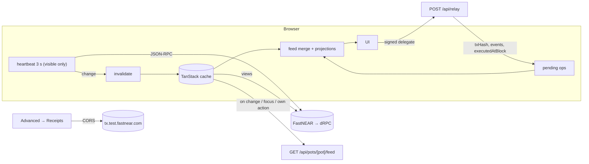

# Pot frontend architecture (apps/web + packages/pot-sdk)

> **Owner:** frontend-architect, written for **Cerasela (P2)**, who builds the frontend with Claude Code from Nov 1, and for P1. **Written:** 2026-10-21. **Status:** plan only. No product code before Nov 1 (D-63); every snippet below is illustrative.
> **Inputs, in priority order:** [decisions.md](decisions.md) (binding; §8 names are binding) → [ux-spec.md](ux-spec.md) (UX source of truth: states, copy keys, tokens) → [../kb](../kb) (evidence). Where they conflict, this doc follows decisions.md and lists the conflict in §14.
> **Markers:** ✅ verified (KB or primary source) · 📄 docs only · ⚠️ assumption (owner named) · **Choice** = a decision this doc makes that decisions.md does not cover.
> **Companion docs written in parallel:** architecture.md, api-spec.md, data-model.md (backend); contracts-spec.md, accounts-and-deploy.md (onchain). §13 lists exactly what this doc needs from them. Where a payload is theirs, the shapes here are expectations, not definitions.
> **Rev 6 (2026-10-21, brand; decisions.md Revision 6, D-67, D-45):** the design system is Cerasela's brand ([../brand/README.md](../brand/README.md), `brand/tokens.json`), and Night is in scope.
> - §7 is rewritten: generated `--pot-*` variables for Day and Night, the `data-theme` no-flash script, Gabarito + Figtree with `tnum`, the typing-dots loader, the 600 ms marigold burst, Lucide at stroke 2, the focus ring, and the brand radii and layout.
> - §8.1 takes the manifest, icons and `theme-color` from `brand/web`; §2.5 and §2.7 get the OG image and the metadata.
> - Avatars use join order (§7.5); the hero shows two decimals (`MoneyText`).
> - The landing's secondary [Continue with email] is in §5.1.
> - Marked "rev6".
>
> **Rev 5 (2026-10-21, decisions.md Revision 5):** withdraw is Phase 3 and not built: no `withdraw_request` intent and no `FLAG_WITHDRAW`; the `own` Approve state shows `approve.own.counted` only (§5.4); O3 and §15 Q5 updated.
> **Rev 4 security fixes (2026-10-21, [review-security.md](review-security.md) §7):** static security headers incl. CSP `frame-ancestors 'none'` (§1.5); the Approve sheet acts only on hub-tracked proposals and renders the proposal's own kind; others show read-only (§5.4); invite links default to 7 days / 10 uses and the Share sheet shows expiry and uses left (§5.10); `new_member` reason; NEAR Auth login calls `/authorize` directly with a device-bound `nonce` (§4.4); wallets without `signDelegateActions` attach the hub's cost (§4.5); `/demo` leases go through BotID (§2.6); names on `/j` only with an active `?i=` (§2.5).
> **Rev 3 review (2026-10-21, [review.md](review.md)):** demo cast Maya / Sam / Leo and Trip $100 / $200 (D-61); `Rules` mirrors the contract; new intents `propose_rules` and `withdraw_request`; 300 Tgas for votes on `call` proposals; `/demo` shows the reference Pot; the early "Approved" comes from the relay's two-phase response (E1 is a fallback); dev sessions on preview; the build order in §12 now defers to implementation-plan.md; §13 and §14 updated.

---

## 0. The choices that shape the code

| # | Choice | Why | Refs |
|---|---|---|---|
| 1 | **Static app shell, client data.** Signed-in screens are prerendered shells. Chain state is fetched in the browser with TanStack Query. Only `/j/[slug]` and `/demo` render real data on the server, through `'use cache'` with a short lifetime. | Cache Components on (D-43); KB advises against prefetching user data in RSC; client polling stays off Vercel invocations | D-32, D-43, [frontend-stack.md](../kb/frontend-stack.md), [backend-infra.md](../kb/backend-infra.md) |
| 2 | **Sheets are URL state, not routes.** `?sheet=add\|spend\|close\|share\|create` and `?r=<proposalId>`, set with native `history.pushState`. Back closes a sheet and deep links work. No intercepting or parallel routes. The ux-spec's `/p/[slug]/r/[id]` is kept as a 307 redirect to `?r=`. | §2.2 | ux-spec §2, D-41 |
| 3 | **Session hint cookie.** The server sets a non-httpOnly `pot_hint` (account id, signer kind, display name; no secrets) next to the httpOnly session cookie. That keeps every app shell static. | Avoids `cookies()` in layouts, which would make every page dynamic | ⚠️ api-spec (§13) |
| 4 | **One read client** in `@pot/sdk`: dependency-free JSON-RPC over `fetch`, FastNEAR → dRPC failover, a request budget, and a hard ban on `rpc.testnet.near.org`. | near-api-js stays off first-load routes | D-32, D-42 |
| 5 | **Heartbeat-driven refetch.** A visible Pot polls 3 cheap chain views every 3 s, paused while hidden. The DB-backed feed route is refetched only when the heartbeat sees a change, on focus, or after the user's own action. | P-4; protects Neon CU-hours and Vercel invocations | D-32, [backend-infra.md](../kb/backend-infra.md) |
| 6 | **Optimistic ops settle by block height.** An op is settled once a view with `blockHeight ≥ executedAtBlock` has been read. | No flicker, no double counting | §3.5 |
| 7 | **One `PotSigner` interface with 4 adapters.** DeviceKeySigner (default, no popup), NearAuthSigner (AddKey only), NearConnectSigner, DemoSigner (the server signs). | D-21, D-22 | §4 |
| 8 | **Three lazy chunks:** signing (near-api-js + noble), auth (auth0-spa-js), wallet (near-connect). Popups are pre-opened synchronously as `about:blank` inside the tap. | D-42; popup blockers | [near-auth.md](../kb/near-auth.md) |
| 9 | **Per-key signing queue.** `nonce = max(chain, lastUsed) + 1`, TTL 200 blocks, one in flight per key. | Prevents nonce races | [meta-tx-relayer.md](../kb/meta-tx-relayer.md) gotcha 3 |
| 10 | **Typed reducers for the 10 flows** (§5). No XState, no zustand. | Small bundle; unit-testable | Choice |
| 11 | **Brand tokens (`brand/tokens.json`) → generated `--pot-*` CSS variables for Day and Night → Tailwind v4 `@theme inline`,** mapped onto shadcn base-nova's variable names. `data-theme` on `<html>`, set before first paint (rev6) | D-67 (Night in scope); ux-spec §7 now points to the brand | D-40, D-41, D-45, D-67 |
| 12 | **Hand-written `public/sw.js`** for push, notification clicks and a postMessage soft-navigation bridge. No fetch handler. | D-42 | [pwa-push.md](../kb/pwa-push.md) |
| 13 | **Flat `en.json` keyed by the ux-spec IDs,** with generated var types. Two-layer jargon lint, `jsx-no-literals`, and import guards. | D-44 | §9 |
| 14 | **Tests in three tiers.** Mocked-chain Playwright (visual + axe) on every PR; two-context testnet runs on preview deploys; a CDP installability check; a bundle-budget gate. | D-65 | §11 |
| 15 | **Mock-first build order.** A clickable Pot on Nov 1 runs against `MockChain`, then real chain views from Nov 2. MVP freeze Nov 7. | C7 checkpoints | §12 |

---

## 1. Repo and app structure (D-64)

### 1.1 Workspace and pins

```
pot/                              fresh repo on Nov 1 (D-63); kb/ + plan/ copied to docs/, spikes/ never
├─ apps/web/                      Next.js 16.4.2: UI + route handlers + workflows
├─ packages/pot-sdk/              @pot/sdk: typed views + action builders, shared by web and scripts
├─ contracts/  scripts/  docs/    (onchain / P1)
├─ pnpm-workspace.yaml            packages: [apps/*, packages/*]; allowBuilds (pnpm 11, KB)
└─ package.json                   "packageManager": "pnpm@11.x"; engines.node ">=22.22.2" (near-api-js engines)
```

Frontend pins. D-40 is binding; the rows marked **Choice** add to it.

| Package | Pin | Used in | Note |
|---|---|---|---|
| next / react / react-dom | 16.4.2 / 19.3.1 / 19.3.1 | web | ≥ 16.4.1 for the RCE fix (D-40; decisions.md §1 row 14) |
| typescript / eslint / eslint-config-next | 5.9.3 / 9.39.5 / 16.4.2 | web, sdk | TS 7 breaks typescript-eslint ([frontend-stack.md](../kb/frontend-stack.md)) |
| tailwindcss + @tailwindcss/turbopack | 4.3.3 | web | no PostCSS file; the Turbopack loader only |
| shadcn CLI / @base-ui/react | 4.22.1 / 1.9.0 | web | style `base-nova`; Base UI uses the `render` prop, not `asChild` |
| sonner / motion / @tanstack/react-query | 2.0.8 / 14.4.x (14.5.0 after Oct 22) / 5.104.5 | web | `motion/react` |
| react-hook-form / zod / @hookform/resolvers | 7.90.0 / 4.6.7 / 6.0.0 | Create sheet only (lazy) | keeps zod (~33 KB) off first load |
| near-api-js | 7.3.1 | lazy signing chunk; `@pot/sdk/sign` | D-42 |
| @noble/curves | **2.2.0 exact** (Choice) | invite keys, fallback device key | the same version near-api-js 7.3.1 pins, so one copy ✅ (read from its package.json) |
| @auth0/auth0-spa-js | 2.28.4 (Choice) | lazy auth chunk | D-20 thin wrapper |
| @hot-labs/near-connect | 0.11.4 | lazy wallet chunk | MVP calls the connector directly; `near-connect-hooks` 1.1.6 is not mounted (Choice) |
| qrcode.react | 4.2.0 (Choice) | Share sheet (lazy) | SVG QR |
| lucide-react | 1.6x | web | 20/24 px, **stroke 2** (rev6, brand; Lucide's default) |
| @playwright/test / @axe-core/playwright / fast-check | 1.64.1 / 4.14.0 / 4.10.2 | tests | |
| vitest | 4.1.12 (Choice) | web unit tests | 5.0.x is 2 weeks old; re-check on Nov 1 |

**Not used:** next-intl (Cache Components issues, KB), vaul (D-41), Serwist (D-42), `@fast-auth-near/*` SDKs (D-20), XState, zustand, TanStack persisters (there is no offline shell to hydrate, D-42).

### 1.2 `apps/web` tree

```
apps/web/
├─ AGENTS.md                      next dev's managed block + "read docs/plan/frontend-architecture.md"
├─ next.config.ts                 §1.5
├─ components.json                shadcn base-nova
├─ eslint.config.mjs              nextVitals + nextTs + jargon + import guards (§9.4)
├─ playwright.config.ts  vitest.config.ts
├─ i18n/en.json                   flat, ux-spec IDs (§9)
├─ i18n/messages.d.ts             generated by scripts/gen-i18n-types.mjs (committed)
├─ assets/fonts/                 rev6: Gabarito-ExtraBold.ttf, Figtree-SemiBold.ttf (OFL) for ImageResponse only (§2.5)
├─ public/
│  ├─ sw.js                       push + notificationclick only (§8.3)
│  ├─ favicon.ico favicon.svg apple-touch-icon.png icon-192.png icon-512.png icon-maskable-512.png og-image.png
│  │                              rev6: copied from brand/web, byte-identical (U-WEB-09), at the brand's own paths
│  ├─ icons/badge-96.png          monochrome Android notification badge (alpha mask of the glyph, F-23)
│  └─ screens/pot-1170x2532.png   richer Android install sheet
├─ app/
│  ├─ layout.tsx                  html/body, Gabarito + Figtree (fonts.ts), the no-flash theme script in <head>, metadata + viewport (§2.7, §8.1), <Providers>, <SwBridge>, <Toaster> (rev6)
│  ├─ fonts.ts                    rev6: next/font Gabarito + Figtree (§7.2)
│  ├─ tokens.css                  rev6: GENERATED from docs/brand/tokens.json by scripts/gen-tokens.mjs (§7.1)
│  ├─ globals.css                 imports tokens.css + @theme (§7.1)
│  ├─ manifest.ts                 §8.1
│  ├─ not-found.tsx  global-error.tsx   (rev6: no app/icon.* or apple-icon.*: icons come from public/ through metadata, §8.1)
│  ├─ page.tsx                    "/" lite landing; client redirect to /pots if pot_hint; Auth0 redirect-callback island
│  ├─ (app)/layout.tsx            AppShell: TabBar, SessionGate (client), GlobalSheetHost, ConfirmHost, banners, LiveRegion
│  ├─ (app)/pots/page.tsx         Pots tab
│  ├─ (app)/p/[slug]/page.tsx     Pot: hero, ?tab=activity|members|rules, PotSheetHost (?sheet, ?r)
│  ├─ (app)/requests/page.tsx     Requests tab
│  ├─ (app)/you/page.tsx  (app)/you/advanced/page.tsx
│  ├─ j/[slug]/page.tsx           invite landing (SSR, public)
│  ├─ j/[slug]/opengraph-image.tsx
│  ├─ demo/page.tsx               judge entry (SSR, D-63)
│  └─ api/**                      backend-owned (D-24, §8 routes); not specified here
├─ components/
│  ├─ ui/                         shadcn-generated (Base UI). Edit only via tokens
│  ├─ app-shell/                  TabBar, PotHeader, SessionGate, SignedOutScreen, Banners (Offline/Service/Demo)
│  ├─ pot/                        BalanceHero, GoalBar, PotCard, SegmentedTabs, ActivityFeed, FeedItem, RequestCard,
│  │                              ApprovalMeter, ApprovalBar, MemberRow, RefundTable, RuleSentence, RulePreview,
│  │                              StatusChip, ReceiptLink, MoneyText, Avatar
│  ├─ sheets/                     SheetHost, ResponsiveSheet, AddMoneySheet, SpendSheet, ApproveSheet, CloseSheet,
│  │                              ShareSheet, CreatePotSheet, DepositSheet (P2), ConfirmStep, DetailsSheet
│  ├─ money/                      AmountKeypad (Keypad), SourcePicker, ResultCard, Celebration
│  ├─ onboarding/                 JoinCta, AccountSetupProgress, InAppBanner, YoureIn
│  ├─ landing/                    InviteHero (server), InviteCtaIsland (client), DemoPersonaForm (server, no-JS form)
│  ├─ pwa/                        InstallCoach, PushPrompt, BadgeSync, SwBridge
│  ├─ feedback/                   LiveRegion, ErrorDetails, EmptyState, Skeletons, TypingDots (rev6, §7.4)
│  ├─ brand/                      rev6: Mark, Lockup, Glyph as inline SVG from docs/brand/logo (never recoloured; the lockup swaps on-light/on-dark by theme)
│  └─ advanced/                   lint-exempt: AccountRow, OnChainRules, ReceiptsList, ExplorerLink
├─ lib/
│  ├─ config/                     env.ts (public env, no zod), flags.ts, routes.ts (URL builders, §2.2)
│  ├─ session/                    hint.ts (pot_hint cookie → SessionHint), useSession.ts
│  ├─ sdk.ts                      createPotSdk() for client and server (§1.4)
│  ├─ query/                      keys.ts, client.ts, heartbeat.ts, hooks/* (usePot, useBalance, useProposals…)
│  ├─ feed/                       model.ts, merge.ts, derive.ts (§3.6)
│  ├─ ops/                        store.ts, project.ts, reconcile.ts, persist.ts (§6.1)
│  ├─ signing/                    types.ts, resolve.ts, queue.ts, nonce.ts, load.ts (lazy loaders)
│  │   ├─ device/                 keystore.ts (IndexedDB), webcrypto.ts, fallback.ts (noble + AES-GCM wrap)
│  │   ├─ near-auth/              client.ts (thin auth0-spa-js wrapper, D-20)
│  │   ├─ near-connect/           connector.ts
│  │   ├─ demo/                   demo-signer.ts
│  │   └─ engine.ts               near-api-js delegate build/sign/encode (the lazy chunk entry)
│  ├─ relay/                      client.ts, errors.ts (§4.8), events.ts (EVENT_JSON parse)
│  ├─ actions/                    run.ts (intent → sign → relay → op), invites.ts, flows/*
│  ├─ machines/                   join, spend, voteRequest, approve, addMoney, deposit, confirmDevice,
│  │                              installCoach, push, createPot (typed reducers + tests)
│  ├─ pwa/                        display-mode.ts, platform.ts (iOS version, in-app), install.ts, push.ts, badge.ts, escape.ts
│  ├─ i18n/                       t.ts, plural.ts, format.ts (money, dates, relative time)
│  ├─ a11y/                       announce.ts, focus.ts
│  ├─ motion/                     tokens.ts, features.ts (LazyMotion async features)
│  ├─ theme/                      rev6: script.ts (the no-flash <head> script, §7.1), useTheme.ts (useSyncExternalStore over data-theme + matchMedia; sets pot-theme, theme-color metas)
│  └─ server/                     'server-only': invite-preview.ts, demo-snapshot.ts ('use cache' readers)
├─ e2e/                           fixtures/ (mock-chain, mock-rpc-server.ts, personas), mock/*.spec.ts, testnet/*.spec.ts, pwa/*.spec.ts
└─ scripts/                       lint-copy.mjs, gen-i18n-types.mjs, check-bundle-budget.mjs, check-no-near-org.mjs, gen-tokens.mjs (rev6)
```

### 1.3 Module boundaries (enforced with `no-restricted-imports`)

| Module | May import | Must not import |
|---|---|---|
| `app/**` server files, `lib/server/**` | `@pot/sdk` (read), `lib/i18n`, backend server modules, `'server-only'` | `lib/signing/**`, `near-api-js`, client-only modules |
| `components/**`, `lib/{query,feed,ops,machines}/**` | `@pot/sdk` (types, read, builders), `lib/signing/load` (the loader only) | `near-api-js`, `@auth0/*`, `@hot-labs/*`, `@pot/sdk/sign` |
| `lib/signing/**` | `near-api-js`, `@noble/curves`, `@pot/sdk/sign`, plus `@auth0/auth0-spa-js` and `@hot-labs/near-connect` by dynamic `import()` only | React |
| `components/advanced/**` | anything above | — (jargon-lint exempt) |

### 1.4 `packages/pot-sdk` boundary

`@pot/sdk` is source-only TypeScript: no build step, `"sideEffects": false`. Next consumes it via `transpilePackages`.

**Choice:** relative imports with explicit `.ts` extensions (`allowImportingTsExtensions`). P1's scripts can then import it under plain Node 22.22.2, using built-in type stripping (verified locally: `node --test x.test.ts` runs). Type stripping forbids `enum` and `namespace`, so use `as const` objects instead. ⚠️ Confirm on Nov 1 that Turbopack resolves `.ts`-suffixed imports inside the workspace package.

```jsonc
// packages/pot-sdk/package.json (sketch)
{ "name": "@pot/sdk", "type": "module", "sideEffects": false,
  "exports": { ".": "./src/index.ts",            // types + read + builders + math. ZERO runtime deps
               "./sign": "./src/sign/index.ts",   // near-api-js 7.3.1 (lazy chunk / scripts only)
               "./testing": "./src/testing/index.ts" },
  "peerDependencies": { "near-api-js": "7.3.1" } }
```

```
packages/pot-sdk/src/
├─ config.ts         SdkConfig { network, hubId, usdcId, rpcUrls, txApiUrl, explorerUrl }; daoIdFromSlug()
├─ types/            ids.ts hub.ts dao.ts usdc.ts events.ts intents.ts
├─ read/             rpc.ts (failover client) views.ts (Hub/Dao/Usdc views) parse.ts (sanitize, vote_counts)
├─ actions/          build.ts (intent → CallSpec) gas.ts kinds.ts
├─ math/             prorata.ts (mirrors D-09 math; fast-check tested) approvals.ts (k of n) expiry.ts
├─ money.ts          Micro ↔ cents, parse keypad input → Micro (6 decimals)
├─ sign/             delegate.ts webcrypto-signer.ts encode.ts   (imports near-api-js)
└─ testing/          fixtures (Lisbon Trip demo cast) + MockChain implementing ChainViews
```

**Types the UI uses.** The shapes mirror decisions.md §8 views; contracts-spec.md owns the exact fields, and anything marked ⚠️ is requested of it in §13.

```ts
// types/ids.ts
declare const brand: unique symbol
type Brand<T, B extends string> = T & { readonly [brand]: B }
export type AccountId = Brand<string, 'AccountId'>
export type DaoId = Brand<string, 'DaoId'>          // `${slug}.pots.<root>` (D-02); the `pot` arg everywhere
export type Slug = Brand<string, 'Slug'>
export type ProposalId = number                      // u64, small in practice
export type PublicKeyStr = `ed25519:${string}`
export type Micro = bigint                           // USDC base units, 6 decimals; MicroStr on the wire
export type MicroStr = string
export interface Viewed<T> { value: T; blockHeight: number }   // every view carries its block (for §3.5)

// types/hub.ts
export type PresetId = 'trip' | 'club' | 'team' | 'custom'          // = the hub's Preset (rev3); the MVP only creates 'trip'
export type Category = 'groceries' | 'food' | 'transport' | 'stay' | 'tickets' | 'other'
export interface Rules {                                            // mirrors contracts-spec §2.2 Rules (rev3)
  instantCap: Micro; memberBudget: Micro                            // memberBudget counts instant spends only (D-07)
  instantPayees: 'members' | 'members_and_allowlist'; payeeAllowlist: AccountId[] }   // allowlist ≤ 10, empty for 'members'
export type PotStatus = 'open' | 'closing' | 'closed'               // closing = close proposed (D-09)
export interface PotView {
  pot: DaoId; slug: Slug; name: string; emoji?: string; preset: PresetId; creator: AccountId
  status: PotStatus; rules: Rules; totalIn: Micro; memberCount: number
  closeProposalId?: ProposalId; createdAtMs: number
  seq?: number                                   // ⚠️ requested: bumps on every hub-side change (cheap change detector)
}
export interface PotSummary { pot: DaoId; slug: Slug; name: string; emoji?: string; status: PotStatus
  totalIn: Micro; myContribution: Micro; memberCount: number }       // ⚠️ requested shape for get_pots_of
export interface MemberView { account: AccountId; contributed: Micro; spent: Micro; joinedAtMs: number }
export type SpendPath = 'instant' | 'vote'
export interface SpendPreview { path: SpendPath | 'blocked'
  reason: 'ok' | 'over_cap' | 'over_budget' | 'recipient' | 'new_member' /* rev4: hasn't put money in */ | 'balance' | 'not_open'
  approvalsNeeded: number; budgetUsed: Micro }
export interface ClosePreview { balance: Micro; payouts: { account: AccountId; contributed: Micro; amount: Micro }[]
  dustTo: AccountId | null; openRequests: number }
export interface RequestView { id: number; requester: AccountId; receiver: AccountId; amount: Micro
  category: Category; requestRef: string; path: SpendPath; proposalId: ProposalId | null
  status: 'proposed' | 'approved' | 'paid' | 'payout_failed' | 'rejected' | 'expired' | 'withdrawn'; createdAtMs: number }   // 'withdrawn' = hub 'removed' (rev3); rev5: withdraw is Phase 3, so only sync can set 'removed'
export interface InviteView { invitePk: PublicKeyStr; createdBy: AccountId; expiresAtMs: number   // rev4: always set (default 7 d)
  maxUses: number; uses: number; revoked: boolean }                                                 // rev4: always set (default 10)
export interface SubjectView { kind: 'spend' | 'join' | 'close' | 'rules'; requestId: number | null   // rev4: hub get_proposal_subject
  member: AccountId | null; rulesVersion: number | null; live: boolean }

// types/dao.ts. The testnet global code Ea8t… (278adc7, D-03) returns vote_counts as strings and has get_actions_log.
export type ProposalStatus = 'InProgress' | 'Approved' | 'Rejected' | 'Removed' | 'Expired' | 'Moved' | 'Failed'
export type ProposalKind = Record<string, unknown>   // kept verbatim: act_proposal needs it back byte-equal (D-04, D-05)
export interface Proposal { id: ProposalId; proposer: AccountId; description: string; kind: ProposalKind
  status: ProposalStatus; voteCounts: Record<string, [number, number, number]>   // normalized from number|string
  votes: Record<string, 'Approve' | 'Reject' | 'Remove'>; submissionTimeNs: bigint }
export interface PolicySummary { members: AccountId[]; threshold: [number, number]; quorum: number; proposalPeriodNs: bigint }

// read/views.ts: the interfaces the UI calls (one implementation over RPC, one MockChain)
export interface HubViews {   // `balance` = the client's usdc.ft_balance_of(dao) read; the hub can't read it in a view (contracts-spec §4, rev3)
  getPot(pot: DaoId): Promise<Viewed<PotView | null>>
  getPotsOf(account: AccountId): Promise<Viewed<PotSummary[]>>
  getMembers(pot: DaoId, balance?: Micro): Promise<Viewed<MemberView[]>>
  getRules(pot: DaoId): Promise<Viewed<Rules>>
  previewSpend(pot: DaoId, account: AccountId, amount: Micro, receiver: AccountId, balance?: Micro): Promise<Viewed<SpendPreview>>
  previewClose(pot: DaoId, balance?: Micro): Promise<Viewed<ClosePreview>>
  getRequests(pot: DaoId, fromIndex: number, limit: number): Promise<Viewed<RequestView[]>>
  getRequest(pot: DaoId, requestId: number): Promise<Viewed<RequestView | null>>
  getInvite(pot: DaoId, invitePk: PublicKeyStr): Promise<Viewed<InviteView | null>>
  getProposalSubject(pot: DaoId, proposalId: ProposalId): Promise<Viewed<SubjectView | null>>   // rev4: null = not created by the hub
}
export interface DaoViews {
  getPolicy(dao: DaoId): Promise<Viewed<PolicySummary>>
  getProposals(dao: DaoId, fromIndex: number, limit: number): Promise<Viewed<Proposal[]>>
  getProposal(dao: DaoId, id: ProposalId): Promise<Viewed<Proposal | null>>   // null on ERR_NO_PROPOSAL
  getLastProposalId(dao: DaoId): Promise<Viewed<number>>
  getActionsLog(dao: DaoId): Promise<Viewed<{ account: AccountId; proposalId: ProposalId; action: string; blockHeight: number }[]>>
}
export interface UsdcViews { balanceOf(a: AccountId): Promise<Viewed<Micro>>; isRegistered(a: AccountId): Promise<Viewed<boolean>> }
export interface AccountViews { accessKey(a: AccountId, pk: PublicKeyStr): Promise<Viewed<{ nonce: bigint; fullAccess: boolean } | null>> }
export interface ChainViews { hub: HubViews; dao: DaoViews; usdc: UsdcViews; account: AccountViews }
export function createPotSdk(cfg: SdkConfig): ChainViews & { build: typeof buildCall; cfg: SdkConfig }
```

**Actions.** `@pot/sdk` builds pure JSON call specs. The web app's `lib/actions/run.ts` executes them (sign → relay → op tracking).

```ts
// types/intents.ts: names match the decisions.md §8 hub/DAO/USDC methods
export type ActionIntent =
  | { type: 'add_money'; pot: DaoId; amount: Micro }                                // usdc.ft_transfer_call → pots.<root> (D-06)
  | { type: 'request_spend'; pot: DaoId; amount: Micro; receiverId: AccountId; category: Category; requestRef: string } // D-07
  | { type: 'vote'; pot: DaoId; proposalId: ProposalId; kind: ProposalKind
      action: 'VoteApprove' | 'VoteReject' | 'Finalize' }   // gas follows `kind` (rev3): Transfer 100 Tgas, FunctionCall (close, rules) 300; Finalize = close retry (F-22)
  | { type: 'join'; pot: DaoId; invitePk: PublicKeyStr; signature: string }        // D-08
  | { type: 'create_pot'; slug: Slug; name: string; preset: PresetId; rules: Rules | null; invitePk?: PublicKeyStr; emoji?: string }   // rules null = preset defaults
  | { type: 'add_invite'; pot: DaoId; invitePk: PublicKeyStr; expiresAtMs?: number; maxUses?: number }
  | { type: 'revoke_invite'; pot: DaoId; invitePk: PublicKeyStr }
  | { type: 'rotate_invite'; pot: DaoId; oldPk: PublicKeyStr; newPk: PublicKeyStr }  // 1 delegate, 2 FunctionCalls (relayer R5 allows the pair)
  | { type: 'propose_close'; pot: DaoId }
  | { type: 'retry_payout'; pot: DaoId; proposalId: ProposalId }
  | { type: 'set_rules'; pot: DaoId; rules: Rules }                                  // sole member only (decisions.md §8)
  | { type: 'propose_rules'; pot: DaoId; rules: Rules }                              // rev3: several members (D-07b); then the proposer's own VoteApprove at 300 Tgas
  // rev5: no 'withdraw_request' intent; withdraw is Phase 3, not built (decisions D-07)
  | { type: 'add_device_key'; account: AccountId; publicKey: PublicKeyStr }           // AddKey on own account (D-21)

export type CallAction =
  | { type: 'FunctionCall'; method: string; args: object; gas: bigint; deposit: bigint }
  | { type: 'AddKey'; publicKey: PublicKeyStr; access: 'FullAccess' }
export interface CallSpec { receiverId: string; actions: CallAction[] }
export function buildCall(i: ActionIntent, cfg: SdkConfig): CallSpec
```

Default gas and deposits (`actions/gas.ts`). Contracts-spec owns the final numbers, and the relayer caps must accept them (§13).

| Intent | Receiver | Method | Gas | Deposit | Source |
|---|---|---|---|---|---|
| add_money | `usdc.<root>` | `ft_transfer_call{receiver_id: pots.<root>, amount, msg:{"pot":dao}}` | 100 Tgas | 1 yocto | D-06 (≥ 100; < 35 silently bounces) |
| request_spend | `pots.<root>` | `request_spend` | 150 Tgas | 0 | D-07 |
| vote (Transfer: spend; AddMemberToRole: a join the hub couldn't approve) | DAO | `act_proposal{id, action, proposal: kind}` | 100 Tgas (rev4: the relayer requires exactly 100) | 0 | D-04, D-05 |
| vote or Finalize (`call` proposal: close, rules) | DAO | same | **300 Tgas** (rev3; the relayer requires exactly 300 for VoteApprove and Finalize, R11) | 0 | D-07b, D-09: a 40-payee final vote needs ≈ 231 |
| join | hub | `join` | 100 Tgas | 0 | D-08 |
| create_pot | hub | `create_pot` | 300 Tgas | 0 | D-02, D-03 |
| add/revoke/rotate invite, set_rules | hub | as named | 30 Tgas each | 0 | contracts-spec §3.12 |
| propose_rules | hub | as named | 100 Tgas | 0 | contracts-spec §3.12 (rev3; rev5: `withdraw_request` is Phase 3, not built) |
| propose_close / retry_payout | hub | as named | 150 / 100 Tgas | 0 | D-09, [contracts-patterns.md](../kb/contracts-patterns.md) A.4 |
| add_device_key | own account | `AddKey(FullAccess)` | — | — | D-21, D-24 |

Rev 4: deposits on hub methods are 0 because the relayer signs and the hub sponsors. A wallet **without** `signDelegateActions` sends the tx itself (`signAndSendTransaction`), so it isn't sponsored: `buildCall(i, cfg, {direct: true})` attaches the hub's cost for the six hub-funded methods (contracts-spec §3.0: `create_pot` 0.07, `join` 0.02, `request_spend` 0.06, `add_invite` 0.005, `propose_rules` 0.06, `propose_close` 0.15 NEAR on testnet; the hub refunds the excess). Relayed delegates never carry these deposits (the relayer refuses them, `deposit_cap`).

### 1.5 `next.config.ts` (the frontend-relevant parts)

```ts
const nextConfig: NextConfig = {
  cacheComponents: true, partialPrefetching: true,              // D-43 (scaffold default)
  transpilePackages: ['@pot/sdk'],
  turbopack: { rules: { '*.css': { loaders: ['@tailwindcss/turbopack'], as: '*.css' } } },
  async redirects() {                                           // ux-spec IA deep link → query state (§2.2)
    return [{ source: '/p/:slug/r/:id', destination: '/p/:slug?r=:id', permanent: false }]
  },
  async headers() {
    return [
      // rev4 (review-security M-3): static security headers on every route; no nonce, so Cache Components keeps working.
      // Listed FIRST: for the same key, a later matching entry wins (/j/* keeps Referrer-Policy: same-origin, /sw.js its own CSP).
      { source: '/:path*', headers: [
        { key: 'Content-Security-Policy', value: "frame-ancestors 'none'; object-src 'none'; base-uri 'none'; form-action 'self'" },
        { key: 'X-Frame-Options', value: 'DENY' },                       // the Approve sheet can't be clickjacked
        { key: 'X-Content-Type-Options', value: 'nosniff' },
        { key: 'Referrer-Policy', value: 'strict-origin-when-cross-origin' },
        { key: 'Permissions-Policy', value: 'camera=(), microphone=(), geolocation=()' },
        { key: 'Strict-Transport-Security', value: 'max-age=63072000' } ] },
      { source: '/sw.js', headers: [
        { key: 'Content-Type', value: 'application/javascript; charset=utf-8' },
        { key: 'Cache-Control', value: 'no-cache, no-store, must-revalidate' },
        { key: 'Content-Security-Policy', value: "default-src 'self'; script-src 'self'" } ] },  // KB snippet, verified
      { source: '/j/:path*', headers: [{ key: 'Referrer-Policy', value: 'same-origin' }, { key: 'X-Robots-Tag', value: 'noindex' }] },
    ]
  },
}
// Never export dynamic / revalidate / fetchCache / dynamicParams / runtime from any segment (Cache Components, KB).
```

Public env (`lib/config/env.ts`, read as `process.env.NEXT_PUBLIC_*` constants with no zod on the client):

| Var | Example | Note |
|---|---|---|
| `NEXT_PUBLIC_NETWORK` | `testnet` | |
| `NEXT_PUBLIC_HUB_ID` / `NEXT_PUBLIC_USDC_ID` | `pots.<root>` / `usdc.<root>` | separate preview and prod accounts (D-02) |
| `NEXT_PUBLIC_RPC_URLS` | `https://rpc.testnet.fastnear.com,https://near-testnet.drpc.org` | D-32; build fails if near.org is present (§9.4) |
| `NEXT_PUBLIC_TX_API` / `NEXT_PUBLIC_EXPLORER` | `https://tx.test.fastnear.com` / `https://testnet.nearblocks.io` | receipts |
| `NEXT_PUBLIC_APP_URL` | prod origin | `metadataBase`; falls back to `https://${VERCEL_URL}` on previews |
| `NEXT_PUBLIC_NEAR_AUTH_CLIENT_ID`, `NEXT_PUBLIC_NEAR_AUTH_DOMAIN` | shared testnet client, `login.testnet.fast-auth.com` | the shared client accepts callbacks only from `http://localhost:3000` (decisions.md §1 row 9, D-22) |
| `NEXT_PUBLIC_VAPID_PUBLIC_KEY` | — | never rotate ([notifications.md](../kb/notifications.md)) |
| Flags (`NEXT_PUBLIC_FLAG_*`) | `NEAR_AUTH`, `WALLET`, `DEMO`, `APPLE=false`, `DEV_SESSION` (preview only), and the cut-order flags of implementation-plan §1.5: `TELEGRAM`, `EMAIL`, `NUDGE`, `PAIRING`, `PUSH`, `RULES_EDIT`, `XC`, `CLOSE` (rev5: no `WITHDRAW`; withdraw is Phase 3, not built); plus `DEMO_PUSH` (R-15) | D-22 fallbacks: hosted builds run with NEAR Auth off until whitelisted. The text below shortens these to `FLAG_*`. Rev 3: each flag is one env var; the server reads `FLAG_<NAME>` and the client the mirrored `NEXT_PUBLIC_FLAG_<NAME>` |

---

## 2. Routes

### 2.1 Route map

| Route | File | Rendering (Cache Components) | Data | Auth | Notes |
|---|---|---|---|---|---|
| `/` | `app/page.tsx` | static | none | — | Lite landing ("Start a Pot", "Try the demo"). The client sends signed-in users to `/pots` (hint cookie). Hosts the Auth0 `?code&state` redirect callback (the shared client only allows the root, [near-auth.md](../kb/near-auth.md)) |
| `/pots` | `(app)/pots/page.tsx` | static shell | client: `potsOf`, balances | hint | `?sheet=create` |
| `/p/[slug]` | `(app)/p/[slug]/page.tsx` | shell + `<Suspense>` around the client `PotScreen` (it uses `useParams`) | client: heartbeat + feed | hint | `?tab=activity\|members\|rules` (replaceState); `?sheet=add\|spend\|close\|share`; `?r=<proposalId>` (Approve, including close approvals) |
| `/p/[slug]/r/[id]` | (redirect in next.config) | — | — | — | 307 → `/p/[slug]?r=[id]` (ux-spec IA; push, email and bot targets) |
| `/requests` | `(app)/requests/page.tsx` | static shell | client: heads + proposals for every Pot | hint | badge = waiting on me |
| `/you`, `/you/advanced` | `(app)/you/…` | static shell | client | hint | Advanced is lint-exempt (ux-spec §10) |
| `/j/[slug]` | `j/[slug]/page.tsx` | static frame + `<Suspense>` body (params, `?i`) | **server**: `'use cache'` invite preview (§2.5) + client refresh | public | the secret lives in `#fragment` (D-08) |
| `/j/[slug]/opengraph-image` | `opengraph-image.tsx` | per request, cached data | server | public | 1200×630 |
| `/demo` | `demo/page.tsx` | prerendered + `'use cache'` snapshot (30 s) | **server** | public | AI judges (D-63, [hackathon-rules.md](../kb/hackathon-rules.md)) |
| `/api/**` | backend | — | — | — | §8 names; payloads in api-spec.md |

`SessionGate` (client, in `(app)/layout.tsx`) reads the `pot_hint` cookie:
- Without it, it renders `SignedOutScreen`: Continue with Google (`FLAG_NEAR_AUTH`), I have a NEAR wallet, Try the demo, and on preview builds only "Join with a test account" (`FLAG_DEV_SESSION`, `POST /api/session/dev`, ux-spec `landing.cta.dev`; rev3).
- With it, it renders the tab content.
- A 401 from any API call opens `session.expired` (ux-spec §4.20).

```ts
// lib/session/hint.ts: parsed from the non-httpOnly pot_hint cookie (⚠️ api-spec, §13 A2).
// Display and routing only; every API call is authorized by the httpOnly session cookie.
export interface SessionHint { accountId: AccountId; kind: 'near-auth' | 'wallet' | 'demo' | 'dev'; displayName: string   // 'dev' = preview-only test account (rev3)
  emailHint?: string /* "m•••@gmail.com" for landing.signed_in_as */; persona?: 'maya' | 'sam' | 'leo'   // D-61 cast (rev3)
  leasedPot?: DaoId; devicePublicKey?: PublicKeyStr }
export const useSessionHint: () => SessionHint | null   // useSyncExternalStore over document.cookie (server snapshot: null)
```

### 2.2 Sheets: URL query state (decision)

| Option | Verdict | Reason |
|---|---|---|
| Intercepting + parallel routes (`@sheet/(.)…`) | ✗ | Next 16 requires a `default.tsx` per slot or the build fails (📄 v16 upgrade guide). Soft and hard navigation render different trees, so every sheet needs two implementations. Exit animations are lost on unmount. Sheet data is client-side anyway, so there is no SSR gain |
| Client-only state | ✗ | Back and the Android back gesture would leave the Pot instead of closing the sheet; deep links are impossible; with Cache Components, preserved `<Activity>` routes keep stale open sheets (📄 "derive dialog state from the URL instead") |
| **URL query state + native `history.pushState`** | ✅ | Back closes the sheet (ux-spec §2). Push, email and bot deep links work cold or warm. Reloads keep the sheet. There is no RSC round trip (native pushState "integrate[s] into the Next.js Router", 📄 linking-and-navigating). One mounted host plays exit animations. It only needs `<Suspense>` around the `useSearchParams` reader |

| Sheet | URL | Host | Deep-link source |
|---|---|---|---|
| Add money | `/p/[slug]?sheet=add` (+`&src=xc&d=<depositId>` in P2) | PotSheetHost | Nudge push; D-50 "Your $X arrived" push |
| Spend | `/p/[slug]?sheet=spend` | PotSheetHost | — |
| Approve (+ close approval) | `/p/[slug]?r=<proposalId>` | PotSheetHost | approval and close pushes, email, bot |
| Close | `/p/[slug]?sheet=close` | PotSheetHost | — |
| Share | `/p/[slug]?sheet=share` | PotSheetHost | right after Create |
| Create (full height) | `/pots?sheet=create` | GlobalSheetHost | — |
| ConfirmStep, InstallCoach, Push pre-prompt, Details | **local state** | ConfirmHost / feature hosts | none. These are transient steps inside a flow; a deep link to "Confirm it's you" would be meaningless and unsafe |

Mechanics (`lib/config/routes.ts` + `useSheet()`):
- **open(sheet):** `history.pushState(null, '', url)` (pass `null`, as the Next docs do; don't rely on `history.state`) and set the module flag `openedInApp = true`.
- **close():** if `openedInApp`, call `history.back()`; otherwise (cold deep link) call `history.replaceState(null, '', basePath)`, so closing never leaves the app.
- **Hardware back:** the URL changes first, and the host animates out from the last rendered content.
- **Reset rule:** sheets reset their local state in their close and success handlers and never rely on unmount, because Cache Components preserves state through `<Activity>` (📄 migrating guide, "Forms after submission"). A half-typed amount survives Back and Forward, as ux-spec 4.7 wants ("the amount is kept in the sheet if reopened"), until the user closes the sheet.
- `ResponsiveSheet` renders a Base UI `Drawer` below 768 px and a `Dialog` at or above it (ux-spec §2). Sheets mount client-side only, so there is no hydration mismatch on viewport size.

### 2.3 Server vs client components

| Rule | Detail |
|---|---|
| Server components | layouts and page frames, the `/j/[slug]` hero, `/demo`, metadata, OG images, the static marketing at `/`. They render text with `t()` (a pure function, so it is safe on the server) |
| Client components | everything that reads chain state for a signed-in user, every sheet, the signing layer, PWA hooks. Mark the boundary as low as possible: `PotScreen`, `JoinCtaIsland`, `SheetHost` |
| Props across the boundary | Micro amounts cross as `MicroStr`, never `bigint`, to keep RSC payloads boring. Params cross as a Promise and are unwrapped with `use()` |
| Browser-only values | `useSyncExternalStore` (`matchMedia`, `navigator.standalone`, the hint cookie, IndexedDB readiness) with a server snapshot. No `setState` in effects (eslint-plugin-react-hooks 7, KB snippet 11) |
| `server-only` / `client-only` | `import 'server-only'` in `lib/server/**`; `import 'client-only'` in `lib/signing/**` and `lib/pwa/**` |

### 2.4 Cache Components + Suspense rules (D-43 checklist)

1. Read `params`, `searchParams`, `cookies()` and `headers()` **only inside `<Suspense>`**. Pass the Promise down. The KB verified the build fails otherwise.
2. Client `useParams()`, `usePathname()` and `useSearchParams()` in dynamic segments **suspend during prerender**, so wrap their reader. Use `fallback={null}` for SheetHost and `<PotSkeleton/>` for PotScreen.
3. **Never** export `dynamic`, `revalidate`, `fetchCache`, `dynamicParams` or `runtime`. Only `maxDuration` is allowed, and only in route handlers.
4. `Date.now()`, `Math.random()` and `crypto.randomUUID()` are build errors during prerender. Relative times ("2h ago") are computed in client components. Server text uses absolute dates.
5. `'use cache'` functions take only serializable args (slug, invite pk) and call `cacheLife()` and `cacheTag()`. No `cookies()` inside.
6. `generateMetadata` on `/j/[slug]` reads params. That is allowed because the page also defers its body, so metadata streams for browsers and **blocks in `<head>` for link-preview bots**. Next's HTML-limited bot list covers WhatsApp, facebookexternalhit (iMessage), Twitterbot (which matches TelegramBot's "like TwitterBot" UA case-insensitively), Slackbot and Discordbot (✅ read `html-bots.ts`). No `htmlLimitedBots` override is needed.
7. The escape hatch, if a segment fights back before Nov 1: `export const instant = false` on that segment. It is not a reason to flip D-43.

### 2.5 `/j/[slug]` invite landing (SSR with real Pot data, before login)

**Link format.** D-08 binds `/j/<slug>#<secret>`, where the secret is a 32-byte ed25519 seed in base64url, 43 chars. This doc adds an optional, non-secret **`?i=<invite public key>`** so the server can render the inviter and the invite's validity (objection O1). Without `i`, the landing still works: the H1 falls back to "You're invited to {potName}".

```tsx
// app/j/[slug]/page.tsx (sketch)
export default function InvitePage({ params, searchParams }: PageProps<'/j/[slug]'>) {
  return (
    <main className="mx-auto max-w-flow px-4 pt-12">          {/* rev6: container-flow 440 px; space-12 top margin (brand) */}
      <Suspense fallback={<InviteSkeleton />}>                {/* static shell = frame + skeleton */}
        <InviteBody params={params} searchParams={searchParams} />
      </Suspense>
    </main>
  )
}
async function InviteBody({ params, searchParams }: Pick<PageProps<'/j/[slug]'>, 'params' | 'searchParams'>) {
  const { slug } = await params
  const { i } = await searchParams
  const p = await getInvitePreview(slug, typeof i === 'string' ? i : null)   // 'use cache' (below)
  if (!p.pot) return <InviteError kind="invalid" />
  return <><InviteHero preview={p} /><JoinCtaIsland preview={toClientProps(p)} /></>
}
// lib/server/invite-preview.ts
export async function getInvitePreview(slug: string, invitePk: string | null) {
  'use cache'
  cacheLife({ stale: 10, revalidate: 15, expire: 300 }); cacheTag(`pot:${slug}`)
  // @pot/sdk read client on the server: FastNEAR (FASTNEAR_API_KEY if bought) → dRPC failover
  // reads: hub.getPot, hub.getMembers, usdc.balanceOf(dao), invitePk ? hub.getInvite : null
  // DB (backend module): display names + avatar tints for members; inviter = invite.createdBy (⚠️ data-model)
}
```

| Landing state (ux-spec 4.1, 5.1, 5.2) | Decided where | Output |
|---|---|---|
| Valid invite | server | H1 `landing.title` (inviter from `?i`) or the fallback; `landing.balance` / `.zero`; GoalBar; `landing.members`; `landing.trust`; `landing.rules_peek`; `landing.expiry` |
| Pot closed / invite expired, revoked (`invite.replaced`), used up, or not found | server (with `?i`); client otherwise | full-screen `invite.*` |
| Already a member | client (hint cookie account ∈ members) | `invite.already_member` + [Open {potName}] |
| Signed in, not a member | client | `landing.signed_in_as` + [Join {potName}] (2 taps) |
| In-app browser | client (`lib/pwa/platform.ts`) | `landing.inapp.*` **above** the CTAs; Google and passkey hidden; Email stays |
| Fragment missing | client | `invite.invalid` |
| Offline / RPC failed | client | `invite.network_error` + [Try again]; the SSR content stays |

Client island duties (`JoinCtaIsland`):
- Read `location.hash` and store the secret in `sessionStorage['pot.invite.'+slug]`. That survives a redirect-flow fallback.
- After a successful join, `history.replaceState(null, '', '/p/'+slug)` strips the fragment, then clear the stored secret.
- On idle:
  - pre-generate the device key (§4.3);
  - preload the auth chunk;
  - start the 3 s refresh of balance and members ("refresh silently", ux-spec 4.1).
- Reserve the CTA block's height so swapping CTA variants causes no layout shift.

Never log, send or persist the secret anywhere else. "Copy link" and the in-app "Open in Safari" escape must include `#fragment`. The KB's `escapeUrl` snippet drops the hash, so append `u.hash` (⚠️ verify on a device that `x-safari-https://` keeps it).

**Rev 4 privacy (review-security M-7):** member names and avatars render only when `?i=` resolves to an `active` invite; otherwise the landing shows the Pot name, emoji, member count and balance. `getInvitePreview` validates the slug format before any I/O and caches a not-found slug for 60 s (random slugs can't burn RPC calls).

**Metadata and OG image:**
- `generateMetadata`:
  - title `"{inviter} invited you to {potName}"`, otherwise `"Join {potName} on Pot"`;
  - description `landing.trust`;
  - `robots: { index: false }`.
- `opengraph-image.tsx` only receives `params` (📄 v16: `params` is a Promise), so it renders the cover/emoji, the Pot name, initials-only avatars (rev4) and "{n} friends", but **no balance**, because platforms cache OG images for a long time. It uses `ImageResponse` 1200×630 and `emoji: 'twemoji'` (⚠️). The same cached helper supplies the data.
  - **(rev6, brand)** It is drawn in the look of `brand/web/og-image.png`: marigold ground, the eggplant glyph, the title in Gabarito 800 eggplant, the lowercase wordmark, and member avatars in `member-*` colours by join order.
  - Fonts: Satori can't read woff2, so it loads the committed TTFs from `assets/fonts/` with `readFile`. This replaces the earlier plan for Geist's TTF.
  - On any error, the route returns the bytes of `public/og-image.png`. That static image is also the site-wide default from the root metadata (§8.1), so `/j` links unfurl in the brand before F-24 lands.
- `metadataBase` is set from `NEXT_PUBLIC_APP_URL` in the root layout.

### 2.6 `/demo` (server-rendered for AI judges, D-63, D-33)

- **Content in the HTML, not behind JS:**
  - H1 `demo.choose`;
  - explanation (`demo.banner`);
  - two `<form method="post" action="/api/demo/session">` buttons with a hidden `persona=maya|leo`. The route handler sets cookies and returns 303 → `/p/<leased slug>` (api-spec §2.8 branches on `Accept`).
  - Rev 4 (review-security H-5): a new lease passes BotID. When JavaScript runs, a small island submits the form with `fetch` (so BotID's client signal is attached; ⚠️ check on Nov 6) and then navigates to the returned slug. A no-JS post gets 303 → `/demo?ro=1`, which shows ⓟ `demo.readonly` ("The interactive demo needs JavaScript. The snapshot below and the JSON links are live.") above the same snapshot. A client without JavaScript couldn't use the leased Pot anyway (the app shell needs JS).
- **"What to try":** 3 steps mirroring the README.
- **Live snapshot of the reference Pot** (balance, members, the last 5 feed lines as plain text; rev3, D-33):
  - comes from `getDemoSnapshot()` (`'use cache'`, `cacheLife({ stale: 30, revalidate: 30, expire: 600 })`, try/catch → "Snapshot unavailable" so builds never fail);
  - reads the permanent, never-leased reference Pot `lisbon-trip` (env `DEMO_REFERENCE_POT`), the same Pot as the README CLI twins and `GET /api/demo/state`'s `reference` (api-spec §7.1). Rev 3: it no longer reads the nightly shared Pot, whose numbers change with visitors;
  - includes a link to `GET /api/pots/<dao>/feed` as the JSON twin.
- **`?as=maya|leo`** (Playwright convenience): a client island inside `<Suspense>` auto-submits the matching form. Rev 4 (review-security L-5): only when `pot_hint.kind` is missing or `demo`, so a link can't silently swap a real session for a demo one; otherwise it just shows the forms. (The nightly E-10 on production starts from a fresh context, so it still auto-submits.)
- **In a demo session**, `DemoBanner` stays on top with `demo.switch` (to either of the other two personas, Sam included; rev3) and `demo.reset` (both POST `/api/demo/session`).

### 2.7 Titles and document metadata

- `document.title` per screen, set with React 19 `<title>` from client components once data is known: "Lisbon Trip · Pot", "Approve $300 · Pot" (WCAG 2.4.2, ux-spec §8).
- The root `metadata` has `title.template "%s · Pot"`, `appleWebApp {capable, title: 'Pot', statusBarStyle: 'default'}`, `formatDetection {telephone: false}`. (rev6) It also carries `metadataBase`, `description` (the brand tagline), `icons` (from `public/`), `openGraph.images` (`/og-image.png`, 1200×630) and `twitter.card: 'summary_large_image'`; the code is in brand/README §11.
- `viewport`:
  - `width=device-width, initial-scale=1, viewport-fit=cover, interactive-widget=resizes-content` (the last is Android-only, KB);
  - `themeColor: '#FBF7F2'`. (rev6) Replaced by the brand pair `[{media: '(prefers-color-scheme: light)', color: '#faf9f6'}, {media: '(prefers-color-scheme: dark)', color: '#1c1424'}]`, plus `colorScheme: 'light dark'`. When the person overrides the theme, `useTheme` rewrites both metas' `content` (§7.1).

---

## 3. Data layer



### 3.1 Chain read client (`@pot/sdk/read/rpc.ts`)

| Concern | Spec | Evidence |
|---|---|---|
| Endpoints | `[https://rpc.testnet.fastnear.com, https://near-testnet.drpc.org]` from env. `createRpcClient` **throws** if any URL matches `rpc.testnet.near.org` or `near-testnet.lava.build` | D-32: near.org adds +3.05 s and 429s without CORS; lava answers 410 ([backend-infra.md](../kb/backend-infra.md)) |
| Transport | `POST {jsonrpc, id, method:'query', params:{request_type:'call_function', finality, account_id, method_name, args_base64}}`, decode `result.result` bytes → JSON. Returns `{value, blockHeight: result.block_height}` | — |
| Timeout | 4 s (`AbortSignal.timeout`) | FastNEAR p95 ≤ 234 ms |
| Failover triggers | network error, timeout, HTTP 408/429/5xx, a JSON-RPC body with code `-429`, a CORS-less 429 that surfaces as `TypeError` | KB: 429s may arrive with no CORS header, or as HTTP 200 with `{"code":-429}` |
| Not failover | `UNKNOWN_ACCOUNT`, `NO_CONTRACT_CODE`, `MethodResolveError`, contract panics. These throw a typed `RpcViewError{code, message}` | — |
| Stickiness | After a failover, stay on dRPC for 60 s, then probe FastNEAR again | — |
| Parsing | `res.text()` → `JSON.parse`; on failure, escape raw control characters and retry (Sputnik panics carry newlines) | [sputnik-dao.md](../kb/sputnik-dao.md) gotcha 11 |
| Budget (browser) | Token bucket of **100 requests/min per tab**, burst 10. Excess requests queue; nothing is dropped | FastNEAR keyless: 120/min sustained OK, ~200/min → 429, then a penalty ([backend-infra.md](../kb/backend-infra.md)) |
| Finality | UI views use `final`. Nonce reads for signing use `optimistic` (§4.7) | P-4 ≤ 3.3 s after finality |
| Server use | The same client, with `headers: {Authorization: Bearer FASTNEAR_API_KEY}` if a key exists. Vercel egress IPs are shared, so the 429 risk is higher; the dRPC failover is mandatory | — |
| Normalization | `vote_counts` arrives as `number \| string`, so normalize to numbers. `submission_time` is a ns string, so convert to bigint. U128 strings become `Micro` | D-03 global code returns strings |

### 3.2 TanStack Query

```ts
// lib/query/client.ts
export const makeQueryClient = () => new QueryClient({ defaultOptions: {
  queries: { staleTime: 2_000, gcTime: 5 * 60_000, refetchOnWindowFocus: true,
             refetchIntervalInBackground: false,             // the interval pauses while document.hidden
             retry: (n, e) => n < 2 && isTransient(e), networkMode: 'online' },
  mutations: { retry: 0, networkMode: 'online' } } })
// Browser: one singleton. Server: never (no RSC prefetch of user data, KB).
```

| Key | Fetches | staleTime | Interval while visible | Used by |
|---|---|---|---|---|
| `['potsOf', me]` | `hub.get_pots_of` | 10 s | 10 s on `/pots`, `/requests` | Pots, Requests |
| `['pot', dao, 'head']` | `dao.get_actions_log` (falls back to `get_last_proposal_id`) | 0 | **3 s** | change detector: proposals + votes |
| `['pot', dao, 'view']` | `hub.get_pot` | 0 | **3 s** | hero, status, rules, `seq` change detector |
| `['pot', dao, 'balance']` | `usdc.ft_balance_of(dao)` | 0 | **3 s** (10 s on PotCard) | hero, landing |
| `['pot', dao, 'members']` | `hub.get_members` | 10 s | on change | Members tab, "You put in", avatars |
| `['pot', dao, 'requests']` | `hub.get_requests(from, 20)` | 5 s | on change | feed, Requests |
| `['pot', dao, 'proposals', fromId]` | `dao.get_proposals(fromId, 20)` | 5 s | on change | feed overlay, meters, Requests |
| `['pot', dao, 'proposal', id]` | `dao.get_proposal` | 0 | 3 s while the Approve sheet is open | Approve |
| `['pot', dao, 'policy']` | `dao.get_policy` | 60 s | on `member_joined` / `rules_changed` | k of n, expiry |
| `['pot', dao, 'feed']` | `GET /api/pots/[pot]/feed` | 30 s | **event-driven only** | Activity |
| `['pot', dao, 'previewSpend', me, amount, receiver]` | `hub.preview_spend` | 5 s | none (300 ms debounce) | RulePreview |
| `['pot', dao, 'previewClose']` | `hub.preview_close` | 5 s | on change while Close or Members is visible | RefundTable, "Gets back" |
| `['invite', dao, pk]` | `hub.get_invite` | 30 s | none | landing, Share |
| `['usdc', 'balance', account]` | `usdc.ft_balance_of` | 5 s | 10 s while the Add sheet is open | SourcePicker, "Finish adding" |
| `['account', account, 'key', pk]` | `view_access_key` | 60 s | none | device readiness (§4.3) |
| `['deposit', id]` | `GET /api/oneclick/status/[id]` | 0 | 3 s while the stepper is visible | P2 |
| `['receipts', account]` | FastNEAR `POST /v0/account` | 60 s | none | Advanced → Receipts |

### 3.3 Polling cadence and RPC budget

| Screen (visible) | Calls per tick | Rate | Notes |
|---|---|---|---|
| Pot | 3 (`head`, `view`, `balance`) | 60/min | plus on-change fetches (1–3 calls). Stays under the 100/min tab budget |
| Approve sheet on top | +1 (`proposal`) | +20/min | stops on close |
| Pots home | 1 + N balances every 10 s | ≈ (N+1)×6/min | N ≤ 8 visible cards; the rest when scrolled into view |
| Requests | N heads every 6 s | 10N/min | for N > 6, cap the cadence at 12 s |
| Landing | 2 (balance, members) every 3 s | 40/min | anonymous visitors |
| Hidden or background | 0 | — | `refetchIntervalInBackground: false`; `focusManager` uses `visibilitychange` |
| After my own relayed action | `head`/`view`/`balance` every **1 s for 6 s** | burst | "post-action fast heartbeat", then back to 3 s |

D-32's 3 s cadence applies to the screens where money moves: Pot, Approve and landing. List screens (Pots, Requests) poll more slowly to stay inside FastNEAR's per-IP budget, which is shared by every tab on the same network (Choice).

### 3.4 Change detection and invalidation

- **Heartbeat:**
  - when `head` changes (structural sharing changes identity only when content changes), invalidate `requests`, `proposals` (window from the smallest changed id), `feed`;
  - when `view.seq` (or, failing that, `totalIn`/`memberCount`/`status`) changes, invalidate `members`, `feed`, `previewClose`;
  - when `balance` changes, invalidate `feed`.
- **After a relayed action** (§4.8 result `ok`):

| Intent | Invalidate immediately (prefix match) | Settled when (§3.5) |
|---|---|---|
| add_money | `['pot',dao]`, `['usdc','balance',me]` | `balance.blockHeight ≥ executedAtBlock` |
| request_spend | `['pot',dao]`, `['usdc','balance',receiver]` | `requests` contains `requestRef` |
| vote | `['pot',dao,'proposal',id]`, `['pot',dao,'proposals']`, `['pot',dao,'head']`, `balance` | `proposal.votes[me]` present |
| join | `['potsOf',me]`, `['pot',dao]` | `members` contains me |
| create_pot | `['potsOf',me]` | `potsOf` contains the DAO |
| propose_close | `['pot',dao]` | `view.status === 'closing'` |
| add / revoke / rotate invite | `['invite',dao]` | — |
| retry_payout | `['pot',dao,'proposal',id]`, `balance` | status ≠ `Failed` |

- The server writes `relay_log` before it responds, so a feed refetch right after the relay already contains the actor's item. Other members see it on their next heartbeat change (≤ 3.3 s after finality, P-4).

### 3.5 Reconciling optimistic state with the chain

- The relay response carries `executedAtBlock`: the highest block height among the tx's receipts (⚠️ api-spec, §13). An op becomes **settled** when every query in its settle set has been fetched with `blockHeight ≥ executedAtBlock`. Then:
  - its optimistic projection is dropped;
  - the chain value takes over;
  - the hero counts up or down from the old value (`duration-count`).
- Fallback: an op that is still unsettled 10 s after `confirmed` is settled anyway, after one forced refetch. The views are the truth.
- Projections never change the main hero number. A pending add shows as `pot.hero.pending` ("+$150 on the way", ink-2, ux-spec 4.4; rev6: `ink-muted`). Pending outflows show only on their feed item and result card.
- Mixed finality is avoided: views are always `final`, so a just-relayed action shows as "Sent ✓" (truth from the relay outcome) for ≈ 1–2 s before the final view catches up. That avoids optimistic-then-final flicker.

### 3.6 Feed assembly

Sources and what each contributes:

| Source | Gives | Freshness |
|---|---|---|
| `GET /api/pots/[pot]/feed` (backend, D-31: relay_log + memos + profiles + pot display metadata) | history items with `txHash` (receipts), `requestRef → memo` (D-07), `profiles` (names, avatars), joins, contributions, rule changes | event-driven refetch |
| `hub.get_requests` | request ↔ `proposalId`, path, category, requester, receiver, amount | on change |
| `dao.get_proposals` + `get_policy` | live status, votes, counts, `submission_time`; k of n | on change |
| Pending ops (§6.1) | items that haven't landed yet (`Sending…`), optimistic votes | instant |
| FastNEAR Tx API (`tx.test.fastnear.com`, CORS ✅) | receipts for actions that bypassed our relayer (wallets via `signAndSendTransaction`); the Advanced → Receipts list | lazy, only on "Receipt" tap |

Identity keys:
- Merge order: server ⊕ chain ⊕ ops; a later source overrides fields, never identity.
  - `contribution:<txHash>`
  - `request:<proposalId>` (covers instant spends, vote requests and close)
  - `join:<account>`
  - `rules:<txHash>`
  - `closed:<dao>`
- Ops start as `op:<opId>` and are re-keyed when the relay returns:
  - `requestRef === op.id` for spends;
  - `txHash` for contributions;
  - `(proposalId, voter)` for votes.

Status derivation (`lib/feed/derive.ts`). The chain is the truth; expiry is computed client-side because Sputnik sets it lazily ([sputnik-dao.md](../kb/sputnik-dao.md) R7):

| Condition | UI status | Feed copy (ux-spec §5.5) |
|---|---|---|
| op queued, signing or relaying | sending | item + `chip.sending` |
| DAO `InProgress` and now ≤ `submission + period` | needs approval | `feed.pending` + ApprovalMeter |
| DAO `InProgress` and now > `submission + period` | expired | `feed.expired` |
| DAO `Approved`, path instant | instant | `feed.instant` + "Approved by Pot rules ✓" |
| DAO `Approved`, path vote | approved | `feed.approved` |
| DAO `Rejected` | declined | `feed.declined` |
| DAO `Expired` | expired | `feed.expired` |
| DAO `Failed` | failed | `feed.failed` (+ retry via hub `retry_payout`, decisions.md §8) |
| DAO `Removed`, `Moved` | hidden | — |
| close proposal `InProgress` → `Approved` | close requested → closed | `feed.close_requested` → `feed.closed` |

Reason text = the off-chain memo note if one exists, otherwise the category label. Day headings ("Today", "Yesterday", "Nov 12") are computed client-side (§15 Q11 proposes the keys).

### 3.7 Derived values (`@pot/sdk/math`)

| Value | Formula | Copy |
|---|---|---|
| Your share | `floor(balance × myContribution / totalIn)` (D-09 math) | `pot.hero.share` |
| Gets back (Members, Close) | `preview_close.payouts` (authoritative; includes the dust rule) | `members.row`, RefundTable |
| k of n | `max(quorum, min(floor(n·num/den) + 1, n))`, where n = current member group size ([sputnik-dao.md](../kb/sputnik-dao.md) R7) | `approve.progress`, `preview.vote.*` |
| Expires | `submission_time + proposal_period − now` | `approve.expires` |
| Pot after this | `balance − amount` | `approve.after` |
| Local RulePreview (instant feedback) | instant ⇔ amount ≤ cap ∧ used + amount ≤ budget ∧ receiver ∈ members ∧ amount ≤ balance; `preview_spend` confirms within 300 ms. The chain still decides (`spend.became_vote`) | `preview.*` |

---

## 4. Signing layer

### 4.1 Interface

```ts
// lib/signing/types.ts
export type SignerKind = 'device' | 'near-auth' | 'near-connect' | 'demo'
export type Readiness = 'ready' | 'needs_device' | 'reconnect_wallet' | 'unsupported'
export interface Prepared { intent: ActionIntent; call: CallSpec; senderId: AccountId
  nonce?: bigint; maxBlockHeight?: bigint; delegateBytes?: Uint8Array /* NEP-461-prefixed, for NEAR Auth */ }
export type SignedPayload =
  | { via: 'relay'; body: RelayBody }                                  // device, wallet delegate, demo → POST /api/relay
  | { via: 'devices'; body: DevicesBody }                              // NEAR Auth AddKey → POST /api/devices
  | { via: 'submitted'; txHash: string }                               // wallet signAndSendTransaction (user paid gas)
export interface PotSigner {
  readonly kind: SignerKind
  readonly accountId: AccountId
  readonly publicKey: PublicKeyStr | null
  readonly needsGesture: boolean        // true → ConfirmStep before sign() (popup or wallet UI)
  readonly relayed: boolean             // false → the user pays testnet gas (wallet without signDelegateActions)
  readiness(): Promise<Readiness>
  prepare(intent: ActionIntent): Promise<Prepared>   // ALL async work happens here, before the tap
  sign(p: Prepared, g?: { popup?: Window | null }): Promise<SignedPayload>  // no await before opening a popup
}
export function resolveSigner(session: SessionHint): Promise<PotSigner>   // lib/signing/resolve.ts
```

### 4.2 Adapters

| Adapter | Used for | Key | Gesture | Output → route | Chunk |
|---|---|---|---|---|---|
| **DeviceKeySigner** (default) | every action of a NEAR Auth user (D-21) | Ed25519 device key: non-extractable WebCrypto key in IndexedDB; fallback below | no | `{signedDelegate}` → `POST /api/relay` | signing |
| **NearAuthSigner** | AddKey on a new device or after an iOS install (D-21) only. A browser that can't hold any device key (no IndexedDB) gets readiness `unsupported` → SignedOutScreen with wallet/demo options and ⓟ `signin.unsupported_browser`. There is no per-action NEAR Auth mode in the MVP | MPC key, nothing stored locally | Auth0 popup + approval form, ~9 s MPC ([near-auth.md](../kb/near-auth.md)) | `{guardId, verifyPayload, signPayload (base64), devicePublicKey, keyKind, pop, idempotencyKey}` → `POST /api/devices` (api-spec §2.2; rev3) | auth + signing |
| **NearConnectSigner** | "I have a NEAR wallet" (D-20, D-22b) | wallet | wallet UI | `signDelegateActions` → `POST /api/relay` (Meteor, Intear, Ledger, NEAR CLI on testnet); otherwise `signAndSendTransaction` (user pays gas) | wallet + signing |
| **DemoSigner** | `/demo` personas (D-22a, D-33) | server-held | no | `{demo: {intent}}` → `POST /api/relay`; the server builds and signs with the persona key and runs the same validation (⚠️ api-spec) | none |

### 4.3 DeviceKeySigner

**Browser support for WebCrypto Ed25519** (MDN browser-compat-data, read 2026-10-21 ✅):

| Engine | `generateKey` / `sign` / `exportKey` Ed25519 | Consequence |
|---|---|---|
| Safari / iOS Safari / installed iOS web apps (WebKit) | **17+** (iOS 17+). Note: Safari makes **randomized** (hedged) signatures, not RFC 8032 deterministic ones | valid under standard verification; never compare signature bytes in tests or use them as idempotency keys |
| Chrome / Android Chrome / Android WebView / Samsung Internet | **137+** (mirrors Chrome) | Samsung Internet and older WebViews may lag → fallback |
| Firefox | 129+ | — |
| Next 16 browser floor | Chrome 111+, Safari 16.4+ (📄) | the fallback covers Chrome 111–136 and iOS 16.4–16.x |

**Storage.** IndexedDB database `pot-keys`, version 1, store `device`:

```ts
interface DeviceKeyRecord { id: 'current' | 'pending'; accountId?: AccountId; publicKey: PublicKeyStr
  impl: 'webcrypto' | 'fallback'; privateKey: CryptoKey | { wrapped: ArrayBuffer; iv: Uint8Array; wrapKey: CryptoKey }
  createdAt: number; onChainVerifiedAt?: number }
```

- **Generate:** `crypto.subtle.generateKey({name:'Ed25519'}, false, ['sign','verify'])`. The private key is non-extractable; the public key is always exportable (`exportKey('raw')` → base58 → `ed25519:…`). It is stored as a structured-clone `CryptoKey`.
- **Sign:** near-api-js `Signer.signDelegateAction` hashes `encodeDelegateAction(da)` with sha256 and passes **those 32 bytes** to `signBytes()` (✅ read in near-api-js 7.3.1 `lib/index.js` L3210-3224). So `class WebCryptoSigner extends Signer { signBytes = (h) => subtle.sign('Ed25519', key, h) }` is enough.
- **Fallback, when Ed25519 is absent:**
  - @noble/curves 2.2.0 `ed25519` with a 32-byte seed from `crypto.getRandomValues`;
  - the seed is AES-GCM-wrapped with a non-extractable WebCrypto AES key, both stored in IndexedDB;
  - the record is marked `impl:'fallback'`.
  - This only stops raw storage dumps, not XSS (see the security notes below). It is logged as a debug-overlay telemetry event.
- **Pre-generation:** `DeviceKeyStore.ensurePending()` runs on idle on `/j/[slug]` and on the signed-out screen. The key is then ready before `POST /api/session` (D-21 steps 3-4). Rev 4: the same idle step fetches `GET /api/session/challenge` (refreshed when older than 8 min), so the bound `nonce` (§4.4) is ready before the tap and the popup still opens synchronously.
- **Proof of possession** (D-21 step 4): sign `utf8("pot-session-v1|" + b64url(sha256(idToken)) + "|" + ts)` and send `{devicePublicKey, pop: {ts, sig}}` with `POST /api/session` (⚠️ api-spec owns the exact bytes).
- **Readiness:** the key exists in IndexedDB **and** `view_access_key(account, pk)` returns full access. Otherwise the readiness is `needs_device` and §5.7 runs.
  - Typical causes: a new device, an iOS Home Screen install (only cookies are copied, [pwa-push.md](../kb/pwa-push.md)), Safari's 7-day eviction of script-writable storage in tabs (⚠️), or cleared site data.
- **Persistence:** after the first successful action, call `navigator.storage.persist()` (best effort; ⚠️ result varies by browser).
- **Sign-out:**
  - delete the IndexedDB record (the key becomes unusable);
  - `DELETE /api/push/subscription`;
  - clear the cookies via the backend.
  - The orphaned on-chain key is harmless because its private half is destroyed. A relayed `DeleteKey` needs a relayer allowlist change (D-24 allows AddKey only), so it is Phase 2.

**Security notes** (device keys are full-access, D-21):
- XSS is equivalent to account takeover: script running in our origin can sign anything, and an attacker can relay it with their own relayer.
- Mitigations:
  - React-escaped text only;
  - no `dangerouslySetInnerHTML` (ESLint `react/no-danger`, rev4);
  - no third-party scripts on app routes;
  - memos and names are rendered as text; rev4 (review-security L-4): names, memos and decline reasons are rejected client-side, like the server, when they contain Unicode format characters (Cf) other than ZWJ U+200D and VS16 U+FE0F (bidi overrides);
  - rev4: server-provided URLs (e.g. a 1Click `explorerUrl`) go into `href` only after an `https:` scheme check;
  - rev4 (review-security M-3): the static, nonce-free headers of §1.5 are **enforced** from Nov 1 (`frame-ancestors 'none'`, `X-Frame-Options: DENY`, `object-src 'none'`, `base-uri 'none'`, `form-action 'self'`, `nosniff`); a `script-src`/`connect-src` policy runs **report-only** from day 11 (a nonce CSP would force dynamic rendering under Cache Components, and a strict `connect-src` could break NEAR Connect wallets).
- Pot funds stay guarded by hub rules (D-05); only the user's own USDC balance is exposed.

### 4.4 NearAuthSigner (thin wrapper over `@auth0/auth0-spa-js`, D-20)

- **Login with a device-bound nonce (rev4, review-security M-1; task F-27 with B-20):** auth0-spa-js 2.28.4 generates its own OIDC `nonce` and overwrites a caller's (review-security F-15), so the **login** does not use `loginWithPopup`. The wrapper builds the `/authorize` URL itself (Authorization Code + PKCE S256, `response_type=code`, `scope=openid profile email`, `redirect_uri` = origin, `state`, `response_mode=web_message` in the pre-opened popup or a redirect fallback, `connection` as below) with `nonce = base64url(sha256(rawPk(devicePublicKey) ‖ rawBytes(challenge)))` (api-spec §2.1), exchanges the code at `POST /oauth/token` (public client with the PKCE verifier; the origin must be in the client's Allowed Web Origins), and sends the `id_token` plus the `challenge` to `POST /api/session`. ⚠️ Verify on localhost:3000 on Nov 9 that `web_message` and the token exchange work on the tenant. Until F-27 lands, F-14's localhost login uses `loginWithPopup` (no binding), and no hosted origin enables NEAR Auth before it lands (G4).
- **Signing approvals** (AddKey for a new device) keep auth0-spa-js `loginWithPopup` + `getTokenSilently`: the `fatxn` claim binds the JWT to the exact bytes, so no nonce is needed.
- **Config:**
  - `new Auth0Client({domain, clientId, authorizeTimeoutInSeconds: 180, cacheLocation: 'memory', authorizationParams: {redirect_uri: location.origin}})`. KB §1 suggests `localstorage`, but Pot's session is its own cookie and NEAR Auth is only a signer ([near-auth.md](../kb/near-auth.md) gotchas), so memory keeps ID tokens out of storage (Choice);
  - `connection: 'google-oauth2'` skips the Auth0 chooser (ux-spec 6.1 row 2b).
- **Popup rule:**
  - inside the click handler, **synchronously** call `const popup = window.open('about:blank', 'pot-auth', 'popup,width=480,height=720')`, then `await loadAuth()` and pass `{popup}`;
  - if `popup === null` (iOS standalone may return null, 📄 web.dev), fall back to `loginWithRedirect`;
  - persist `{flow, prepared delegate bytes, returnTo}` in `sessionStorage`, then resume in the `/` callback island.
- **AddKey prepare** (when the ConfirmStep opens, before the tap):
  - read `view_access_key(account, mpcPk)` with `optimistic` finality to get `nonce + 1` and the current block height;
  - set `maxBlockHeight = blockHeight + 600` (relayer window ≤ head + 600);
  - `buildDelegateAction` with `AddKey(newDevicePk, FullAccess)`;
  - keep `encodeDelegateAction(da)` bytes for the approval request.
- **Sign:** call `approveDelegate(bytes, popup)` (KB §1), which returns the JWT (60 s lifetime). POST it to `/api/devices` within ~50 s. On expiry, re-prepare and show `confirm.failed`.
- **Errors:**
  - popup closed → `{error:'cancelled'}` → silent;
  - `PopupOpenError` → `confirm.blocked` / `auth.popup_blocked`;
  - `PopupTimeoutError` → `confirm.failed`;
  - JWKS / tenant down → `auth.service_down`.
- **Constraint:** the shared testnet client only accepts `http://localhost:3000`. Run `next dev -p 3000` on `localhost`, never `127.0.0.1`. Hosted builds keep `FLAG_NEAR_AUTH=false` until H-01 gives us a dedicated client (preferred) or a whitelist (D-22; decide by Nov 8), **and** the nonce binding (B-20, F-27) is live (rev4).

### 4.5 NearConnectSigner

- `const { NearConnector } = await import('@hot-labs/near-connect')` runs inside the "I have a NEAR wallet" tap. Construct `{ network: 'testnet', footerBranding: null }`. The default network is mainnet ([near-connect.md](../kb/near-connect.md)).
- **Sign-in:**
  - `connector.connect({ signMessageParams: { message: 'Sign in to Pot', recipient: <app id>, nonce } })` (NEP-413);
  - then `POST /api/session/wallet` sets the cookies.
- **Actions:**
  - if `wallet.manifest.features.signDelegateActions`, call `signDelegateActions({delegateActions:[{receiverId, actions}]})` → `signedDelegateActions[0]` → `/api/relay`. The wallet picks the nonce and expiry; the relayer validates;
  - otherwise call `signAndSendTransaction`. This path bypasses `relay_log`, so the feed shows it from chain views, with a receipt from the FastNEAR Tx API, and no notifications go out (MVP limitation). Rev 4: such a direct call isn't sponsored, so hub-funded methods attach the hub's cost (`buildCall(…, {direct: true})`, §1.4; the excess comes back) and the ConfirmStep says the wallet pays (ⓟ `confirm.wallet_pays`).
- **Readiness:** `connector.getConnectedWallet()`. After an iOS install, the connector's IndexedDB is empty → `reconnect_wallet` → a ConfirmStep variant with provider "your wallet".

### 4.6 DemoSigner

- `needsGesture: false`, `relayed: true`.
- `sign()` returns `{via:'relay', body:{demo:{intent}, idempotencyKey}}`. The server checks that the demo cookie's persona is a member of the leased Pot, builds the CallSpec with `@pot/sdk`, signs with the persona key, then reuses the relay pipeline.
- Persona switching and resets go through `POST /api/demo/session` (§2.6). Playwright opens two contexts (Maya, Leo), each with its own cookie jar (✅ storage isolation verified, KB).
- **Rev 3: both contexts must act in the same leased Pot.** A lease belongs to the `pot_demo_visitor` cookie (api-spec §2.8), so two fresh cookie jars would lease two different Pots. The Maya context opens `/demo?as=maya` first; the Leo context then gets a copy of Maya's `pot_demo_visitor` cookie (`context.cookies()` → `addCookies()`, which works for `HttpOnly` cookies) and POSTs `/api/demo/session {persona: "leo"}`. Each context keeps its own session cookie. In the README, judges use the banner's "Switch to Leo" instead (test-plan §5.2, submission-plan J-5).

### 4.7 Delegate building with near-api-js 7.3.1 (lazy chunk `lib/signing/engine.ts`)

```ts
import { actions, buildDelegateAction, encodeSignedDelegate, base64Encode, PublicKey, Signer } from 'near-api-js'
export async function signDelegate(signer: Signer, sender: AccountId, call: CallSpec, nonce: bigint, maxBlockHeight: bigint) {
  const da = buildDelegateAction({
    senderId: sender, receiverId: call.receiverId, nonce, maxBlockHeight, publicKey: await signer.getPublicKey(),
    actions: call.actions.map((a) => a.type === 'FunctionCall'
      ? actions.functionCall(a.method, a.args, a.gas, a.deposit)
      : actions.addFullAccessKey(PublicKey.from(a.publicKey))),
  })
  const { signedDelegate } = await signer.signDelegateAction(da)      // sha256(NEP-461 prefix ‖ borsh) → signBytes
  return base64Encode(encodeSignedDelegate(signedDelegate))           // = RelayBody.signedDelegate
}
```

| Parameter | Rule | Evidence |
|---|---|---|
| Nonce | `max(view_access_key(optimistic).nonce, lastUsed[account:pk]) + 1`, read **just before signing** | any higher value works and invalidates lower pending ones; same-nonce races fail on-chain ([meta-tx-relayer.md](../kb/meta-tx-relayer.md)) |
| `maxBlockHeight` | `block_height` from the same `view_access_key` response + **200** (≈ 112 s at 560 ms) for device/demo; + 600 for NEAR Auth | the relayer accepts `head+10 < mbh ≤ head+600` |
| Concurrency | `SigningQueue` keyed by `account:publicKey`, FIFO, 1 in flight, 30 s per job timeout. Sign when a job **starts**, not when it is enqueued, so expiry stays fresh | gotcha 3 |
| Multi-action | one delegate = one receiver. `rotate_invite` = `[revoke_invite, add_invite]` on the hub in one delegate (⚠️ relayer must allow 2 calls); vote-path request + own approval = two delegates (different receivers) | NEP-366 rules |
| Retries | `expired` / `nonce_used` reasons → re-read the nonce, re-sign and retry **once**, with the same `idempotencyKey` | §4.8 |

### 4.8 Relay client and error mapping

```ts
// lib/relay/client.ts: expectations of api-spec (§13)
type RelayBody = { signedDelegate: string; idempotencyKey: string; intent: ActionIntent['type']; requestRef?: string }
              | { demo: { intent: ActionIntentWire }; idempotencyKey: string }
type RelayOk = { ok: true; requestId: string; relayId: string; txHash: string; receiptUrl: string
                 outcome: 'success' | 'inner_failed'; error?: string /* panic text incl. ERR_* */; errorCode?: string
                 events: PotEvent[]; executedAtBlock: number; result: RelayResult
                 final: boolean }   // rev3: false only on the early request_spend answer; then poll GET /api/relay/[relayId] (api-spec §2.3)
// HTTP 202 {ok: true, status: 'pending', relayId, txHash}: outcome unknown after 25 s → poll GET /api/relay/[relayId] (api-spec §1.2)
type RelayRejected = { ok: false; requestId: string; reason: RelayReason; retryAfterMs?: number }
// Timeout 25 s (multi-hop spends ≈ 4–7 s ⚠️). On a network error or timeout the outcome is UNKNOWN: retry the identical body
// (same idempotencyKey → the server returns the stored outcome, KB R6 step 8), then reconcile from chain views.
```

| Relay result | UI class | Copy (ux-spec keys) | Money moved? | Retry |
|---|---|---|---|---|
| network error or timeout (outcome unknown) | `unknown_outcome` | proposed `generic.checking` (§15 Q11), then the real result | unknown | auto: same body ×2, then reconcile |
| `rate_limited`, `quota_exceeded` | `rate_limited` | `relayer.cap` | no | none |
| 503 / `service_unavailable`, or 2 failures within 60 s | `relayer_down` | `*.error.relayer` + `relayer.down.banner` for 2 min | no | manual |
| `expired`, `nonce_used` | `retryable` | silent | no | auto once (re-sign) |
| `bad_signature`, `key_not_found`, `sender_mismatch` | `needs_device` | opens ConfirmStep (§5.7), then retries | no | after DEVICE_OK |
| `not_signed_in` (401) | `session` | `session.expired` | no | after re-auth |
| `receiver_not_allowed`, `method_not_allowed`, `deposit_cap`, `gas_cap`, `fc_key_deposit` | `bug` | `generic.error` + Details | no | none |
| `inner_failed` with `ERR_ALREADY_VOTED` | success | `approve.already` | — | — |
| `inner_failed` with `ERR_PROPOSAL_NOT_READY_FOR_VOTE` | `decided` | refetch → `approve.decided.*` / `approve.expired` | no | none |
| `inner_failed` with a hub not-member / pot-closed / invite code (⚠️ the code strings come from contracts-spec) | specific | `pot.not_member`, `close.readonly`, `invite.*` | no | none |
| `ok` + `add_money` without a `contribution` event (ft refund: too little gas or a hub panic) | `failed` | `add.error.generic` | no (refunded, D-06) | manual |
| `ok` + `spend_payout_failed` event | `approved_not_sent` | `feed.failed` | not yet | `retry_payout` |
| any other `inner_failed` | `failed` | the flow's `*.error.generic` + Details | no | manual |

Raw errors are shown only inside **Details** (`details.label`, `details.request_id`, `details.copy`). The raw panic text is expanded only when Advanced → "Show technical details in errors" is on (ux-spec §10).

### 4.9 Lazy loading plan

| Chunk | Contents | Budget (br) | Warm-up trigger |
|---|---|---|---|
| signing | near-api-js 7.3.1, @noble/curves 2.2.0, borsh, engine | ≤ 75 KB | any money sheet opens; landing CTA visible (idle); `requestIdleCallback` 2 s after `/p/[slug]` first paint |
| auth | auth0-spa-js 2.28.4 + wrapper | ≤ 70 KB | Join CTA or SignedOutScreen visible; ConfirmStep opens |
| wallet | @hot-labs/near-connect 0.11.4 | ≤ 15 KB (+ sandboxed wallet iframes) | "More ways to join" opened |
| motion features | `domAnimation` for `LazyMotion` | ≤ 25 KB | after first paint (never on the LCP element) |
| create | react-hook-form + zod + resolvers | ≤ 45 KB | `?sheet=create` |
| qr | qrcode.react | ≤ 15 KB | Share sheet |

---

## 5. State machines

Each flow is a typed reducer in `lib/machines/*` (`State`, `Event`, `reduce(s, e)`, plus effects in a hook) with Vitest tables that mirror the rows below. Copy keys are ux-spec IDs. ⓟ marks keys this doc proposes (§15 Q11).

### 5.1 Onboarding / join (target ≤ 4 taps, median < 30 s; P-1)

| State | Shows | Event → next |
|---|---|---|
| `landing` | SSR landing (§2.5) | `TAP_JOIN_GOOGLE` (popup pre-opened synchronously) → `authorizing` · rev6: `TAP_JOIN_EMAIL` (the landing's secondary [Continue with email], ux-spec §4.1; same flow with the tenant's email + password `connection`, ⚠️ name from spike §B) → `authorizing` · `TAP_JOIN_SIGNED_IN` → `joining` · `TAP_WALLET` → `walletConnecting` · `TAP_JOIN_DEV` (preview only, `FLAG_DEV_SESSION`; asks for a first name, then `POST /api/session/dev`; rev3) → `creatingSession` |
| `authorizing` | landing dimmed + "Continue in the sign-in window" ⓟ | `AUTH_OK{idToken}` → `creatingSession` · `AUTH_CANCEL` → `landing` (silent) · `POPUP_BLOCKED` → `landing` + `auth.popup_blocked` · `AUTH_ERR` → `landing` + `auth.failed` / `auth.service_down` · `POPUP_NULL` → redirect flow (resumes at `creatingSession`) |
| `walletConnecting` | NEAR Connect selector | `WALLET_OK` → `POST /api/session/wallet` → `joining` · `CANCEL` → `landing` |
| `creatingSession` | AccountSetupProgress `setup.progress.1`, time-based to 90 %, `setup.slow` at 10 s | `SESSION_OK{isNew, deviceOnChain}` → `deviceOnChain ? joining : needsDevice` · `ERR` → `setupError` |
| `needsDevice` (existing account, new device) | ConfirmStep §5.7 | `DEVICE_OK` → `joining` · `CANCEL` → `joinError` |
| `joining` | `setup.progress.2`. Effect: lazily load noble ed25519, sign the D-08 domain message (pot + account) with the invite seed, then relay `join` | `JOINED` or `ALREADY_MEMBER` → `joined` · `INVITE_INVALID/EXPIRED/REVOKED/USED` → `inviteError` (`invite.*`) · `RELAY_ERR` → `joinError` |
| `joined` | `setup.success.*`; focus moves to the H1 (tabIndex −1); polite announcement | `ADD_SHARE` → `/p/[slug]?sheet=add` (prefilled with the suggested share) · `LATER` → `/p/[slug]` |
| `setupError` / `joinError` | `setup.error.relayer` / `setup.error.join` + [Try again] | `RETRY` → `creatingSession` / `joining` (idempotent) |

Taps: link 1 + Join 1 + Google account 1 (+1 consent, ⚠️ auth) = 3–4. On a new device for an existing account the ConfirmStep adds 1 tap and ≈ 15–25 s (§14 O9).

### 5.2 Instant spend (the 1.2 s beat)

| State | Shows | Event → next |
|---|---|---|
| `editing` | Spend sheet, RulePreview `preview.instant` | `SUBMIT` → `checking` |
| `checking` | the sheet morphs into ResultCard `spend.checking` + shimmer (rev6: `TypingDots`, §7.4) (`aria-busy`); **min 1200 ms** (`min-checking`); shimmer stops at 5 s (WCAG 2.2.2) → static `spend.still_checking` at 6 s; `spend.slow` at 15 s (the user may leave; the op keeps running) | `APPROVED` (the relay's early answer `final: false` with `path: "instant"` (api-spec §3.4, B-09), **or** a final answer with `spend_auto_approved`, **or** the E1 probe below) ∧ ≥ 1.2 s → `approved` · `BECAME_VOTE` (`path: "vote"`) → `becameVote` · `RELAY_ERR` before approval → `editing` + `spend.error.relayer` / `.generic` (values kept) |
| (rev3) after an early `APPROVED` | — | poll `GET /api/relay/[relayId]` every 1 s for up to 15 s: `payout: "sent"` → `RELAY_OK` · `payout: "failed"` → `PAYOUT_FAILED` · still pending → `UNKNOWN` |
| `approved` | `spend.approved`, tint + check spring + ≤ 600 ms burst (rev6: a `brand-soft` tint and the brand's one celebration, a 600 ms marigold `Celebration` from the submit button, §7.4) | after ≥ 600 ms: if the relay result is known → `sent` or `approvedNotSent`, else → `sending` |
| `sending` | `spend.sending` + `chip.sending` | `RELAY_OK` without `spend_payout_failed` → `sent` · `PAYOUT_FAILED` → `approvedNotSent` · `UNKNOWN` → reconcile from views (≤ 10 s) |
| `sent` | `spend.sent` + [Receipt] [Done]; live region: "Approved by Pot rules. $84 sent to you." only | `DONE` → close + reset |
| `approvedNotSent` | `feed.failed` main + sub | `DONE` |
| `becameVote` | `spend.became_vote` + ApprovalMeter → continues as §5.3 `castingOwnApproval` | — |

**Rev 3: the server's two-phase answer is the primary source of the early "Approved"** (architecture K-15, api-spec §3.4, task B-09, Nov 7). Until B-09 lands, `APPROVED` and `SENT` arrive together when the relay returns, and the designed beats play in sequence: both are already true, so nothing is shown before it is true (ux-research "Approved ≠ Sent").

Approval probe (enhancement **E1**, **fallback only**: built only if B-09 slips past Nov 7):
- while the relay POST is pending, poll `hub.get_requests` (newest 2, `optimistic`) every 600 ms for our `requestRef` (≤ 16 calls);
- the first `approving`/`approved` sighting with a proposal id triggers `APPROVED`.

### 5.3 Vote request (+ the requester's own approval, D-61 / H-10)

| State | Shows | Event → next |
|---|---|---|
| `submitting` | CTA busy `spend.cta.vote` | `RELAY_OK{spend_requested{proposal_id}}` → `castingOwnApproval` (or `sent` if H-10 says the requester doesn't count) · `RELAY_ERR` → `editing` + error |
| `castingOwnApproval` | `spend.vote_sent`; meter optimistic "1 of k" | `VOTE_OK` → `sent` · `VOTE_ERR` → `sent` with "0 of k" + a [Add your approval] ⓟ button on the user's own RequestCard; retry queued |
| `sent` | `spend.vote_sent` | `DONE` |

The own vote is a second delegate to the DAO (`act_proposal VoteApprove` with the exact `kind` from `get_proposal`, D-04). Never predict the proposal id before the first relay returns: a wrong id would approve someone else's request.
- Persist `autoVote{dao, proposalId}` in localStorage until `VOTE_OK`. On the next app start the device signer resumes it silently, rev4: only after checking that the proposal's hub request has `requester == me` and `request_ref == op.id` (`get_proposal_subject` → `get_request`), so a tampered localStorage entry can't make the device vote for someone else's proposal.
- The meter derives "1 of 2" from the DAO's `votes`; the requester sees `approve.own.counted`.

### 5.4 Approve / decline (sheet + inline)

| State | Shows | Event → next |
|---|---|---|
| `loading` (cold deep link) | sheet skeleton | `DATA` → `ready` · `decided` · `expired` · `own` |
| `ready` | `approve.title`, `.reason`, `.why.*`, ApprovalMeter, `.after`, `.expires`, ApprovalBar [Approve $300] [Decline] | `APPROVE` → (`needsGesture` ? ConfirmStep →) `voting(approve)` · `DECLINE` → `declining` |
| `declining` | `approve.decline.reason` (optional; posted after the `VoteReject` relay with `POST /api/notes {kind: "decline_reason"}`, which lands with X-05 on Nov 6; rev3, §14 O6) | `CONFIRM` → `voting(reject)` · `CANCEL` → `ready` |
| `voting` | `approve.optimistic`; meter +1 (<100 ms) | `RELAY_OK` → `reconciling` · `ALREADY_VOTED` → `done(already)` · `NOT_READY` → refetch → `decided` / `expired` · `RELAY_ERR` → `ready` + `approve.error.relayer` / `.vote_revert` (meter reverts) |
| `reconciling` | — | `votes[me]` seen → `done` · status `Approved` and my vote completed it → `final` (`approve.final` + burst; rev6: check icon + message, **no burst**: the brand's one celebration belongs to "Approved by Pot rules", ux-spec §4.10) · `Failed` → `failed` (`approve.failed` + [Add money]) |
| `done` / `final` / `declined` | `approve.already` / `approve.final` / `approve.declined.self` | `CLOSE` → focus returns to the request's feed item |
| `own` | `approve.own.counted` (no decision buttons). Rev 5: no Withdraw (the `approve.withdraw*` keys are Phase 3, not built). Under the D-61 default the requester's approval is already cast and Sputnik votes are final (`ERR_ALREADY_VOTED`), so there is no Decline either. Under H-10's option B (`approve.own.excluded`) the requester hasn't voted, and whether the sheet then offers [Decline] is ux-spec's call (§4.10) | — |
| `expired` / `decided` | `approve.expired` / `approve.decided.*` | — |

**Rev 4: what the Approve sheet may act on (review-security H-2, M-10).**
- Approve and decline only proposals the hub created and still tracks: `getProposalSubject(pot, id)` non-null with `live: true` (the relayer refuses the rest with `proposal_not_tracked`).
- Any other `InProgress` DAO proposal (a member's own `ChangePolicy`, `Transfer`, `UpgradeSelf`, …) shows in Requests and the feed as a read-only card, ⓟ `requests.direct_change` ("Direct change, not created by Pot"), with the decoded kind (receiver, amount or the policy change) and **no Approve button**: a one-tap approve there would be a phishing route.
- The sheet renders the amount and receiver **decoded from `get_proposal(id).kind`** (the thing actually voted on), not only from the hub's `RequestView`; if they differ, it shows `generic.error` and doesn't sign. A close approval renders the payouts decoded from the proposal's `ft_transfer` actions (base64 JSON args) and a rules approval the decoded `set_rules` args.

**Inline approve** (ux-spec 6.4 A) is allowed only when `signer.needsGesture === false`:
- the card's [Approve] creates an op with `delayMs: 4000`, and the card flips to `approve.undo`;
- `UNDO` cancels the op (it is still `queued`), so the action is reversible (WCAG 3.3.4);
- the timeout → `voting`.
- When a gesture is needed, the card shows [Review] instead.

### 5.5 Add money: demo dollars (testnet)

| State | Shows | Event → next |
|---|---|---|
| `editing` | `add.*`: keypad, chips [Your share $150] [$50] [$100], SourcePicker (`add.source.demo` preselected on testnet; `add.source.pot_dollars` if the user's USDC balance > 0), `add.usdc_note` the first time | open: if Demo is selected and `usdc.balance(me) < suggested`, **pre-request `POST /api/faucet`** for max(shortfall, $50) (Choice; rev4: the faucet's minimum claim is $50, api-spec §2.4) · `SUBMIT` → `toppingUp` or `relaying` |
| `toppingUp` | the sheet closes; the feed item shows `add.sending`; the hero shows `pot.hero.pending` | `FAUCET_OK` → `relaying` · `FAUCET_ERR` → `failed(add.error.relayer)` |
| `relaying` | same | `RELAY_OK` + `contribution` event → `added` · `RELAY_OK` without the event → `failed(add.error.generic)` · `RELAY_ERR` → `failed(add.error.relayer)` |
| `added` | toast `add.success`; GoalBar completes; the first time → InstallCoach card (§5.8) | — |
| `failed` while the user's USDC balance ≥ amount | persistent card `add.finish_pending.*` → [Finish adding $150] | `TAP` → `relaying` |

Insufficient own funds (source = Pot dollars) → inline `add.error.insufficient_own` (the amount is kept). Offline → CTA disabled with `add.offline`.

### 5.6 Any-chain deposit stepper (Phase 2, D-50: 5 steps)

| Step | Trigger | Copy | Notes |
|---|---|---|---|
| 0 pick network | Shield status via the server | `xc.network.label`; paused chains disabled with a reason ⓟ | Base, Arbitrum, Solana; Ethereum labelled "slower" (D-50) |
| 1 waiting | `PENDING_DEPOSIT` | `xc.step.waiting` + QR + [Copy address]; countdown to the deadline; testnet shows "DO NOT SEND" and the button `[Simulate sending]` → `POST /api/oneclick/simulate` | FLEX_INPUT: "Send {x} USDC on {network}" + "We'll accept {min} or more" (§14 O5) |
| 2 spotted | `KNOWN_DEPOSIT_TX` (rare) | `xc.step.spotted` | treat as step 2 |
| 3 converting | `PROCESSING` | `xc.step.converting`; **"Taking longer" at 5 min** (D-50) | measured p50 18–84 s ([intents-1click.md](../kb/intents-1click.md)) |
| 4 arrived | `SUCCESS` | `xc.step.arrived` | the money is in the member's account, not yet in the Pot |
| 5 added | relayed `ft_transfer_call` (ConfirmStep if `needsGesture`) | `xc.step.added` → `add.success` | failure → `add.finish_pending` |
| ✕ | `INCOMPLETE_DEPOSIT` / `REFUNDED` (+reason) / `FAILED` / deadline passed | `xc.incomplete` / `xc.refunded` / `xc.failed` / `xc.expired` | FAILED keeps the depositAddress + correlationId visible |

- The client polls `GET /api/oneclick/status/[id]` every 3 s while the sheet is visible; the server Workflow keeps polling regardless (D-50).
- The URL `?sheet=add&src=xc&d=<id>` resumes the stepper and is also the target of D-50's "Your $X arrived" push.

### 5.7 New device: "Confirm it's you" (D-21)

| State | Shows | Event → next |
|---|---|---|
| `checking` (app start with a hint cookie) | nothing (reads work) | key in IndexedDB ∧ on-chain → `ready` · otherwise → `needsDevice` (lazy; nothing blocks reading) |
| `needsDevice` | nothing until the first signed action; then the ConfirmStep opens | `SIGNED_ACTION_REQUESTED` → `preparing` |
| `preparing` | ConfirmStep `confirm.title`, `confirm.body` = "Add this phone to your Pot account" ⓟ; CTA disabled ≤ 1 s | generate the new key (§4.3) + MPC nonce + head + build `AddKey` + load chunks → `awaitingTap` |
| `awaitingTap` | `confirm.cta` "Continue with Google" | `TAP` (popup pre-opened) → `approving` |
| `approving` | `confirm.waiting` | `APPROVED{jwt}` → `submitting` · `CANCEL` → `awaitingTap` (silent) · `BLOCKED` → `awaitingTap` + `confirm.blocked` · `ERR` → `awaitingTap` + `confirm.failed` |
| `submitting` (`POST /api/devices`: MPC ~9 s + relay ~3 s) | `confirm.waiting` + determinate progress (15 s budget) | `OK` → `verifying` · `JWT_EXPIRED` → `preparing` + `confirm.failed` · `ERR` → `awaitingTap` + `confirm.failed` |
| `verifying` | — | `view_access_key(account, newPk)` seen (≤ 10 s) → `ready` → resume the original action |

Fallback if the iOS standalone popup fails in the pending device test ([near-auth.md](../kb/near-auth.md), open question 2, checklist §D): "Pair from Safari" (Phase 2 option, §14 O9).

### 5.8 Install coach (ux-spec §9)

Context detection (`lib/pwa/platform.ts`, client, once):

| Context | Detection | Coach |
|---|---|---|
| `standalone` | `matchMedia('(display-mode: standalone)')` ∨ `navigator.standalone` | hidden; first launch → push pre-prompt (§5.9) |
| `in_app` | `TelegramWebviewProxy` / `TelegramWebview` globals, UA `Instagram\|FBAN\|FBAV\|Line/\|TikTok\|musical_ly\|LinkedInApp` (optional `inapp-spy` 5.0.10) | `coach.inapp.*` + [Open in Safari/Chrome] (escape link **with** `#fragment`) + [Copy link] |
| `ios27` / `ios26` | iOS (iPhone/iPad, or MacIntel + touch) + Safari: **`Version/27` vs `Version/26`**. The OS part of the UA is frozen at 18_x since iOS 26, so only the Safari token is reliable ✅ (evilmartians, singular) | 4 numbered steps (`coach.ios27.step1` / `coach.ios.step1` + `step1_alt` + 2-4 + done) |
| `ios_other` | iOS + `CriOS\|FxiOS\|EdgiOS` | generic share-menu copy ⓟ |
| `android_prompt` | `beforeinstallprompt` captured (`preventDefault`, stored) | [Install Pot] → `prompt()` |
| `android_menu` | Android, no event | `coach.android.step1-3` |
| `desktop` | everything else | You tab row only |

| State | Event → next |
|---|---|
| `idle` | `FIRST_CONTRIBUTION_OK` or `POT_CREATED` (and not standalone or desktop, shows < 2, not snoozed) → `card` |
| `card` (`coach.card.*` inside the success state) | `SHOW_ME` → `coaching` (iOS / menu / in-app) or `prompting` (android_prompt) · `NOT_NOW` → `snoozed(7 d)`, shows++ |
| `prompting` | `accepted` → `installed` · `dismissed` → `snoozed` |
| `coaching` (bottom sheet) | `DONE` → `idle` · `appinstalled` / display-mode change → `installed` (`coach.installed`) |

State persisted in localStorage `pot.coach = {shows, snoozedUntil}` inside try/catch. Measured events: `coach_shown`, `coach_opened`, `install_detected` (debug overlay, ux-spec §11).

### 5.9 Push permission (D-42: only after install, with a reason)

| State | Shows | Event → next |
|---|---|---|
| `unsupported` | You → Notifications row explains (iOS tab → `needs_install`, links the coach) | — |
| `default` (standalone, first launch, or You toggle) | pre-prompt sheet `push.prompt.title/body` + [Turn on notifications] [Not now] | `TAP_ON` (**inside the gesture**: `Notification.requestPermission()`) → `requesting` · `LATER` → `snoozed` |
| `requesting` | system prompt | `granted` → `subscribing` · `denied` → `denied` |
| `subscribing` | — | `pushManager.subscribe({userVisibleOnly: true, applicationServerKey})` → `POST /api/push/subscription` → `subscribed` · `ERR` → `error` (retry from the You toggle) |
| `subscribed` | You toggle on; BadgeSync active | logout → `DELETE /api/push/subscription` + `sub.unsubscribe()` |
| `denied` | `push.denied` + Settings steps | — |

### 5.10 Create Pot (P-2, brief)

- Name and emoji (`create.step1.*`; `create.error.name` 2–40 chars).
- Preset Trip (`create.preset.trip`) + optional "$150 each" goal.
- `creating`:
  - `create.progress` with "Free: we cover the setup";
  - `create.slow` at 8 s; budget ≤ 15 s (P-2).
- Generate the invite keypair locally, then relay `create_pot(slug, name, 'trip', rules, invitePk)` in **one** delegate. Rev 4: that first link works for 7 days and 10 people (the hub's default, review-security H-1).
- Slug = kebab(name) ≤ 24 chars + `-` + 4 base36 chars. On "account exists", retry with a new suffix silently (ux-spec 4.12).
- Then `/p/[slug]?sheet=share`.
- Store the invite seed in IndexedDB `pot-invites` (on this device only; never on the server, D-31). The Share sheet shows it while it is valid; on other devices [Make a new link] creates one (`add_invite`, defaults 7 days / 10 uses). Rev 4: the InviteCard shows `share.expiry` with the date **and the joins left** (from `get_invite`), and any member can make a new link at any time.

---

## 6. Optimistic UI and error handling

### 6.1 Pending-ops store (`lib/ops/store.ts`; `useSyncExternalStore`, no library)

```ts
type OpStatus = 'queued' | 'signing' | 'awaiting_gesture' | 'relaying' | 'confirmed' | 'settled' | 'failed' | 'unknown' | 'cancelled'
interface PendingOp {
  id: string                       // 16-char Crockford base32 from crypto.getRandomValues; = idempotencyKey = requestRef (spends)
  intent: ActionIntent; pot?: DaoId; createdAt: number; delayUntil?: number   // inline-approve undo window
  status: OpStatus; attempt: number
  effects: OptimisticEffect[]      // how to project onto views
  relay?: { txHash: string; requestId: string; executedAtBlock: number; events: PotEvent[] }
  error?: UiError
}
type OptimisticEffect =
  | { kind: 'pendingIn'; pot: DaoId; amount: Micro }                 // hero "+$150 on the way"
  | { kind: 'feedItem'; pot: DaoId; draft: FeedItemDraft }          // new item with chip.sending
  | { kind: 'vote'; pot: DaoId; proposalId: ProposalId; voter: AccountId; vote: 'Approve' | 'Reject' }
  | { kind: 'membership'; pot: DaoId; account: AccountId }
interface UiError { cls: 'offline' | 'relayer_down' | 'rate_limited' | 'retryable' | 'needs_device' | 'session' | 'decided'
  | 'specific' | 'approved_not_sent' | 'failed' | 'unknown_outcome' | 'bug'; copyKey: MessageKey; vars?: Record<string, string | number>
  moneyMoved: 'no' | 'unknown' | 'not_yet'; requestId?: string; txHash?: string; raw?: string }
```

- **Lifecycle:** `queued` → (`awaiting_gesture`) → `signing` → `relaying` → `confirmed` → `settled`, or `failed` / `unknown` / `cancelled`.
- **Persistence:**
  - `sessionStorage` keeps ops in `relaying`, `confirmed` or `unknown`, so a reload doesn't hide an in-flight item. On load they are reconciled against the views; anything not visible on chain after 30 s is dropped silently;
  - `autoVote` entries go to localStorage (§5.3).
- **Offline:** ops are never queued while offline. Delegates expire in ~2 minutes and money must not move later by surprise. CTAs are disabled instead (ux-spec 4.20).

### 6.2 Chips, hero and revert

| Op status | FeedItem | Hero | Sheet |
|---|---|---|---|
| queued / signing / relaying | `chip.sending` (icon + text) | `pot.hero.pending` for adds | closes immediately (Add, Approve) or morphs (Spend) |
| confirmed | `chip.sent` for 2 s, then removed | pending stays until settled | — |
| settled | normal item | count up/down 500 ms (instant under reduced motion) | — |
| failed (`moneyMoved: 'no'`) | item fades out (200 ms) | pending removed | toast with the flow's error key + [Details] |
| unknown | `chip.sending` + `generic.checking` ⓟ | unchanged | resolves within 10 s via views |

**Rule:** one announcement per event. Either the toast or the inline live region speaks, never both (WCAG 4.1.3, ux-spec §8).

### 6.3 Errors

- **Copy order** is the ux-spec §1.4 rule: what happened → whether money moved → what to do. `moneyMoved` picks the clause: "Nothing left your account", "Nothing left the Pot", or ⓟ "We're checking whether it went through".
- **`ErrorDetails`:** an Accordion in the toast action or the Details sheet. It shows `details.request_id` and `details.copy`, which copies JSON `{requestId, code, txHash, at, intent}`. The raw message appears only with the Advanced toggle on.
- **Request id:** every API response carries `requestId` in the body or `x-request-id` (⚠️ api-spec). RPC errors get a client-generated id.
- `role="alert"` is used only for failures that need an action, rendered inline in the sheet. Everything else is polite.

### 6.4 Offline and degraded service

| Situation | Detection | UI |
|---|---|---|
| Offline | `navigator.onLine` events, or 2 consecutive failures on both RPC hosts | `offline.banner` (top, polite); money CTAs disabled, and tapping them explains (`add.offline`, `spend.offline`, `approve.offline`); queries pause (TanStack `onlineManager`); cached data stays with "Updated {relative}" ⓟ; `online.restored` toast |
| Relayer down | §4.8 rule (503, or 2 failures in 60 s); optional `GET /api/health` (⚠️ api-spec) | `relayer.down.banner` for 2 min |
| Daily cap | `rate_limited` | `relayer.cap` toast |
| Session expired | 401 | `session.expired` sheet with one-tap re-auth |
| Full reload while offline | no SW fetch handler (D-42) | the browser's offline page. Accepted, per [pwa-push.md](../kb/pwa-push.md) "no offline page" |

---

## 7. Design system implementation

### 7.1 Tokens → Tailwind v4 `@theme` (rev6: the brand, Day and Night; D-67)

**Source and generation.**
- The tokens come from `brand/tokens.json`, which the repo copies to `docs/brand/` (D-67, brand/README §1).
- `scripts/gen-tokens.mjs` reads it and writes `app/tokens.css`. The output is committed; CI re-runs the script and fails on a diff (U-WEB-09).
- Nobody edits `tokens.css` by hand. A token change starts in the Design System artifact, then `tokens.json`.

**Naming:** the raw token is `--pot-<token>` (the exact `tokens.json` name), switched per theme → `@theme inline` → utilities (`bg-ground`, `text-ink-muted`, `bg-brand text-on-brand`, `border-line-strong`, `text-waiting`, `bg-member-3`, `shadow-sheet`).

```css
/* app/tokens.css: GENERATED from docs/brand/tokens.json; do not edit */
:root, [data-theme="day"] {
  color-scheme: light;
  --pot-ground:#faf9f6; --pot-surface:#ffffff; --pot-surface-sunken:#f1eee9; --pot-line:#e6e1da; --pot-line-strong:#8f8597;
  --pot-ink:#2b1b3a; --pot-ink-muted:#645a70;
  --pot-brand:#ffb320; --pot-brand-soft:#ffe7a8; --pot-brand-deep:#b87800; --pot-on-brand:#2b1b3a;
  --pot-link:#5b3a8c; --pot-focus:#5b3a8c; --pot-approved:#1e7a54; --pot-waiting:#2d5bc9; --pot-declined:#c0373c;
  --pot-member-1:#ffd166; --pot-member-2:#9ad7c2; --pot-member-3:#b8c7ff; --pot-member-4:#f5b3c8; --pot-member-5:#d7c1f0; --pot-member-6:#c9e3a6;
  --pot-shadow-card:0 1px 2px rgba(43,27,58,.06), 0 8px 24px rgba(43,27,58,.08); --pot-shadow-sheet:0 -8px 32px rgba(43,27,58,.16);
  /* derived, not tokens: the Day-only 1 px border on marigold buttons; the sheet scrim */
  --pot-brand-border:var(--pot-brand-deep); --pot-scrim:rgb(43 27 58 / .45);
}
[data-theme="night"] {
  color-scheme: dark;
  --pot-ground:#1c1424; --pot-surface:#261c30; --pot-surface-sunken:#33283f; --pot-line:#3f3350; --pot-line-strong:#8e819e;
  --pot-ink:#f6f1ea; --pot-ink-muted:#bdb2c8;
  --pot-brand:#ffb320; --pot-brand-soft:#4a3a22; --pot-brand-deep:#e39a00; --pot-on-brand:#2b1b3a;
  --pot-link:#ffc94d; --pot-focus:#ffc94d; --pot-approved:#5fd3a0; --pot-waiting:#93b0ff; --pot-declined:#ff8a8f;
  /* member-1…6: same values in both themes */
  --pot-shadow-card:0 1px 0 rgba(255,255,255,.04) inset, 0 8px 24px rgba(0,0,0,.35); --pot-shadow-sheet:0 -8px 32px rgba(0,0,0,.5);
  --pot-brand-border:transparent; --pot-scrim:rgb(0 0 0 / .35);
}
/* no-JS fallback (the /demo HTML that AI judges read): the same Night values when no data-theme is set */
@media (prefers-color-scheme: dark) { :root:not([data-theme]) { /* generator repeats the Night block here */ } }
```

```css
/* app/globals.css (sketch) */
@import "tailwindcss";
@import "tw-animate-css";
@import "shadcn/tailwind.css";
@import "./tokens.css";
@custom-variant dark (&:where([data-theme="night"], [data-theme="night"] *));   /* shadcn's dark: classes follow Night, not a .dark class */

@theme inline {   /* after the shadcn import, so these radii win over its calc(var(--radius)) ones */
  --color-ground:var(--pot-ground); --color-surface:var(--pot-surface); --color-surface-sunken:var(--pot-surface-sunken);
  --color-line:var(--pot-line); --color-line-strong:var(--pot-line-strong); --color-ink:var(--pot-ink); --color-ink-muted:var(--pot-ink-muted);
  --color-brand:var(--pot-brand); --color-brand-soft:var(--pot-brand-soft); --color-brand-deep:var(--pot-brand-deep); --color-on-brand:var(--pot-on-brand);
  --color-link:var(--pot-link); --color-focus:var(--pot-focus);
  --color-approved:var(--pot-approved); --color-waiting:var(--pot-waiting); --color-declined:var(--pot-declined);
  --color-member-1:var(--pot-member-1); /* … --color-member-6 */
  --font-display:var(--font-display); --font-sans:var(--font-sans);   /* defined on <html> by next/font (§7.2) */
  --text-balance-hero:2.75rem; --text-balance-hero--line-height:3rem; --text-balance-hero--font-weight:800; --text-balance-hero--letter-spacing:-0.02em;
  --text-title:1.625rem; --text-title--line-height:1.875rem; --text-title--font-weight:700; --text-title--letter-spacing:-0.01em;
  --text-heading:1.1875rem; --text-heading--line-height:1.5rem; --text-heading--font-weight:700;
  --text-body:1rem; --text-body--line-height:1.5rem; --text-body-sm:0.875rem; --text-body-sm--line-height:1.25rem;
  --text-label:0.9375rem; --text-label--line-height:1.25rem; --text-label--font-weight:600;
  --text-amount:1.0625rem; --text-amount--line-height:1.5rem; --text-amount--font-weight:700;
  --radius-sm:0.625rem; --radius-md:1rem; --radius-lg:1.5rem; --radius-pill:999px;
  --shadow-card:var(--pot-shadow-card); --shadow-sheet:var(--pot-shadow-sheet);
  --container-flow:27.5rem; --container-app:67.5rem;
  --breakpoint-xs:22.5rem;   /* brand bp-sm 360 (max-xs:); Tailwind's md 48rem and lg 64rem already equal bp-md and bp-lg; sm (640) stays for shadcn */
  --ease-standard:cubic-bezier(.2,0,0,1); --ease-enter:cubic-bezier(.05,.7,.1,1); --ease-exit:cubic-bezier(.3,0,.8,.15);
}
:root {   /* shadcn base-nova names → brand roles; resolved against <html>'s data-theme, so generated components follow both themes */
  --background:var(--pot-ground); --foreground:var(--pot-ink);
  --card:var(--pot-surface); --card-foreground:var(--pot-ink); --popover:var(--pot-surface); --popover-foreground:var(--pot-ink);
  --primary:var(--pot-brand); --primary-foreground:var(--pot-on-brand);
  --secondary:var(--pot-surface); --secondary-foreground:var(--pot-ink);
  --muted:var(--pot-surface-sunken); --muted-foreground:var(--pot-ink-muted);
  --accent:var(--pot-surface-sunken); --accent-foreground:var(--pot-ink);   /* hover = surface-sunken (brand) */
  --destructive:var(--pot-declined); --border:var(--pot-line); --input:var(--pot-line-strong); --ring:var(--pot-focus);
  --radius:1rem;
}
html, body { background: var(--pot-ground); color: var(--pot-ink); }   /* Safari 26 samples the body colour for toolbar tint (KB) */
body { position: relative; }                                            /* Base UI drawer on iOS (shadcn docs, KB) */
:focus-visible { outline: 2px solid var(--pot-focus); outline-offset: 2px; }   /* brand focus ring, every interactive element */
```

**The `data-theme` switch** (brand/README §7; Choice: no next-themes):

```tsx
// app/layout.tsx (sketch): the script is static, runs in <head> before first paint, and sets data-theme + color-scheme
import { THEME_SCRIPT } from '@/lib/theme/script'   // the string from brand/README §7 (reads localStorage 'pot-theme', else prefers-color-scheme)
export default function RootLayout({ children }: LayoutProps<'/'>) {
  return (
    <html lang="en" className={`${display.variable} ${sans.variable}`} suppressHydrationWarning>
      <head>
        {/* eslint-disable-next-line react/no-danger -- the one allowed inline script (D-67) */}
        <script dangerouslySetInnerHTML={{ __html: THEME_SCRIPT }} />
      </head>
      <body className="min-h-dvh font-sans text-body">{/* … */}</body>
    </html>
  )
}
```

- `suppressHydrationWarning` covers the attributes the script adds to `<html>`. The script is static, so Cache Components keeps the shell prerendered. If F-25's report-only CSP gains `script-src`, allow the script by its sha256 hash.
- **`useTheme()` (`lib/theme/useTheme.ts`)** is a `useSyncExternalStore` over `<html data-theme>` (a MutationObserver) and `matchMedia('(prefers-color-scheme: dark)')`.
  - `setTheme('auto' | 'day' | 'night')` writes or removes `localStorage['pot-theme']` and sets `data-theme` and `color-scheme`.
  - On an explicit choice it rewrites both `<meta name="theme-color">` contents to that theme's `ground`; on `auto` it restores the media pair.
  - It listens to `storage` events, so other tabs follow.
  - It backs You → Settings → Appearance (ux-spec §4.15).
- shadcn's sonner wrapper imports `useTheme` from `next-themes`. Point it at `lib/theme` instead (`<Toaster theme={resolved}>`) and remove `next-themes`. A `ThemeProvider` would add a second script.

- **Spacing:** the brand's `space-N` = N × 4 px = Tailwind's default (`--spacing: .25rem` → `p-4` = 16 px), so no override. Use only 1, 2, 3, 4, 6, 8 and 12.
- **Sizes:** buttons `h-13` (52 px) primary and `h-12` (48 px) secondary; keypad keys `h-14 w-16`; rows `min-h-14`; tab bar `h-14` plus `pb-[env(safe-area-inset-bottom)]`; sheets `max-h-[92dvh]`; every target is at least `min-h-11` (`tap-min`, 44 px).

### 7.2 Typography (D-45, rev6: Gabarito + Figtree)

- **Fonts (`app/fonts.ts`):**
  - `Gabarito({ subsets: ['latin'], variable: '--font-display', fallback: ['Figtree', 'system-ui', 'sans-serif'] })`
  - `Figtree({ subsets: ['latin'], variable: '--font-sans', fallback: ['system-ui', '-apple-system', 'Segoe UI', 'sans-serif'] })`
- **Verified in next@16.4.2's own source and font list:**
  - Both are variable fonts there, and omitting `weight` loads the whole `wght` axis: one woff2 per family per subset (latin: Gabarito 34 KB, Figtree 20 KB).
  - `display: 'swap'` is next/font's default, and so is the size-adjusted fallback (next's capsize metrics include both).
  - `subsets` only selects what is preloaded: every `@font-face` from Google's CSS stays, so latin-ext (ă, ș, ț in names) loads on demand.
- **Variables:** naming them `--font-sans` and `--font-display` avoids shadcn's self-reference ([frontend-stack.md](../kb/frontend-stack.md) gotcha).
- **Weights in use:** Gabarito 700 (`title`, `heading`) and 800 (`balance-hero`); Figtree 400 (`body`, `body-sm`), 600 (`label`) and 700 (`amount`).
- **Tabular figures:** `MoneyText` always adds `tabular-nums`. Both fonts' `tnum` was verified on 2026-10-21 with fontTools, in the woff2 files next/font serves: Gabarito digits are 568 units at 800, Figtree 632 at 700. Their default figures are proportional, so the class is mandatory.
  - Every amount in the app renders through `MoneyText` (ESLint: no raw `formatUsd` in JSX outside it).
  - Two decimals everywhere (rev6, ux-spec §1.3).
  - `formatUsd` writes money out with U+2212 "−", which is as wide as "+".
- **Balance:** `font-display text-balance-hero tabular-nums max-xs:text-[2.25rem]` (36 px below 360 px), on its own left-aligned line, so a change in digit count never moves its neighbours. The "$" is `ink`, like the digits. Render it without an opacity entrance: Motion on the LCP element pushed LCP to 3.3 s (KB).
- **Dynamic Type** (D-45):

```css
@supports (font: -apple-system-body) {
  html { font: -apple-system-body; font-family: var(--font-sans), system-ui, sans-serif; line-height: 1.5; }
}
```

  At iOS's default text size this makes the root **17 px**, so every rem token renders ~6 % larger than the 390 px mock. Cerasela decides whether to accept that (§15 Q1). Inputs stay ≥ 16 px, so iOS doesn't zoom on focus.

### 7.3 Spacing, radii, elevation, layout (rev6: the brand tokens)

- **Radii:**
  - `rounded-sm` 10: inputs, chips.
  - `rounded-md` 16: buttons, feed cards, toasts.
  - `rounded-lg` 24: the Pot hero, sheet top corners, dialogs.
  - `rounded-pill`: avatars, status pills, the goal bar, segmented controls.
- **Shadows:** `shadow-card` for the Pot hero, Pot cards, the sticky CTA bar and toasts; `shadow-sheet` for bottom sheets. Both switch with the theme. Everything else is flat.
- **Width:** flows, sheets and `/j` use `max-w-flow mx-auto px-4 md:px-6` (`container-flow`, 440 px). The app shell uses `max-w-app mx-auto` (`container-app`, 1080 px).
- **Two columns from `lg` (`bp-lg`, 1024 px):** the Pot (hero, goal, feed) on the left; "Waiting on you"/Requests and Members on the right. Below `lg`, the three bottom tabs.
- **`ResponsiveSheet`:** a Base UI `Drawer` below `md`, a `Dialog` at `md` (`bp-md`, 768 px) and up. Both use `max-w-flow`, `rounded-lg` and `shadow-sheet`, and the `--pot-scrim` backdrop.
- **Sticky CTA zone:** `pb-[calc(16px+env(safe-area-inset-bottom))]`. Primary actions sit in the bottom 40 % of a phone screen.
- `scroll-padding-bottom` equals the CTA bar plus the tab bar height (WCAG 2.4.11).

### 7.4 Motion (Motion 14 + CSS)

| Element | Implementation | Duration / easing | Reduced motion (`prefers-reduced-motion: reduce`) |
|---|---|---|---|
| Sheets (Base UI Drawer) | CSS on `[data-starting-style]` / `[data-ending-style]`, translateY | 360 ms `ease-enter` in, 280 ms `ease-exit` out | 120 ms fade, no translate |
| Toasts | sonner default, top-center, safe-area offset; rev6: `theme` from `useTheme()`, `rounded-md`, `shadow-card` | 200 ms | fade |
| Chip select, press | CSS `scale(.97)`; rev6: the primary button presses to `bg-brand-deep` | 120 ms `ease-standard` | no scale; colour only |
| Segmented control indicator | Motion `layoutId` | 280 ms | instant |
| Feed insert/remove | Motion `AnimatePresence` + `m.li` (height + opacity) | 280 ms | opacity only, 120 ms |
| Number roll (hero, result card) | Motion `animate(motionValue)` → formatted text | 500 ms `ease-standard` | instant swap |
| "Checking Pot rules" (rev6: **`TypingDots`**, the brand's one motif, replacing the shimmer; also used static in the empty feed) | three 6-8 px circles in `ink-muted` beside the text; CSS keyframes: opacity .35 → 1 → .35 with a 2 px rise, staggered 0 / 150 / 300 ms; `animation-iteration-count` capped so the loop stops at 5 s, then static dots + `spend.still_checking`; the text is the live region, the dots are `aria-hidden` | 1200 ms loop | static dots + text |
| Check icon | Motion spring (stiffness 500, damping 30) | — | static ✓ |
| Approval burst (rev6: **`Celebration`**, the brand's one celebration) | 10-12 `m.span` circles (6-8 px) in `bg-brand`, in a portal from the submit button's centre; each travels 40-72 px along a spread angle while it scales and fades to 0; `aria-hidden`, `pointer-events: none`. Only when Pot rules approve the person's own request (`spend.approved`); never on load, for other people's approvals, or for group approvals (§5.4) | 600 ms, ease-out, once | none: the message only (the check stays static) |
| 1.2 s rules beat | timer in the spend machine | `min-checking` 1200 ms | **kept**: it is pacing, not motion |

- Setup: `<MotionConfig reducedMotion="user">` + `<LazyMotion features={loadDomAnimation} strict>` with `m.*` components.
- `lib/motion/tokens.ts` mirrors the CSS duration variables.
- No loop runs longer than 5 s, and nothing flashes (WCAG 2.2.2, 2.3.1).

### 7.5 Component inventory

shadcn (base-nova, Base UI) primitives, added with `pnpm dlx shadcn@4.22.1 add …`:

| Primitive | Pot usage | Note |
|---|---|---|
| `drawer`, `dialog` | ResponsiveSheet | `Drawer.VirtualKeyboardProvider` wraps the Portal in sheets with text inputs (D-41). rev6: `max-w-flow`, `rounded-lg` (top corners on the drawer), `shadow-sheet`, `--pot-scrim` backdrop |
| `button`, `card`, `badge`, `avatar`, `progress`, `skeleton`, `separator`, `alert` | everywhere | `render={<Link/>}`, not `asChild`. rev6 Button variants (the edited `button.tsx`) are below |
| `tabs` | SegmentedTabs (Activity, Members, Rules) | tablist semantics. rev6: `rounded-pill` track on `surface-sunken`, active segment `surface` |
| `toggle-group` | reason chips, SourcePicker, network chips | `aria-pressed` / radio. rev6: chips `rounded-sm` with `label` type; selected = `bg-brand-soft text-ink` + ✓ |
| `input`, `textarea`, `label`, `switch`, `accordion`, `dropdown-menu`, `tooltip` (desktop only), `sonner` | forms, Details, ••• menu | sonner `theme="light"`, no ThemeProvider (rev6: `theme` from `useTheme()`, §7.1; no next-themes). Inputs: `rounded-sm`, `bg-surface-sunken`, `border-line-strong`, 16 px. rev6 Choice: `switch` and `checkbox` show the checked state in `bg-ink`, so marigold stays for the primary action and the goal bar |

**Button variants (rev6, D-67).** `default` is `secondary`, so marigold is opt-in:
- `primary`: `bg-brand text-on-brand border border-[var(--pot-brand-border)]` (`brand-deep` in Day, none in Night), `active:bg-brand-deep`, `h-13 rounded-md text-label`. At most **one per screen** (M-20 enforces it). For example: Add money on the Pot screen, Join with Google on `/j`, Approve in the Approve sheet, and the CTA of each money sheet.
- `secondary`: `bg-surface text-ink border border-line-strong hover:bg-surface-sunken`; Night uses `bg-transparent` (as on the canvas). Used for Spend, Decline, every RequestCard button, and Continue with email.
- `ghost`: no border, `hover:bg-surface-sunken`.
- `link`: `text-link`.
- There is no marigold `destructive`: Decline stays secondary.
- Lint bans the classes `text-brand*` (marigold and `brand-deep` are never text).

Custom components (props sketches; behaviour per ux-spec §3):

```ts
BalanceHero   { balance: Micro; share: Micro; contributed: Micro; pendingIn?: Micro; state: 'live'|'stale'|'loading'; closedAt?: string }
GoalBar       { collected: Micro; goal: Micro; deadline?: string }                 // text twin "$450 of $900 collected"; rev6: fill bg-brand, track bg-brand-soft, rounded-pill (1.5:1 in Day, so the twin is mandatory)
PotCard       { pot: DaoId; slug: Slug; name: string; emoji?: string; balance?: Micro; share?: Micro; waiting: number; closedAt?: string }
SegmentedTabs { value: 'activity'|'members'|'rules'; onChange(v): void }         // replaceState ?tab=
ActivityFeed  { pot: DaoId; items: FeedItemVM[]; waitingOnMe: FeedItemVM[]; onOpen(item): void }
FeedItem      { item: FeedItemVM }   // type: joined|contribution|instant|pending|approved|declined|expired|failed|rule_change|close_requested|closed
RequestCard   { req: RequestVM; mode: 'inline-approve'|'review'|'own'; onApprove?(): OpHandle; onReview?(): void }
ApprovalMeter { count: number; needed: number; voters: { account: AccountId; name: string; vote: 'Approve'|'Reject' }[] }
ApprovalBar   { amount: Micro; state: 'ready'|'voting'|'done'|'own'|'decided'; onApprove(): void; onDecline(): void; undoUntil?: number }
RulePreview   { result: 'instant'|'vote'|'blocked'; reason: SpendPreview['reason']; k?: number; n?: number; limits: Rules; balance: Micro }
RuleSentence  { rule: 'instant'|'threshold'|'budget'|'recipients'|'expiry'; values: Record<string, string>; editable?: boolean }
Keypad        { value: string; onChange(v: string): void; max?: Micro; quickChips: { label: string; amount: Micro }[]; onSubmit(): void }
              // AmountKeypad: no OS keyboard; physical digits/Backspace/Enter on desktop; display role="status"; 2 decimals; auto-shrink >7 chars
SourcePicker  { value: 'demo'|'pot_dollars'|'xc'; available?: Micro; testnet: boolean; onChange(v): void }
ResultCard    { machine: SpendMachineState; amount: Micro; receiptHref?: string }
DepositStepper{ status: OneClickStatus; network: Network; deadline: string; deposit: DepositVM; onSimulate?(): void }  // aria-current="step"
StatusChip    { status: 'sending'|'sent'|'approved'|'needs'|'declined'|'expired'|'failed' }   // icon + word + colour; rev6: approved/sent = approved + check, needs = waiting + clock, declined/failed = declined + x, sending/expired = ink-muted; rounded-pill on surface-sunken
ConfirmStep   { provider: 'google'|'wallet'; actionSummary: string; state: ConfirmState; onContinue(e: MouseEvent): void }
AccountSetupProgress { stage: 1|2; startedAt: number; budgetMs: number; slow: boolean }
MemberRow     { member: MemberVM; contributed: Micro; spentShare: Micro; refund: Micro; invited?: boolean; onNudge?(): void }
RefundTable   { rows: { name: string; contributed: Micro; refund: Micro }[]; total: Micro; dustTo?: string }  // real <table>, <th scope>
InviteCard    { link: string; expiresAt: string; usesLeft: number; onShare(): void; onCopy(): void; onRotate(): void }   // QR lazily loaded; rev4: expiry and joins left always shown
InstallCoach  { ctx: CoachContext; onDone(): void; onLater(): void; promptInstall?(): Promise<'accepted'|'dismissed'> }
Banners       Offline | Service | Maintenance | Demo { persona; onSwitch(); onReset() }
ErrorDetails  { error: UiError }     EmptyState { illustration; title; body; cta? }     ReceiptLink { txHash; label }
              // rev6: EmptyState's illustration is the logo glyph (eggplant on Day, marigold on Night); the empty feed shows its static typing dots
MoneyText     { micro: Micro; variant: 'hero'|'row'|'button'; sign?: 'in'|'out' }   // rev6: always tabular-nums; hero and rows show 2 decimals ("$450.00");
              // 'button' (and sentences) drop .00 for whole amounts ("Add $150"); sign 'in' → "+ $150.00", 'out' → "− $84.00" (U+2212); floor to cents
Avatar        { account: AccountId; name: string; joinIndex?: number }   // rev6: bg member-((joinIndex mod 6) + 1) from MemberView.join_index, eggplant (on-brand) initials;
              // no joinIndex (invited, not joined) → surface-sunken + ink-muted. Not a per-user tint (api-spec AvatarTint is unused by the UI)
TypingDots    { label: MessageKey; still?: boolean }   // rev6, §7.4: the "Checking Pot rules" loader and the empty feed; stops after 5 s
Celebration   { anchor: RefObject<HTMLElement> }       // rev6, §7.4: the one 600 ms marigold burst; renders nothing under reduced motion
```

---

## 8. PWA

### 8.1 Manifest (`app/manifest.ts`)

| Field | Value | Note |
|---|---|---|
| `id`, `scope` | `/`, `/` | |
| `name`, `short_name` | `t('app.name')` = "Pot" (D-62; rev6: decided) | |
| `description` | `t('app.description')` = the brand tagline "Group chat money that follows its own rules." (rev6) | user-facing, so the jargon lint applies |
| `start_url` | `/pots?source=pwa` | lands signed-in users on Pots (rev6: deliberately not the brand file's `/`) |
| `display`, `orientation` | `standalone`, `portrait` | |
| `background_color`, `theme_color` | `#FBF7F2` (rev6: **`#faf9f6`**, the Day `ground`, from `brand/web/site.webmanifest`). The manifest has one `theme_color`; Night's `#1c1424` comes from the media-matched `viewport.themeColor` (§2.7) | Safari 26 ignores theme-color (⚠️ KB); Android uses it |
| `icons` | 192, 512, 512 maskable (80 % safe zone) PNG + `icon.svg` (`sizes:any`; SVG icons work on iOS 26). rev6: the brand set exactly: `/icon-192.png` and `/icon-512.png` (purpose `any`, rounded tile on transparency) and `/icon-maskable-512.png` (purpose `maskable`, the pot at 78 % inside the 80 % safe circle), copied from `brand/web` to `public/`. The `icon.svg` entry is dropped: the brand's SVG is the small-size favicon cut, not drawn for large icons | required for `beforeinstallprompt` |
| `screenshots` | `1170×2532` PNG, `form_factor: narrow`, label "Your Pot" | richer Android install sheet (📄) |
| `categories`, `lang`, `dir`, `prefer_related_applications` | `['finance','social']`, `en-US`, `ltr`, `false` | |

- Apple: `app/apple-icon.png` (180×180) and `appleWebApp` metadata. (rev6: `public/apple-touch-icon.png` from `brand/web`, a full-bleed marigold square that iOS rounds itself, declared with `metadata.icons.apple`; no `app/apple-icon.png`.) Optional startup images for 390×844, 393×852, 402×874 and 430×932 @3x arrive on day 12 polish (⚠️ untested whether iOS 26 still needs them).
- `public/icons/badge-96.png` is the monochrome Android notification badge. (rev6: not in the brand pack. F-23 derives it as an alpha mask of `pot-glyph-eggplant.svg`; Android paints only the alpha.)
- (rev6) **Tab icons and the link preview** come through the root metadata, not file conventions: `icons.icon` = `/favicon.ico` (16/32/48) + `/favicon.svg` (the small-size cut), `openGraph.images` = `/og-image.png` (1200×630). The code is in brand/README §11. That sketch replaces `brand/web/head-snippet.html`, whose Google Fonts links are dropped because next/font self-hosts the fonts (§7.2). U-WEB-09 checks that the `public/` copies stay byte-identical to `brand/web`.

### 8.2 `public/sw.js`: responsibilities (D-42)

| Handles | Detail |
|---|---|
| `install` / `activate` | `skipWaiting()` / `clients.claim()` |
| `push` | Parse Declarative Web Push `{web_push:8030, notification:{title, body, navigate, tag, data, app_badge}, app_badge, mutable:false}` and a flat fallback (KB snippet 2). Then `showNotification(title, {body, tag, icon, badge, data:{url: navigate}})` (rev6: `icon` `/icon-192.png`, `badge` `/icons/badge-96.png`) and `navigator.setAppBadge(n)` where available (Chromium). iOS 18.4+ shows declarative pushes without running the SW (`mutable:false`), so the badge comes from `app_badge` |
| `notificationclick` | `close()`. Validate that `data.url` is same-origin. If a window exists: `focus()` + `postMessage({type:'pot:navigate', url})`, and the in-app `SwBridge` calls `router.push(url)` (soft navigation, keeps state). Otherwise `clients.openWindow(url)` |
| `pushsubscriptionchange` | re-subscribe with the old `applicationServerKey` and `POST /api/push/subscription` (⚠️ untested) |
| **Never** | `fetch` handler, precache, `importScripts`. Money data must be live (D-42) |

- Served with the `/sw.js` headers in §1.5. Registered once by `SwBridge`: `register('/sw.js', {scope:'/', updateViaCache:'none'})`. `const SW_VERSION` is bumped by hand.
- Push `navigate` URL contract for the backend (§13): approval → `/p/<slug>?r=<id>`; nudge → `/p/<slug>?sheet=add`; deposit arrived → `/p/<slug>?sheet=add&src=xc&d=<id>`; joined → `/p/<slug>?tab=members`; everything else → `/p/<slug>`. URLs must be absolute https.

### 8.3 Display mode and safe areas

- `useStandalone()` uses `useSyncExternalStore` on `matchMedia('(display-mode: standalone)')` + `navigator.standalone` + `appinstalled`.
- CSS: `@media (display-mode: standalone)` gives the header `pt-[max(env(safe-area-inset-top),12px)]` and hides "Add to Home Screen" rows.
- `viewport-fit=cover` is always on: the tab bar and sticky CTA pad with `env(safe-area-inset-bottom)`; full-bleed sheets pad left and right with `env(safe-area-inset-left|right)`.
- Heights use `min-h-dvh`, never `100vh`.
- No fixed coloured header (Safari 26 tint sampling, KB).

### 8.4 Keyboard

- **Amounts never open the OS keyboard:** the Keypad is custom.
- **Text inputs** (Create name, Spend note, Decline reason) live inside `<Drawer.VirtualKeyboardProvider>` and pad the sticky CTA with `var(--drawer-keyboard-inset, 0px)` (📄 Base UI).
- Android also honours `interactive-widget=resizes-content`. iOS Safari 26 does not, so `visualViewport` via Base UI is the only path (KB).
- Input font ≥ 16 px. `enterKeyHint="done"` on single-line inputs.

### 8.5 Badging API

`BadgeSync` (client) watches the Requests "waiting on me" count:
- calls `navigator.setAppBadge(n)` or `clearAppBadge()`;
- only when `'setAppBadge' in navigator` and (iOS: standalone with notification permission granted; desktop installed: always);
- feature-detected and silent otherwise. Android Chrome has no `setAppBadge`; the launcher dot comes from notifications (KB).

---

## 9. i18n and the jargon lint (D-44)

### 9.1 `i18n/en.json`

- The file is **flat**, keyed exactly by the ux-spec §5 IDs. Some IDs are both a leaf and a parent (`landing.balance` and `landing.balance.zero`), so nested JSON can't hold them.
- Namespaces are the key prefixes:
  - `app`, `landing`, `invite`, `auth`, `setup`, `session`, `signin` ⓟ;
  - `pots`, `pot`, `feed`, `chip`, `members`, `rules`;
  - `add`, `xc`, `spend`, `preview`, `approve`, `requests`, `create`, `share`, `close`;
  - `you`, `advanced`, `confirm`, `offline`, `online`, `relayer`, `maintenance`, `generic`, `details`, `receipt`, `demo`, `coach`, `push`, `notif`, `legal`, `a11y`.
- Plurals: `key#one` / `key#other` (`Intl.PluralRules('en-US')`).
- ux-spec's `spend.reason.chips` (one string) becomes `spend.reason.chip.<category>`.

```jsonc
{ "landing.title": "{inviter} invited you to {potName}",
  "members.header#one": "{n} person", "members.header#other": "{n} people",
  "notif.approval.title": "{name} needs your OK" }      // push copy is sent by the server with the same t()
```

### 9.2 Typed `t()`

`scripts/gen-i18n-types.mjs` emits `i18n/messages.d.ts` (committed; CI fails on a diff):

```ts
export interface Messages { 'landing.title': { inviter: string; potName: string }; 'pot.cta.add': undefined; 'members.header': { n: number } /* … */ }
export function t<K extends keyof Messages>(key: K, ...vars: Messages[K] extends undefined ? [] : [Messages[K]]): string
// money and dates go through lib/i18n/format.ts (Intl.NumberFormat en-US USD from cents; never a bare sign, ux-spec §1.3)
```

### 9.3 Banned words (layer 1: `scripts/lint-copy.mjs` over en.json values)

The list is the plan's "Never show" table (the original plan C5) plus ux-spec §1.2. Matching is case-insensitive with word boundaries:

`DAO`, `multisig`, `treasury`, `proposals?`, `votes?`, `voting`, `council`, `quorum`, `bond`, `gas`, `fees?`, `yocto(NEAR)?`, `storage( deposit)?`, `relayer`, `sponsored`, `wallets?`, `account ?IDs?`, `address(?! bar)`, `addresses`, `testnet`, `tx`, `hash(es)?`, `transaction hash`, `blocks?`, `USDC`, `Sputnik`, `Trezu`, `NEAR` (**case-sensitive**, so the English word "near" passes), `blockchain`, `crypto`, `tokens?`, `seed phrase`, `private key`, `signatures?`, `sign(ing)? transactions?`, `bot`, `policy`, `contracts?`, `cap`, `budget`, `allowance`, `deposits?`, `transfer_call`, `settle(ment)?`, `pro-?rata`, `chain`, `networks?`, `bridge`, `swap`, `intents?`, `Rulebot`, `on-?chain`, `organizers`.

Allowlist (ux-spec §1.2 + D-20):
- prefixes `advanced.`, `xc.`, `demo.`, `legal.`, `notif.bot.`;
- exact keys `add.usdc_note`, `landing.more.wallet` ("I have a NEAR wallet", D-20), `advanced.wallet`.

### 9.4 ESLint layer (TSX) and CI hook

| Rule | Scope | Purpose |
|---|---|---|
| `react/jsx-no-literals` (`noStrings: true`, allow `•••`, `·`, `✕`, `✓`) | `app/**`, `components/**` except `components/ui/**` | every user-facing string goes through `t()`, so the en.json lint is authoritative |
| `no-restricted-syntax` jargon regex on JSXText, UI attributes, template literals and `toast()` literals | same | KB snippet 10 (the backstop) |
| `no-restricted-syntax` on the literal `/rpc\.testnet\.near\.org\|lava\.build/` | everything | D-32 |
| `no-restricted-imports`: `near-api-js`, `@pot/sdk/sign`, `@auth0/*`, `@hot-labs/*` outside `lib/signing/**` | everything | D-42 bundle rule |
| `react-hooks` v7 (`set-state-in-effect`) | everything | KB snippet 11 |

CI (`.github/workflows/web.yml`, `ubuntu-24.04`, D-65):
- `pnpm lint && pnpm lint:copy && pnpm i18n:check && pnpm typecheck`;
- `node scripts/check-no-near-org.mjs` greps the repo **and** `node_modules/**/dist` defaults for the deprecated RPC (KB);
- pre-commit runs `lint:copy`.

---

## 10. Accessibility (WCAG 2.2 AA)

| Area | Implementation | Test |
|---|---|---|
| Sheet focus (2.4.3, 2.1.2) | Base UI `Drawer.Popup initialFocus={titleRef}` (title `tabIndex=-1`); `finalFocus` = the trigger, or the related feed item for deep links (looked up by `data-item-key`); `modal` traps focus; Esc closes; a visible ✕ (2.5.7) | keyboard + VoiceOver |
| Live regions (4.1.3) | one polite `LiveRegion` per screen in the AppShell, used via `useAnnounce()` for "Sending…", "Approved by Pot rules", "Added…", "1 of 2 approvals". `role="alert"` only inline for failures that need action. The hero is a live region **only** on change. No toast plus announcement for the same event | VoiceOver, TalkBack |
| Targets (2.5.8) | ≥ 48×48 px with ≥ 8 px spacing (buttons 52/48, keys 64×56, rows ≥ 56, chips 48 high); no inline links in money UI | Playwright bounding-box assertion on all `button, a, [role=tab]` |
| Focus visible / not obscured (2.4.7, 2.4.11) | 2 px ink ring + 2 px canvas offset (rev6: the brand ring, `outline: 2px solid var(--pot-focus)` + 2 px offset on `:focus-visible`; plum in Day, `#ffc94d` in Night, where the offset gap is what separates it from a marigold button); `scroll-padding-bottom` = CTA bar + tab bar; toasts at the top | keyboard + 200 % zoom, in Day and Night |
| Status without colour (1.4.1) | StatusChip = icon + word + colour (rev6: `check` / `clock` / `x`); amounts carry words ("Gets back") | grayscale screenshot (§11) |
| Contrast (1.4.3, 1.4.11; rev6) | only brand token pairs, all computed in brand/README §3 for both themes; marigold never as text; text on `brand-soft` is `ink`/`ink-muted`; the GoalBar always has its text twin | U-WEB-09 contrast audit + axe in both themes (M-21) |
| Names (2.5.3, 4.1.2) | visible label inside the accessible name ("Approve $300"); keypad keys labelled "1"…"9", "decimal point", "delete"; tabs = tablist; chips `aria-pressed` | axe |
| Financial review (3.3.4) | every money sheet shows the outcome above its button; notifications open sheets and never act; inline approve has a 4 s Undo | flow review |
| Reflow and zoom (1.4.4, 1.4.10) | rem tokens; 320 px without horizontal scroll; keypad display auto-shrinks | 320 px Playwright project + Safari zoom |
| Titles (2.4.2) | React 19 `<title>` per screen (§2.7) | inspect |
| Motion (2.2.2, 2.3.3) | §7.4 reduced-motion column; shimmer stops at 5 s (rev6: the typing-dots pulse stops at 5 s; no burst under reduced motion) | emulate `reducedMotion: 'reduce'` |
| Login (3.3.8) | OAuth, passkey or wallet; no cognitive tests | manual |

**VoiceOver path: join** (implements ux-spec §8):
1. The `InviteHero` H1 is the first stop.
2. The balance, goal and members sentences are plain paragraphs, in order.
3. The trust sentence follows.
4. "Join with Google, button".
5. On return:
   - `AccountSetupProgress` has `aria-busy="true"`;
   - the stage text is polite;
   - on `joined`, focus moves to the "You're in!" H1 (`tabIndex=-1`), followed by the body and the "Add my $150 share" button.

**VoiceOver path: approve** (implements ux-spec §8):
1. A push opens `/p/<slug>?r=<id>`.
2. The sheet loads, and focus goes to the H2 "Maya asks for $300" (the dialog is labelled by its title; `aria-describedby` points at the reason and the "why" line).
3. The meter text, "Pot after this" and "Expires" follow.
4. [Approve $300].
5. A polite announcement: "Approved. 2 of 2. $300 is on its way to Maya."
6. The sheet closes, and focus lands on the request item, now "Approved".

Day-11 matrix (ux-spec §8): VoiceOver on iOS 26/27 in a Safari tab and in the installed app; TalkBack on Android Chrome; axe on every route and open sheet; desktop keyboard pass; 200 % zoom; reduced motion; 320 px.

---

## 11. Performance and testing

### 11.1 Budgets

| Metric | Budget | Measured how | Basis |
|---|---|---|---|
| First-load JS, `/j/[slug]` | ≤ 170 KB br | Playwright: sum of script bodies (KB method) + `next analyze export --route` | KB: the bare shell is 131 KB br |
| First-load JS, `/demo` | ≤ 150 KB br | same | mostly server HTML |
| First-load JS, `/p/[slug]`, `/pots`, `/requests`, `/you` | ≤ 230 KB br | same | KB: `/` with everything except near-api-js = 244 KB br |
| Lazy chunks | §4.9 table | analyzer | near-api-js costs ≈ 58 KB br (KB) |
| LCP, `/j/[slug]` and `/demo` | ≤ 2.5 s (Lighthouse 13.5 mobile, 390×844 DPR 3); design target 1.5 s on 4G (ux-research) | Lighthouse CLI on a preview | no Motion on the LCP element |
| TBT / CLS / INP | ≤ 200 ms / ≤ 0.05 / ≤ 200 ms | Lighthouse + web-vitals in the debug overlay | the reserved CTA height prevents CLS |
| RPC | ≤ 3 calls per 3 s per visible Pot; ≤ 100/min per tab | budget counter in the debug overlay (`?debug=1`) | FastNEAR keyless limits (KB) |
| Interaction latency | optimistic UI < 100 ms after a tap; ConfirmStep popup opens inside the tap | Playwright `performance.now` marks | ux-spec §6 |

`scripts/check-bundle-budget.mjs` runs in CI on `next build` + `next analyze -o` and fails the job when a route or chunk exceeds its budget.

### 11.2 Test tiers

| Tier | Runs | What | Tools |
|---|---|---|---|
| Unit | every push | machines (§5 tables as fixtures), feed merge and derive, money formatting, pro-rata (fast-check, 2,000 runs, P-9 invariant), RPC failover (fetch mocked), i18n var types | Vitest 4.1.12; `node --test` inside `@pot/sdk` |
| **Mocked UI** | every PR, against a `build:mock` (`NEXT_PUBLIC_RPC_URLS=http://127.0.0.1:4010`, `DATA_SOURCE=mock`) + `next start` | full flows against `MockChain`, served over JSON-RPC by `e2e/fixtures/mock-rpc-server.ts` (Playwright `webServer`, CORS `*`) so **server-side** reads (`/j`, `/demo`) are mocked too; `page.route('/api/**')` serves relay, session and feed fixtures. Deterministic latencies: setup 6 s, checking 1.2 s, sending 2 s, the same as hallway round A; **visual snapshots** (`toHaveScreenshot`, 390×844, `animations: 'disabled'`, `page.clock` frozen); **axe** (`wcag2a`, `2aa`, `21aa`, `22aa`) on every route and open sheet; grayscale snapshots for review. rev6: snapshots and axe run in **Day and Night** (`colorScheme: 'dark'` project), plus the brand checks M-20 (one marigold button, marigold never text) and M-22 (tabular figures) (test-plan §5.1) | Playwright 1.64.1 (`chrome` channel + WebKit `iPhone 13`), @axe-core/playwright 4.14.0 |
| **Testnet e2e** | `deployment_status` on main + nightly (Vercel Protection Bypass cookie, BotID bypass, KB) | two contexts, Maya and Leo, through `/demo?as=` personas (D-65), sharing one visitor cookie so both act in the same leased Pot (§4.6, rev3); each lease is one demo Pot (D-33) | Playwright |
| PWA | nightly + manual | CDP `Page.getInstallabilityErrors` → `[]` and `Page.getAppManifest` errors `[]` in a **persistent** context (incognito reports `in-incognito`, KB); `/sw.js` headers; headed-only push smoke (headless can't subscribe) | Playwright persistent context |
| Device | day 3 (early check) and day 11 | iPhone iOS 26/27: install, the ConfirmStep popup in standalone, push, badge, VoiceOver; Android: install sheet, push; in Telegram and Instagram: in-app detection and escape (with fragment) | human |
| Lighthouse | day 7 and 12 on the preview | performance + accessibility (there is no PWA category since v12) | `npx -y lighthouse@13.5.0 --screenEmulation.width=390 --screenEmulation.height=844 --screenEmulation.deviceScaleFactor=3` |

Acceptance tests mapped to the plan's features:

| Plan ID | Test | Tier |
|---|---|---|
| P-1 login (≤ 3 steps, < 30 s) | manual timing on localhost:3000 (Google can't be automated); mocked join flow counts taps ≤ 4 | device + mocked |
| P-2 create (≤ 15 s, 0 NEAR, progress) | Maya creates a Pot and the Share sheet shows a link | testnet nightly only (each run funds a new DAO float, ≈ 0.06 NEAR with the 0.05 float, D-05 Rev 2) |
| P-3 invite + join (multi-use, D-08) | Maya's link, Leo's context joins, Maya's Members tab shows Leo ≤ 5 s | testnet nightly |
| P-4 add money (balance ≤ 5 s after finality) | Leo adds $10 demo dollars; the hero updates ≤ 8 s after the relay returns | testnet (runs last in its lease, because it changes the close math; test-plan §5.2) |
| P-5 instant spend | Maya spends $84 groceries → "Approved by Pot rules" → "$84 sent to you"; checking shown ≥ 1.2 s (rev3: the D-61 amounts) | testnet + mocked (beats) |
| P-6 vote | Maya asks for $300 (over the $100 cap) → meter "1 of 2" → Leo's Requests badge = 1 → Approve → both feeds "Approved" ≤ 10 s | testnet |
| P-7 any-chain (P2) | simulated deposit drives all 5 steps; the `slow` scenario shows "Taking longer" at 5 min (clock-mocked) | mocked + testnet sim |
| P-8 rules (P2) | Rules sentences render from `get_rules`; multi-member edit = `propose_rules` + the proposer's own approval; sole member = `set_rules` (rev3) | mocked + testnet nightly |
| P-9 close (P2) | RefundTable equals `preview_close`; pro-rata property test | unit + testnet nightly |
| P-10 notifications (P2) | headed push smoke (Chrome) + iPhone manual (declarative push, badge, tap opens `?r=`) | PWA + device |
| P-11 visibility (testnet form, D-52) | Advanced shows the explorer link + "On-chain rules" panel from `get_policy`; no Trezu link on testnet | mocked |

---

## 12. Build order for P2 (Nov 1–13)

**Rev 3: [implementation-plan.md](implementation-plan.md) §3.4 (F-xx tasks) and §4 (day by day) own the schedule.** This first draft had a different order (NEAR Auth on Nov 2, `/demo` on Nov 5, the stepper on Nov 8); the table below now mirrors the plan, so the two docs can't drift. Agents ask before pushing, making the repo public, signing a tx (testnet included), posting or submitting (D-63). Each day ends with a preview deploy that a human confirms.

| Day | P2 tasks (implementation-plan §3.4) | Acceptance (this doc) | Gate |
|---|---|---|---|
| **Nov 1** | F-01 scaffold (create-next-app 16.4.2, shadcn base-nova, tokens §7.1; rev4: the §1.5 security headers; rev6: **brand import, no design work** (Gabarito + Figtree replace Geist): `tokens.css` generated from `brand/tokens.json` (Day + Night) and the theme script, Gabarito + Figtree, Button variants, icons + manifest + metadata + `og-image.png` from `brand/web`) · F-03 `@pot/sdk` types + `MockChain` with the D-61 cast · F-04 AppShell, TabBar, Pot screen on mocks, `?sheet=add/spend` and `?r=` with mocked machines (Checking 1.2 s → Approved → Sent) · X-02 web CI skeleton | clickable at 390×844; Back closes sheets; axe 0 on the mock Pot; `next build` passes with Cache Components | G0 |
| Nov 2 | F-02 i18n + jargon lint · F-05 read client (FastNEAR → dRPC) + query keys + heartbeat on preview views · F-06 MVP sheets and tabs on mocks, plus Pots home and You · X-03 pot-sdk v0 freeze (16:00) | a CLI-created preview Pot renders; every MVP sheet is clickable on mocks | — |
| Nov 3 | F-07 DeviceKeyStore (WebCrypto + fallback) · F-08 signing engine, SigningQueue, relay client + §4.8 mapping, ops store · F-09 Create + Share wiring (dev session on preview) · QA-1 | a Pot is created through `/api/relay` and the user pays 0 (P-2); the signing chunk is absent from the first-load list | **G1** |
| Nov 4 | X-09 faucet route · F-10 Add money (faucet + `ft_transfer_call`, pending hero, count-up) · F-11 Spend sheet + RulePreview + the instant machine (start) · F-03 math tests | P-4 ≤ 5 s after finality; P-5 beats in order; $300 shows "needs 2 of 3" | — |
| Nov 5 | F-11 vote path + own approval · F-12 Approve sheet + Requests tab (rev4: hub-tracked proposals only, decoded kind, read-only cards for the rest) · F-13 `/j/[slug]` SSR + join machine (dev-session join on preview) | a second browser joins via the link; P-6 passes on two phones | **G2** |
| Nov 6 | F-14 NEAR Auth wrapper on `localhost:3000` + `/api/session` + You sign-out · X-08 demo routes (rev4: BotID, per-/64 limits, reference and shared guards) · F-15 `/demo` SSR + DemoSigner + DemoBanner (rev4: `fetch` lease island, `?ro=1`) · X-05 feed + notes routes | `/demo` HTML contains the balance text with no JS; NEAR Auth on localhost creates an account with 2 keys and 0 NEAR | — |
| **Nov 7** | F-16 feed merge, memo and decline-reason wiring, errors, banners · F-17 bug bash + axe/visual/bundle gates · X-10 hallway round B · X-11 backup video | live feed on two phones ≤ 3.3 s after finality; hallway T1+T2 < 2:00 for ≥ 2 of 3; jargon hits = 0 | **G3** MVP freeze |
| Nov 8 | X-10 synthesis · F-18 hallway top-5 fixes · F-19 NEAR Connect · X-07 testnet Playwright (E-10 with E-01…E-03, E-06; test-plan §5.2) | a Meteor or Intear contribution is gasless; E-10 (J-1…J-5) green on preview | **G4** (D-22 call, 18:00) |
| Nov 9 | F-20 Members "Gets back", Rules editor, Advanced room · F-21 DepositStepper on mocks · F-24 OG image (rev6: the per-invite image in the brand look; `og-image.png` is the default from Nov 1), in-app escape, inline Undo · X-05b meta and profile routes · rev4: F-27 nonce-bound NEAR Auth login (only if G4 turns NEAR Auth on for a hosted origin; then F-24's inline Undo moves to Nov 11 Eve) | P-8 on preview; P-11 testnet form; stepper scenarios pass on mocks | — |
| Nov 10 | F-22 Close sheet + close-approve variant + closed state · X-06 push server · F-21 wired to the simulator | P-9 refund table matches `preview_close` ($22.00 each) | **G5** feature freeze |
| Nov 11 | F-23 PWA (install coach, push pre-prompt, `sw.js` on devices, BadgeSync, new-device ConfirmStep) · F-25 accessibility, CSP report-only, Lighthouse, W-08 headers check (rev4) · QA-3 | push received on an installed iPhone; VoiceOver join and approve scripts pass; installability errors `[]` | — |
| Nov 12 | F-26 final video cuts + README screenshots · QA-4 | LCP ≤ 2.5 s on `/j` and `/demo`; a11y 100 | **G6** |
| Nov 13 | release checks (no near.org grep, all CI green); submission is human-only | — | **G7** |

Cut order if late: implementation-plan §1.5 (Telegram → email + nudges → Pair from Safari → web push → rules editor → mainnet clip → 1Click simulator → close, shown disabled with `close.disabled`). Never cut: link join, instant spend, group approval, `/demo`, NEAR Connect.

---

## 13. What this doc expects from the companion docs (alignment list)

| # | Doc | Expectation | Why |
|---|---|---|---|
| A1 | api-spec | `POST /api/relay` accepts `{signedDelegate, idempotencyKey, intent, requestRef?}` and, for demo sessions, `{demo:{intent}, idempotencyKey}`. It returns `{ok, requestId, txHash, outcome, error?, events[], executedAtBlock}` or `{ok:false, reason, requestId, retryAfterMs?}` with the reason names in §4.8. The same body + key returns the stored outcome | §3.5, §4.8 |
| A2 | api-spec | `/api/session*` also sets the non-httpOnly `pot_hint` cookie `{accountId, kind, displayName, emailHint?, persona?, leasedPot?}`; `POST /api/session` takes `{idToken, devicePublicKey, pop:{ts,sig}}` and returns `{accountId, isNew, deviceOnChain}` | §2.1, §4.3 |
| A3 | api-spec | `POST /api/devices` takes `{guardId, verifyPayload, signPayload, devicePublicKey, keyKind, pop, idempotencyKey}`, with `signPayload` in **base64** and `pop` over `pot-device-add-v1\|{accountId}\|{ts}` (rev3: api-spec §2.2 is the definition) | §5.7 |
| A4 | api-spec / data-model | `GET /api/pots/[pot]/feed` returns `{items[{key,type,actor,at,txHash?,amount?,proposalId?,requestRef?,category?}], profiles{account→{name,tint,avatarUrl?}}, memos{requestRef→text} (members only), pot{name,emoji?}, requestId}` | §3.6 |
| A5 | api-spec | `POST /api/demo/session` with form posts (`Accept: text/html` → 303 to `/p/<slug>`) and JSON; supports `{persona, reset}` | §2.6 |
| A6 | api-spec | `POST /api/faucet` is idempotent per `idempotencyKey`, has a daily cap per account, and can be called when the Add sheet opens | §5.5 |
| A7 | backend | Push `navigate` URLs per §8.2; `after()` fan-out uses `t('notif.*')` from the same en.json | §8.2 |
| A8 | backend | after **every** relayed vote and after a failed payout, the relayer calls hub `sync(pot, proposal_id)` (D-05 Rev 2; rev3, was "after a final vote"). The frontend never calls `sync` | §3.6 |
| A9 | contracts-spec | `get_pot` includes `seq` (or another change counter) and `emoji` if the name doesn't carry it; `get_pots_of` returns `PotSummary`; `get_requests` exposes `request_ref` and `proposal_id`; error strings as stable `ERR_*` substrings | §1.4, §4.8 |
| A10 | contracts-spec | the D-08 join message bytes and the signature encoding (base58 or base64) | §5.1 |
| A11 | relayer (D-24) | gas caps accept the §1.4 defaults: 300 Tgas for votes and `Finalize` on `call` proposals (close, rules), which R11 requires exactly (rev3, was 200); `rotate_invite` as a 2-call delegate (R5 allows the pair) | §4.7 |
| A12 | data-model | invite metadata row `invite_pk → created_by` (written when the relay sees `create_pot`/`add_invite`), for `?i=` | §2.5, O1 |
| A13 | contracts-spec (rev4) | `get_proposal_subject(pot, proposal_id)` → `{kind, request_id, member, rules_version, live}` or `null` | §5.4 |
| A14 | api-spec (rev4) | `GET /api/session/challenge` → `{challenge, expiresAt}`; `POST /api/session` accepts `challenge` and checks the ID token's `nonce` | §4.4 |

---

## 14. Objections

Rev 3 status: **O1** accepted (D-08 Rev 1: `?i=<invite_pk>`). **O2, O5, O7, O11** resolved by the (rev3) edits in ux-spec.md. **O3** resolved (Rev 5): withdraw is Phase 3, not built; the day-1 policy gives the rulebot no `transfer:RemoveProposal` (D-04, D-07), so the button stays hidden. **O4** resolved: D-02/D-61 Rev 1 cast Maya, Sam and Leo with the Trip $200 per-person limit; fixtures and `SessionHint` updated. **O6** resolved: `POST /api/notes` stores decline reasons; nudges are `POST /api/nudges` (cut by default); covers are emoji only. **O8** resolved: `propose_rules` (D-07b) is in §1.4. **O9** accepted (D-21 fallback, B-15). **O10** pending Cerasela (D-42 Rev 3 default: no push before install). **O12** pending Cerasela (H-10, default Geist); rev6: **resolved**, the brand sets Gabarito + Figtree (D-45, both with `tnum`). The table is kept as the rationale.

| # | Conflict | Evidence | Followed now | Proposed change |
|---|---|---|---|---|
| O1 | D-08's link `/j/<slug>#<secret>` gives the server no way to know **who invited** or whether the invite is still valid, yet ux-spec 4.1 and the OG card need "{inviter} invited you to {potName}" in SSR | the fragment never reaches the server (D-08); `opengraph-image` only gets `params` (📄 v16) | the landing works without it (H1 falls back to "You're invited to {potName}") | add a **non-secret `?i=<invite public key>`**. The public key is already public on-chain via `add_invite`. It gives a correct H1, early expired/revoked screens and an accurate OG title |
| O2 | ux-spec IA has `/j/[code]` and one-time codes | D-08 (multi-use keypairs) | D-08 | update ux-spec §2 and §5.2 (`invite.used` only fires on `max_uses`) |
| O3 | ux-spec 4.10 "Withdraw request" | D-04 member permissions are AddProposal, VoteApprove, VoteReject and Finalize: no `RemoveProposal`/`VoteRemove`, and Sputnik votes can't be changed (`ERR_ALREADY_VOTED`, [sputnik-dao.md](../kb/sputnik-dao.md)) | the button is hidden (rev5: withdraw is Phase 3, not built) | cut withdraw from the MVP (requests expire), or add a hub soft-withdraw that only hides the request in Pot's UI. Not recommended in 14 days |
| O4 | ux-spec demo cast (Sam; per-person limit **$200**) vs D-60/D-61/D-33 (Priya; budget **$300**) | decisions.md | fixtures use Priya / $300 | Cerasela confirms (H-10) and ux-spec §6 and the hallway checklist get updated |
| O5 | ux-spec xc copy: "Send **exactly**…", "Usually 1–3 minutes", slow at **20 min**, "went back to {refund address}" | D-50 (FLEX_INPUT, "Taking longer" at 5 min, `refundType: INTENTS`); measured p50 18–84 s ([intents-1click.md](../kb/intents-1click.md)) | D-50 timings; copy keys as named | rewrite `xc.instructions` ("Send {x} USDC on {network}" + "We'll accept {min} or more"), `xc.step.converting` ("Usually under a minute"; Ethereum "about 1–2 minutes"), `xc.slow` at 5 min, `xc.refunded` ("Your money is safe and wasn't added") |
| O6 | ux-spec: decline reason (`approve.decline.reason`), Nudge, cover photos | none of them has a route in §8, and on-chain `memo` text is public (D-07) | hidden behind flags | extend `POST /api/requests/memo` for decline reasons; add `POST /api/nudge` (rate-limited) or cut it; emoji-only covers in the MVP |
| O7 | ux-spec [Join with Apple] | D-20: no Apple on testnet | `FLAG_APPLE=false` | ux-spec F1 Apple branch = mainnet only |
| O8 | P-8 rules editor: `set_rules` "via a `call` proposal", but D-24 allows DAO calls only to `act_proposal` | D-24 receiver/method list | the Rules tab is read-only | the hub adds `propose_rules(pot, rules)` (like `propose_close`, using the rulebot's `call:AddProposal`), or the relayer allows DAO `add_proposal` with kind `FunctionCall → pots.<root>.set_rules` |
| O9 | D-21 iOS install path depends on a NEAR Auth popup inside an **installed iOS web app** | the evidence conflicts (WWDC23 vs web.dev vs a Sept 2026 field report, [near-auth.md](../kb/near-auth.md)); spike §D is still pending | popup → redirect fallback | if the spike fails, add a Phase-2 **"Pair from Safari"**: the PWA generates key B and opens `x-safari-https://…/link-device#pk=B&code=123456`; Safari (holding key A) shows the code, the user confirms, and A relays `AddKey(B)`. No MPC, no popup |
| O10 | D-42 "ask for push permission only after install" | Android Chrome supports Web Push in a normal tab ([pwa-push.md](../kb/pwa-push.md) matrix), and many Android users never install | D-42 | allow the pre-prompt in Android Chrome tabs after the first contribution (P-10 stays "installed PWA" for iOS) |
| O11 | ux-spec "Dynamic Type via rem" and the §7.6 "vaul" spring | D-45 (`-apple-system-body`; rem alone ignores Text Size on iOS), D-41 (Base UI) | D-45, D-41 | update ux-spec §7 wording |
| O12 | ux-spec §13 Q5 recommends Inter | D-45 defaults to Geist (tnum measured) | Geist | Cerasela's call (H-10); a one-line swap |

---

## 15. Questions for Cerasela (design calls)

1. **Dynamic Type at 17 px:** `-apple-system-body` makes the iOS root 17 px at the default text size, so everything is ~6 % larger than the 390 px Figma. Accept it (native-feeling), or compensate in the tokens?
2. **The Approved → Sent beat** when both arrive together (no E1): Approved for ≥ 600 ms, then Sending for ≥ 400 ms, then Sent. OK, or skip Sending?
3. **OG image:** cover + name + avatars + "{n} friends", without the balance (previews get cached). Agree? (rev6: drawn in the look of `brand/web/og-image.png`, which is also the site default and the fallback, §2.5.)
4. **Covers:** emoji only in the MVP (no photo upload needs no storage route)?
5. ~~Withdraw request (O3): hide it?~~ Resolved (rev5): hidden; withdraw is Phase 3, not built (decisions D-07).
6. ~~Decline reason and Nudge (O6).~~ Resolved (rev3): the decline reason uses `POST /api/notes`; nudge is cut by default (phase0-checklist §5 #13).
7. **Inline approve with Undo** for device-key users: on by default (ux-spec 6.4 A)?
8. **Android coach:** show the [Install Pot] card after the first contribution (as on iOS), or only in You?
9. **Session hint cookie:** OK that the display name is readable by page JS (not secret)?
10. ~~Demo cast and budget (O4).~~ Resolved (D-61 Rev 1): Maya, Sam and Leo; $200 per person.
11. **New copy keys (ⓟ) to add to ux-spec §5:**
    - `generic.checking` ("We're checking whether this went through…")
    - `auth.continue_in_window`
    - `confirm.body.add_device` ("Add this phone to your Pot account")
    - `confirm.reconnect_wallet`
    - `pot.closing` ("This Pot is closing. Adding money and spending are paused.")
    - `spend.add_own_approval`
    - `coach.ios_other.step1`
    - `xc.network.paused`
    - `feed.day.today` / `feed.day.yesterday`
    - `stale.updated` ("Updated {relative}")
    - `signin.*` (signed-out screen)
    - `invite.incomplete` (link without its secret)
    - `signin.unsupported_browser` (no IndexedDB: use a wallet or the demo)
    - `landing.cta.dev` ("Join with a test account", preview builds only; rev3, already added to ux-spec §5.1)
    - rev4: `requests.direct_change` ("Direct change, not created by Pot"), `demo.readonly` ("The interactive demo needs JavaScript…"), `confirm.wallet_pays` (a wallet without gasless signing pays the setup cost), `device.pair.warning` (api-spec §2.2); `preview.vote.new_member` and `approve.why.new_member` are already in ux-spec §5 (rev4)
12. **Desktop:** Dialog at ≥ 768 px for every sheet, including Create (ux-spec says full-height)?
13. **Rev 4, new members (review-security H-1):** may a member who hasn't put money in make instant spends? Default: **no** (`new_member` → the request goes to the group). Also on H-10's list (phase0-checklist §5 #26).
14. **Rev 4, privacy copy (review-security M-7):** add "The Pot name and amounts are public" to the Create sheet, and a lock-screen-safe push body ("Maya needs your OK in Lisbon Trip", no memo text)? Default: not in the MVP copy; the README discloses it.
15. **Rev 4, late money (review-security M-6):** show "If the Pot closed now you'd get back {x} of this" in the Add sheet when the balance is below what was put in? Default: README limitation only; the hint is Phase 3.
16. **Rev 6, brand calls** (brand/README §12; defaults in brackets):
    - the Pot screen's one marigold button [Add money; RequestCard buttons secondary];
    - no burst when your vote completes a group approval [none];
    - two decimals in the hero ["$450.00", ux-spec §1.3];
    - the disabled style [50 % opacity];
    - the Appearance copy [Match my phone · Day · Night];
    - `switch`/`checkbox` checked colour [`ink`];
    - the overflow-menu icon [`ellipsis-vertical`, so three horizontal dots stay the brand motif].

---

## 16. Sources

KB (accessed 2026-10-21): [frontend-stack.md](../kb/frontend-stack.md), [pwa-push.md](../kb/pwa-push.md), [near-auth.md](../kb/near-auth.md), [near-connect.md](../kb/near-connect.md), [meta-tx-relayer.md](../kb/meta-tx-relayer.md), [intents-1click.md](../kb/intents-1click.md), [backend-infra.md](../kb/backend-infra.md), [sputnik-dao.md](../kb/sputnik-dao.md), [contracts-patterns.md](../kb/contracts-patterns.md), [accounts-onboarding.md](../kb/accounts-onboarding.md), [notifications.md](../kb/notifications.md), [ux-research.md](../kb/ux-research.md), [competitors-ux-patterns.md](../kb/competitors-ux-patterns.md), [hackathon-rules.md](../kb/hackathon-rules.md).

Primary sources read for this doc (2026-10-21):
- https://raw.githubusercontent.com/mdn/browser-compat-data/main/api/SubtleCrypto.json: Ed25519 `generateKey`/`sign`/`exportKey` in Chrome 137, Firefox 129, Safari 17 (randomized signatures note) ✅
- https://nextjs.org/docs/app/guides/upgrading/version-16: parallel-route `default.js` now required; async params for `opengraph-image`; `proxy` rename ✅
- https://nextjs.org/docs/app/api-reference/functions/generate-metadata ("With Cache Components", streaming metadata, HTML-limited bots) ✅
- https://nextjs.org/docs/app/guides/migrating-to-cache-components: Suspense for params, `<Activity>` state preservation ("derive dialog state from the URL"), `instant = false`, `generateMetadata` rules ✅
- https://nextjs.org/docs/app/getting-started/linking-and-navigating ("Native History API … integrate into the Next.js Router") ✅
- https://nextjs.org/docs/app/api-reference/functions/use-router: `bfcacheId` and Activity notes ✅
- https://raw.githubusercontent.com/vercel/next.js/canary/packages/next/src/shared/lib/router/utils/html-bots.ts: HTML-limited bot regex ✅
- https://base-ui.com/react/components/drawer: Root/Popup props (`initialFocus`, `finalFocus`, `onOpenChangeComplete`), `VirtualKeyboardProvider`, `--drawer-keyboard-inset`, `data-starting-style` / `data-ending-style` ✅
- https://evilmartians.com/chronicles/how-to-detect-safari-and-ios-versions-with-ease and https://www.singular.net/blog/frozen-safari-user-agent/: iOS 26 freezes the OS part of the UA; use `Version/<major>` ⚠️ secondary
- near-api-js 7.3.1 `lib/index.js` L3210-3224 and `lib/index.d.ts` (`Signer.signDelegateAction` signs sha256 of the encoded delegate; `actions.addFullAccessKey`, `buildDelegateAction`, `encodeSignedDelegate`); dependency pins `@noble/curves 2.2.0` (local package read in the spike's node_modules, read-only) ✅
- npm registry (`npm view`, 2026-10-21): vitest 5.0.5 / 4.1.12, @auth0/auth0-spa-js 2.28.4, @noble/curves 2.4.0 (2.2.0 pinned by near-api-js), qrcode.react 4.2.0, inapp-spy 5.0.10 ✅
- Local check: Node 22.22.2 runs `.ts` tests with built-in type stripping (`node --test x.test.ts`) ✅
